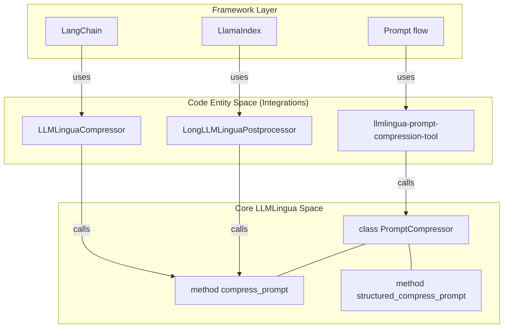
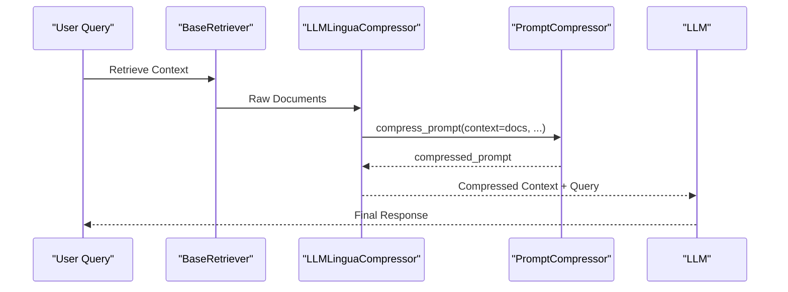
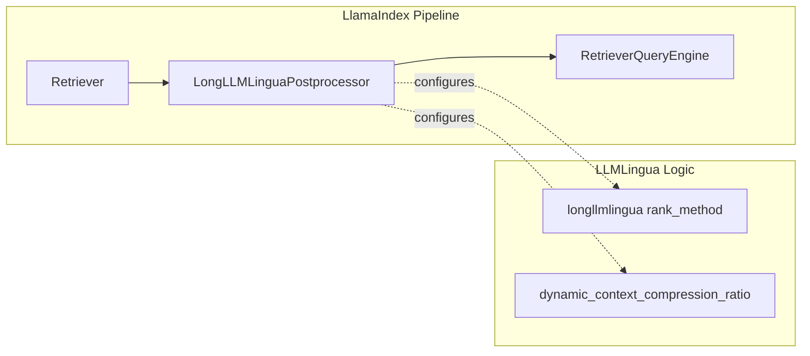

<!-- source: DeepWiki mcp.deepwiki.com · repo microsoft/LLMLingua · page 5 Integrations · fetched 2026-10-26 -->

# Integrations

<details>
<summary>Relevant source files</summary>

The following files were used as context for generating this wiki page:

- [DOCUMENT.md](DOCUMENT.md)
- [README.md](README.md)

</details>


This page documents how to integrate LLMLingua with third-party frameworks and tools to leverage prompt compression capabilities in various applications. LLMLingua is designed to be framework-agnostic at its core, but it provides specialized wrappers for popular ecosystems like LangChain and LlamaIndex to simplify RAG (Retrieval-Augmented Generation) pipelines.

For information about basic usage of LLMLingua without integrations, please refer to [Basic Usage](#4.2).

## Integration Overview

LLMLingua provides official integrations with the following frameworks to help developers incorporate prompt compression into their existing workflows, particularly for applications that handle large context windows or complex prompts.

### System Integration Map

The following diagram bridges the natural language concepts of "Integrations" with the specific code entities used to implement them.


Sources: [README.md:25-27](), [DOCUMENT.md:162-209]()

## LangChain Integration

LangChain integration allows for efficient compression of retrieved documents before they are passed to the LLM. This is primarily handled via the `LLMLinguaCompressor` which acts as a document compressor within LangChain's retrieval logic.

For details, see [LangChain Integration](#5.1).

### Workflow Diagram


Sources: [DOCUMENT.md:162-184]()

## LlamaIndex Integration

LlamaIndex utilizes LLMLingua through the `LongLLMLinguaPostprocessor`. This component is used as a `node_postprocessor`, allowing the system to reorder and compress nodes (documents) retrieved from an index to mitigate "lost-in-the-middle" issues.

For details, see [LlamaIndex Integration](#5.2).

### Implementation Logic


Sources: [DOCUMENT.md:186-209](), [README.md:32]()

## Prompt flow Integration

LLMLingua is integrated into **Prompt flow**, Microsoft's development tool for LLM-based applications. It is available as a streamlined tool that can be dragged into a DAG (Directed Acyclic Graph) workflow to compress prompts dynamically during execution.

Key features in Prompt flow:
*   Automatic reduction of token costs in complex flows.
*   Support for dynamic adjustment of compression parameters based on previous node outputs.

Sources: [README.md:25]()

## RAG System Benefits

Integrating LLMLingua into RAG systems provides several technical advantages summarized in the table below:

| Feature | Integration Implementation | Benefit |
| :--- | :--- | :--- |
| **Cost Reduction** | Token-level filtering in `PromptCompressor` | Up to 20x reduction in API costs [README.md:36-72]() |
| **Long Context** | `LongLLMLingua` reordering logic | Mitigates "lost in the middle" [README.md:41-43]() |
| **Speed** | `LLMLingua-2` token classification | 3x-6x faster than iterative methods [README.md:46-49]() |
| **Security** | `SecurityLingua` guardrail | Detects jailbreak attacks via compression [README.md:51-54]() |

Sources: [README.md:36-72](), [DOCUMENT.md:3-9]()

## Custom Integrations

Developers can build custom integrations by directly instantiating the `PromptCompressor` class. The core interaction pattern involves passing the raw context to `compress_prompt` and using the resulting `compressed_prompt` string in the final LLM call.

```python
from llmlingua import PromptCompressor
# Initializing the core entity
llm_lingua = PromptCompressor() # [llmlingua/prompt_compressor.py:15]()

# Standard integration pattern
result = llm_lingua.compress_prompt(
    context=raw_documents, 
    instruction=instruction, 
    question=question, 
    ratio=0.5
)
compressed_text = result['compressed_prompt']
```

Sources: [DOCUMENT.md:10-32](), [llmlingua/prompt_compressor.py:15-50]()

---

