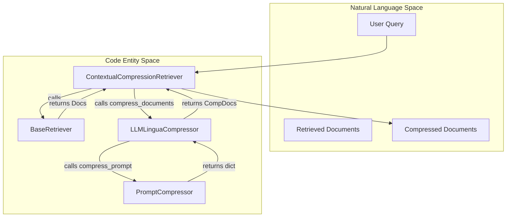
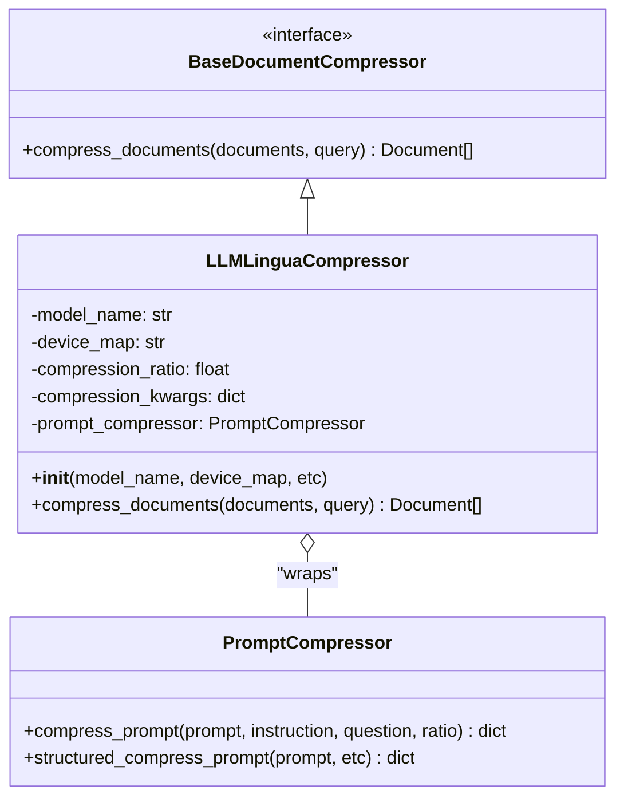
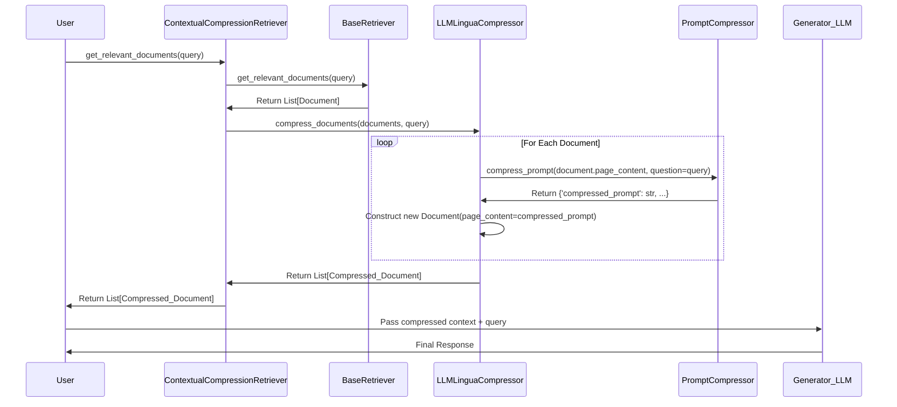

<!-- source: DeepWiki mcp.deepwiki.com · repo microsoft/LLMLingua · page 5.1 LangChain Integration · fetched 2026-10-26 -->

# LangChain Integration

<details>
<summary>Relevant source files</summary>

The following files were used as context for generating this wiki page:

- [DOCUMENT.md](DOCUMENT.md)
- [README.md](README.md)
- [Transparency_FAQ.md](Transparency_FAQ.md)

</details>


This document explains how to integrate LLMLingua with LangChain to enable efficient prompt compression in retrieval workflows. This integration is particularly valuable for reducing token usage in Retrieval-Augmented Generation (RAG) systems by filtering out non-essential tokens from retrieved documents before they are passed to the generator LLM.

## Architecture Overview

LLMLingua integrates with LangChain through a specialized document compressor adapter. This adapter connects the `PromptCompressor` capabilities to LangChain's `ContextualCompressionRetriever` pipeline.

### Natural Language to Code Entity Mapping

The following diagram maps the logical retrieval stages to the specific code entities involved in the LangChain integration.



Sources: [README.md:27](), [DOCUMENT.md:162-184]()

## Key Components

### LLMLinguaCompressor

The `LLMLinguaCompressor` class serves as the adapter between the LLMLingua library and LangChain's document processing interface.



- **Role**: Implements LangChain's `BaseDocumentCompressor` interface. [DOCUMENT.md:169-176]()
- **Implementation**: It internally initializes and manages an instance of `PromptCompressor`. [DOCUMENT.md:169-176]()
- **Data Flow**: It iterates through retrieved LangChain `Document` objects, passing their `page_content` to `compress_prompt` and returning new `Document` objects with the compressed text. [DOCUMENT.md:177-182]()

### ContextualCompressionRetriever

The `ContextualCompressionRetriever` is the standard LangChain orchestrator that wraps a base retriever and a compressor.

- **Initialization**: Takes a `base_retriever` (e.g., VectorStoreRetriever) and a `base_compressor` (the `LLMLinguaCompressor`). [DOCUMENT.md:172-176]()
- **Execution**: When `get_relevant_documents` is called, it first retrieves documents and then applies the compression logic. [DOCUMENT.md:172-176]()

## Integration Workflow

The following sequence diagram illustrates the detailed data flow through the integrated system:



Sources: [DOCUMENT.md:177-182](), [DOCUMENT.md:18-24]()

## Implementation

### Basic Setup

The following example demonstrates the standard setup using the `gpt2` model for compression.

```python
from langchain.retrievers import ContextualCompressionRetriever
from langchain_community.retrievers.document_compressors import LLMLinguaCompressor

# Initialize the LLMLingua compressor
# model_name can be any supported HF model like "microsoft/phi-2"
compressor = LLMLinguaCompressor(model_name="openai-community/gpt2", device_map="cpu")

# Connect the compressor to your existing retriever
compression_retriever = ContextualCompressionRetriever(
    base_compressor=compressor,
    base_retriever=retriever  # e.g., a VectorStoreRetriever
)

# Documents returned here are already compressed
compressed_docs = compression_retriever.get_relevant_documents(
    "What are the main findings of the report?"
)
```

Sources: [DOCUMENT.md:169-182](), [DOCUMENT.md:27-32]()

### Configuration Options

The `LLMLinguaCompressor` constructor and its `compression_kwargs` allow fine-grained control over the compression process:

| Parameter | Description | Source |
|-----------|-------------|--------|
| `model_name` | The small LM used for perplexity calculation (e.g., `gpt2`, `phi-2`, `Llama-2-7b-Chat-GPTQ`). | [DOCUMENT.md:27-31]() |
| `device_map` | Execution device (`cpu`, `cuda`, `mps`). | [DOCUMENT.md:31-32]() |
| `compression_ratio` | Target ratio for compression (e.g., `0.5`). | [DOCUMENT.md:43]() |
| `use_llmlingua2` | Boolean to enable the LLMLingua-2 token classification approach. | [DOCUMENT.md:61-62]() |
| `compression_kwargs` | Dictionary of arguments passed directly to the `compress_prompt` method. | [DOCUMENT.md:40-51]() |

## Advanced Usage Patterns

### LongLLMLingua for RAG

To address the "lost in the middle" problem in long-context RAG, use the specific parameters for `LongLLMLingua` via `compression_kwargs`.

```python
compressor = LLMLinguaCompressor(
    model_name="microsoft/phi-2",
    compression_kwargs={
        "condition_in_question": "after_condition",
        "reorder_context": "sort",
        "dynamic_context_compression_ratio": 0.3,
        "rank_method": "longllmlingua",
    }
)
```

Sources: [DOCUMENT.md:34-51](), [README.md:41-44]()

### LLMLingua-2 for High Speed

For scenarios requiring low latency, LLMLingua-2 offers 3x-6x speed improvements using a BERT-level encoder for token classification.

```python
compressor = LLMLinguaCompressor(
    model_name="microsoft/llmlingua-2-xlm-roberta-large-meetingbank",
    use_llmlingua2=True,
    compression_kwargs={
        "rate": 0.33,
        "force_tokens": ['\n', '?'] # Preserve structural tokens
    }
)
```

Sources: [DOCUMENT.md:54-70](), [README.md:46-49]()

### Technical Considerations

- **Memory Management**: For resource-constrained environments, use quantized models like `TheBloke/Llama-2-7b-Chat-GPTQ` which require <8GB GPU memory. [DOCUMENT.md:29-32]()
- **Prompt Sensitivity**: Instructions and questions are highly sensitive to compression. In the LangChain integration, the query is passed as the `question` parameter to ensure it remains intact or is compressed less aggressively than the document context. [DOCUMENT.md:35-41]()
- **Preservation**: Use `force_reserve_digit=True` or `force_tokens` if the retrieved documents contain critical numerical data or specific symbols that must not be compressed. [DOCUMENT.md:63](), [DOCUMENT.md:7]()

Sources: [DOCUMENT.md:3-9](), [DOCUMENT.md:86-101]()

---

