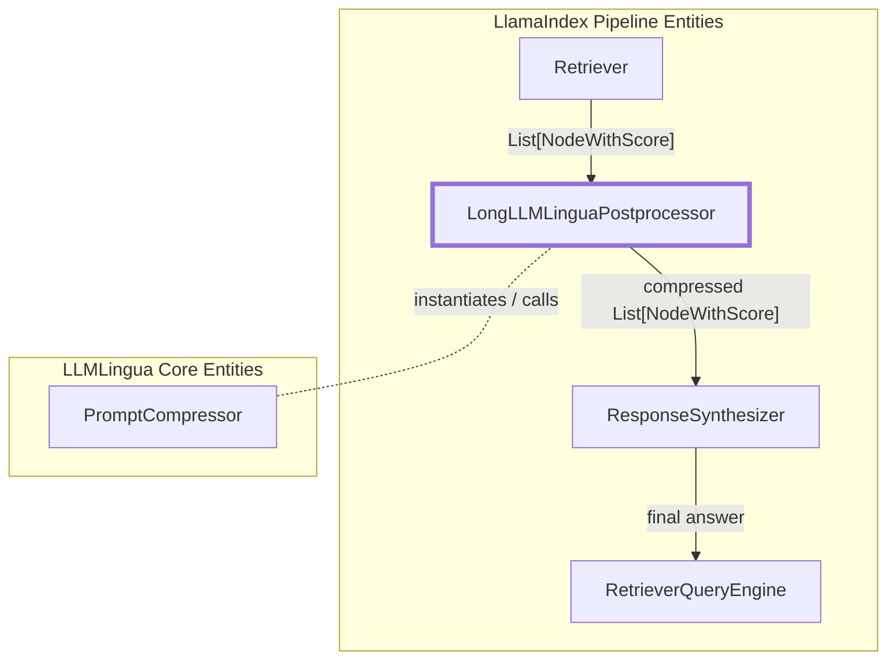
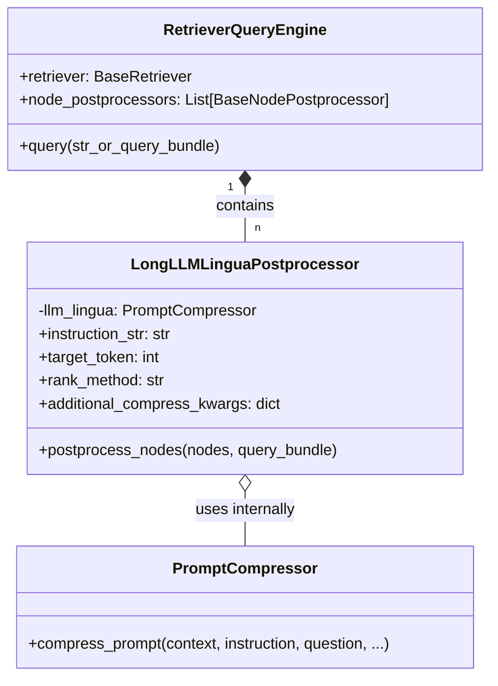
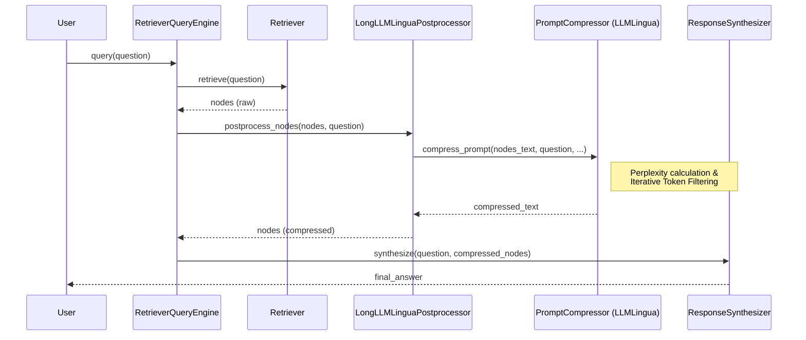

<!-- source: DeepWiki mcp.deepwiki.com · repo microsoft/LLMLingua · page 5.2 LlamaIndex Integration · fetched 2026-10-26 -->

# LlamaIndex Integration

<details>
<summary>Relevant source files</summary>

The following files were used as context for generating this wiki page:

- [DOCUMENT.md](DOCUMENT.md)
- [Transparency_FAQ.md](Transparency_FAQ.md)
- [examples/RAGLlamaIndex.ipynb](examples/RAGLlamaIndex.ipynb)

</details>


## Purpose and Scope

This page documents the integration between LLMLingua's prompt compression capabilities and the LlamaIndex framework. This integration allows developers to use `LongLLMLinguaPostprocessor` as a `node_postprocessor` within the LlamaIndex retrieval pipeline [examples/RAGLlamaIndex.ipynb:34-36](). By compressing retrieved contexts before they are fed into a Response Synthesizer, this integration addresses token limitations, reduces financial costs, and mitigates the "lost in the middle" phenomenon in long-context RAG scenarios [examples/RAGLlamaIndex.ipynb:69-70]().

Sources: [examples/RAGLlamaIndex.ipynb:26-36](), [examples/RAGLlamaIndex.ipynb:69-70]()

## Integration Architecture

The integration centers on the `LongLLMLinguaPostprocessor`, which wraps the `PromptCompressor` from the LLMLingua package [examples/RAGLlamaIndex.ipynb:34-35](). It intercepts the nodes retrieved by a `Retriever` and applies compression algorithms before passing them to the synthesis stage.

### Code Entity Space Mapping

The following diagram maps the LlamaIndex system components to the specific code entities in both the LlamaIndex and LLMLingua codebases.



Sources: [examples/RAGLlamaIndex.ipynb:34-36](), [examples/RAGLlamaIndex.ipynb:45-52](), [llmlingua/prompt_compressor.py:12-14]()

## Component Detail: LongLLMLinguaPostprocessor

The `LongLLMLinguaPostprocessor` is the primary interface for this integration. It accepts parameters consistent with the `PromptCompressor` and applies them to LlamaIndex `Nodes`.

### Key Class Relationships



Sources: [examples/RAGLlamaIndex.ipynb:34-36](), [examples/RAGLlamaIndex.ipynb:49-60](), [llmlingua/prompt_compressor.py:12-14]()

### Configuration Parameters

The postprocessor supports standard LLMLingua arguments and `additional_compress_kwargs` for fine-grained control:

| Parameter | Role | Code Context |
|:---|:---|:---|
| `instruction_str` | System-level instruction for the task | [examples/RAGLlamaIndex.ipynb:50-50]() |
| `target_token` | The budget for the final compressed prompt | [examples/RAGLlamaIndex.ipynb:51-51]() |
| `rank_method` | Strategy for ranking chunks (e.g., `"longllmlingua"`) | [examples/RAGLlamaIndex.ipynb:52-52]() |
| `additional_compress_kwargs` | Dictionary for LongLLMLingua specific features | [examples/RAGLlamaIndex.ipynb:53-59]() |

#### Additional Compress Kwargs
Inside `additional_compress_kwargs`, users can enable advanced LongLLMLingua features:
*   `condition_in_question`: Positions the question relative to the context (e.g., `"after"`) [examples/RAGLlamaIndex.ipynb:55-55]().
*   `reorder_context`: Set to `"sort"` to enable document reordering to combat positional bias [examples/RAGLlamaIndex.ipynb:57-57]().
*   `dynamic_context_compression_ratio`: Dynamically allocates budget based on document relevance [examples/RAGLlamaIndex.ipynb:58-58]().
*   `context_budget`: Defines the coarse-grained compression budget (e.g., `"+100"`) [examples/RAGLlamaIndex.ipynb:56-56]().

Sources: [examples/RAGLlamaIndex.ipynb:49-61](), [DOCUMENT.md:45-51]()

## RAG Pipeline Flow

The integration can be implemented in two ways: as part of an automated `RetrieverQueryEngine` or as a manual step-by-step process.

### Automated Flow (RetrieverQueryEngine)
In this setup, the `RetrieverQueryEngine` automatically triggers the postprocessor after retrieval.

```python
from llama_index.query_engine import RetrieverQueryEngine
from llama_index.indices.postprocessor import LongLLMLinguaPostprocessor

# 1. Setup Postprocessor
node_postprocessor = LongLLMLinguaPostprocessor(
    instruction_str="Given the context, please answer the final question",
    target_token=300,
    rank_method="longllmlingua",
    additional_compress_kwargs={
        "condition_compare": True,
        "condition_in_question": "after",
        "reorder_context": "sort",
        "dynamic_context_compression_ratio": 0.4,
    },
)

# 2. Setup Engine
query_engine = RetrieverQueryEngine.from_args(
    retriever,
    node_postprocessors=[node_postprocessor]
)

# 3. Execute
response = query_engine.query("What did the author do after college?")
```

Sources: [examples/RAGLlamaIndex.ipynb:45-60](), [examples/RAGLlamaIndex.ipynb:580-593]()

### Data Flow Sequence



Sources: [examples/RAGLlamaIndex.ipynb:34-36](), [examples/RAGLlamaIndex.ipynb:495-497](), [examples/RAGLlamaIndex.ipynb:580-593]()

## Benefits in LlamaIndex Scenarios

1.  **Cost and Latency**: In the provided example, LLMLingua reduced a context from **10,719 tokens** to **308 tokens**, achieving a **34.8x compression ratio** [examples/RAGLlamaIndex.ipynb:495-497](), [examples/RAGLlamaIndex.ipynb:524-534]().
2.  **Information Density**: By removing redundant tokens while keeping the "essential characters," the information density of the prompt increases [DOCUMENT.md:7-8](), [examples/RAGLlamaIndex.ipynb:69-70]().
3.  **Positional Optimization**: Through `reorder_context`, the most critical passages are moved to the beginning and end of the prompt to satisfy the positional preferences of LLMs [examples/RAGLlamaIndex.ipynb:96-97]().

Sources: [examples/RAGLlamaIndex.ipynb:69-97](), [DOCUMENT.md:7-8]()

---

