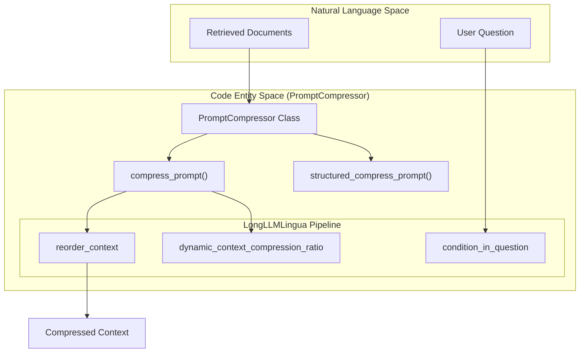
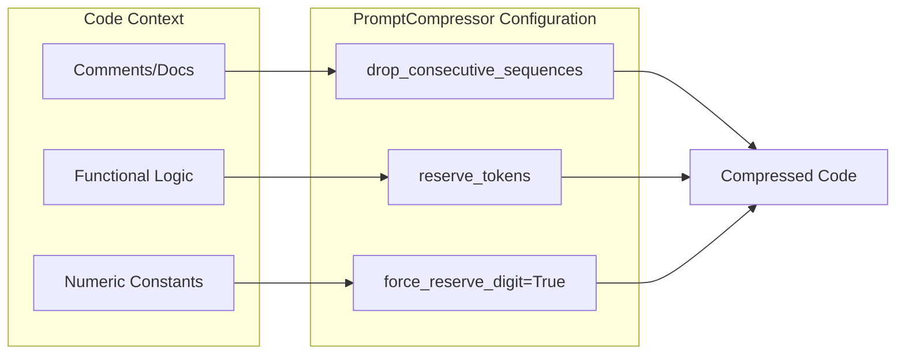

<!-- source: DeepWiki mcp.deepwiki.com · repo microsoft/LLMLingua · page 6 Example Applications · fetched 2026-10-26 -->

# Example Applications

Relevant source files

The following files were used as context for generating this wiki page:

- [README.md](README.md)
- [examples/RAG.ipynb](examples/RAG.ipynb)
- [examples/Retrieval.ipynb](examples/Retrieval.ipynb)

This page outlines the real-world applications of the LLMLingua series prompt compression technologies. It demonstrates how LLMLingua, LongLLMLingua, and LLMLingua-2 can be applied to various scenarios to improve efficiency, reduce costs, and enhance performance when working with large language models (LLMs).

For information about the core architecture and compression techniques, see [Core Architecture](#2). For details about different LLMLingua versions, see [LLMLingua Versions](#3).

## RAG Systems

Retrieval-Augmented Generation (RAG) is a technique that enhances LLM responses by providing relevant retrieved context. However, RAG systems often face challenges with token limits and information density, as retrieved contexts can become very long, sometimes exceeding 40k tokens [examples/RAG.ipynb:21-28]().

LLMLingua and especially LongLLMLingua are particularly effective for RAG applications by:

1. **Coarse-to-fine Compression**: Utilizing document-level perplexity for coarse-grained filtering followed by token-level perplexity for fine-grained compression [examples/RAG.ipynb:39-47]().
2. **Mitigating "Lost in the Middle"**: Using document reordering to place critical passages at the beginning and end of the context [examples/RAG.ipynb:49-54]().
3. **Cost Reduction**: Improving RAG performance by up to 21.4% while using only 1/4 of the original tokens [README.md:41-44]().

### RAG System Architecture

The following diagram bridges the natural language retrieval space to the code entities within the LLMLingua compression pipeline.

For details, see [RAG Systems](#6.1).

Sources: [README.md:41-44](), [examples/RAG.ipynb:21-54](), [examples/RAGLlamaIndex.ipynb:433-456]()

## Online Meeting Summarization

Meeting transcripts are often lengthy and contain repetitive content. LLMLingua provides an efficient solution for compressing transcripts while preserving speaker identity and critical information [README.md:208-221]().

Key features for meeting summarization:
- **Speaker Protection**: Using the `structured_compress_prompt` method with XML-like tags to set `compress=False` for speaker labels [README.md:214-221]().
- **Variable Compression Rates**: Assigning different `rate` parameters to different segments of the transcript based on importance [README.md:214-221]().

For details, see [Online Meeting Summarization](#6.2).

Sources: [README.md:208-221](), [examples/OnlineMeeting.ipynb:32-32]()

## Chain-of-Thought Reasoning

LLMLingua enhances Chain-of-Thought (CoT) reasoning by compressing intermediate reasoning steps. This is crucial for maintaining reasoning logic within context limits [README.md:31-32]().

Key benefits for CoT applications:
1. **Structure Preservation**: Maintaining the logical flow of reasoning while reducing natural language redundancy.
2. **Demonstration Compression**: Compressing few-shot CoT examples to allow for more demonstrations or longer reasoning chains in the final prompt.

For details, see [Chain-of-Thought Reasoning](#6.3).

Sources: [README.md:31-32](), [examples/CoT.ipynb:32-32]()

## Code Processing

Code context often contains documentation and boilerplate that can be compressed without losing the functional logic. The `Code.ipynb` example demonstrates how LLMLingua handles programming languages [README.md:31-32]().

Technical considerations for code:
- **Numeric Preservation**: Using parameters like `force_reserve_digit` to ensure constants and indices are not removed during compression.
- **Syntax Integrity**: Maintaining the structural balance of brackets and keywords essential for LLM code understanding.

### Code Processing Logic

This diagram maps code processing requirements to specific implementation parameters in the `PromptCompressor`.

For details, see [Code Processing](#6.4).

Sources: [README.md:31-32](), [examples/Code.ipynb:32-32]()

## Application Integration Map

LLMLingua integrates with major RAG frameworks and application tools to facilitate these use cases.

| Integration | Primary Code Entity | Typical Use Case |
|-------------|---------------------|------------------|
| **LlamaIndex** | `LongLLMLinguaPostprocessor` | Automated RAG context compression [README.md:27-30]() |
| **LangChain** | `LLMLinguaCompressor` | Contextual compression in document retrievers [README.md:27-30]() |
| **Prompt flow** | `llmlingua-prompt-compression-tool` | Visual workflow integration for AI apps [README.md:25-25]() |

Sources: [README.md:25-32](), [examples/RAGLlamaIndex.ipynb:433-456]()

---

