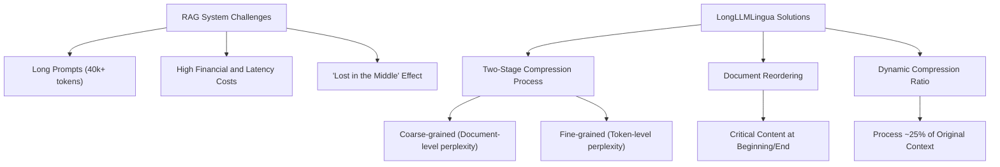
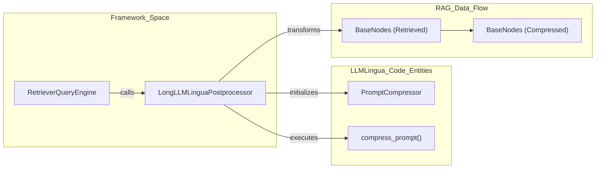
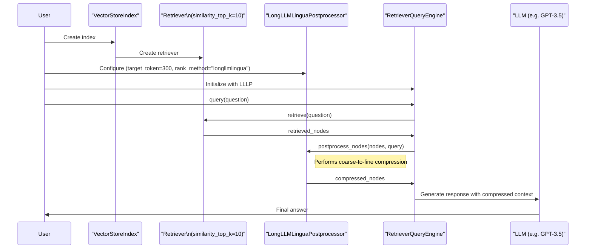

<!-- source: DeepWiki mcp.deepwiki.com · repo microsoft/LLMLingua · page 6.1 RAG Systems · fetched 2026-10-26 -->

# RAG Systems

<details>
<summary>Relevant source files</summary>

The following files were used as context for generating this wiki page:

- [examples/RAG.ipynb](examples/RAG.ipynb)
- [examples/RAGLlamaIndex.ipynb](examples/RAGLlamaIndex.ipynb)
- [examples/Retrieval.ipynb](examples/Retrieval.ipynb)

</details>


## Purpose and Scope

This document explains how to use LLMLingua, particularly LongLLMLingua, to enhance Retrieval-Augmented Generation (RAG) systems. It covers the challenges of traditional RAG implementations, such as the "lost in the middle" issue, and how LLMLingua addresses these through a coarse-to-fine compression pipeline, document reordering, and integration with frameworks like LlamaIndex.

Sources: [examples/RAG.ipynb:8-26](), [examples/RAGLlamaIndex.ipynb:8-26]()

## RAG Challenges and LLMLingua Solutions

Traditional RAG methods often generate prompts exceeding **40k tokens**, leading to high financial costs and increased latency [examples/RAG.ipynb:26-28](). Furthermore, decreased information density causes performance degradation, known as the "lost in the middle" issue, where LLMs fail to identify key information placed in the center of long contexts [examples/RAG.ipynb:26-28]().



Sources: [examples/RAG.ipynb:26-54](), [examples/RAGLlamaIndex.ipynb:69-97]()

## LLMLingua RAG Integration Architecture

LLMLingua provides specialized components for RAG frameworks. In LlamaIndex, the `LongLLMLinguaPostprocessor` serves as a node postprocessor that invokes the core `PromptCompressor` logic [examples/RAGLlamaIndex.ipynb:34-36]().

### System Component Mapping

The following diagram bridges the Natural Language concepts to the Code Entity space, specifically highlighting the `LongLLMLinguaPostprocessor` integration.



Sources: [examples/RAGLlamaIndex.ipynb:34-61](), [examples/RAGLlamaIndex.ipynb:576-595]()

## Implementation with LlamaIndex

The `LongLLMLinguaPostprocessor` is configured with parameters consistent with the `PromptCompressor`. Key arguments include `target_token`, `rank_method`, and `additional_compress_kwargs` for fine-tuning the LongLLMLingua behavior [examples/RAGLlamaIndex.ipynb:49-60]().



Sources: [examples/RAGLlamaIndex.ipynb:49-61](), [examples/RAGLlamaIndex.ipynb:443-454](), [examples/RAGLlamaIndex.ipynb:576-595]()

## Usage Patterns

### 1. Direct Pipeline Integration (LlamaIndex)

This is the standard way to incorporate LLMLingua into an existing LlamaIndex RAG pipeline using `RetrieverQueryEngine`.

```python
from llama_index.indices.postprocessor import LongLLMLinguaPostprocessor

node_postprocessor = LongLLMLinguaPostprocessor(
    instruction_str="Given the context, please answer the final question",
    target_token=300,
    rank_method="longllmlingua",
    additional_compress_kwargs={
        "condition_compare": True,
        "condition_in_question": "after",
        "context_budget": "+100",
        "reorder_context": "sort",  # enable document reorder
        "dynamic_context_compression_ratio": 0.4, # enable dynamic compression ratio
    },
)
```

Sources: [examples/RAGLlamaIndex.ipynb:49-61]()

### 2. Manual Compression (Custom RAG)

For custom RAG systems not using LlamaIndex, `PromptCompressor` can be used directly to handle retrieved documents.

```python
from llmlingua import PromptCompressor

llm_lingua = PromptCompressor()
compressed_prompt = llm_lingua.compress_prompt(
    context=retrieved_documents, # list of strings
    instruction=instruction,
    question=question,
    target_token=500,
    rank_method="longllmlingua",
    reorder_context="sort",
    dynamic_context_compression_ratio=0.4
)
```

Sources: [examples/RAG.ipynb:404-437]()

## Key Configuration Parameters

| Parameter | Description | Recommended Value |
|-----------|-------------|------------------|
| `target_token` | The desired length of the compressed prompt. | 300-500 |
| `rank_method` | Strategy for importance scoring. Use `"longllmlingua"` for RAG. | `"longllmlingua"` |
| `reorder_context` | Alleviates "lost in the middle" by placing critical documents at the start/end. | `"sort"` |
| `dynamic_context_compression_ratio` | Dynamically allocates budget based on document relevance. | `0.3 - 0.4` |
| `condition_in_question` | Position of the question relative to the context during perplexity calculation. | `"after"` |

Sources: [examples/RAGLlamaIndex.ipynb:53-59](), [examples/RAG.ipynb:404-437](), [examples/Retrieval.ipynb:26-31]()

## Example Applications

### NaturalQuestions Multi-document QA
In this scenario, a system recalls 20 documents (1 ground truth, 19 distractors). Using LongLLMLingua, the context is compressed from ~2,890 tokens to ~520 tokens while maintaining accuracy and mitigating positional bias.

Sources: [examples/RAG.ipynb:69-71](), [examples/RAG.ipynb:373-477]()

### Retrieval ReRank
LongLLMLingua can be used as a high-performance reranker. Results show it outperforms traditional embedding-based methods (e.g., Sentence-BERT, OpenAI embeddings) and state-of-the-art rerankers (e.g., BGE Reranker) by more accurately capturing the relationship between the query and documents.

Sources: [examples/Retrieval.ipynb:30-38]()

---

