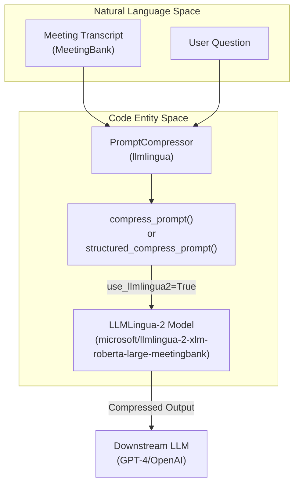
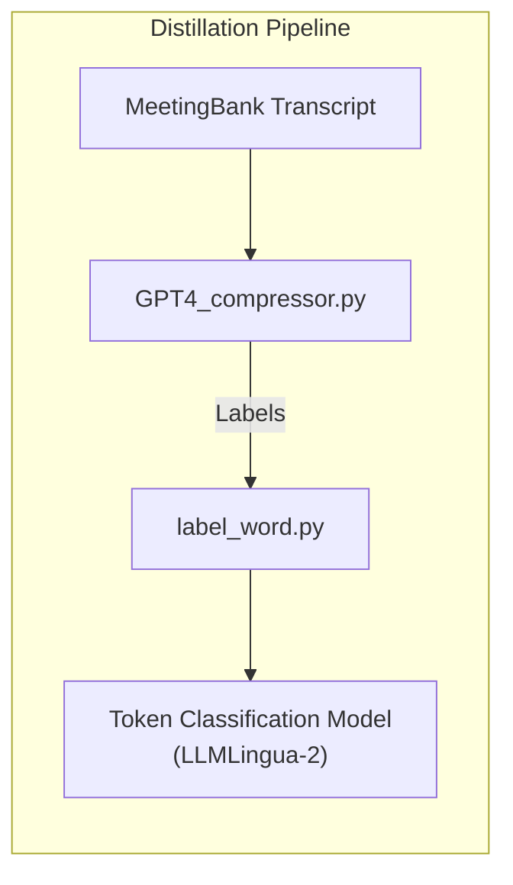

<!-- source: DeepWiki mcp.deepwiki.com · repo microsoft/LLMLingua · page 6.2 Online Meeting Summarization · fetched 2026-10-26 -->

# Online Meeting Summarization

<details>
<summary>Relevant source files</summary>

The following files were used as context for generating this wiki page:

- [examples/LLMLingua2.ipynb](examples/LLMLingua2.ipynb)
- [examples/OnlineMeeting.ipynb](examples/OnlineMeeting.ipynb)
- [experiments/llmlingua2/data_collection/GPT4_compressor.py](experiments/llmlingua2/data_collection/GPT4_compressor.py)
- [experiments/llmlingua2/data_collection/compress.py](experiments/llmlingua2/data_collection/compress.py)
- [images/motivation.png](images/motivation.png)

</details>


## Purpose and Scope

This page documents how LLMLingua is applied to online meeting transcripts for compression and question answering. Meeting transcripts represent a particularly challenging use case for large language models due to their length (often exceeding 40,000 tokens), conversational nature, and high redundancy [examples/OnlineMeeting.ipynb:26-26](). This document explores how LLMLingua-based compression techniques, particularly LLMLingua-2 and LongLLMLingua, can significantly reduce token counts while maintaining the ability to extract key information accurately.

For information about general Retrieval-Augmented Generation (RAG) applications, see [RAG Systems](). For details about the core compression techniques used, see [Compression Techniques]().

Sources: [examples/OnlineMeeting.ipynb:16-26]()

## System Overview

LLMLingua's application to meeting transcripts addresses the "lost in the middle" problem common in long contexts, where important information can be obscured by noise at the beginning or end of the document [examples/OnlineMeeting.ipynb:42-45](). By utilizing the `PromptCompressor` class, transcripts are reduced to a fraction of their original size, enabling faster and more cost-effective processing by downstream LLMs like GPT-4 [examples/LLMLingua2.ipynb:23-23]().

### Code Entity Flow

The following diagram maps the logical flow of meeting transcript processing to the specific classes and methods in the codebase.



**Diagram: Meeting Summarization Code Entity Mapping**

Sources: [examples/LLMLingua2.ipynb:34-40](), [examples/OnlineMeeting.ipynb:26-26](), [examples/LLMLingua2.ipynb:183-189]()

## MeetingBank Dataset

The examples in this document primarily use the **MeetingBank** dataset, which contains realistic meeting transcripts with associated questions and answers [examples/OnlineMeeting.ipynb:44-45]().

Key characteristics of the MeetingBank dataset:
- **Conversational nature**: High degree of redundancy typical of spoken dialogue [examples/OnlineMeeting.ipynb:26-26]().
- **Extreme Length**: Prompt lengths can exceed 60,000 tokens in some scenarios [examples/OnlineMeeting.ipynb:42-42]().
- **In-Domain Target**: LLMLingua-2 features a specific model variant (`llmlingua-2-xlm-roberta-large-meetingbank`) trained via data distillation for this specific domain [examples/LLMLingua2.ipynb:37-37]().

Sources: [examples/OnlineMeeting.ipynb:34-45](), [examples/LLMLingua2.ipynb:37-37]()

## Implementation Workflow

### 1. Setup and Initialization
To handle meeting transcripts effectively, the `PromptCompressor` is typically initialized with the LLMLingua-2 model specifically optimized for MeetingBank.

```python
from llmlingua import PromptCompressor

llm_lingua = PromptCompressor(
    model_name="microsoft/llmlingua-2-xlm-roberta-large-meetingbank",
    use_llmlingua2=True,
)
```
Sources: [examples/LLMLingua2.ipynb:34-40]()

### 2. Compression with Speaker Protection
In meeting scenarios, maintaining the structure of the conversation (who said what) is critical. Users can use `force_tokens` to ensure punctuation and structural markers are preserved [examples/LLMLingua2.ipynb:186-186]().

```python
compressed_prompt = llm_lingua.compress_prompt(
    context,
    rate=0.33,
    force_tokens=["!", ".", "?", "\n"],
    drop_consecutive=True,
)
```
Sources: [examples/LLMLingua2.ipynb:183-189]()

### 3. Data Collection and Distillation
The high performance on meeting data is achieved through a distillation pipeline where a large model (GPT-4) acts as the teacher.



**Diagram: Data Distillation for Meeting Domain**

Sources: [experiments/llmlingua2/data_collection/GPT4_compressor.py:12-21](), [experiments/llmlingua2/data_collection/compress.py:53-61]()

## Key Parameters for Meeting Contexts

The following parameters in `compress_prompt` are frequently adjusted for meeting transcripts:

| Parameter | Purpose | Context |
|-----------|---------|---------|
| `rate` | The target compression ratio (e.g., 0.33 for 3x compression). | [examples/LLMLingua2.ipynb:185-185]() |
| `force_tokens` | Prevents the removal of critical structural tokens like newlines or sentence endings. | [examples/LLMLingua2.ipynb:186-186]() |
| `drop_consecutive` | If `True`, removes redundant consecutive tokens often found in transcripts. | [examples/LLMLingua2.ipynb:187-187]() |
| `use_llmlingua2` | Enables the faster, task-agnostic token classification approach. | [examples/LLMLingua2.ipynb:38-38]() |

Sources: [examples/LLMLingua2.ipynb:34-40](), [examples/LLMLingua2.ipynb:183-189]()

## Performance on MeetingBank

LLMLingua-2, despite being significantly smaller than 7B parameter models, achieves superior performance on MeetingBank QA and Summary tasks [examples/LLMLingua2.ipynb:90-91]().

### Comparative Analysis
- **Speed**: LLMLingua-2 is 3x-6x faster than previous iterations, making it suitable for real-time meeting assistance [examples/LLMLingua2.ipynb:23-23]().
- **Accuracy**: On the MeetingBank test set, the compressed prompts yield answers that come close to matching the performance of the original, uncompressed prompt [examples/LLMLingua2.ipynb:91-91]().

### Example QA Flow
1. **Original Context**: A transcript from `huuuyeah/meetingbank` [examples/LLMLingua2.ipynb:110-111]().
2. **Question**: "What is the agenda item three resolution 31669 about?" [examples/LLMLingua2.ipynb:113-113]().
3. **Compression**: The transcript is compressed at a rate of 0.33 [examples/LLMLingua2.ipynb:185-185]().
4. **Result**: The downstream LLM (GPT-4) correctly identifies the resolution's focus on individualized tenant assessment [examples/LLMLingua2.ipynb:136-136]().

Sources: [examples/LLMLingua2.ipynb:23-23](), [examples/LLMLingua2.ipynb:89-91](), [examples/LLMLingua2.ipynb:110-136]()

## Conclusion

By utilizing domain-specific models like the MeetingBank-trained LLMLingua-2, users can handle the extreme context lengths of online meetings. This approach mitigates latency and token costs while preserving the conversational nuances necessary for accurate summarization and question answering.

Sources: [examples/OnlineMeeting.ipynb:26-26](), [examples/LLMLingua2.ipynb:23-23]()

---

