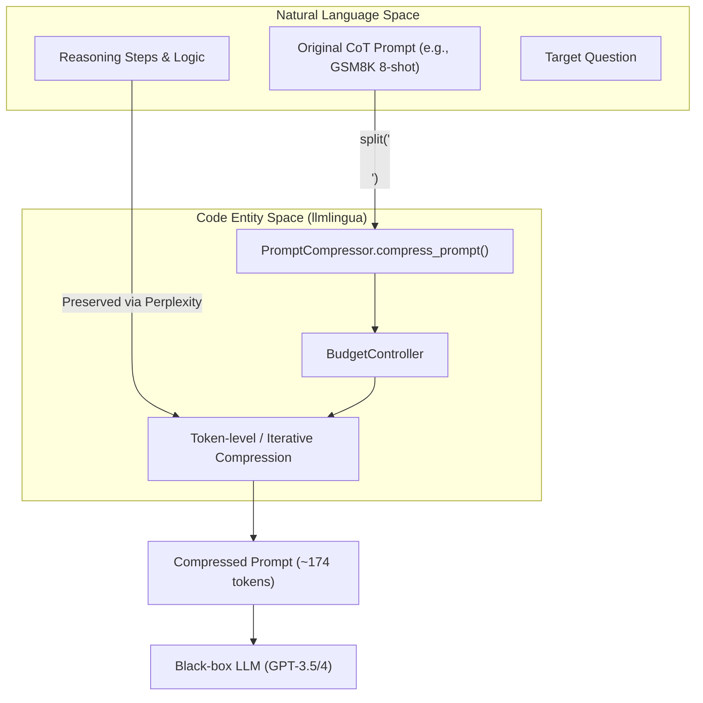
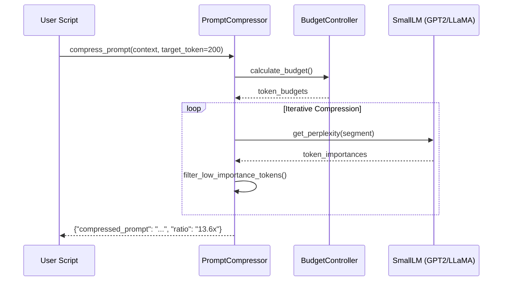

<!-- source: DeepWiki mcp.deepwiki.com · repo microsoft/LLMLingua · page 6.3 Chain-of-Thought Reasoning · fetched 2026-10-26 -->

# Chain-of-Thought Reasoning

<details>
<summary>Relevant source files</summary>

The following files were used as context for generating this wiki page:

- [README.md](README.md)
- [examples/CoT.ipynb](examples/CoT.ipynb)

</details>


## Purpose and Overview

This document explains how LLMLingua is used to enhance Chain-of-Thought (CoT) reasoning in Large Language Models (LLMs). CoT involves describing reasoning processes in detail within prompts to improve model performance on complex tasks. However, these demonstrations often result in extremely long prompts. LLMLingua addresses this by compressing CoT demonstrations while preserving the essential reasoning structure and logic.

For details on the core compression logic used in these examples, see [2.1 PromptCompressor Class]().

## CoT and In-Context Learning Challenges

In-Context Learning (ICL) allows LLMs to learn tasks from a few examples. When combined with CoT, prompts include detailed intermediate reasoning steps. While effective—for example, improving GSM8K performance from 74.9 to 78.85 in GPT-3.5-Turbo—it leads to high token consumption. A standard 8-shot GSM8K prompt can reach **2,366 tokens** [examples/CoT.ipynb:26-26]().

### Data Flow in CoT Compression

The following diagram bridges the natural language reasoning space with the code entities in `llmlingua`.

**Title: CoT Reasoning Data Flow to PromptCompressor**

Sources: [examples/CoT.ipynb:26-42](), [examples/CoT.ipynb:380-387]()

## Implementation: GSM8K Math Reasoning

The GSM8K dataset (Grade School Math 8K) is the primary example for CoT compression in the LLMLingua repository. Using a small language model (e.g., GPT2-small or LLaMA-7B) as a compressor, LLMLingua identifies unimportant tokens in the reasoning chain [examples/CoT.ipynb:42-42]().

### Core Compression Configuration

The implementation utilizes the `PromptCompressor` class from `llmlingua`.

| Parameter | Value in CoT Example | Description |
|-----------|----------------------|-------------|
| `target_token` | `200` | The desired length of the compressed prompt [examples/CoT.ipynb:384-384](). |
| `context_budget` | `"*1.5"` | Dynamic budget allocation for the context [examples/CoT.ipynb:385-385](). |
| `iterative_size` | `100` | Segment size for the iterative compression algorithm [examples/CoT.ipynb:386-386](). |

### Code Entity Interaction

This diagram maps the internal components of the `PromptCompressor` used during the CoT workflow.

**Title: Internal Component Interaction for CoT**

Sources: [examples/CoT.ipynb:380-407](), [README.md:36-36]()

## Performance Metrics

LLMLingua achieves significant token reduction without substantial loss in reasoning accuracy. In the GSM8K 8-shot setup:

*   **Original Prompt:** 2,366 tokens [examples/CoT.ipynb:58-59]().
*   **Compressed Prompt:** 174 tokens [examples/CoT.ipynb:576-576]().
*   **Compression Ratio:** ~13.6x [examples/CoT.ipynb:576-576]().
*   **Accuracy:** 78.24% (compared to original performance levels) [examples/CoT.ipynb:581-581]().

## Practical Example: CoT.ipynb Workflow

The `examples/CoT.ipynb` notebook demonstrates the following workflow for math reasoning:

1.  **Initialization**: Loading the `PromptCompressor` with a budget-friendly model like `gpt2` [examples/CoT.ipynb:334-344]().
2.  **Sectioning**: Splitting the 8-shot examples by double newlines (`\n\n`) to maintain example boundaries [examples/CoT.ipynb:381-381]().
3.  **Compression**: Executing `compress_prompt` with a high compression target (e.g., 200 tokens) [examples/CoT.ipynb:380-387]().
4.  **Inference**: Concatenating the `instruction`, `compressed_prompt`, and the new `question` before sending to a black-box LLM (like GPT-3.5) [examples/CoT.ipynb:401-407]().

```python
# Simplified snippet from examples/CoT.ipynb
from llmlingua import PromptCompressor

llm_lingua = PromptCompressor()
compressed_prompt = llm_lingua.compress_prompt(
    prompt_complex.split("\n\n"),
    instruction=instruction,
    question=question,
    target_token=200,
    condition_in_question=None # Standard CoT doesn't always need LongLLMLingua features
)
```
Sources: [examples/CoT.ipynb:334-407]()

## Key Considerations for CoT

*   **Reasoning Structure**: LLMLingua's perplexity-based approach naturally retains tokens that are critical for the "logical flow" because they are less predictable by the small language model [README.md:75-75]().
*   **Lost in the Middle**: While standard LLMLingua is used in the `CoT.ipynb` example, for extremely long reasoning chains, the `LongLLMLingua` variant can be used to mitigate the "lost in the middle" issue [README.md:41-41]().
*   **Iterative Compression**: Using `iterative_size` is crucial for CoT to maintain the dependencies between reasoning steps within a single demonstration [examples/CoT.ipynb:386-386]().

Sources:
- [README.md:36-55]()
- [examples/CoT.ipynb:21-59]()
- [examples/CoT.ipynb:334-407]()
- [examples/CoT.ipynb:574-581]()

---

