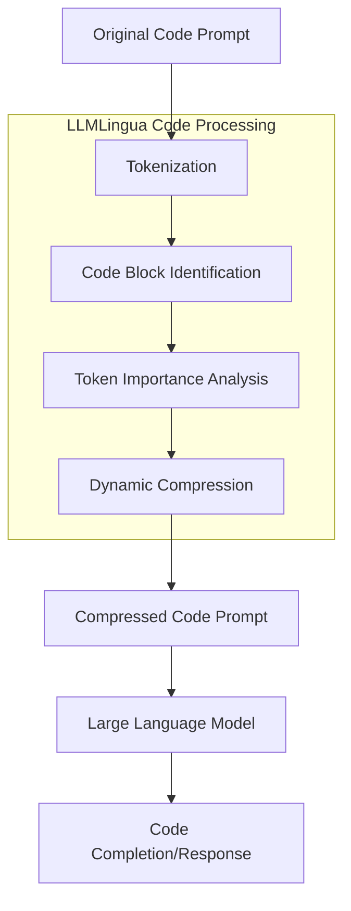
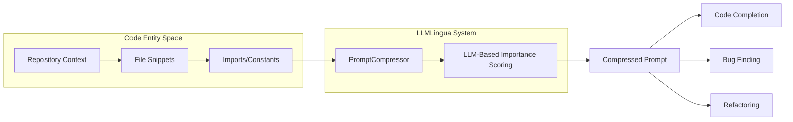
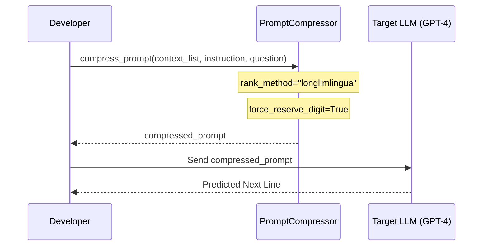

<!-- source: DeepWiki mcp.deepwiki.com · repo microsoft/LLMLingua · page 6.4 Code Processing · fetched 2026-10-26 -->

# Code Processing

<details>
<summary>Relevant source files</summary>

The following files were used as context for generating this wiki page:

- [README.md](README.md)
- [examples/Code.ipynb](examples/Code.ipynb)

</details>


## Purpose and Scope

This page describes how LLMLingua can be applied to process and compress code-related prompts for tasks such as code completion, code explanation, and repository-level reasoning. Code processing presents unique challenges compared to natural language processing, as it contains structured syntax, specialized numeric constants, and complex dependencies that must be preserved for functional correctness.

The techniques described here are particularly effective for long-context code tasks, such as those found in the **RepoBench-P** dataset, where prompts can reach 20,000 characters [examples/Code.ipynb:26-27]().

## Code Processing Challenges

Code presents specific challenges for prompt compression that differ from natural language:

1.  **Syntax Preservation**: Code syntax is strict; removing a single bracket or semicolon can render the entire snippet unparseable.
2.  **Numeric Integrity**: Numeric values in code (e.g., array indices, constants, memory addresses) are often critical. LLMLingua uses `force_reserve_digit` to handle this [examples/Code.ipynb:420-420]().
3.  **Context Dependencies**: Code often contains references to functions, classes, or variables defined in disparate files.
4.  **Long-Range Dependencies**: Logic in a file may depend on a class definition located thousands of tokens away in the prompt.

Sources: [examples/Code.ipynb:26-27](), [examples/Code.ipynb:420-420]()

## Code Compression Workflow

The workflow for code processing utilizes the `PromptCompressor` to filter irrelevant reference files or code blocks while preserving the core logic needed for completion.



**Title: Code Processing Workflow in LLMLingua**

Sources: [examples/Code.ipynb:26-27](), [examples/Code.ipynb:366-376]()

## Integration with Code Tasks

LLMLingua bridges the gap between massive repository contexts and the limited context windows of LLMs.



**Title: Mapping Code Entities to LLMLingua Processing**

Sources: [examples/Code.ipynb:239-261](), [examples/Code.ipynb:366-397]()

## RepoBench-P Example

The **RepoBench-P** dataset (Code Completion Task) is used to demonstrate LLMLingua's efficacy. The task involves supplementing the next line of code given incomplete snippets and related reference files [examples/Code.ipynb:42-45]().

### Example Performance
LongLLMLingua can achieve a **1.4 point improvement** in accuracy at a **6x compression ratio** compared to using the full, uncompressed context [examples/Code.ipynb:26-27]().

| Metric | Original Prompt | Compressed Prompt |
|-----------|-----------------|-------------------|
| Tokens (Example) | 18,837 | 2,281 |
| Compression Ratio | - | 8.3x |
| GPT-4 Result | Failure (Context Limit) | Correct Completion |

Sources: [examples/Code.ipynb:26-27](), [examples/Code.ipynb:42-45](), [examples/Code.ipynb:329-359]()

## Implementing Code Processing

### Numeric Preservation with `force_reserve_digit`
A critical feature for code is `force_reserve_digit`. When set to `True`, LLMLingua ensures that digits are not removed during the compression process, which is vital for maintaining the integrity of constants and indices in code [examples/Code.ipynb:420-420]().

### Key Parameters for Code Processing
When calling `compress_prompt`, the following parameters are recommended for code:

| Parameter | Recommended Setting | Reason |
|-----------|---------------------|--------|
| `use_sentence_level_filter` | `False` | Code does not follow natural language sentence boundaries [examples/Code.ipynb:373-373](). |
| `dynamic_context_compression_ratio` | `0.4` | Balances compression across different code blocks [examples/Code.ipynb:375-375](). |
| `reorder_context` | `"sort"` | Moves the most relevant code blocks closer to the instruction [examples/Code.ipynb:376-376](). |
| `condition_compare` | `True` | Enables comparison between question and context for ranking [examples/Code.ipynb:370-370](). |
| `force_reserve_digit` | `True` | Prevents corruption of numeric values in code [examples/Code.ipynb:420-420](). |

Sources: [examples/Code.ipynb:366-376](), [examples/Code.ipynb:420-420]()

## Implementation Pattern

The implementation typically involves splitting code contexts into logical units (e.g., functions or 4-line blocks) before passing them to the `PromptCompressor`.



**Title: Sequence for Code Completion Task**

Sources: [examples/Code.ipynb:302-306](), [examples/Code.ipynb:364-377](), [examples/Code.ipynb:420-420]()

### Code Snippet: Compression Execution
```python
# Configuration for code completion
compressed_prompt = llm_lingua.compress_prompt(
    contexts_list,
    instruction=instruction,
    question=question,
    target_token=2000,
    condition_compare=True,
    condition_in_question="after",
    rank_method="longllmlingua",
    use_sentence_level_filter=False, # Essential for code
    context_budget="+100",
    dynamic_context_compression_ratio=0.4,
    reorder_context="sort",
    force_reserve_digit=True # Preserve constants
)
```

Sources: [examples/Code.ipynb:364-377](), [examples/Code.ipynb:420-420]()

## Best Practices

1.  **Logical Chunking**: Split code contexts into logical blocks (e.g., by function or every 4-10 lines) to allow the compressor to rank relevant logic effectively [examples/Code.ipynb:316-320]().
2.  **Disable Sentence Filtering**: Always set `use_sentence_level_filter=False` as code lacks standard punctuation marks like periods to denote "sentences" [examples/Code.ipynb:373-373]().
3.  **Preserve Digits**: Use `force_reserve_digit=True` to avoid breaking logic that relies on specific numeric constants [examples/Code.ipynb:420-420]().
4.  **Rank Method**: Use `rank_method="longllmlingua"` for tasks involving large repositories to mitigate the "lost in the middle" effect [examples/Code.ipynb:372-372]().

Sources: [examples/Code.ipynb:316-320](), [examples/Code.ipynb:372-373](), [examples/Code.ipynb:420-420]()

---

