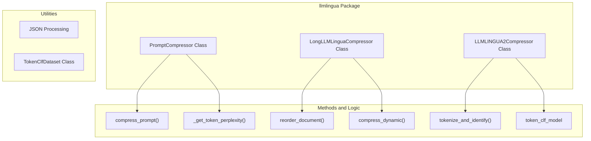
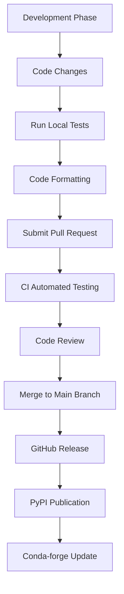
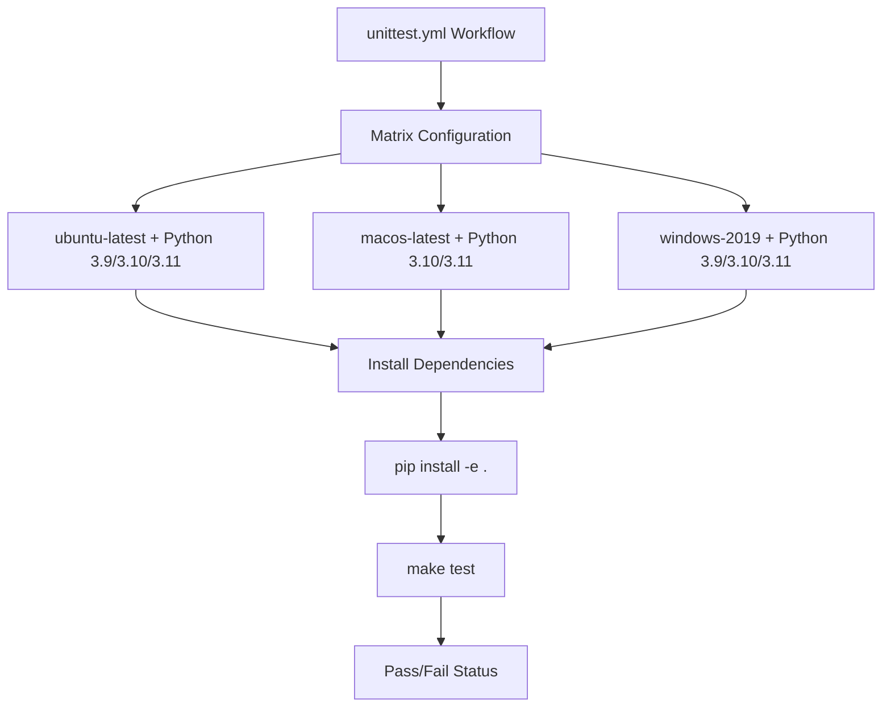
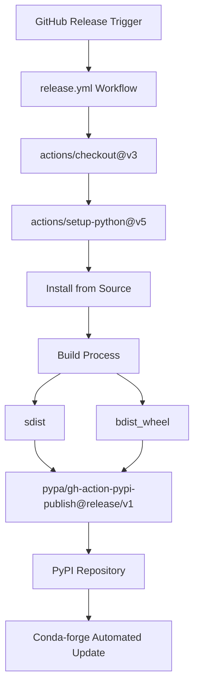
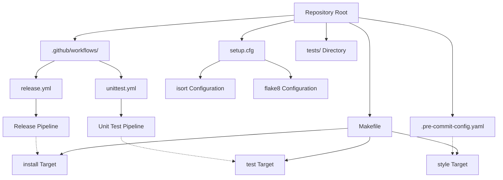

<!-- source: DeepWiki mcp.deepwiki.com · repo microsoft/LLMLingua · page 7 Development · fetched 2026-10-26 -->

# Development

<details>
<summary>Relevant source files</summary>

The following files were used as context for generating this wiki page:

- [.github/workflows/release.yml](.github/workflows/release.yml)
- [.github/workflows/unittest.yml](.github/workflows/unittest.yml)
- [.pre-commit-config.yaml](.pre-commit-config.yaml)
- [Makefile](Makefile)
- [setup.cfg](setup.cfg)

</details>


This page provides information for developers who want to contribute to the LLMLingua project. It covers the development workflow, testing procedures, and release process. For specific information about training custom models, see [Training LLMLingua-2 Models](#7.1), and for detailed contribution guidelines, see [Contributing Guidelines](#7.2).

## Development Environment

The LLMLingua development environment relies on several standard Python tools for testing, code quality, and package management.

### Required Tools

- **Python**: Versions 3.9, 3.10, or 3.11 (all are tested in CI) [[.github/workflows/unittest.yml:21-21]()]
- **pytest & pytest-xdist**: For running the test suite [[.github/workflows/unittest.yml:35-35]()]
- **NLTK**: Required for text processing with `punkt_tab` [[.github/workflows/unittest.yml:35-36]()]
- **black, isort, flake8**: For code formatting and style checking [[Makefile:11-13]()] [[setup.cfg:1-29]()]
- **pre-commit**: For managing git hooks [[.pre-commit-config.yaml:1-37]()]
- **wheel**: For building distribution packages [[Makefile:7-7]()]

### Setting Up the Environment

1. Clone the repository:
   ```bash
   git clone https://github.com/microsoft/LLMLingua.git
   cd LLMLingua
   ```

2. Install in development mode:
   ```bash
   pip install -e .
   ```

3. Install development dependencies:
   ```bash
   pip install pytest pytest-xdist nltk black isort flake8
   python -c "import nltk; nltk.download('punkt_tab')"
   ```

Sources: [.github/workflows/unittest.yml:32-36](), [.github/workflows/unittest.yml:40-40]()

## LLMLingua Codebase Structure

### Code Organization Diagram



This structure reflects how the various compressor classes implement the different versions of LLMLingua technology, each with specialized methods for their particular compression techniques.

Sources: [Makefile:4-4](), [.github/workflows/unittest.yml:42-47]()

## Development Workflow

### Development Lifecycle



Sources: [.github/workflows/unittest.yml:1-47](), [.github/workflows/release.yml:1-46]()

## Testing

LLMLingua uses `pytest` for running tests. All tests are located in the `tests` directory.

### Running Tests Locally

To run the test suite locally:

```bash
make test
```

This command executes `pytest` with parallelization via `pytest-xdist` [[Makefile:15-16]()].

The options used:
- `-n auto`: Automatically determine number of processes for parallelization.
- `--dist=loadfile`: Distribute test files across processes.
- `-s`: Show output (don't capture).
- `-v`: Verbose output.

Sources: [Makefile:15-16]()

### Continuous Integration Testing

When a pull request is submitted, GitHub Actions automatically runs the test suite on multiple platforms and Python versions [[.github/workflows/unittest.yml:4-7]()].



The test workflow is defined in [`.github/workflows/unittest.yml:1-47`]() and runs on:
- Operating Systems: Ubuntu, macOS, Windows [[.github/workflows/unittest.yml:20-20]()]
- Python versions: 3.9, 3.10, 3.11 [[.github/workflows/unittest.yml:21-21]()]

Sources: [.github/workflows/unittest.yml:15-47]()

## Code Style

LLMLingua follows code style rules defined in [`setup.cfg:1-29`](), which configures:

1. **isort**: For import sorting.
   - Line length: 119 [[setup.cfg:21-21]()]
   - Multi-line output style: 3 [[setup.cfg:23-23]()]
   - Includes trailing commas [[setup.cfg:5-5]()]
2. **flake8**: For code linting.
   - Ignored rules: E203, E501, E741, W503, W605 [[setup.cfg:27-27]()]
   - Max line length: 119 [[setup.cfg:28-28]()]
3. **black**: For automated code formatting [[.pre-commit-config.yaml:29-32]()].

To format your code according to these standards:

```bash
make style
```

This runs `black`, `isort`, and `flake8` on the `llmlingua` and `tests` directories [[Makefile:10-13]()].

Sources: [Makefile:10-13](), [setup.cfg:1-29](), [.pre-commit-config.yaml:25-32]()

## Release Process

LLMLingua uses an automated release process through GitHub Actions.

### Release Workflow Components and Flow



When a new release is published on GitHub [[.github/workflows/release.yml:8-10]()], the workflow:
1. Runs on Ubuntu with Python 3.10 [[.github/workflows/release.yml:17-18]()].
2. Builds both source and wheel distributions using `python setup.py sdist bdist_wheel` [[.github/workflows/release.yml:42-42]()].
3. Uses `pypa/gh-action-pypi-publish` to securely publish to PyPI [[.github/workflows/release.yml:43-47]()].

Sources: [.github/workflows/release.yml:1-46]()

## CI/CD File Structure and Relationships



Sources: [Makefile:1-16](), [.github/workflows/unittest.yml:1-47](), [.github/workflows/release.yml:1-46](), [setup.cfg:1-29](), [.pre-commit-config.yaml:1-37]()

---

