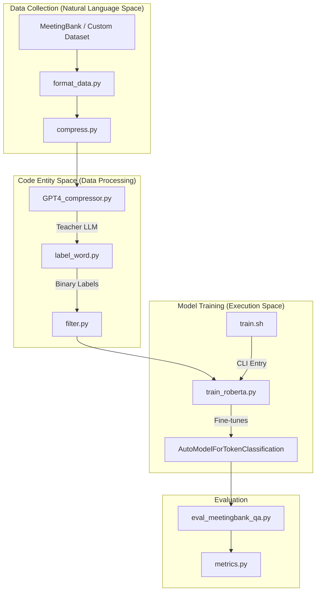
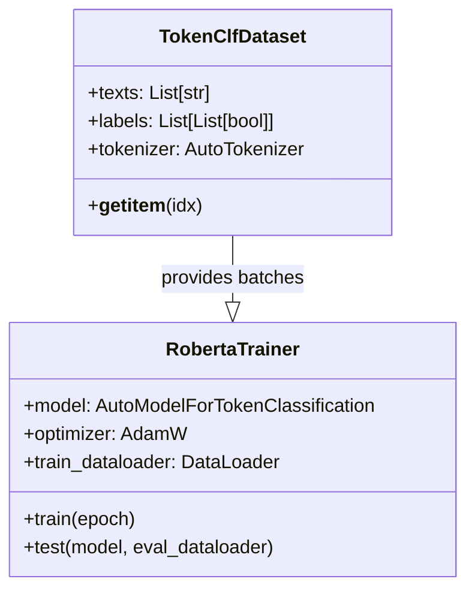

<!-- source: DeepWiki mcp.deepwiki.com · repo microsoft/LLMLingua · page 7.1 Training LLMLingua-2 Models · fetched 2026-10-26 -->

# Training LLMLingua-2 Models

Relevant source files

The following files were used as context for generating this wiki page:

- [examples/LLMLingua2.ipynb](examples/LLMLingua2.ipynb)
- [experiments/llmlingua2/README.md](experiments/llmlingua2/README.md)
- [experiments/llmlingua2/data_collection/GPT4_compressor.py](experiments/llmlingua2/data_collection/GPT4_compressor.py)
- [experiments/llmlingua2/data_collection/README.md](experiments/llmlingua2/data_collection/README.md)
- [experiments/llmlingua2/data_collection/collect_data.sh](experiments/llmlingua2/data_collection/collect_data.sh)
- [experiments/llmlingua2/data_collection/compress.py](experiments/llmlingua2/data_collection/compress.py)
- [experiments/llmlingua2/data_collection/label_word.py](experiments/llmlingua2/data_collection/label_word.py)
- [experiments/llmlingua2/evaluation/eval_meetingbank_qa.py](experiments/llmlingua2/evaluation/eval_meetingbank_qa.py)
- [experiments/llmlingua2/evaluation/metrics.py](experiments/llmlingua2/evaluation/metrics.py)
- [experiments/llmlingua2/model_training/train.sh](experiments/llmlingua2/model_training/train.sh)
- [experiments/llmlingua2/model_training/train_roberta.py](experiments/llmlingua2/model_training/train_roberta.py)

## Purpose and Scope

This document provides technical instructions for training custom LLMLingua-2 models. LLMLingua-2 uses a token classification approach, moving away from the perplexity-based iterative compression of original LLMLingua to a data distillation method [examples/LLMLingua2.ipynb:23-23](). By training a BERT-level encoder (like RoBERTa) to classify which tokens to keep or discard, LLMLingua-2 achieves 3x-6x faster performance and better task-agnostic generalization [examples/LLMLingua2.ipynb:23-23]().

## Training Pipeline Overview

The LLMLingua-2 training pipeline bridges the gap between high-quality LLM compression (GPT-4) and efficient small-model inference. It consists of four major stages: data distillation, word labeling, filtering, and model training.

### Code Entity Flow

The following diagram maps the logical phases to the specific scripts and classes in the codebase.

Sources: [experiments/llmlingua2/data_collection/collect_data.sh:4-16](), [experiments/llmlingua2/model_training/train_roberta.py:15-16]()

## 1. Data Collection and Distillation

The training process begins by using a "teacher" model (GPT-4) to compress a large corpus. The `PromptCompressor` class in `GPT4_compressor.py` facilitates this by wrapping the OpenAI ChatCompletion API [experiments/llmlingua2/data_collection/GPT4_compressor.py:12-21]().

### Data Formatting and Chunking
1.  **Formatting**: Data must be a list of dictionaries with `idx` and `prompt` keys [experiments/llmlingua2/data_collection/README.md:29-29]().
2.  **Chunking**: Since long contexts exceed GPT-4 window limits or compression focus, `compress.py` uses `chunk_origin` to split text into segments (default `chunk_size=512`) [experiments/llmlingua2/data_collection/compress.py:83-103]().
3.  **Distillation**: The `compress` method in `GPT4_compressor.py` sends chunks to GPT-4 using specific instructions (defined in `compression_instructions.json`) to produce a condensed version [experiments/llmlingua2/data_collection/GPT4_compressor.py:55-74]().

Sources: [experiments/llmlingua2/data_collection/compress.py:38-41](), [experiments/llmlingua2/data_collection/GPT4_compressor.py:55-74]()

## 2. Token Labeling (Word Alignment)

The most critical step is converting GPT-4's natural language output back into binary labels for the original tokens. This is handled by `label_word.py`.

### The Alignment Algorithm
The script uses `spacy` (`en_core_web_sm`) to tokenize both the original and compressed text [experiments/llmlingua2/data_collection/label_word.py:46-55](). It then iterates through the compressed tokens and searches for them in the original text within a dynamic window.

*   **Window Search**: It looks forward and backward from the `prev_idx` within `args.window_size` (default 400) [experiments/llmlingua2/data_collection/label_word.py:98-131]().
*   **Label Assignment**: If a match is found, the corresponding index in the `labels` list (boolean) is set to `True` [experiments/llmlingua2/data_collection/label_word.py:101-102]().

### Quality Metrics
During labeling, the script calculates several diagnostic metrics [experiments/llmlingua2/data_collection/label_word.py:138-153]():
*   **Find Rate**: How many compressed tokens were successfully mapped to the original.
*   **Alignment Gap**: `hitting_rate - matching_rate`, used to identify samples where the alignment failed significantly [experiments/llmlingua2/data_collection/label_word.py:146-146]().

Sources: [experiments/llmlingua2/data_collection/label_word.py:81-184]()

## 3. Data Filtering and Formatting

After labeling, `filter.py` removes low-quality samples (e.g., those with an `alignment_gap > 0.1`) to ensure the training signal is clean [experiments/llmlingua2/data_collection/collect_data.sh:15-16](). The final dataset is saved as a `.pt` file containing `origin` text and `labels` [experiments/llmlingua2/model_training/train_roberta.py:176-177]().

## 4. Model Training

The training is performed by `train_roberta.py`, which fine-tunes a `AutoModelForTokenClassification` [experiments/llmlingua2/model_training/train_roberta.py:15-15]().

### Training Implementation Detail

*   **Base Model**: Defaults to `FacebookAI/xlm-roberta-large` [experiments/llmlingua2/model_training/train_roberta.py:27-27]().
*   **Loss Function**: Uses the standard CrossEntropyLoss provided by the `transformers` model output when `labels` are passed to the forward pass [experiments/llmlingua2/model_training/train_roberta.py:68-69]().
*   **Optimization**: Employs `torch.nn.utils.clip_grad_norm_` with a `MAX_GRAD_NORM` of 10 to stabilize training [experiments/llmlingua2/model_training/train_roberta.py:19-104]().
*   **Logging**: Integrates with `SummaryWriter` for TensorBoard visualization of Loss and Accuracy [experiments/llmlingua2/model_training/train_roberta.py:53-99]().

Sources: [experiments/llmlingua2/model_training/train_roberta.py:15-109](), [experiments/llmlingua2/model_training/utils.py:1-20]()

## 5. Evaluation

Evaluation is conducted using task-specific scripts like `eval_meetingbank_qa.py`.

### Metrics and Scoring
The `metrics.py` file provides a suite of evaluation functions:
*   **QA F1 Score**: Standard F1 for question answering [experiments/llmlingua2/evaluation/metrics.py:140-147]().
*   **Rouge Score**: For summarization tasks [experiments/llmlingua2/evaluation/metrics.py:113-119]().
*   **Best Subspan EM**: For exact match detection in long contexts [experiments/llmlingua2/evaluation/metrics.py:194-201]().

The evaluation pipeline loads the compressed prompts, queries a target LLM (e.g., GPT-3.5), and compares the response against ground truth [experiments/llmlingua2/evaluation/eval_meetingbank_qa.py:83-107]().

Sources: [experiments/llmlingua2/evaluation/eval_meetingbank_qa.py:65-121](), [experiments/llmlingua2/evaluation/metrics.py:113-201]()

## Summary of Training Parameters

| Parameter | Default Value | Script |
| :--- | :--- | :--- |
| `chunk_size` | 512 | `compress.py` |
| `window_size` | 400 | `label_word.py` |
| `max_len` | 512 | `train_roberta.py` |
| `learning_rate` | 1e-5 | `train_roberta.py` |
| `batch_size` | 10 | `train_roberta.py` |

Sources: [experiments/llmlingua2/data_collection/label_word.py:29-29](), [experiments/llmlingua2/model_training/train_roberta.py:18-49]()

---

