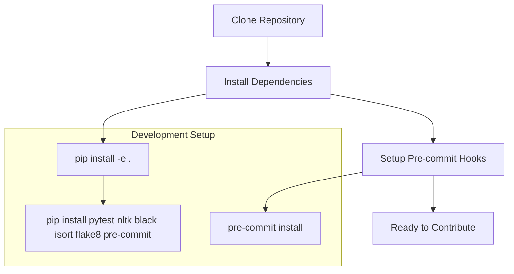
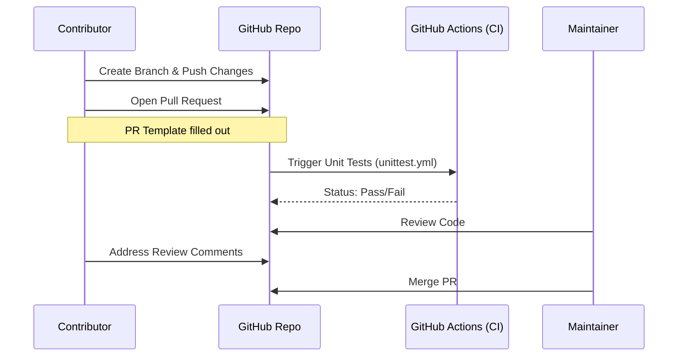

<!-- source: DeepWiki mcp.deepwiki.com · repo microsoft/LLMLingua · page 7.2 Contributing Guidelines · fetched 2026-10-26 -->

# Contributing Guidelines

<details>
<summary>Relevant source files</summary>

The following files were used as context for generating this wiki page:

- [.github/ISSUE_TEMPLATE/bug_report.yml](.github/ISSUE_TEMPLATE/bug_report.yml)
- [.github/PULL_REQUEST_TEMPLATE.md](.github/PULL_REQUEST_TEMPLATE.md)
- [.github/workflows/release.yml](.github/workflows/release.yml)
- [.github/workflows/unittest.yml](.github/workflows/unittest.yml)
- [.gitignore](.gitignore)
- [.pre-commit-config.yaml](.pre-commit-config.yaml)
- [CODE_OF_CONDUCT.md](CODE_OF_CONDUCT.md)
- [Makefile](Makefile)
- [SECURITY.md](SECURITY.md)
- [SUPPORT.md](SUPPORT.md)
- [setup.cfg](setup.cfg)

</details>


This document provides detailed instructions for contributing to the LLMLingua project. It outlines the development setup process, coding standards, testing requirements, CI/CD workflows, and the pull request process.

## Development Environment Setup

Setting up your development environment correctly is the first step to contributing successfully to LLMLingua. The project utilizes `pre-commit` hooks to ensure code quality before commits are even made.



1.  **Clone the repository**:
    ```bash
    git clone https://github.com/microsoft/LLMLingua.git
    cd LLMLingua
    ```

2.  **Install the package in development mode**:
    This allows changes in the source code to be immediately reflected in the environment.
    ```bash
    pip install -e .
    ```

3.  **Install development and test dependencies**:
    ```bash
    pip install pytest pytest-xdist nltk pre-commit black isort flake8
    python -c "import nltk; nltk.download('punkt_tab')"
    ```

4.  **Initialize pre-commit**:
    LLMLingua uses `pre-commit` to run automated checks (formatting, linting, and basic integrity) on every commit.
    ```bash
    pre-commit install
    ```

Sources: [Makefile:6-9](), [.github/workflows/unittest.yml:32-40](), [.pre-commit-config.yaml:1-37]()

## Code Style and Standards

LLMLingua follows specific code formatting and style guidelines to maintain consistency across the codebase. These standards are enforced via `black`, `isort`, and `flake8`.

### Style Tools and Configuration

The project configuration is primarily managed in `setup.cfg` and `.pre-commit-config.yaml`.

| Tool | Purpose | Configuration Detail |
| :--- | :--- | :--- |
| `black` | Code formatting | Line length: 119 characters. [setup.cfg:21-21]() |
| `isort` | Import sorting | Multi-line output mode 3, 2 lines after imports. [setup.cfg:22-23]() |
| `flake8` | Linting | Ignores E203, E501, E741, W503, W605. [setup.cfg:27-27]() |
| `nbQA` | Notebook quality | Runs `black` on Jupyter Notebooks. [.pre-commit-config.yaml:33-37]() |

### Automated Style Checks

You can run style checks manually using the provided `Makefile`:

```bash
# Formats code with black and isort, then checks with flake8
make style
```

The `style` target executes these tools against the `llmlingua` and `tests` directories [Makefile:4-13]().

Sources: [Makefile:10-13](), [setup.cfg:1-29](), [.pre-commit-config.yaml:9-37]()

## Testing

Comprehensive testing is required for all contributions. LLMLingua uses `pytest` for its test suite.

### Running Tests Locally

To run the full test suite locally:

```bash
make test
```

This command triggers `pytest` with parallel execution (`-n auto`) to speed up the process [Makefile:15-16]().

### CI/CD Workflows

LLMLingua employs GitHub Actions for automated testing and deployment.

1.  **Unit Tests (`unittest.yml`)**: Triggered on `pull_request` and `merge_group`. It runs the test suite across Ubuntu, macOS, and Windows for Python 3.9, 3.10, and 3.11 [.github/workflows/unittest.yml:4-21](). It installs the package and dependencies before running `make test` [.github/workflows/unittest.yml:33-47]().
2.  **Release (`release.yml`)**: Triggered when a GitHub release is `published`. It builds the source distribution and wheel, then publishes them to PyPI [.github/workflows/release.yml:8-47]().

Sources: [.github/workflows/unittest.yml:1-48](), [.github/workflows/release.yml:1-47](), [Makefile:15-16]()

## Contributing Workflow

### 1. Issue Reporting
Before starting work, check existing issues to avoid duplicates. Use the provided templates:
*   **Bug Reports**: Use the template to provide steps to reproduce, expected behavior, and environment logs [.github/ISSUE_TEMPLATE/bug_report.yml:1-48]().
*   **Support**: Refer to the Microsoft Support Policy; issues are tracked via GitHub [SUPPORT.md:1-14]().

### 2. Pull Request Process
The PR process follows a standard fork-and-pull model.



**PR Requirements**:
*   Fill out the PR template, including the issue fixed and a description of changes [.github/PULL_REQUEST_TEMPLATE.md:1-17]().
*   Ensure all CI checks pass.
*   Update documentation if applicable [.github/PULL_REQUEST_TEMPLATE.md:22-22]().
*   Add new tests for new features [.github/PULL_REQUEST_TEMPLATE.md:23-23]().

**Reviewers**: Tag relevant maintainers (e.g., `@iofu728`, `@QianhuiWu`) as suggested in the PR template [.github/PULL_REQUEST_TEMPLATE.md:36-43]().

Sources: [.github/PULL_REQUEST_TEMPLATE.md:1-44](), [.github/workflows/unittest.yml:4-7](), [SUPPORT.md:5-7]()

## Security and Conduct

### Security Policy
Do **not** report security vulnerabilities through public GitHub issues. Report them to the Microsoft Security Response Center (MSRC) at [https://msrc.microsoft.com/create-report](https://msrc.microsoft.com/create-report) or via email to [secure@microsoft.com](mailto:secure@microsoft.com) [SECURITY.md:9-17]().

### Code of Conduct
This project has adopted the [Microsoft Open Source Code of Conduct](https://opensource.microsoft.com/codeofconduct/). Please review it to understand the expectations for participating in the community [CODE_OF_CONDUCT.md:1-10]().

Sources: [SECURITY.md:1-42](), [CODE_OF_CONDUCT.md:1-10]()

---

