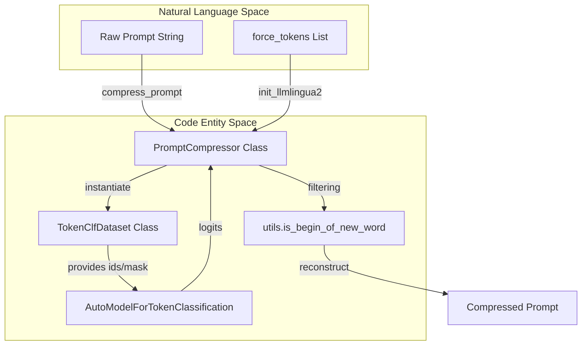
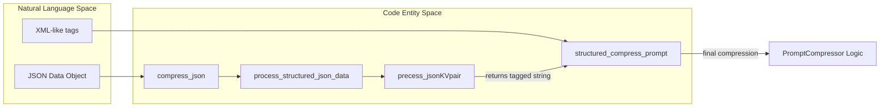

<!-- source: DeepWiki mcp.deepwiki.com · repo microsoft/LLMLingua · page 8 Glossary · fetched 2026-10-26 -->

# Glossary

Relevant source files

The following files were used as context for generating this wiki page:

- [DOCUMENT.md](DOCUMENT.md)
- [README.md](README.md)
- [Transparency_FAQ.md](Transparency_FAQ.md)
- [examples/LLMLingua2.ipynb](examples/LLMLingua2.ipynb)
- [experiments/llmlingua2/data_collection/GPT4_compressor.py](experiments/llmlingua2/data_collection/GPT4_compressor.py)
- [experiments/llmlingua2/data_collection/compress.py](experiments/llmlingua2/data_collection/compress.py)
- [llmlingua/prompt_compressor.py](llmlingua/prompt_compressor.py)
- [llmlingua/utils.py](llmlingua/utils.py)
- [tests/test_llmlingua2.py](tests/test_llmlingua2.py)

This page provides definitions for codebase-specific terms, jargon, abbreviations, and domain concepts essential for understanding the LLMLingua series. It covers the technical terminology used in the implementation of prompt compression, model configurations, and integration parameters.

## Core Concepts

| Term | Definition |
| :--- | :--- |
| **Prompt Compression** | The process of identifying and removing non-essential tokens from a prompt to reduce length while maintaining original information like ICL and reasoning [README.md:34-37](), [Transparency_FAQ.md:5-6](). |
| **Small Language Model (SLM)** | A compact model (e.g., GPT2-small, LLaMA-7B) used by LLMLingua to calculate perplexity or token importance for compression [README.md:34-37](), [Transparency_FAQ.md:13-14](). |
| **Perplexity (PPL)** | A measurement used to estimate the importance of tokens; LLMLingua assumes tokens with lower perplexity are more redundant and can be removed [llmlingua/prompt_compressor.py:165-175](), [Transparency_FAQ.md:13-14](). |
| **Iterative Compression** | A technique where the prompt is compressed in segments to better capture the conditional probability of tokens [llmlingua/prompt_compressor.py:42-44](). |
| **Data Distillation** | The process used to train LLMLingua-2, where a teacher model (GPT-4) labels tokens to be preserved or discarded, creating a dataset for a smaller BERT-level encoder [README.md:46-50](), [examples/LLMLingua2.ipynb:23-25](). |

**Sources:** [README.md:34-50](), [llmlingua/prompt_compressor.py:42-44](), [llmlingua/prompt_compressor.py:165-175](), [Transparency_FAQ.md:5-14](), [examples/LLMLingua2.ipynb:23-25]().

---

## Model Components and Subsystems

### Subsystem Overview
The LLMLingua series consists of four specialized subsystems, each targeting specific LLM challenges.

*   **LLMLingua**: The original perplexity-based token-level compressor [README.md:38-40]().
*   **LongLLMLingua**: Optimized for long-context scenarios to mitigate the "lost in the middle" issue [README.md:41-45]().
*   **LLMLingua-2**: A token classification approach for task-agnostic compression, offering 3x-6x speedup [README.md:46-50]().
*   **SecurityLingua**: A security-aware layer designed to detect jailbreak attacks through compression [README.md:51-55]().

### Prompt Module Definitions
LLMLingua categorizes prompts into three distinct functional modules:
1.  **Instruction**: Directives such as task descriptions; highly sensitive to compression [Transparency_FAQ.md:41-41]().
2.  **Context**: Supplementary information like documents or search results; lower sensitivity to compression [Transparency_FAQ.md:40-40]().
3.  **Question**: User inquiries or requests; highly sensitive to compression [Transparency_FAQ.md:39-39]().

**Sources:** [README.md:38-55](), [Transparency_FAQ.md:39-41]().

---

## Technical Parameters and Configuration

### Compression Parameters
Common arguments used in `compress_prompt` and related methods:

*   **`rate` / `ratio`**: The target compression ratio (e.g., 0.5 means 50% reduction) [llmlingua/prompt_compressor.py:185-189](), [DOCUMENT.md:43-43]().
*   **`target_token`**: The specific number of tokens the compressed prompt should contain [llmlingua/prompt_compressor.py:63-63](), [DOCUMENT.md:18-18]().
*   **`condition_in_question`**: (LongLLMLingua) A parameter to make compression question-aware, values include `after_condition` or `before_condition` [DOCUMENT.md:45-45]().
*   **`force_tokens`**: A list of specific tokens (like `\n` or `?`) that must be preserved during compression [llmlingua/prompt_compressor.py:63-63](), [DOCUMENT.md:63-63]().
*   **`drop_consecutive`**: Whether to remove consecutive identical tokens [llmlingua/prompt_compressor.py:187-187]().

### LLMLingua-2 Specifics
*   **`use_llmlingua2`**: Boolean flag to enable the LLMLingua-2 classification-based backend [llmlingua/prompt_compressor.py:51-54]().
*   **`max_force_token`**: Maximum number of tokens that can be forcibly preserved [llmlingua/prompt_compressor.py:58-58]().
*   **`added_tokens`**: Special tokens (e.g., `[NEW0]`, `[NEW1]`) used to map forced tokens during the classification process [llmlingua/prompt_compressor.py:112-115]().

**Sources:** [llmlingua/prompt_compressor.py:51-115](), [llmlingua/prompt_compressor.py:185-189](), [DOCUMENT.md:18-63]().

---

## Data Flow and Implementation Logic

The following diagrams illustrate the transition from natural language inputs to the internal code entities and data structures.

### LLMLingua-2 Token Classification Pipeline
This diagram shows how natural language text is processed by the `PromptCompressor` when `use_llmlingua2=True`.

**Sources:** [llmlingua/prompt_compressor.py:36-69](), [llmlingua/prompt_compressor.py:95-117](), [llmlingua/utils.py:13-65](), [llmlingua/utils.py:81-101]().

### Structured and JSON Compression Flow
This diagram details the flow of structured data through the utility layer.

**Sources:** [llmlingua/prompt_compressor.py:461-480](), [llmlingua/prompt_compressor.py:504-515](), [llmlingua/utils.py:123-151](), [llmlingua/utils.py:154-181]().

---

## Integration Terms

*   **`LLMLinguaCompressor`**: The LangChain-specific implementation of the document compressor [README.md:27-27]().
*   **`LongLLMLinguaPostprocessor`**: The LlamaIndex-specific node postprocessor that implements LongLLMLingua logic [README.md:27-27]().
*   **`ContextualCompressionRetriever`**: A LangChain component used in conjunction with LLMLingua to compress retrieved documents in RAG pipelines [README.md:27-27]().
*   **`MeetingBank`**: A benchmark dataset frequently used for evaluating and training LLMLingua-2 models [README.md:46-49](), [examples/LLMLingua2.ipynb:89-91]().

**Sources:** [README.md:27-49](), [examples/LLMLingua2.ipynb:89-91]().