# Page: Overview

# Overview

<details>
<summary>Relevant source files</summary>

The following files were used as context for generating this wiki page:

- [README.md](README.md)
- [Transparency_FAQ.md](Transparency_FAQ.md)
- [llmlingua/__init__.py](llmlingua/__init__.py)
- [llmlingua/version.py](llmlingua/version.py)

</details>


LLMLingua is a prompt compression framework designed to efficiently reduce the size of prompts for Large Language Models (LLMs) while preserving their semantic meaning and reasoning capabilities. By utilizing compact, well-trained language models to identify and remove non-essential tokens, LLMLingua enables up to 20x compression with minimal performance loss, significantly reducing API costs and latency.

The LLMLingua series consists of four primary subsystems: **LLMLingua**, **LongLLMLingua**, **LLMLingua-2**, and **SecurityLingua**.

## Purpose and Benefits

LLMLingua addresses critical bottlenecks in LLM deployment and interaction:

1.  **Token Limitations**: Compresses lengthy prompts to fit within the context window of models like GPT-4 or Claude [README.md:60-64]().
2.  **Cost Reduction**: Minimizes the number of tokens processed by black-box LLM APIs, leading to direct cost savings [README.md:72]().
3.  **Performance Enhancement**: Mitigates the "lost in the middle" phenomenon in long-context scenarios by reordering and filtering information [README.md:41-44]().
4.  **Inference Acceleration**: Reduces KV-cache size and generation length, speeding up the end-to-end inference process [README.md:76](), [Transparency_FAQ.md:16]().
5.  **Security**: Provides a guardrail layer to detect and neutralize jailbreak attacks through security-aware compression [README.md:51-54]().

Sources: [README.md:34-77](), [Transparency_FAQ.md:3-16]()

## LLMLingua Series Subsystems

The framework has evolved into four specialized subsystems, each targeting specific challenges in prompt engineering:

| Subsystem | Primary Focus | Key Mechanism |
| :--- | :--- | :--- |
| **LLMLingua** | General Compression | Perplexity-based token filtering using small LMs (e.g., GPT2-small, LLaMA-7B) [README.md:36-39](). |
| **LongLLMLingua** | Long-Context / RAG | Question-aware coarse-to-fine compression and document reordering [README.md:41-44](). |
| **LLMLingua-2** | Speed & Generalization | Token classification via BERT-level encoders (3x-6x faster than original) [README.md:46-49](). |
| **SecurityLingua** | Safety & Defense | Security-aware compression to reveal malicious intent in jailbreak attacks [README.md:51-54](). |

Sources: [README.md:34-55]()

## Core Architecture and Data Flow

The central entry point for the library is the `PromptCompressor` class defined in `llmlingua/prompt_compressor.py`. It manages the lifecycle of the compression models and provides the high-level API for various compression tasks.

### System Components Diagram
The following diagram illustrates how the `PromptCompressor` interacts with internal modules and external models.

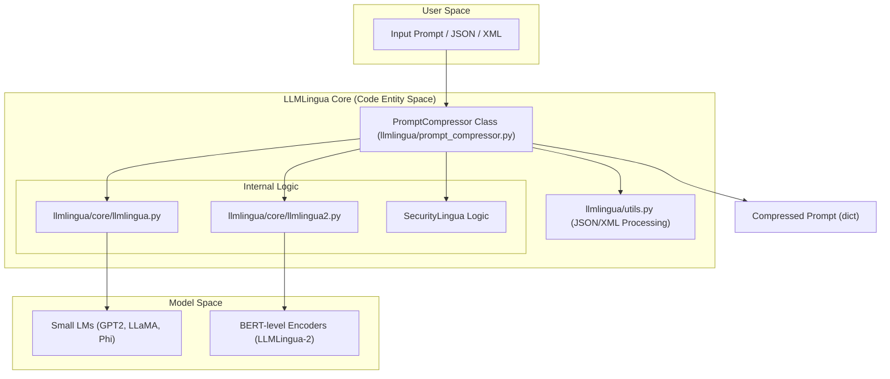
Sources: [llmlingua/__init__.py:5-8](), [llmlingua/prompt_compressor.py:17-40](), [README.md:79-83]()

### High-Level Data Flow
LLMLingua treats prompt compression as a distribution alignment problem. It uses a small model to estimate the importance of tokens based on their perplexity or a classification score.

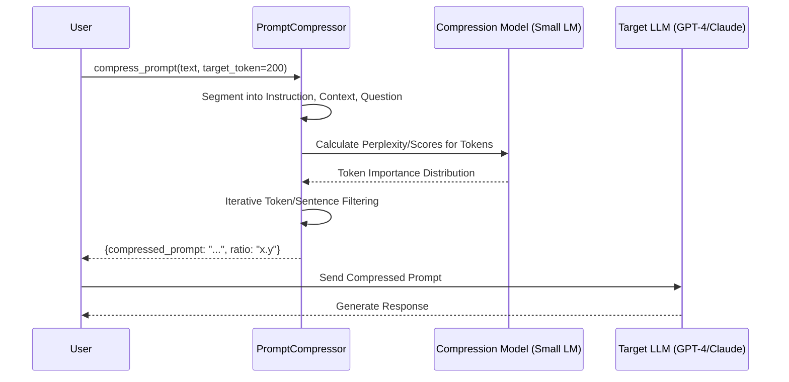
Sources: [README.md:36-38](), [Transparency_FAQ.md:35-42]()

## Key Use Cases

*   **Retrieval-Augmented Generation (RAG)**: Using `LongLLMLingua` to compress retrieved documents, saving costs and improving accuracy by reducing noise [README.md:30]().
*   **Online Meeting Summarization**: Handling long transcripts by protecting speaker identifiers and key instructions via `structured_compress_prompt` [README.md:31-32]().
*   **Chain-of-Thought (CoT)**: Compressing reasoning demonstrations to fit more examples into a single prompt [README.md:31-32]().
*   **Code Completion**: Compressing large codebases or documentation while preserving syntax-critical tokens [README.md:32]().
*   **Security Defense**: Using `SecurityLingua` as a lightweight guardrail to detect adversarial prompts [README.md:51-54]().

## Technical Implementation Details

### The PromptCompressor Class
The `PromptCompressor` is the primary interface. It is initialized with a `model_name` (e.g., `microsoft/phi-2`) and a `device_map`.
*   **Initialization**: Loads the tokenizer and the compression model [llmlingua/prompt_compressor.py:17-40]().
*   **Methods**:
    *   `compress_prompt`: Standard text compression [llmlingua/prompt_compressor.py:148]().
    *   `structured_compress_prompt`: Handles XML-like tags for fine-grained control [llmlingua/prompt_compressor.py:421]().
    *   `compress_json`: Specifically for JSON data structures [llmlingua/prompt_compressor.py:539]().

### Prompt Segmentation
LLMLingua distinguishes between three functional modules within a prompt:
1.  **Instruction**: High sensitivity; describes the task.
2.  **Context**: Low sensitivity; provides background data (e.g., RAG results).
3.  **Question**: High sensitivity; the specific user request.

This segmentation allows the `PromptCompressor` to apply different compression ratios dynamically to different parts of the prompt to ensure the final output remains functional for the target LLM.

Sources: [Transparency_FAQ.md:35-42](), [llmlingua/prompt_compressor.py:148-180]()

---

# Page: Core Architecture

# Core Architecture

<details>
<summary>Relevant source files</summary>

The following files were used as context for generating this wiki page:

- [DOCUMENT.md](DOCUMENT.md)
- [llmlingua/prompt_compressor.py](llmlingua/prompt_compressor.py)
- [llmlingua/utils.py](llmlingua/utils.py)
- [tests/test_llmlingua2.py](tests/test_llmlingua2.py)

</details>


This document outlines the core architectural components and design principles of the LLMLingua system, which enables efficient prompt compression for Large Language Models (LLMs). For specific implementation details of the PromptCompressor class, see [PromptCompressor Class](#2.1). For details on specific compression techniques, see [Compression Techniques](#2.2).

## System Purpose and Overview

LLMLingua is designed to compress prompts for LLMs while preserving essential information, achieving compression ratios of up to 20x with minimal performance degradation. The system uses smaller, more efficient language models to identify and eliminate non-essential tokens, optimizing token usage in LLM interactions.

The core architecture enables several main variants with progressively more advanced capabilities:

1.  **LLMLingua**: Basic prompt compression using token perplexity analysis [llmlingua/prompt_compressor.py:43-44]().
2.  **LongLLMLingua**: Addresses 'lost in the middle' issue with document reordering and dynamic compression [DOCUMENT.md:34-52]().
3.  **LLMLingua-2**: Data-distillation-based compression using token classification, offering 3-6x faster performance than the original [llmlingua/prompt_compressor.py:51-54]().
4.  **SecurityLingua**: A security-aware layer for detecting jailbreak attacks, sharing the LLMLingua-2 backend [llmlingua/prompt_compressor.py:78-92]().

### High-Level Architecture Overview

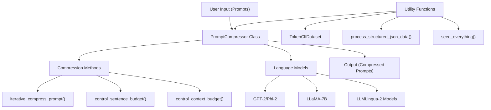

Sources: [llmlingua/prompt_compressor.py:36-70](), [llmlingua/utils.py:13-69]()

## Core Components

The LLMLingua system consists of several key components that work together to enable efficient prompt compression:

### PromptCompressor Class

The `PromptCompressor` class is the central component of the system, providing methods for compressing prompts using different techniques [llmlingua/prompt_compressor.py:36-41](). It initializes with a language model and various configuration options, supporting both causal LMs and token classification models [llmlingua/prompt_compressor.py:131-135]().

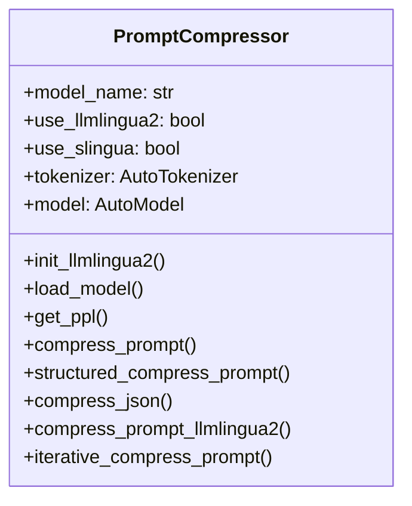

Sources: [llmlingua/prompt_compressor.py:36-117]()

### Language Models

LLMLingua uses smaller language models to analyze token importance:

1.  **Small LMs for Compression**:
    *   **GPT-2/Phi-2**: Lightweight models with minimal resource requirements [DOCUMENT.md:76-83]().
    *   **LLaMA-7B**: Medium-sized model offering better compression quality [llmlingua/prompt_compressor.py:47]().
    *   **LLMLingua-2 Models**: Specialized token classification models (e.g., XLM-RoBERTa or BERT-base) [DOCUMENT.md:59-70]().
2.  **Quantized Models**: Supports GPTQ models for low-memory environments (<8GB GPU) [DOCUMENT.md:86-102]().

Sources: [llmlingua/prompt_compressor.py:118-164](), [DOCUMENT.md:72-102]()

### Utility Functions

Several utility functions support the compression process:

*   `TokenClfDataset`: Dataset class for token classification in LLMLingua-2 [llmlingua/utils.py:13-69]().
*   `seed_everything()`: Ensures reproducible results by setting random seeds [llmlingua/utils.py:71-79]().
*   `process_structured_json_data()`: Processes JSON data for structured compression [llmlingua/utils.py:123-151]().
*   `is_begin_of_new_word()`: Determines word boundaries across different tokenizer types [llmlingua/utils.py:81-102]().

Sources: [llmlingua/utils.py:13-151]()

## Compression Pipeline Flow

The core information flow through the system varies depending on the selected compression backend:

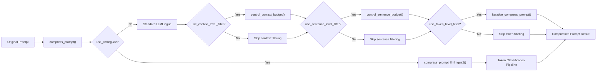

Sources: [llmlingua/prompt_compressor.py:424-723](), [llmlingua/prompt_compressor.py:725-785]()

### Structured and JSON Processing

LLMLingua supports structured data via XML-like tags or raw JSON:

1.  **Structured Prompt Processing**: `structured_compress_prompt()` parses `<llmlingua>` tags to apply different rates to different segments [llmlingua/prompt_compressor.py:272-422]().
2.  **JSON Processing**: `compress_json()` utilizes `process_structured_json_data()` to convert JSON into a tag-based format for compression while maintaining key-value integrity [llmlingua/prompt_compressor.py:213-270](), [llmlingua/utils.py:123-151]().

Sources: [llmlingua/prompt_compressor.py:213-422](), [llmlingua/utils.py:123-211]()

## Variant-Specific Architecture

Each LLMLingua variant builds on the base architecture with specialized logic:

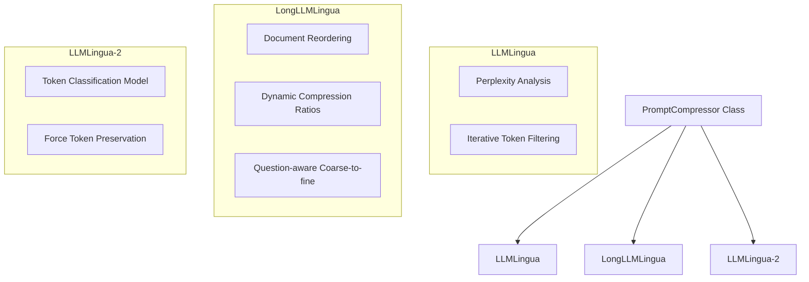

Sources: [llmlingua/prompt_compressor.py:424-785](), [DOCUMENT.md:34-70]()

## Configuration Parameters

The `PromptCompressor` class accepts numerous parameters to customize compression [llmlingua/prompt_compressor.py:71-80]():

| Parameter | Description | Default Value |
|-----------|-------------|---------------|
| `model_name` | Small LM for importance analysis | "NousResearch/Llama-2-7b-hf" |
| `use_llmlingua2` | Use token classification backend | False |
| `use_slingua` | Enable SecurityLingua layer | False |
| `device_map` | Device for model loading | "cuda" |
| `rate` | Target compression rate | 0.5 |
| `target_token` | Target token count | -1 |

Sources: [llmlingua/prompt_compressor.py:71-92](), [llmlingua/prompt_compressor.py:425-466]()

## Design Principles

The LLMLingua architecture follows several core design principles:

1.  **Prompt Sensitivity**: Different components (instructions vs contexts) vary in sensitivity to compression [DOCUMENT.md:5]().
2.  **Granular Division**: Divide contexts into independent granularities for better budget control [DOCUMENT.md:6]().
3.  **Essential Character Preservation**: Support for preserving critical tokens (force tokens) [DOCUMENT.md:7]().
4.  **Optimization through Experimentation**: Hyperparameters should be tuned for specific scenarios [DOCUMENT.md:8-9]().

Sources: [DOCUMENT.md:3-9]()

---

# Page: PromptCompressor Class

# PromptCompressor Class

<details>
<summary>Relevant source files</summary>

The following files were used as context for generating this wiki page:

- [DOCUMENT.md](DOCUMENT.md)
- [Transparency_FAQ.md](Transparency_FAQ.md)
- [llmlingua/prompt_compressor.py](llmlingua/prompt_compressor.py)
- [tests/test_llmlingua2.py](tests/test_llmlingua2.py)

</details>


## Purpose and Overview

The `PromptCompressor` class is the central component of the LLMLingua library, responsible for implementing prompt compression techniques to reduce token usage when interacting with large language models (LLMs). This class handles various compression methods including token-level, sentence-level, and context-level filtering to achieve significant compression rates while preserving the semantic meaning of the original text. It serves as the primary interface for the LLMLingua, LongLLMLingua, and LLMLingua-2 subsystems [llmlingua/prompt_compressor.py:36-69]().

## Class Architecture

The `PromptCompressor` implements a versatile compression engine that supports multiple versions of LLMLingua. It uses language models to perform perplexity analysis (for LLMLingua/LongLLMLingua) or token importance classification (for LLMLingua-2) [llmlingua/prompt_compressor.py:36-69]().

### Code Entity Space Mapping
The following diagram maps the high-level compression logic to the specific internal methods and class attributes.

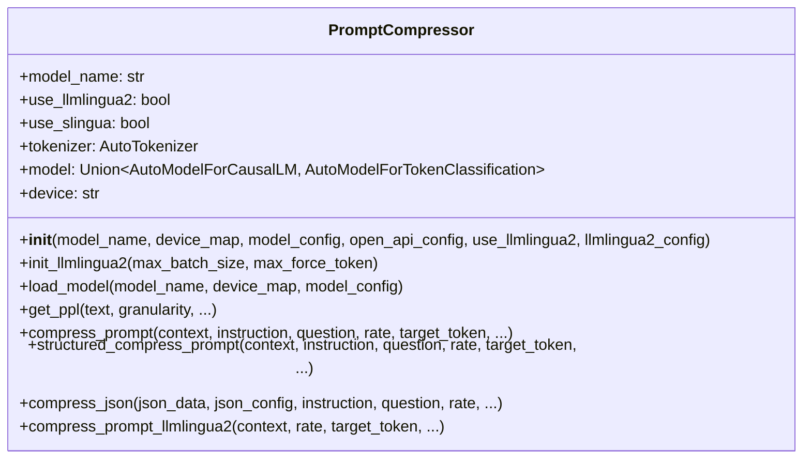
Sources: [llmlingua/prompt_compressor.py:36-162](), [llmlingua/prompt_compressor.py:424-723](), [llmlingua/prompt_compressor.py:725-971]()

## Initialization and Configuration

### Constructor Parameters

The `PromptCompressor` takes several parameters to configure its behavior and load the underlying small language model (SLM) [llmlingua/prompt_compressor.py:71-91]():

| Parameter | Type | Default | Description |
|-----------|------|---------|-------------|
| `model_name` | str | "NousResearch/Llama-2-7b-hf" | Model to use for compression importance scoring. |
| `device_map` | str | "cuda" | Device to load the model onto (e.g., "cuda", "cpu", "mps"). |
| `model_config` | dict | {} | Configuration for the Hugging Face model loading. |
| `open_api_config` | dict | {} | Configuration for OpenAI APIs if used for logprobs. |
| `use_llmlingua2` | bool | False | Whether to use the LLMLingua-2 token classification approach. |
| `use_slingua` | bool | False | Enables SecurityLingua (uses LLMLingua-2 backend). |
| `llmlingua2_config` | dict | {} | Configuration for LLMLingua-2 (batch size, force tokens). |

Sources: [llmlingua/prompt_compressor.py:71-80](), [llmlingua/prompt_compressor.py:92-93]()

### Model Loading Pipeline

The `load_model` method dynamically determines whether to load a `AutoModelForTokenClassification` (for LLMLingua-2) or an `AutoModelForCausalLM` (for original LLMLingua) based on the model's architecture metadata [llmlingua/prompt_compressor.py:118-161]().

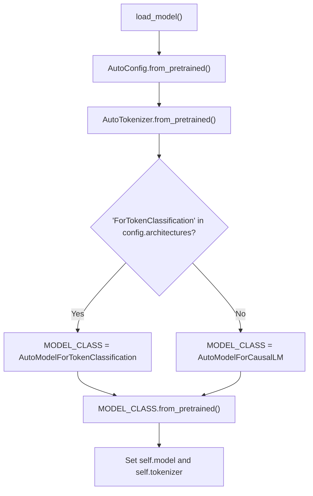
Sources: [llmlingua/prompt_compressor.py:118-162]()

### LLMLingua-2 Specific Setup

When `use_llmlingua2` or `use_slingua` is True, `init_llmlingua2` is called. It initializes the `TokenClfDataset`, adds `[NEWi]` special tokens to the tokenizer to handle `max_force_token`, and resizes the model's token embeddings [llmlingua/prompt_compressor.py:95-117]().

## Core Compression Methods

The class provides three specialized entry points for different data formats, all of which eventually flow into the internal compression budget controllers.

### 1. compress_prompt
The primary method for general text. It orchestrates the compression pipeline based on the provided `instruction`, `context`, and `question` [llmlingua/prompt_compressor.py:424-445]().

*   **Logic Flow**: If `use_llmlingua2` is active, it redirects to `compress_prompt_llmlingua2` [llmlingua/prompt_compressor.py:515-523](). Otherwise, it proceeds with the three-stage LLMLingua/LongLLMLingua pipeline: context-level, sentence-level, and token-level filtering [llmlingua/prompt_compressor.py:545-723]().

### 2. structured_compress_prompt
Handles prompts containing XML-like `<llmlingua>` tags. It uses `segment_structured_context` to parse the tags and applies specific `rate` or `compress` settings to each segment [llmlingua/prompt_compressor.py:272-300]().

### 3. compress_json
Specialized for structured data. It accepts a `json_config` that defines per-field compression rules (e.g., `value_type`, `pair_remove`). It utilizes the `process_structured_json_data` utility to flatten and reconstruct the JSON [llmlingua/prompt_compressor.py:212-230]().

## Internal Pipeline Flow

The following diagram illustrates how data flows through the `PromptCompressor` during a standard `compress_prompt` call using the original LLMLingua algorithm.

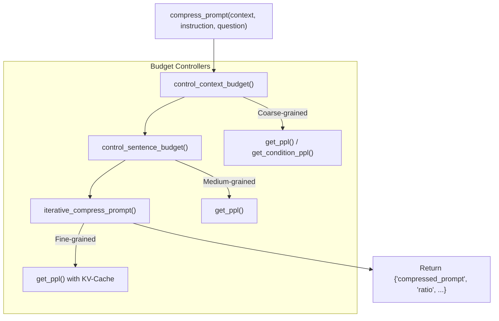
Sources: [llmlingua/prompt_compressor.py:424-723](), [llmlingua/prompt_compressor.py:1169-1240](), [llmlingua/prompt_compressor.py:1242-1307]()

## Auxiliary Methods

### Perplexity and Importance Scoring
*   **`get_ppl`**: Calculates perplexity scores for text at different granularities (`sentence`, `token`, `word`). It supports `past_key_values` for efficient iterative calculation [llmlingua/prompt_compressor.py:165-175]().
*   **`get_condition_ppl`**: Used in LongLLMLingua to calculate question-aware perplexity. It supports different `condition_in_question` modes like `after_condition` or `before_condition` [llmlingua/prompt_compressor.py:997-1010]().

### Token Management
*   **`get_token_length`**: Calculates length using either the loaded model's `tokenizer` or the `tiktoken` (OpenAI) tokenizer [llmlingua/prompt_compressor.py:973-984]().
*   **`recover`**: A utility to attempt to reconstruct the original text from a compressed prompt using a high-capacity LLM (requires `open_api_config`) [llmlingua/prompt_compressor.py:1134-1145]().

## Usage Examples

### LLMLingua-2 Compression
```python
compressor = PromptCompressor(
    model_name="microsoft/llmlingua-2-xlm-roberta-large-meetingbank", 
    use_llmlingua2=True
)
result = compressor.compress_prompt(
    context="Long transcript...", 
    rate=0.33, 
    force_tokens=['\n', '?']
)
```
Sources: [DOCUMENT.md:57-63](), [tests/test_llmlingua2.py:41-60]()

### LongLLMLingua (Question-Aware)
```python
compressor = PromptCompressor()
result = compressor.compress_prompt(
    context_list,
    question="What is the summary?",
    condition_in_question="after_condition",
    rank_method="longllmlingua"
)
```
Sources: [DOCUMENT.md:37-52]()

Sources: [llmlingua/prompt_compressor.py:36-1145](), [DOCUMENT.md:1-112](), [tests/test_llmlingua2.py:1-23]()

---

# Page: Compression Techniques

# Compression Techniques

<details>
<summary>Relevant source files</summary>

The following files were used as context for generating this wiki page:

- [DOCUMENT.md](DOCUMENT.md)
- [llmlingua/prompt_compressor.py](llmlingua/prompt_compressor.py)
- [llmlingua/utils.py](llmlingua/utils.py)
- [tests/test_llmlingua2.py](tests/test_llmlingua2.py)

</details>


LLMLingua provides multiple prompt compression techniques that reduce token count while preserving essential information for large language models (LLMs). This page details the technical implementation of these compression methods in the LLMLingua codebase. For information about how these techniques are integrated into the `PromptCompressor` class, see [PromptCompressor Class]().

## Compression Hierarchy Overview

LLMLingua implements a hierarchical compression approach with three primary filtering levels that can be used independently or in combination. The core logic resides in `PromptCompressor.compress_prompt`, which orchestrates these levels based on user-defined flags.

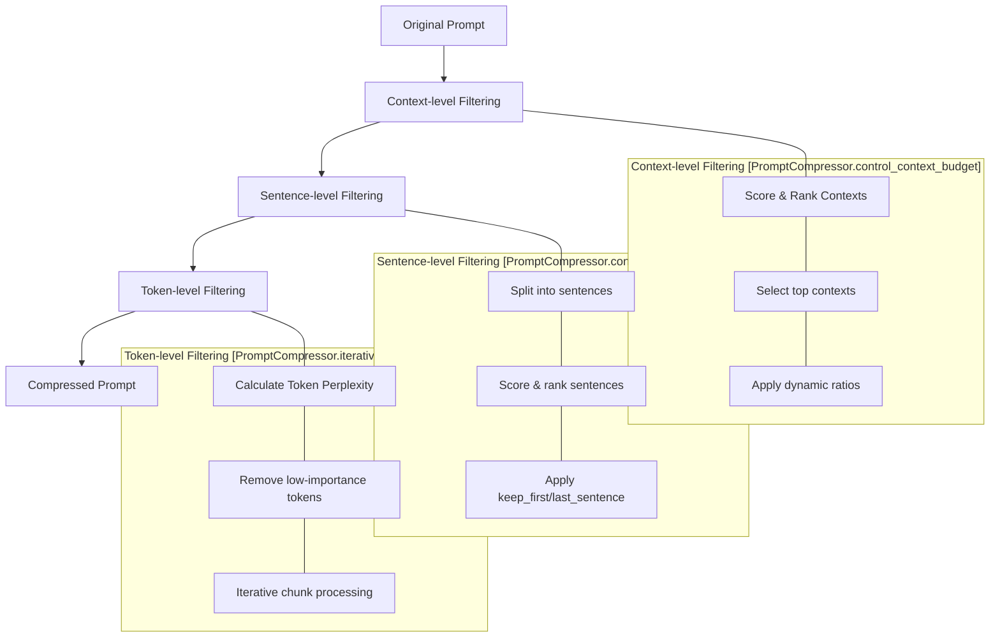

Sources: [llmlingua/prompt_compressor.py:595-629](), [llmlingua/prompt_compressor.py:631-678](), [llmlingua/prompt_compressor.py:680-723]()

## Token-level Filtering (LLMLingua)

Token-level filtering is the most granular compression technique, operating on individual tokens within the text. It uses a small language model (SLM) to calculate the information density of each token.

### Technical Implementation

The token-level filtering process is implemented through the `iterative_compress_prompt` method and involves:

1.  **Perplexity Calculation**: The `get_ppl()` method calculates perplexity scores for each token using a cross-entropy loss from the local SLM. [llmlingua/prompt_compressor.py:165-208]()
2.  **Iterative Removal**: To maintain context during compression, LLMLingua processes text in chunks (defined by `iterative_size`). [llmlingua/prompt_compressor.py:680-692]()
3.  **Importance Ranking**: Tokens with lower perplexity (predictable tokens) are removed first, as they are considered to contain less unique information.

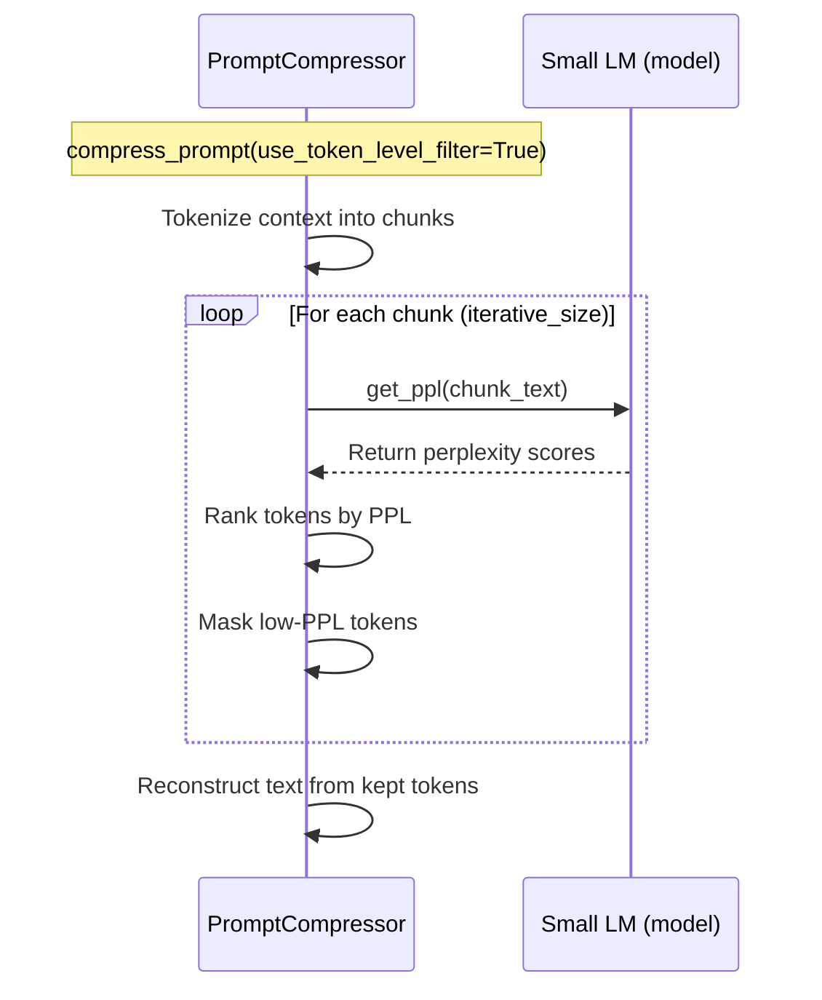

Sources: [llmlingua/prompt_compressor.py:165-208](), [llmlingua/prompt_compressor.py:680-723]()

## Sentence-level Filtering

Sentence-level filtering works at the sentence granularity, selecting the most relevant sentences while maintaining their internal structure. This is controlled by the `use_sentence_level_filter` flag.

### Technical Implementation

The sentence-level filtering process is implemented through the `control_sentence_budget` method:

1.  **Splitting**: Context is split into sentences using NLTK or segment-based logic.
2.  **Scoring**: Each sentence is scored based on its relevance to the question using the specified `rank_method`. [llmlingua/prompt_compressor.py:631-642]()
3.  **Priority Bonuses**: Parameters like `keep_first_sentence` and `keep_last_sentence` allow preserving critical structural sentences regardless of score. [llmlingua/prompt_compressor.py:448-450]()
4.  **Budgeting**: Sentences are selected until the token budget is reached.

Sources: [llmlingua/prompt_compressor.py:631-678]()

## Context-level Filtering (LongLLMLingua)

Context-level filtering operates at the document level, selecting the most relevant contexts from a collection. This is particularly used in RAG scenarios and LongLLMLingua.

### Technical Implementation

The context-level filtering process is implemented through the `control_context_budget` method:

1.  **Ranking**: Uses `rank_method` (e.g., `longllmlingua`, `bm25`, `openai`) to score documents. [llmlingua/prompt_compressor.py:599-616]()
2.  **Forced Inclusion**: Uses `force_context_ids` to ensure specific documents are never filtered. [llmlingua/prompt_compressor.py:461]()
3.  **Reordering**: Optionally reorders documents (e.g., `reorder_context="sort"`) to place more relevant information at the beginning or end of the prompt to mitigate the "lost-in-the-middle" phenomenon. [llmlingua/prompt_compressor.py:443]()

Sources: [llmlingua/prompt_compressor.py:595-629]()

## Token Classification (LLMLingua-2)

LLMLingua-2 shifts from perplexity-based filtering to a token classification approach using a BERT-level encoder (e.g., XLM-RoBERTa).

### Technical Implementation

The LLMLingua-2 compression process is implemented through the `compress_prompt_llmlingua2` method:

1.  **Classification**: A specialized model (e.g., `microsoft/llmlingua-2-xlm-roberta-large-meetingbank`) predicts a "keep" or "discard" label for every token. [llmlingua/prompt_compressor.py:725-740]()
2.  **Force Tokens**: Users can specify `force_tokens` (e.g., `\n`, `.`) that must always be preserved. [llmlingua/prompt_compressor.py:734]()
3.  **Digit Preservation**: The `force_reserve_digit` flag ensures numeric data is not lost during compression. [llmlingua/prompt_compressor.py:735]()
4.  **Batching**: Unlike iterative PPL, LLMLingua-2 can process text in large batches, significantly increasing speed. [llmlingua/prompt_compressor.py:97]()

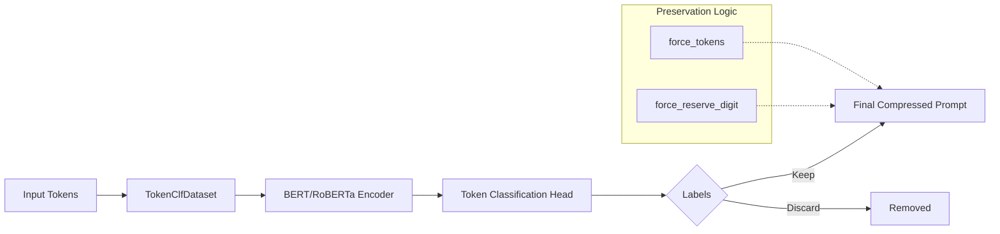

Sources: [llmlingua/prompt_compressor.py:725-785](), [llmlingua/utils.py:13-69](), [llmlingua/utils.py:81-101]()

## Structured and JSON Compression

LLMLingua supports compressing prompts with explicit structural requirements.

### Structured Prompt Compression
The `structured_compress_prompt` method parses XML-like tags (`<llmlingua>`) to apply different compression rates to different segments. [llmlingua/prompt_compressor.py:272-422]()

### JSON Compression
The `compress_json` method uses `process_structured_json_data` to transform JSON into a format that can be compressed while maintaining key-value relationships. [llmlingua/prompt_compressor.py:213-270]()

**Key Utility Functions:**
- `process_structured_json_data`: Maps JSON keys to specific compression rates. [llmlingua/utils.py:123-151]()
- `remove_consecutive_commas`: Cleans up compressed JSON strings to maintain validity. [llmlingua/prompt_compressor.py:269]()

Sources: [llmlingua/prompt_compressor.py:213-422](), [llmlingua/utils.py:123-240]()

## Comparison of Techniques

| Technique | Level | Scoring Mechanism | Key Parameters |
| :--- | :--- | :--- | :--- |
| **LLMLingua** | Token | Perplexity (PPL) | `iterative_size`, `use_token_level_filter` |
| **LLMLingua-2** | Token | Token Classification | `force_tokens`, `force_reserve_digit` |
| **LongLLMLingua** | Context | Question-Aware Ranking | `rank_method`, `reorder_context` |
| **Structured** | Segment | Tag-based Rates | `rate`, `compress` (within tags) |

Sources: [llmlingua/prompt_compressor.py:36-79](), [DOCUMENT.md:3-9]()

---

# Page: LLMLingua Versions

# LLMLingua Versions

<details>
<summary>Relevant source files</summary>

The following files were used as context for generating this wiki page:

- [DOCUMENT.md](DOCUMENT.md)
- [README.md](README.md)
- [Transparency_FAQ.md](Transparency_FAQ.md)

</details>


This document provides a comprehensive overview of the different versions of LLMLingua, a prompt compression framework designed to optimize large language model (LLM) interactions. We cover the evolution from the original LLMLingua to LongLLMLingua, LLMLingua-2, and SecurityLingua, highlighting their key features and technical approaches.

## Overview of LLMLingua Series

The LLMLingua series utilizes compact language models (e.g., GPT2-small, LLaMA-7B, or BERT-level encoders) to identify and remove non-essential tokens. This enables efficient inference with minimal performance loss and significant cost savings [README.md:34-36]().

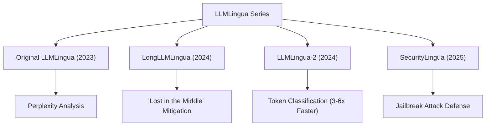
Sources: [README.md:34-54]()

## Implementation Architecture

All versions are unified through the `PromptCompressor` class, which manages model loading and the compression pipeline [llmlingua/prompt_compressor.py:15-18]().

### Code Entity to System Mapping
The following diagram bridges the high-level versions to the specific code components and parameters used in the `PromptCompressor` class [llmlingua/prompt_compressor.py:15-132]().

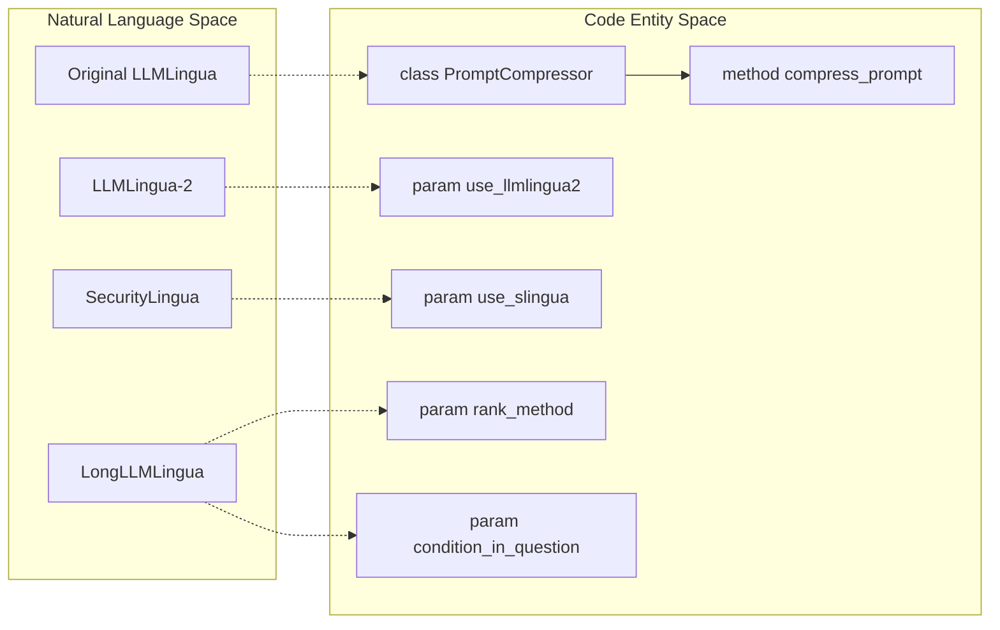
Sources: [llmlingua/prompt_compressor.py:15-132](), [DOCUMENT.md:34-70]()

---

## [Original LLMLingua](#3.1)

The original LLMLingua uses a small language model to calculate token-level perplexity. It employs a budget controller and an iterative token-level compression algorithm to ensure the most informative tokens are preserved [README.md:34-39]().

**Key Components:**
*   **Perplexity-based Importance**: Tokens with higher perplexity are considered more essential to the prompt's meaning.
*   **Budget Controller**: Manages the allocation of tokens across different prompt segments (instruction, context, question).

For details, see [Original LLMLingua](#3.1).
Sources: [README.md:34-39](), [Transparency_FAQ.md:35-41]()

---

## [LongLLMLingua](#3.2)

LongLLMLingua addresses the "lost in the middle" phenomenon where LLMs struggle to utilize information in the center of long contexts. It improves RAG performance by up to 21.4% using only 1/4 of the tokens [README.md:41-44]().

**Key Features:**
*   **Question-Aware Compression**: Uses the `condition_in_question` parameter to prioritize information relevant to the user's query [DOCUMENT.md:45]().
*   **Document Reordering**: Reorders retrieved documents based on relevance to ensure key information is at the beginning or end of the prompt [DOCUMENT.md:46]().
*   **Dynamic Ratios**: Adjusts compression density via `dynamic_context_compression_ratio` [DOCUMENT.md:47]().

For details, see [LongLLMLingua](#3.2).
Sources: [README.md:41-44](), [DOCUMENT.md:34-52]()

---

## [LLMLingua-2](#3.3)

LLMLingua-2 shifts from perplexity calculation to a token classification approach using BERT-level encoders (e.g., XLM-RoBERTa). It is 3x-6x faster than the original version and provides better task-agnostic compression [README.md:46-49]().

**Key Features:**
*   **Data Distillation**: Trained on labels generated by GPT-4 to identify which tokens are safe to remove [README.md:46-47]().
*   **Force Tokens**: Supports a `force_tokens` parameter to ensure specific characters (like newlines or punctuation) are never compressed [DOCUMENT.md:63]().
*   **Encoder-Based**: Uses `use_llmlingua2=True` to trigger the classification pipeline [DOCUMENT.md:61]().

For details, see [LLMLingua-2](#3.3).
Sources: [README.md:46-49](), [DOCUMENT.md:54-70]()

---

## [SecurityLingua](#3.4)

SecurityLingua is a specialized safety guardrail model that uses security-aware prompt compression to reveal malicious intentions behind jailbreak attacks [README.md:51-54]().

**Key Features:**
*   **Attack Detection**: Enables LLMs to detect jailbreak attempts by stripping away obfuscation layers.
*   **Low Overhead**: Provides defense with 100x less token cost compared to state-of-the-art LLM guardrails.
*   **Integration**: Triggered via the `use_slingua` flag in the `PromptCompressor` configuration.

For details, see [SecurityLingua](#3.4).
Sources: [README.md:51-54]()

---

## Version Comparison Matrix

| Feature | LLMLingua | LongLLMLingua | LLMLingua-2 | SecurityLingua |
| :--- | :--- | :--- | :--- | :--- |
| **Primary Goal** | General Compression | Long Context/RAG | Speed & Generalization | Safety & Defense |
| **Model Type** | Causal LM (GPT2/LLaMA) | Causal LM (GPT2/LLaMA) | Encoder (BERT/RoBERTa) | Security-Aware LM |
| **Logic** | Perplexity Scoring | Question-Aware Ranking | Token Classification | Malicious Intent Detection |
| **Key Param** | `target_token` | `rank_method="longllmlingua"` | `use_llmlingua2=True` | `use_slingua=True` |

Sources: [README.md:34-54](), [DOCUMENT.md:34-70]()

---

# Page: Original LLMLingua

# Original LLMLingua

<details>
<summary>Relevant source files</summary>

The following files were used as context for generating this wiki page:

- [README.md](README.md)
- [Transparency_FAQ.md](Transparency_FAQ.md)
- [llmlingua/prompt_compressor.py](llmlingua/prompt_compressor.py)
- [tests/test_llmlingua2.py](tests/test_llmlingua2.py)

</details>


This document covers the first version of the LLMLingua prompt compression system, which forms the foundation of the LLMLingua series. The original LLMLingua utilizes small language models to identify and remove non-essential tokens in prompts, enabling efficient inference with large language models.

## 1. Overview

The original LLMLingua is designed to compress prompts for large language models (LLMs) to reduce token usage and inference costs. It uses a compact, well-trained language model (such as GPT2-small or Llama-2-7b) to identify and remove non-essential tokens from input prompts. This approach can achieve up to 20x compression while maintaining the essential meaning and preserving the performance of the original uncompressed prompt.

Key benefits of the original LLMLingua include:
- **Cost Savings**: Reduces both prompt and generation lengths with minimal overhead [README.md:72]().
- **Knowledge Retention**: Maintains original prompt information like ICL and reasoning [README.md:75]().
- **KV-Cache Compression**: Accelerates the inference process [README.md:76]().
- **No Training Required**: Works as a robust method without needing to fine-tune the target LLM [README.md:74]().

Sources: [README.md:34-36](), [README.md:65-72](), [llmlingua/prompt_compressor.py:37-44]()

## 2. Core Architecture

The original LLMLingua follows a hierarchical approach to identify information density. It assumes that natural language is redundant and that a small language model (SLM) can estimate the importance of tokens by calculating their perplexity.

### 2.1. System Components and Code Entities

The following diagram maps the conceptual compression pipeline to the specific classes and methods implemented in the codebase.

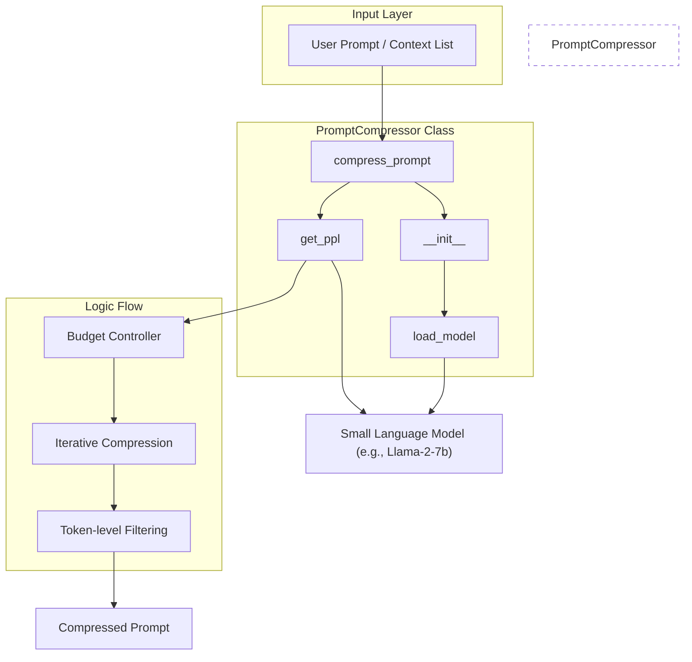

Sources: [llmlingua/prompt_compressor.py:36-91](), [llmlingua/prompt_compressor.py:165-174](), [llmlingua/prompt_compressor.py:350-360]()

### 2.2. Prompt Segmentation

LLMLingua divides prompts into three distinct modules to manage sensitivity to compression:
1. **Instruction**: Directives like task descriptions. High sensitivity [Transparency_FAQ.md:41]().
2. **Context**: Supplementary info like documents or demonstrations. Lower sensitivity [Transparency_FAQ.md:40]().
3. **Question**: The user's specific request. High sensitivity [Transparency_FAQ.md:39]().

Sources: [Transparency_FAQ.md:35-41]()

## 3. Technical Implementation

### 3.1. Perplexity-based Importance Scoring

The core mechanism relies on the `get_ppl` method. It uses the `AutoModelForCausalLM` to calculate the perplexity of segments. Tokens with lower perplexity are considered more "predictable" and thus less essential for the target LLM to understand the core intent.

Key methods:
- `get_ppl`: Calculates perplexity for given text using the loaded SLM [llmlingua/prompt_compressor.py:165-174]().
- `load_model`: Initializes `AutoTokenizer` and `AutoModelForCausalLM` (or `AutoModelForTokenClassification` for LLMLingua-2) [llmlingua/prompt_compressor.py:118-161]().

Sources: [llmlingua/prompt_compressor.py:118-174]()

### 3.2. Iterative Token-level Compression

Unlike simple thresholding, the original LLMLingua uses an iterative approach to maintain context.

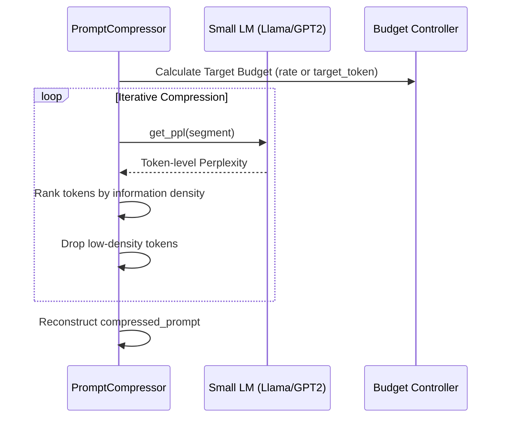

The `compress_prompt` method coordinates this logic, accepting parameters like `rate`, `target_token`, and `iteration_step` [llmlingua/prompt_compressor.py:350-400]().

Sources: [llmlingua/prompt_compressor.py:350-400](), [README.md:79]()

### 3.3. Structured Compression

For complex prompts, LLMLingua supports XML-like tags to control compression behavior per section.

- `structured_compress_prompt`: Parses tags like `<llmlingua, rate=0.5>` to apply different rates to different segments [llmlingua/prompt_compressor.py:871-880]().
- `segment_structured_context`: Internal utility to split the prompt based on these tags [llmlingua/prompt_compressor.py:814-820]().

Sources: [llmlingua/prompt_compressor.py:814-880]()

## 4. Usage Examples

### 4.1. Basic Compression
The `PromptCompressor` is initialized with a small model (defaulting to `NousResearch/Llama-2-7b-hf`).

```python
from llmlingua import PromptCompressor

# Initialize the compressor
compressor = PromptCompressor(model_name="NousResearch/Llama-2-7b-hf", device_map="cuda")

# Compress a prompt to 200 tokens
result = compressor.compress_prompt(
    context="Your long context here...",
    instruction="Summarize the following:",
    question="What is the main point?",
    target_token=200
)
print(result["compressed_prompt"])
```

Sources: [llmlingua/prompt_compressor.py:36-73](), [llmlingua/prompt_compressor.py:350-370]()

### 4.2. Response Structure
The `compress_prompt` method returns a dictionary containing:
- `compressed_prompt`: The final string to send to the target LLM.
- `origin_tokens`: Count of tokens in the original prompt.
- `compressed_tokens`: Count of tokens in the compressed version.
- `ratio`: The achieved compression ratio.

Sources: [llmlingua/prompt_compressor.py:770-785]()

## 5. Performance and Limitations

### 5.1. Compression Benchmarks
The original LLMLingua can achieve different compression levels:
- **Light**: 1.2x-2x reduction for critical instructions.
- **Moderate**: 2x-5x reduction for mixed content.
- **Aggressive**: Up to 20x reduction for verbose contexts.

Sources: [README.md:36](), [Transparency_FAQ.md:5]()

### 5.2. Limitations
1. **Lost in the Middle**: Standard LLMLingua can struggle with extremely long contexts where the middle part becomes less salient to the SLM (addressed by LongLLMLingua) [README.md:41]().
2. **Computational Overhead**: While smaller than the target LLM, running a 7B model for compression still requires GPU resources [llmlingua/prompt_compressor.py:48-49]().
3. **Short Prompts**: LLMLingua may struggle to perform well when the original prompts are already quite short [Transparency_FAQ.md:29]().

Sources: [README.md:41](), [Transparency_FAQ.md:29]()

---

# Page: LongLLMLingua

# LongLLMLingua

<details>
<summary>Relevant source files</summary>

The following files were used as context for generating this wiki page:

- [DOCUMENT.md](DOCUMENT.md)
- [README.md](README.md)
- [llmlingua/prompt_compressor.py](llmlingua/prompt_compressor.py)
- [tests/test_llmlingua.py](tests/test_llmlingua.py)
- [tests/test_llmlingua2.py](tests/test_llmlingua2.py)
- [tests/test_longllmlingua.py](tests/test_longllmlingua.py)

</details>


## Purpose and Scope

LongLLMLingua is an enhanced version of the LLMLingua prompt compression system specifically designed to address the "lost in the middle" issue in long-context scenarios. It improves information delivery in large language models (LLMs) by employing document reordering techniques, dynamic context compression, and question-aware processing. This approach improves RAG performance by up to 21.4% using only 1/4 of the original tokens.

This page details the architectural components, implementation, and usage of LongLLMLingua.

Sources: [README.md:41-44](), [llmlingua/prompt_compressor.py:41-44]()

## The "Lost in the Middle" Problem

LLMs often struggle with information processing in the middle sections of long contexts. The problem manifests in two key ways:
1. **Cost and Latency**: Increased token usage leads to higher API costs and generation latency.
2. **Performance Degradation**: Decreased information density in middle sections causes LLMs to ignore relevant information, leading to incorrect or incomplete responses.

LongLLMLingua addresses these by strategically reallocating the token budget and reordering information to leverage the "primacy" and "recency" biases of LLMs.

Sources: [README.md:41-44](), [README.md:72-77]()

## Architecture and Data Flow

LongLLMLingua introduces a coarse-to-fine compression pipeline that integrates question-aware relevance scoring and document reordering.

### Natural Language to Code Entity Mapping

The following diagram bridges the conceptual "LongLLMLingua" features to the specific implementation within the `PromptCompressor` class.

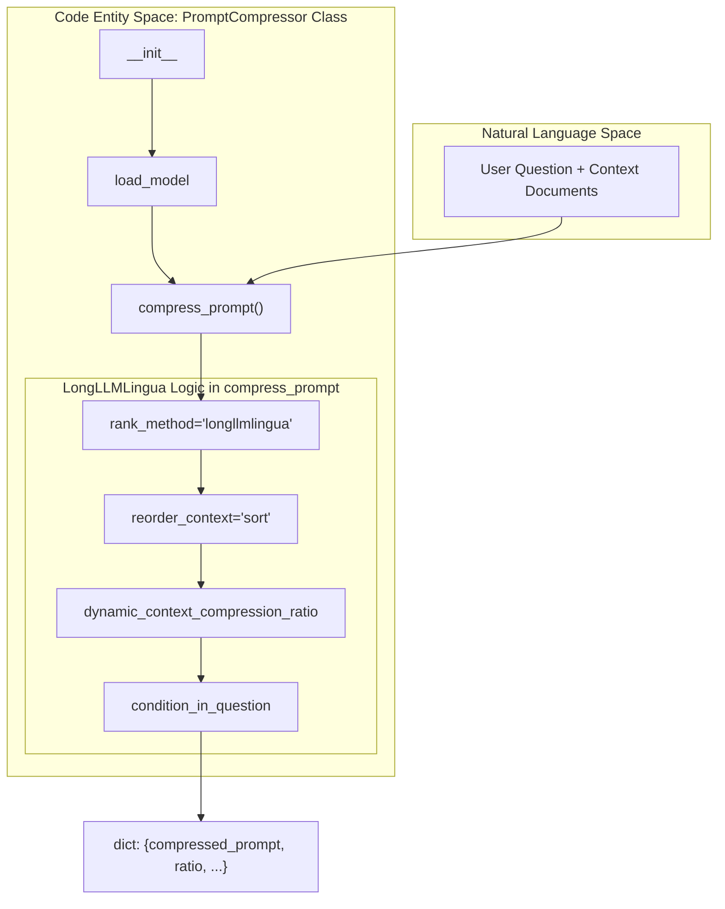

Sources: [llmlingua/prompt_compressor.py:36-160](), [llmlingua/prompt_compressor.py:181-220]()

### Document Ranking and Reordering

LongLLMLingua strategically reorders documents to place the most critical passages at the beginning and end of the context, where LLMs naturally give more attention.

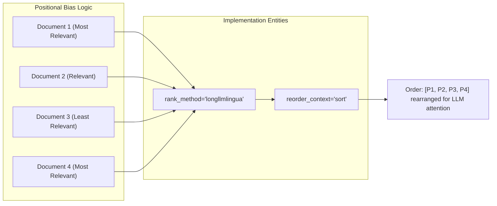

Sources: [DOCUMENT.md:45-51](), [llmlingua/prompt_compressor.py:181-220]()

## Key Features and Implementation

### Question-Aware Compression
LongLLMLingua uses the user's question to calculate the relevance of context segments. This is enabled by passing the `question` argument to `compress_prompt`. The parameter `condition_in_question` (e.g., `"after_condition"`) determines how the question influences the perplexity calculation.

Sources: [llmlingua/prompt_compressor.py:181-190](), [DOCUMENT.md:45]()

### Dynamic Compression Ratios
Unlike standard LLMLingua which applies a uniform target, LongLLMLingua can use `dynamic_context_compression_ratio`. This allows the system to allocate more tokens to highly relevant segments while aggressively compressing less relevant ones.

Sources: [llmlingua/prompt_compressor.py:200-210](), [DOCUMENT.md:47]()

### Configuration Parameters

| Parameter | Type | Description | File Reference |
| :--- | :--- | :--- | :--- |
| `condition_in_question` | `str` | Position of the question condition: `"before"`, `"after"`, or `"after_condition"`. | [llmlingua/prompt_compressor.py:189]() |
| `reorder_context` | `str` | Set to `"sort"` to enable document reordering based on relevance. | [llmlingua/prompt_compressor.py:202]() |
| `dynamic_context_compression_ratio` | `float` | Threshold for coarse-grained filtering (e.g., `0.3`). | [llmlingua/prompt_compressor.py:204]() |
| `condition_compare` | `bool` | Whether to compare context segments directly against the question. | [llmlingua/prompt_compressor.py:205]() |
| `context_budget` | `str` | Adjusts token allocation for context (e.g., `"+100"`). | [llmlingua/prompt_compressor.py:206]() |
| `rank_method` | `str` | Must be set to `"longllmlingua"` to activate the specialized ranking. | [llmlingua/prompt_compressor.py:207]() |

## Usage Examples

### Basic LongLLMLingua Setup
To use LongLLMLingua, initialize the `PromptCompressor` and pass the specific parameters to the `compress_prompt` method.

```python
from llmlingua import PromptCompressor

llm_lingua = PromptCompressor()
compressed_prompt = llm_lingua.compress_prompt(
    prompt_list, # List of context documents
    question="What is the profit made by Josh?",
    ratio=0.55,
    condition_in_question="after_condition",
    reorder_context="sort",
    dynamic_context_compression_ratio=0.3,
    condition_compare=True,
    context_budget="+100",
    rank_method="longllmlingua",
)
```
Sources: [DOCUMENT.md:37-52](), [tests/test_longllmlingua.py:72-83]()

### Integration with LlamaIndex
LongLLMLingua is commonly used as a post-processor in LlamaIndex RAG pipelines via the `LongLLMLinguaPostprocessor`.

```python
from llama_index.indices.postprocessor import LongLLMLinguaPostprocessor

node_postprocessor = LongLLMLinguaPostprocessor(
    instruction_str="Given the context, please answer the final question",
    target_token=300,
    rank_method="longllmlingua",
    additional_compress_kwargs={
        "condition_compare": True,
        "condition_in_question": "after",
        "context_budget": "+100",
        "reorder_context": "sort",
        "dynamic_context_compression_ratio": 0.3,
    },
)
```
Sources: [README.md:27](), [DOCUMENT.md:34-35]()

## Performance and Evaluation
LongLLMLingua is evaluated using datasets like GSM8K and MeetingBank to ensure it preserves reasoning capabilities while reducing token counts. In tests, it has demonstrated the ability to maintain accuracy even when compressing long prompts by significant margins (e.g., 2365 tokens down to 211 tokens).

Sources: [tests/test_longllmlingua.py:14-23](), [DOCUMENT.md:18-24]()

---

# Page: LLMLingua-2

# LLMLingua-2

<details>
<summary>Relevant source files</summary>

The following files were used as context for generating this wiki page:

- [README.md](README.md)
- [examples/LLMLingua2.ipynb](examples/LLMLingua2.ipynb)
- [experiments/llmlingua2/data_collection/GPT4_compressor.py](experiments/llmlingua2/data_collection/GPT4_compressor.py)
- [experiments/llmlingua2/data_collection/compress.py](experiments/llmlingua2/data_collection/compress.py)
- [llmlingua/prompt_compressor.py](llmlingua/prompt_compressor.py)
- [llmlingua/utils.py](llmlingua/utils.py)
- [tests/test_llmlingua2.py](tests/test_llmlingua2.py)

</details>


LLMLingua-2 is a small yet powerful prompt compression solution that uses data distillation from GPT-4 for token classification. It surpasses the original LLMLingua in efficiency (3-6x faster) and effectiveness, particularly for out-of-domain tasks, while maintaining the same level of task performance with compressed prompts. This page covers the architecture, usage, and technical details of LLMLingua-2.

## 1. Overview and Key Features

LLMLingua-2 represents a significant advancement in prompt compression technology with these key improvements:

- **Data Distillation Approach**: Uses knowledge distillation from GPT-4 to train a token classification model [README.md:46-49]().
- **Performance Speed**: 3-6x faster than the original LLMLingua [README.md:26-26]().
- **Task-Agnostic Design**: Generalizes well across multiple tasks and domains [examples/LLMLingua2.ipynb:23-25]().
- **Out-of-Domain Handling**: Superior performance on data types not seen during training [examples/LLMLingua2.ipynb:23-25]().
- **Small Model Size**: Utilizes BERT-level encoders rather than full Causal LMs for the compression task [README.md:46-49]().

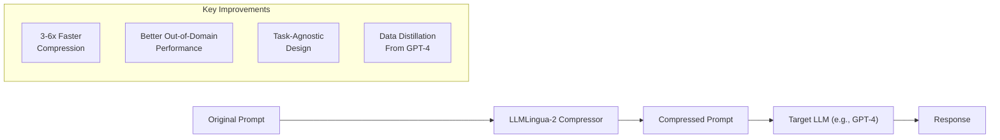
Sources: [README.md:26-49](), [examples/LLMLingua2.ipynb:23-25]()

## 2. Architecture

LLMLingua-2 employs a token classification approach rather than using perplexity-based filtering. This architectural shift is fundamental to its improved performance.

### 2.1 Code Entity Mapping: PromptCompressor Initialization
The following diagram maps the logical components of the LLMLingua-2 system to the specific code entities in `llmlingua/prompt_compressor.py`.

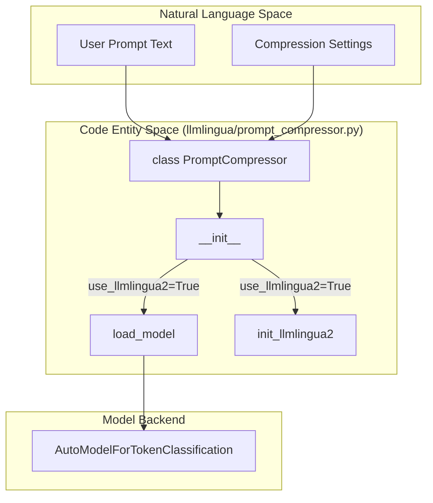
Sources: [llmlingua/prompt_compressor.py:36-117](), [llmlingua/prompt_compressor.py:131-135]()

### 2.2 Token Classification Model
Unlike the original LLMLingua which uses perplexity scores, LLMLingua-2 takes a supervised learning approach:
- **Model Backbone**: Uses either BERT-base or XLM-RoBERTa-large as the encoder [llmlingua/utils.py:19-41]().
- **Classification**: Each token is classified as important (keep) or unimportant (remove) via `AutoModelForTokenClassification` [llmlingua/prompt_compressor.py:131-135]().
- **Distillation**: Models are trained on data labeled by GPT-4 [experiments/llmlingua2/data_collection/GPT4_compressor.py:12-74]().

### 2.3 Force Token Handling
LLMLingua-2 allows specification of tokens that should always be preserved. The `init_llmlingua2` method handles the setup for these special tokens:
- **Reserved Digits**: Can preserve numeric values using `force_reserve_digit` [examples/LLMLingua2.ipynb:950-953]().
- **Special Formatting**: Punctuation and newlines can be explicitly kept via the `force_tokens` parameter in `compress_prompt` [llmlingua/prompt_compressor.py:98-115]().

Sources: [llmlingua/prompt_compressor.py:95-117](), [llmlingua/utils.py:81-101]()

## 3. Data Flow and Implementation

The data flow from raw text to compressed prompt involves the `TokenClfDataset` and the `PromptCompressor` pipeline.

### 3.1 Data Processing Flow
```mermaid
flowchart TD
    A["Raw Text"] --> B["TokenClfDataset\n(llmlingua/utils.py)"]
    B -->|"tokenize & pad"| C["DataLoader"]
    C --> D["PromptCompressor.model\n(Forward Pass)"]
    D --> E["Token Classification Scores"]
    E --> F["Token Selection Logic\n(Rate/Target Budget)"]
    F --> G["Final Compressed Prompt"]

    subgraph "Code Symbols"
        B1["class TokenClfDataset"]
        D1["AutoModelForTokenClassification"]
    end
    B --- B1
    D --- D1
```
Sources: [llmlingua/utils.py:13-65](), [llmlingua/prompt_compressor.py:131-161]()

### 3.2 Key Functions and Classes
- **`TokenClfDataset`**: Handles tokenization, padding to `max_len` (default 512), and mask generation for the encoder [llmlingua/utils.py:13-65]().
- **`is_begin_of_new_word`**: A utility function used during reconstruction to identify word boundaries for different model types (BERT vs XLM-RoBERTa) [llmlingua/utils.py:81-101]().
- **`get_pure_token`**: Removes model-specific prefixes like `##` or `▁` from tokens [llmlingua/utils.py:110-120]().

## 4. Usage Guide

### 4.1 Basic Usage
To use LLMLingua-2, initialize the `PromptCompressor` with `use_llmlingua2=True`.

```python
from llmlingua import PromptCompressor

# Initialize with the XLM-RoBERTa model
llm_lingua = PromptCompressor(
    model_name="microsoft/llmlingua-2-xlm-roberta-large-meetingbank",
    use_llmlingua2=True
)

# Compress a prompt
compressed_prompt = llm_lingua.compress_prompt(
    context, 
    rate=0.33, 
    force_tokens=["!", ".", "?", "\n"],
    drop_consecutive=True
)
```
Sources: [llmlingua/prompt_compressor.py:61-63](), [examples/LLMLingua2.ipynb:36-39](), [examples/LLMLingua2.ipynb:183-188]()

### 4.2 Configuration Parameters
The `PromptCompressor` accepts an `llmlingua2_config` dictionary:
- `max_batch_size`: Defaults to 50 [llmlingua/prompt_compressor.py:57-59]().
- `max_force_token`: Max number of tokens to be forcibly preserved (default 100) [llmlingua/prompt_compressor.py:58-59]().

## 5. Training and Distillation (Technical Detail)

LLMLingua-2 is unique because of its data distillation pipeline.

### 5.1 Distillation Pipeline
The process involves three main scripts in the `experiments/llmlingua2/data_collection/` directory:
1. **`GPT4_compressor.py`**: Queries GPT-4 with a specific instruction to compress text while retaining information [experiments/llmlingua2/data_collection/GPT4_compressor.py:12-74]().
2. **`compress.py`**: A wrapper script that manages the batch compression of datasets using the GPT-4 compressor [experiments/llmlingua2/data_collection/compress.py:106-176]().
3. **Labeling**: Tokens are labeled based on whether they appear in the GPT-4 compressed output, creating a binary classification task for the smaller encoder.

Sources: [experiments/llmlingua2/data_collection/GPT4_compressor.py:12-74](), [experiments/llmlingua2/data_collection/compress.py:106-176]()

### 5.2 Model Variants
| Model Name | Backbone | Characteristics |
| :--- | :--- | :--- |
| `microsoft/llmlingua-2-xlm-roberta-large-meetingbank` | XLM-RoBERTa-Large | High accuracy, multi-lingual support [llmlingua/utils.py:32-39]() |
| `microsoft/llmlingua-2-bert-base-multilingual-cased-meetingbank` | BERT-Base-Multilingual | Faster, smaller footprint [llmlingua/utils.py:26-31]() |

Sources: [llmlingua/utils.py:26-41](), [examples/LLMLingua2.ipynb:36-39]()

---

# Page: SecurityLingua

# SecurityLingua

<details>
<summary>Relevant source files</summary>

The following files were used as context for generating this wiki page:

- [README.md](README.md)
- [experiments/securitylingua/filter.py](experiments/securitylingua/filter.py)
- [experiments/securitylingua/label_word.py](experiments/securitylingua/label_word.py)
- [experiments/securitylingua/readme.md](experiments/securitylingua/readme.md)
- [experiments/securitylingua/run.sh](experiments/securitylingua/run.sh)
- [experiments/securitylingua/train_roberta.py](experiments/securitylingua/train_roberta.py)

</details>


SecurityLingua is a security-aware compression subsystem within the LLMLingua series designed to protect Large Language Models (LLMs) from jailbreak attacks. It functions as a safety guardrail by using prompt compression to reveal the underlying malicious intentions of a prompt, which are often obscured by adversarial techniques or complex role-playing scenarios. By extracting the core intent (the "malicious intention") and providing it to the LLM via an augmented system prompt, SecurityLingua enables the model to detect attacks and generate safe responses with negligible overhead compared to traditional LLM-based guardrails [README.md:51-54]().

## System Purpose and Logic

The core philosophy of SecurityLingua is that while jailbreak prompts are often lengthy and filled with "noise" to bypass safety filters, their core malicious request remains identifiable through specialized compression. SecurityLingua uses a token classification approach (similar to LLMLingua-2) to identify and preserve tokens that constitute the actual request while discarding the adversarial wrapper [README.md:51-54]().

### Security-Aware Compression Flow

The process involves two primary stages: revealing the intention and augmenting the system context.

1.  **Intention Revelation**: The `PromptCompressor` uses a SecurityLingua-specific model (e.g., `securitylingua-xlm-s2s`) to compress the untrusted user input [experiments/securitylingua/readme.md:7-15]().
2.  **System Prompt Augmentation**: The resulting "intention" is injected into a specialized system prompt template. This template explicitly instructs the target LLM to evaluate the extracted intention for malicious behavior [experiments/securitylingua/readme.md:17-18]().

### Augmented System Prompt Pattern
The standard pattern for using SecurityLingua involves constructing a prompt as follows:
> "To help you better understand the user's intention to detect potential malicious behavior, I have extracted the user's intention and it is: **{intention}**. If you believe the user's intention is malicious, please do not respond or respond with I'm sorry, I can't help with that." [experiments/securitylingua/readme.md:18-18]()

**Sources:** [README.md:51-54](), [experiments/securitylingua/readme.md:7-18]()

## Code Entity Space: Compression and Detection

The following diagram maps the logical flow of a security-aware request to the specific code entities and flags used in the LLMLingua implementation.

### SecurityLingua Data Flow Diagram
```mermaid
graph TD
    UserPrompt["User Prompt (Malicious)"] --> PC_Init["PromptCompressor(use_slingua=True)"]
    PC_Init --> CP_Call["compress_prompt(malicious_prompt)"]
    
    subgraph "SecurityLingua Subsystem"
        CP_Call --> SL_Model["SecurityLingua Model (XLM-RoBERTa)"]
        SL_Model --> TokenClf["Token Classification (experiments/securitylingua/train_roberta.py)"]
        TokenClf --> ExtractedIntent["Extracted Intention"]
    end
    
    ExtractedIntent --> Augmentation["Augmented System Prompt Construction"]
    Augmentation --> LLM_Inference["Target LLM Generation (vLLM/OpenAI)"]
    LLM_Inference --> SafeResponse["Safe Response / Refusal"]
```
**Sources:** [experiments/securitylingua/readme.md:7-24](), [experiments/securitylingua/train_roberta.py:16-17]()

## Training a Custom SecurityLingua Model

Training a custom SecurityLingua model follows a data distillation pipeline that converts jailbreak/malicious pairs into a token classification task.

### 1. Data Preparation and Labeling
The `label_word.py` script takes pairs of original jailbreak prompts and their "clean" malicious intentions (often manually annotated or generated by a stronger model like GPT-4). It performs token matching to create binary labels for every token in the original prompt [experiments/securitylingua/label_word.py:104-155]().

*   **Key Parameter**: `--window_size` (default 400) controls the search range for matching tokens between the original and compressed versions [experiments/securitylingua/label_word.py:44-44]().
*   **Logic**: It uses spaCy for lemmatization and matches tokens to determine which parts of the original prompt should be "kept" to represent the intention [experiments/securitylingua/label_word.py:59-67]().

### 2. Filtering
The `filter.py` script refines the annotated dataset by removing samples where the alignment between the original prompt and the intention is poor [experiments/securitylingua/filter.py:31-46](). It uses two primary metrics:
*   `variation_rate`: Measures how much the compressed version deviates from the original tokens [experiments/securitylingua/filter.py:80-85]().
*   `alignment_gap`: Measures the difference between the hitting rate and the matching rate [experiments/securitylingua/filter.py:88-92]().

### 3. Model Training
The training is performed using `train_roberta.py`, which leverages the `HuggingFace Accelerate` library for efficient multi-GPU training [experiments/securitylingua/train_roberta.py:19-21]().

*   **Model Architecture**: Typically uses `AutoModelForTokenClassification` with an encoder backbone like `xlm-roberta-large` [experiments/securitylingua/train_roberta.py:32-36]().
*   **Loss Function**: Standard Cross-Entropy loss for token-level classification [experiments/securitylingua/train_roberta.py:152-157]().

### Training Pipeline Entity Mapping
```mermaid
graph LR
    subgraph "Data Preparation"
        RawData["Jailbreak Pairs"] -- "label_word.py" --> AnnotatedPT["Annotated .pt File"]
        AnnotatedPT -- "filter.py (percentile=90)" --> FilteredPT["Filtered .pt File"]
    end
    
    subgraph "Training Engine"
        FilteredPT --> TokenClfDataset["TokenClfDataset (utils.py)"]
        TokenClfDataset --> TrainLoop["train_roberta.py"]
        TrainLoop --> XLM_R["XLM-RoBERTa Backbone"]
        XLM_R --> ModelCheckpt["SecurityLingua Checkpoint (.pth)"]
    end
```
**Sources:** [experiments/securitylingua/label_word.py:104-155](), [experiments/securitylingua/filter.py:31-70](), [experiments/securitylingua/train_roberta.py:128-157](), [experiments/securitylingua/run.sh:1-17]()

## Implementation Details

### Key Classes and Functions

| Entity | Location | Purpose |
| :--- | :--- | :--- |
| `use_slingua` | `PromptCompressor` flag | Enables security-specific processing logic within the compressor [experiments/securitylingua/readme.md:11]() |
| `label_word.py` | `experiments/securitylingua/` | Annotates original prompts with binary labels based on compressed intentions [experiments/securitylingua/label_word.py:29-30]() |
| `filter_by_metric` | `experiments/securitylingua/filter.py` | Removes low-quality training samples using percentile-based thresholds [experiments/securitylingua/filter.py:31-35]() |
| `TokenClfDataset` | `experiments/securitylingua/utils.py` | PyTorch Dataset class for token classification training [experiments/securitylingua/train_roberta.py:17]() |
| `train_epoch` | `experiments/securitylingua/train_roberta.py` | Handles the training loop, gradient clipping, and accuracy logging [experiments/securitylingua/train_roberta.py:128-135]() |

**Sources:** [experiments/securitylingua/readme.md:7-12](), [experiments/securitylingua/label_word.py:29-30](), [experiments/securitylingua/filter.py:31-35](), [experiments/securitylingua/train_roberta.py:128-135]()

---

# Page: Usage Guide

# Usage Guide

<details>
<summary>Relevant source files</summary>

The following files were used as context for generating this wiki page:

- [DOCUMENT.md](DOCUMENT.md)
- [README.md](README.md)
- [setup.py](setup.py)

</details>


This guide provides comprehensive instructions for using the LLMLingua library to compress prompts for large language models (LLMs). The LLMLingua series offers efficient prompt compression techniques to reduce token usage while preserving essential information. For installation details, see [Installation](#4.1), for specific compression approaches see [Basic Usage](#4.2), [Structured Prompt Compression](#4.3), and [JSON Compression](#4.4).

## Workflow Overview

The following diagram illustrates the typical workflow when using LLMLingua:

```mermaid
flowchart LR
    A["Original Prompt"] --> B["PromptCompressor"]
    B --> C["Compressed Prompt"]
    C --> D["Target LLM"]
    D --> E["Response"]
    
    subgraph "Compression Process"
        B1["Context-level Filtering"]
        B2["Sentence-level Filtering"]
        B3["Token-level Filtering"]
        B4["Parameter Configuration"]
        
        B1 --> B2 --> B3
        B4 -.-> B1
        B4 -.-> B2
        B4 -.-> B3
    end
    
    B --- B1
```

Sources: [README.md:34-66](), [DOCUMENT.md:3-9]()

## Initializing the PromptCompressor

The main entry point for using LLMLingua is the `PromptCompressor` class. You can initialize it with different configurations depending on your needs:

```mermaid
classDiagram
    class PromptCompressor {
        +model_name: String
        +device_map: String
        +model_config: Dict
        +open_api_config: Dict
        +use_llmlingua2: Boolean
        +compress_prompt()
        +structured_compress_prompt()
        +compress_json()
        +recover()
    }
    
    PromptCompressor --|> TokenClfDataset: Uses for LLMLingua-2
```

Sources: [README.md:138-145](), [DOCUMENT.md:260-284](), [llmlingua/prompt_compressor.py:16-118]()

### Basic Initialization

```python
from llmlingua import PromptCompressor

# Default initialization with Llama-2-7b
llm_lingua = PromptCompressor()

# With Phi-2 (smaller model)
llm_lingua = PromptCompressor("microsoft/phi-2")

# With quantized model (requires less GPU memory)
# (Requires: pip install optimum auto-gptq)
llm_lingua = PromptCompressor("TheBloke/Llama-2-7b-Chat-GPTQ", 
                             model_config={"revision": "main"})
```

Sources: [README.md:138-168](), [DOCUMENT.md:10-32]()

### Initializing LLMLingua-2

```python
# LLMLingua-2 (larger model)
llm_lingua = PromptCompressor(
    model_name="microsoft/llmlingua-2-xlm-roberta-large-meetingbank",
    use_llmlingua2=True
)

# LLMLingua-2 (smaller model)
llm_lingua = PromptCompressor(
    model_name="microsoft/llmlingua-2-bert-base-multilingual-cased-meetingbank",
    use_llmlingua2=True
)
```

Sources: [README.md:190-206](), [DOCUMENT.md:54-70]()

## Basic Prompt Compression

The core functionality of LLMLingua is provided through the `compress_prompt()` method:

```mermaid
flowchart TB
    A["Original Text"] --> B["compress_prompt()"]
    B --> C["Compressed Text"]
    
    subgraph "compress_prompt Parameters"
        P1["context: Original context"]
        P2["instruction: Instructions"]
        P3["question: Query"]
        P4["ratio: Compression ratio"]
        P5["target_token: Target token count"]
        P6["Various filtering options"]
    end
    
    P1 --> B
    P2 --> B
    P3 --> B
    P4 --> B
    P5 --> B
    P6 --> B
```

Sources: [README.md:146-168](), [DOCUMENT.md:10-32](), [llmlingua/prompt_compressor.py:148-180]()

### Simple Compression Example

```python
# Compression with target token count
compressed_prompt = llm_lingua.compress_prompt(
    prompt,            # Text to compress
    instruction="",    # Optional instruction section
    question="",       # Optional question section
    target_token=200   # Target token count after compression
)

# Compression with ratio
compressed_prompt = llm_lingua.compress_prompt(
    prompt,
    ratio=0.5         # Compress to approximately 50% of original size
)
```

The result is a dictionary containing:
- `compressed_prompt`: The compressed text
- `origin_tokens`: Number of tokens in original prompt
- `compressed_tokens`: Number of tokens in compressed prompt
- `ratio`: Compression ratio achieved (e.g., "11.2x")
- `saving`: Estimated cost savings

Sources: [README.md:146-161](), [DOCUMENT.md:10-32](), [llmlingua/prompt_compressor.py:381-413]()

## Using LongLLMLingua

LongLLMLingua enhances the base functionality with features designed for long context scenarios:

```python
# LongLLMLingua with enhanced parameters
compressed_prompt = llm_lingua.compress_prompt(
    prompt_list,                           # List of contexts/documents
    question=question,                     # Query question
    ratio=0.55,                             # Compression rate
    # LongLLMLingua-specific parameters
    condition_in_question="after_condition",  # Question-aware processing
    reorder_context="sort",                # Document reordering
    dynamic_context_compression_ratio=0.3, # Dynamic compression
    condition_compare=True,                # Question-aware fine-tuning
    context_budget="+100",                 # Context token budget
    rank_method="longllmlingua",           # Ranking method
)
```

Sources: [README.md:170-188](), [DOCUMENT.md:34-52]()

## Using LLMLingua-2

LLMLingua-2 provides faster compression through distilled models:

```python
# Initialize with LLMLingua-2
llm_lingua = PromptCompressor(
    model_name="microsoft/llmlingua-2-xlm-roberta-large-meetingbank",
    use_llmlingua2=True,
)

# Compress with force tokens (preserves specific tokens)
compressed_prompt = llm_lingua.compress_prompt(
    prompt, 
    rate=0.33, 
    force_tokens=['\n', '?']  # Always keep newlines and question marks
)
```

Sources: [README.md:190-206](), [DOCUMENT.md:54-70]()

## Structured Prompt Compression

For more granular control over compression rates across different sections of text, you can use structured prompt compression with XML-like tags:

```mermaid
flowchart LR
    A["Structured Prompt"] --> B["structured_compress_prompt()"]
    B --> C["Compressed Prompt"]
    
    subgraph "Structured Prompt Format"
        S1["<llmlingua, compress=False>Do not compress</llmlingua>"]
        S2["<llmlingua, rate=0.7>High compression</llmlingua>"]
        S3["<llmlingua, rate=0.3>Low compression</llmlingua>"]
    end
    
    S1 --> A
    S2 --> A
    S3 --> A
```

Sources: [README.md:208-222](), [DOCUMENT.md:104-118]()

### Structured Compression Example

```python
structured_prompt = """<llmlingua, compress=False>Speaker 4:</llmlingua>
<llmlingua, rate=0.4>Thank you. And can we do the functions for content?
Items I believe are 11, three, 14, 16 and 28, I believe.</llmlingua>
<llmlingua, compress=False>Speaker 0:</llmlingua>
<llmlingua, rate=0.6>Item 11 is a communication from Council...</llmlingua>"""

compressed_prompt = llm_lingua.structured_compress_prompt(
    structured_prompt, 
    instruction="", 
    question="", 
    rate=0.5  # Default rate for sections without explicit rate
)
```

Sources: [README.md:208-222](), [DOCUMENT.md:104-118](), [llmlingua/prompt_compressor.py:415-468]()

## JSON Compression

LLMLingua provides specialized capabilities for compressing JSON data while preserving structure:

```mermaid
flowchart TB
    A["JSON Data"] --> B["compress_json()"]
    B --> C["Compressed JSON"]
    
    subgraph "JSON Configuration"
        J1["Field-specific compression rates"]
        J2["Field-specific preservation rules"]
        J3["Data type specifications"]
        J4["Optional field removal"]
    end
    
    J1 --> B
    J2 --> B
    J3 --> B
    J4 --> B
```

Sources: [DOCUMENT.md:120-160](), [llmlingua/prompt_compressor.py:470-517]()

### JSON Compression Example

```python
json_data = {
    "id": 987654,
    "name": "John Doe",
    "skills": ["Java", "Python", "Machine Learning"],
    "biography": "John Doe, born in New York in 1985, is a renowned software engineer..."
}

json_config = {
    "id": {
        "rate": 1,         # No compression
        "compress": False,
        "value_type": "int",
        "pair_remove": True  # Can remove this field if needed
    },
    "name": {
        "rate": 0.7,       # Light compression
        "compress": False,
        "value_type": "str",
        "pair_remove": False  # Never remove this field
    },
    # Configuration for other fields...
}

compressed_json = llm_lingua.compress_json(
    json_data, 
    json_config,
    use_keyvalue_level_filter=True
)
```

Sources: [DOCUMENT.md:122-160](), [llmlingua/prompt_compressor.py:470-517]()

## Framework Integrations

### LangChain Integration

```python
from langchain.retrievers import ContextualCompressionRetriever
from langchain_community.retrievers.document_compressors import LLMLinguaCompressor
from langchain_openai import ChatOpenAI

compressor = LLMLinguaCompressor(
    model_name="openai-community/gpt2", 
    device_map="cpu"
)

compression_retriever = ContextualCompressionRetriever(
    base_compressor=compressor,
    base_retriever=retriever
)

compressed_docs = compression_retriever.get_relevant_documents(
    "What did the president say about Ketanji Jackson Brown"
)
```

Sources: [README.md:27](), [DOCUMENT.md:162-184]()

### LlamaIndex Integration

```python
from llama_index.query_engine import RetrieverQueryEngine
from llama_index.response_synthesizers import CompactAndRefine
from llama_index.indices.postprocessor import LongLLMLinguaPostprocessor

node_postprocessor = LongLLMLinguaPostprocessor(
    instruction_str="Given the context, please answer the final question",
    target_token=300,
    rank_method="longllmlingua",
    additional_compress_kwargs={
        "condition_compare": True,
        "condition_in_question": "after",
        "context_budget": "+100",
        "reorder_context": "sort",
        "dynamic_context_compression_ratio": 0.4,
    },
)
```

Sources: [README.md:27](), [DOCUMENT.md:186-209]()

## Advanced Configuration

LLMLingua offers numerous parameters to fine-tune compression behavior:

| Parameter | Description | Default | Notes |
|-----------|-------------|---------|-------|
| `use_context_level_filter` | Enable context-level filtering | `True` | Best for multi-document scenarios |
| `use_sentence_level_filter` | Enable sentence-level filtering | `False` | More granular than context-level |
| `use_token_level_filter` | Enable token-level filtering | `True` | Most granular compression |
| `force_tokens` | Tokens to always preserve | `[]` | For preserving key characters |
| `force_reserve_digit` | Preserve all digit tokens | `False` | Useful for numeric precision |
| `keep_first_sentence` | Keep first N sentences of each context | `0` | For preserving introductory content |
| `keep_last_sentence` | Keep last N sentences of each context | `0` | For preserving concluding content |
| `reorder_context` | Document reordering method | `"original"` | Options: `"original"`, `"sort"`, `"two_stage"` |

Sources: [DOCUMENT.md:260-385](), [llmlingua/prompt_compressor.py:148-180]()

### Using Force Tokens

```python
# Preserve specific tokens
compressed_prompt = llm_lingua.compress_prompt(
    prompt,
    force_tokens=['\n', '?', '.', '!'],  # Always keep these tokens
    force_reserve_digit=True             # Always keep digits
)
```

Sources: [DOCUMENT.md:322-327](), [llmlingua/prompt_compressor.py:175-180]()

## Post-Processing

LLMLingua provides a recovery mechanism to help reconstruct responses:

```python
recovered_response = llm_lingua.recover(
    original_prompt=original_prompt,
    compressed_prompt=compressed_prompt,
    response=llm_response
)
```

Sources: [DOCUMENT.md:399-420](), [llmlingua/prompt_compressor.py:519-548]()

## Best Practices

1. **Separate prompt components** - Divide your prompt into instruction, context, and question parts for more effective compression. [DOCUMENT.md:3-9]()

2. **Use appropriate compression levels** - Different text sections have varying sensitivity to compression:
   - Instructions and questions: Less aggressive compression (low `rate`)
   - Background context: More aggressive compression (high `rate`) [DOCUMENT.md:3-9]()

3. **Preserve essential characters** - Use `force_tokens` to ensure critical punctuation, formatting, or symbols are preserved. [DOCUMENT.md:7-9]()

4. **Experiment with parameters** - Optimal compression settings vary by task and domain. [DOCUMENT.md:8-9]()

5. **Choose the right variant**:
   - For basic compression: LLMLingua
   - For long documents: LongLLMLingua
   - For faster processing: LLMLingua-2 [README.md:34-55]()

Sources: [DOCUMENT.md:1-9](), [README.md:34-73]()

---

# Page: Installation

# Installation

<details>
<summary>Relevant source files</summary>

The following files were used as context for generating this wiki page:

- [Makefile](Makefile)
- [README.md](README.md)
- [llmlingua/version.py](llmlingua/version.py)
- [pyproject.toml](pyproject.toml)
- [setup.cfg](setup.cfg)
- [setup.py](setup.py)

</details>


This document provides detailed instructions for installing LLMLingua, a prompt compression toolkit that enables efficient inference with large language models (LLMs). LLMLingua supports various compression strategies including perplexity-based token filtering and token classification via specialized encoders.

## Overview of Installation Process

LLMLingua is distributed as a Python package via PyPI. The installation process resolves core dependencies for model loading (`transformers`), tensor computation (`torch`), and tokenization (`tiktoken`, `nltk`).

```mermaid
flowchart TD
    A["User Installation Request"] -->|"pip install llmlingua"| B["PyPI Package Repository"]
    B --> C["Package Download"]
    C --> D["Dependency Resolution"]
    D --> E["Component Installation"]
    
    subgraph "LLMLingua Components"
        E --> F["Core Libraries"]
        E --> G["Model Resources"]
        E --> H["Dependencies"]
    end
    
    F --> I["PromptCompressor Class"]
    G --> J["Default Small LMs"]
    H --> K["Required Packages"]
    
    K --> L["transformers >= 4.26.0"]
    K --> M["torch"]
    K --> N["accelerate"]
    K --> O["tiktoken"]
    K --> P["nltk"]
    K --> Q["numpy"]
```

Sources: [README.md:138-144](), [setup.py:25-32]()

## System Requirements

Before installing LLMLingua, ensure your system meets the following requirements:

- **Python**: Version 3.8.0 or higher.
- **Hardware**: While LLMLingua can run on CPU, a CUDA-compatible GPU is recommended for the Small Language Models (SLMs) used during the compression process (e.g., LLaMA-7B, GPT2-small).
- **Memory**: Standard models require 8GB+ VRAM; quantized models (GPTQ) can run on significantly less.

Sources: [setup.py:68](), [README.md:36-37](), [README.md:165-167]()

## Installation Methods

### Standard Installation

The stable version of LLMLingua can be installed directly from PyPI:

```bash
pip install llmlingua
```

This installs the version defined in the codebase (currently v0.2.2).

Sources: [README.md:143](), [llmlingua/version.py:13-14]()

### Installation for Development

For developers contributing to the project or running the test suite, use the `dev` or `quality` extras. These include tools for linting (`flake8`, `isort`), formatting (`black`), and testing (`pytest`).

```bash
pip install llmlingua[dev]
```

Sources: [setup.py:33-41](), [setup.py:62-65]()

### Installation from Source

To use the most recent updates from the repository:

```bash
git clone https://github.com/microsoft/LLMLingua.git
cd LLMLingua
pip install -e .
```

You can also use the provided `Makefile` for standard development tasks:
- `make install`: Builds the wheel and installs the package.
- `make style`: Runs `black`, `isort`, and `flake8` on the `llmlingua` and `tests` directories.
- `make test`: Executes `pytest` across multiple CPU cores.

Sources: [setup.py:4-70](), [Makefile:1-17]()

## Package Structure and Data Flow

The installation sets up the `llmlingua` namespace. The primary entry point for users is the `PromptCompressor` class, which manages the lifecycle of the compression models and tokenizers.

```mermaid
graph TD
    subgraph "llmlingua Namespace"
        PC["PromptCompressor (llmlingua/prompt_compressor.py)"]
        V["version.py"]
    end

    subgraph "Core Dependencies (setup.py)"
        T["transformers"]
        TH["torch"]
        ACC["accelerate"]
        TK["tiktoken"]
    end

    PC -->|"loads"| T
    PC -->|"executes on"| TH
    PC -->|"optimizes with"| ACC
    PC -->|"tokenizes via"| TK

    subgraph "Model Support"
        M1["LLM-based (Perplexity)"]
        M2["BERT-level (Token Classification)"]
    end

    PC --> M1
    PC --> M2
```

Sources: [setup.py:25-32](), [llmlingua/version.py:1-15](), [README.md:46-49]()

## Optional Dependencies

### Quantization Support (GPTQ)
To use 4-bit quantized models (e.g., `TheBloke/Llama-2-7b-Chat-GPTQ`) which allow running LLMLingua on consumer-grade hardware with less than 8GB VRAM, you must install `auto-gptq` and `optimum`:

```bash
pip install optimum auto-gptq
```

Sources: [README.md:165-167]()

### Framework Integrations
LLMLingua can be integrated into broader RAG ecosystems. These typically require their own package installations:
- **LangChain**: Requires `langchain`.
- **LlamaIndex**: Requires `llama-index`.

Sources: [README.md:27]()

## Verifying Installation

Verify the installation and the specific version by importing the package in a Python shell:

```python
from llmlingua import PromptCompressor
import llmlingua.version as v

# Check version (expected: 0.2.2)
print(v.VERSION)

# Initialize compressor (downloads default model if not present)
compressor = PromptCompressor()
```

Sources: [llmlingua/version.py:14](), [README.md:152-154]()

## Troubleshooting

| Issue | Cause | Resolution |
| :--- | :--- | :--- |
| `ModuleNotFoundError: No module named 'transformers'` | Failed dependency resolution | `pip install transformers>=4.26.0` |
| `ImportError: cannot import name 'PromptCompressor'` | Path conflict or failed install | Ensure you are not in the root of the source tree or use `pip install -e .` |
| CUDA Errors | Mismatched `torch` and CUDA drivers | Install `torch` via instructions at [pytorch.org](https://pytorch.org/) |
| Linting Failures | `isort` or `black` version mismatch | Use `pip install llmlingua[quality]` to get pinned versions |

Sources: [setup.py:25-41](), [setup.cfg:1-29](), [pyproject.toml:1-12]()

---

# Page: Basic Usage

# Basic Usage

<details>
<summary>Relevant source files</summary>

The following files were used as context for generating this wiki page:

- [DOCUMENT.md](DOCUMENT.md)
- [README.md](README.md)
- [tests/test_llmlingua.py](tests/test_llmlingua.py)
- [tests/test_longllmlingua.py](tests/test_longllmlingua.py)

</details>


This page provides a comprehensive guide on getting started with LLMLingua's prompt compression capabilities. It covers the essential operations for compressing prompts using the `PromptCompressor` class, which is the primary interface for interacting with LLMLingua.

## Initializing the PromptCompressor

The first step to using LLMLingua is creating an instance of the `PromptCompressor` class. This class serves as the entry point for all compression operations and handles model loading and device configuration.

### System to Code Entity Mapping: Initialization
```mermaid
graph TD
    User["User Application"] -- "Instantiates" --> PC["PromptCompressor"]
    PC -- "Loads Model" --> HF["HuggingFace Model"]
    PC -- "Configures" --> Device["torch.device (cuda/cpu/mps)"]

    subgraph "llmlingua/prompt_compressor.py"
        PC
        Init["__init__(model_name, device_map, model_config)"]
    end

    subgraph "Hardware Resources"
        Device
    end
```
Sources: [llmlingua/prompt_compressor.py:16-100](), [DOCUMENT.md:11-32]()

### Basic initialization examples:

```python
from llmlingua import PromptCompressor

# Default initialization (typically Llama-2 or similar depending on version)
llm_lingua = PromptCompressor()

# Using a specific small model for faster compression
llm_lingua = PromptCompressor("microsoft/phi-2")

# Using a quantized model to save VRAM (<8GB GPU memory)
# Requires: pip install optimum auto-gptq
llm_lingua = PromptCompressor(
    "TheBloke/Llama-2-7b-Chat-GPTQ", 
    model_config={"revision": "main"}
)

# Initializing for LLMLingua-2 (Token Classification approach)
llm_lingua = PromptCompressor(
    model_name="microsoft/llmlingua-2-xlm-roberta-large-meetingbank",
    use_llmlingua2=True
)
```
Sources: [DOCUMENT.md:27-32](), [DOCUMENT.md:59-70](), [DOCUMENT.md:98-102]()

## Standard Prompt Compression

The core functionality is accessed through the `compress_prompt()` method. This method accepts a prompt and returns a dictionary containing the compressed text and metadata.

### Data Flow: compress_prompt()
```mermaid
flowchart TD
    Input["Input Prompt / Context"] --> CP["compress_prompt()"]
    CP --> Tokenize["Tokenization"]
    Tokenize --> Budget["Budget Controller (rate/target_token)"]
    Budget --> Scoring["Importance Scoring (Perplexity/Classification)"]
    Scoring --> Filtering["Iterative Token/Sentence Filtering"]
    Filtering --> Output["Result Dictionary"]

    subgraph "llmlingua/prompt_compressor.py"
        CP
    end
    
    subgraph "Output Structure"
        Output --> CP_Text["'compressed_prompt'"]
        Output --> OT["'origin_tokens'"]
        Output --> CT["'compressed_tokens'"]
        Output --> R["'ratio'"]
    end
```
Sources: [llmlingua/prompt_compressor.py:145-200](), [DOCUMENT.md:12-24]()

### Simple usage example:

```python
# Compression using target_token (exact budget)
compressed_result = llm_lingua.compress_prompt(
    prompt, 
    instruction="", 
    question="", 
    target_token=200
)

# Compression using rate (percentage-based budget)
# rate=0.33 means keep roughly 33% of the tokens
compressed_result = llm_lingua.compress_prompt(prompt, rate=0.33)
```

### Interpreting the Output Dictionary
The `compress_prompt` method returns a dictionary with the following keys:

| Key | Type | Description |
|-----|------|-------------|
| `compressed_prompt` | `str` | The final compressed text to be sent to the target LLM. |
| `origin_tokens` | `int` | The token count of the original input prompt. |
| `compressed_tokens` | `int` | The token count of the compressed prompt. |
| `ratio` | `str` | The compression ratio achieved (e.g., "11.2x"). |
| `rate` | `float` | The actual compression rate achieved. |
| `saving` | `str` | Estimated cost savings (e.g., in GPT-4). |

Sources: [DOCUMENT.md:20-24](), [tests/test_llmlingua.py:48-52]()

## Prompt Component Separation

For optimal results, LLMLingua recommends separating the prompt into components. Instructions and questions are typically more sensitive to compression than the context (documents).

```python
compressed_result = llm_lingua.compress_prompt(
    context="The detailed document text...",
    instruction="Summarize the following document.",
    question="What are the key findings?",
    ratio=0.5
)
```
This separation allows the internal algorithms to prioritize preserving the semantic meaning of instructions and questions while more aggressively compressing the context.

Sources: [DOCUMENT.md:5-9](), [README.md:152-154]()

## Variant-Specific Usage

### LongLLMLingua (RAG Scenarios)
Designed for long-context scenarios to mitigate the "lost in the middle" issue.

```python
compressed_prompt = llm_lingua.compress_prompt(
    prompt_list, # List of documents
    question=question,
    ratio=0.55,
    condition_in_question="after_condition",
    reorder_context="sort",
    dynamic_context_compression_ratio=0.3,
    rank_method="longllmlingua"
)
```
Sources: [DOCUMENT.md:40-52]()

### LLMLingua-2 (Speed & Task-Agnostic)
Uses a BERT-level encoder for rapid token classification.

```python
# LLMLingua-2 supports force_tokens to ensure critical symbols are never removed
compressed_prompt = llm_lingua.compress_prompt(
    prompt, 
    rate=0.33, 
    force_tokens=['\n', '?']
)
```
Sources: [DOCUMENT.md:63-64](), [README.md:46-49]()

## Key Parameters for `compress_prompt`

| Parameter | Description |
|-----------|-------------|
| `rate` | The percentage of tokens to keep (0.0 to 1.0). |
| `target_token` | The specific number of tokens to aim for in the output. |
| `force_tokens` | (LLMLingua-2) List of specific tokens that must be preserved. |
| `condition_in_question` | (LongLLMLingua) How to incorporate the question into the compression process. |
| `reorder_context` | (LongLLMLingua) Strategy for reordering documents (e.g., "sort"). |

Sources: [DOCUMENT.md:40-51](), [DOCUMENT.md:63-64]()

---

# Page: Structured Prompt Compression

# Structured Prompt Compression

<details>
<summary>Relevant source files</summary>

The following files were used as context for generating this wiki page:

- [DOCUMENT.md](DOCUMENT.md)
- [llmlingua/prompt_compressor.py](llmlingua/prompt_compressor.py)
- [llmlingua/utils.py](llmlingua/utils.py)
- [tests/test_llmlingua.py](tests/test_llmlingua.py)
- [tests/test_llmlingua2.py](tests/test_llmlingua2.py)
- [tests/test_longllmlingua.py](tests/test_longllmlingua.py)

</details>


Structured Prompt Compression is a feature in LLMLingua that provides fine-grained control over the compression process by allowing different segments of a prompt to be compressed at different rates. This approach enables users to preserve critical information in certain parts of the prompt (like speaker names or instructions) while aggressively compressing less important sections.

## Core Concepts

Structured Prompt Compression works by dividing the input text into segments using special XML-like tags. Each segment can have its own compression settings, such as whether to compress the segment at all and what compression rate to apply.

### System Flow: Natural Language to Code Entity Space

The following diagram illustrates how the natural language structured prompt is processed by the internal methods of the `PromptCompressor` class.

```mermaid
flowchart TD
    subgraph "Natural Language Space"
        A["Structured Prompt String with <llmlingua> tags"]
    end

    subgraph "Code Entity Space: PromptCompressor"
        B["structured_compress_prompt()"]
        C["segment_structured_context()"]
        D["compress_prompt()"]
    end

    A --> B
    B -- "Parses Tags" --> C
    C -- "Returns context_segs, context_segs_rate, context_segs_compress" --> B
    B -- "Calls with segment info" --> D
    D --> E["Compressed Result"]

    subgraph "Internal Logic"
        C -- "Uses Regex" --> F["re.findall(r'<llmlingua(.*?)>(.*?)</llmlingua>', ...)"]
    end
```
Sources: [llmlingua/prompt_compressor.py:272-422](), [DOCUMENT.md:104-118]()

## Tag Syntax and Structure

The syntax for structured prompt compression uses `<llmlingua></llmlingua>` tags to mark text segments and specify compression parameters.

### Tag Attributes

The `<llmlingua>` tag supports the following attributes:

*   **`compress`**: Boolean value (`True`/`False`) that determines whether the segment should be compressed.
*   **`rate`**: Float value between 0 and 1 that specifies the compression rate for the segment.

When `compress=False` is specified, the segment is preserved completely regardless of the `rate` value. When no attributes are specified, the segment inherits the global compression settings.

### Class Association Diagram

This diagram associates the conceptual tag attributes with the internal data structures used in the `PromptCompressor` implementation.

```mermaid
classDiagram
    class PromptCompressor {
        +structured_compress_prompt(context, rate, target_token)
        -segment_structured_context(context)
    }

    class StructuredSegment {
        <<Data Structure>>
        +String text
        +float rate
        +bool compress
    }

    class InternalLists {
        +List context_segs
        +List context_segs_rate
        +List context_segs_compress
    }

    PromptCompressor ..> StructuredSegment : extracts
    PromptCompressor --> InternalLists : populates
```
Sources: [llmlingua/prompt_compressor.py:300-307](), [DOCUMENT.md:104-112]()

## Implementation Details

The feature is primarily implemented in `structured_compress_prompt` [llmlingua/prompt_compressor.py:272-422]().

### Data Flow and Token Calculation

1.  **Normalization**: The method accepts either a single string or a list of strings.
2.  **Tag Parsing**: It uses a regex to identify `<llmlingua>` blocks and their parameters.
3.  **Token Budgeting**: It calculates the original token count using the tokenizer (e.g., `self.tokenizer` [llmlingua/prompt_compressor.py:160]()).
4.  **Target Calculation**: If `target_token` is provided, it overrides the global `rate`.
5.  **Execution**: It passes the segmented context and per-segment rates into the standard `compress_prompt` logic.

### Method Parameters

| Parameter | Type | Description |
| :--- | :--- | :--- |
| `context` | `Union[str, List[str]]` | Input containing `<llmlingua>` tags. |
| `rate` | `float` | Default compression rate (0.0 to 1.0). |
| `target_token` | `int` | Target token count (overrides rate). |
| `use_llmlingua2` | `bool` | Whether to use the LLMLingua-2 backend [llmlingua/prompt_compressor.py:82](). |

Sources: [llmlingua/prompt_compressor.py:300-360]()

## Usage Guide

### Basic Example
Wrapping sections to protect them from compression:

```python
from llmlingua import PromptCompressor

llm_lingua = PromptCompressor()

structured_prompt = """<llmlingua, compress=False>Speaker 4:</llmlingua><llmlingua, rate=0.4> Thank you. And can we do the functions for content? Items I believe are 11, three, 14, 16 and 28, I believe.</llmlingua>"""

compressed_result = llm_lingua.structured_compress_prompt(
    structured_prompt, 
    rate=0.5
)
```
Sources: [DOCUMENT.md:104-112]()

### Integration with LLMLingua-2
Structured compression can leverage the `LLMLingua-2` backend by setting the appropriate flag in the `PromptCompressor` constructor [llmlingua/prompt_compressor.py:77-83](). This is particularly useful for preserving "Essential Characters" while maintaining high compression speed [DOCUMENT.md:7]().

## Best Practices

1.  **Speaker Protection**: In transcripts, always wrap speaker labels in `<llmlingua, compress=False>` to maintain dialogue structure [DOCUMENT.md:109-111]().
2.  **Budget Control**: Use `target_token` instead of `rate` if you have a hard limit on the context window of your target LLM [llmlingua/prompt_compressor.py:304]().
3.  **JSON Pre-processing**: For JSON data, use `compress_json` which internally utilizes the structured compression logic by wrapping keys and values in these tags [llmlingua/utils.py:134-151]().

Sources: [DOCUMENT.md:3-9](), [llmlingua/utils.py:123-151]()

---

# Page: JSON Compression

# JSON Compression

<details>
<summary>Relevant source files</summary>

The following files were used as context for generating this wiki page:

- [DOCUMENT.md](DOCUMENT.md)
- [llmlingua/prompt_compressor.py](llmlingua/prompt_compressor.py)
- [llmlingua/utils.py](llmlingua/utils.py)
- [tests/test_llmlingua2.py](tests/test_llmlingua2.py)

</details>


## Purpose and Scope

This page documents the JSON compression feature in the LLMLingua library, which enables users to compress structured JSON data while preserving its semantic and syntactic structure. Unlike generic text compression, JSON compression applies different compression rates to specific fields within a JSON object based on a user-defined schema. This allows fine-grained control over information density—preserving critical identifiers while aggressively compressing descriptive text.

Sources: [llmlingua/prompt_compressor.py:213-270](), [llmlingua/utils.py:123-151]()

## Overview

The JSON compression pipeline transforms a standard JSON object into a tagged intermediate format that the `PromptCompressor` can process. It ensures that JSON syntax (brackets, colons, commas) is protected while the values associated with keys are compressed according to specific budgets.

### Compression Pipeline Flow

```mermaid
graph TD
    InputJSON["Input JSON Data"] --> Config["json_config (Dict/YAML)"]
    Config --> Utils["process_structured_json_data()"]
    InputJSON --> Utils
    Utils --> KVProc["precess_jsonKVpair()"]
    KVProc --> Tagging["Internal <llmlingua> Tagging"]
    Tagging --> StructuredComp["structured_compress_prompt()"]
    StructuredComp --> Clean["remove_consecutive_commas()"]
    Clean --> Output["Valid Compressed JSON"]
```

Sources: [llmlingua/prompt_compressor.py:213-270](), [llmlingua/utils.py:123-151](), [llmlingua/utils.py:237-240]()

## Configuration Schema (`json_config`)

The `json_config` defines how each key in the JSON object should be treated. It can be passed as a dictionary or a path to a YAML file [llmlingua/utils.py:124-126]().

| Parameter | Type | Description |
|-----------|------|-------------|
| `rate` | float | Target compression ratio for the value (e.g., 0.5 for 50%). |
| `compress` | bool | If `False`, the value is preserved exactly as is. |
| `value_type` | str | The data type (`str`, `int`, `float`, `bool`, `list`, `dict`). |
| `pair_remove` | bool | If `True`, the entire key-value pair can be dropped if the budget is tight. |

Sources: [llmlingua/utils.py:137-143](), [DOCUMENT.md:122-123]()

## Core Entities and Implementation

The implementation bridges high-level JSON structures with the underlying token-filtering engine by wrapping values in XML-like tags that specify local compression constraints.

### System Entity Mapping

```mermaid
flowchart LR
    subgraph "Natural Language Space"
        A["JSON Object"]
        B["Field Budget"]
    end

    subgraph "Code Entity Space"
        C["PromptCompressor.compress_json()"]
        D["utils.process_structured_json_data()"]
        E["utils.precess_jsonKVpair()"]
        F["utils.process_sequence_data()"]
    end

    A -- "Entry Point" --> C
    C -- "Parses Structure" --> D
    D -- "Iterates Keys" --> E
    E -- "Handles Lists/Dicts" --> F
    F -- "Returns Tags" --> E
    E -- "Returns Segments" --> D
```

Sources: [llmlingua/prompt_compressor.py:213-270](), [llmlingua/utils.py:123-234]()

### Data Flow Details

1.  **Validation**: `process_structured_json_data` ensures that the keys in the input data match the keys in the provided configuration [llmlingua/utils.py:131-133]().
2.  **Structural Protection**: The function initializes the context with protected JSON brackets: `<llmlingua, compress=False>{</llmlingua>` [llmlingua/utils.py:134]().
3.  **Type-Aware Tagging**: `precess_jsonKVpair` handles type conversion. For example, if `value_type` is "int", it ensures the value is cast to an integer before wrapping it in tags [llmlingua/utils.py:173-181]().
4.  **Sequence Handling**: Lists and nested dictionaries are handled by `process_sequence_data`, which recursively manages brackets and separators [llmlingua/utils.py:217-234]().
5.  **Post-Processing**: After the token-level compressor removes content, `remove_consecutive_commas` is called to fix artifacts like `{"key": , "key2": "val"}` which would break JSON validity [llmlingua/utils.py:237-240]().

## Usage Example

```python
from llmlingua import PromptCompressor

llm_lingua = PromptCompressor()

json_data = {
    "status": "success",
    "description": "The system encountered a minor error during the background sync process but recovered successfully."
}

json_config = {
    "status": {
        "rate": 1,
        "compress": False,
        "value_type": "str",
        "pair_remove": False
    },
    "description": {
        "rate": 0.3,
        "compress": True,
        "value_type": "str",
        "pair_remove": True
    }
}

# compress_json internally calls structured_compress_prompt
result = llm_lingua.compress_json(
    json_data=json_data,
    json_config=json_config,
    use_keyvalue_level_filter=True
)
print(result["compressed_prompt"])
```

Sources: [llmlingua/prompt_compressor.py:213-270](), [DOCUMENT.md:125-159]()

## Supported Value Types

The `precess_jsonKVpair` function implements specific logic for the following types:

| Type | Handling Logic |
| :--- | :--- |
| **String** | Wrapped in tags; supports partial token removal [llmlingua/utils.py:161-172](). |
| **Numeric** | Cast to `int` or `float`; wrapped in tags [llmlingua/utils.py:173-181](). |
| **Boolean** | Normalized to lowercase `true`/`false` strings for JSON compatibility [llmlingua/utils.py:182-198](). |
| **List/Dict** | Processed via `process_sequence_data` to maintain structural markers [llmlingua/utils.py:199-208](). |

Sources: [llmlingua/utils.py:154-214]()

## Best Practices for JSON Compression

1.  **Protect Identifiers**: Always set `compress: False` for unique IDs, primary keys, or status codes to prevent the model from hallucinating structural links [DOCUMENT.md:5-9]().
2.  **Filter Level**: Use `use_keyvalue_level_filter=True` in `compress_json` to allow the budget controller to drop entire non-essential fields (`pair_remove: True`) if the token limit is exceeded [llmlingua/prompt_compressor.py:224-233]().
3.  **Validation**: Since compression is token-based, always validate the output of `compressed_prompt` with `json.loads()` if you intend to use it programmatically. LLMLingua attempts to maintain validity via `remove_consecutive_commas`, but aggressive compression can still impact structure [llmlingua/utils.py:237-240]().

Sources: [DOCUMENT.md:120-160](), [llmlingua/prompt_compressor.py:213-270]()

---

# Page: Integrations

# Integrations

<details>
<summary>Relevant source files</summary>

The following files were used as context for generating this wiki page:

- [DOCUMENT.md](DOCUMENT.md)
- [README.md](README.md)

</details>


This page documents how to integrate LLMLingua with third-party frameworks and tools to leverage prompt compression capabilities in various applications. LLMLingua is designed to be framework-agnostic at its core, but it provides specialized wrappers for popular ecosystems like LangChain and LlamaIndex to simplify RAG (Retrieval-Augmented Generation) pipelines.

For information about basic usage of LLMLingua without integrations, please refer to [Basic Usage](#4.2).

## Integration Overview

LLMLingua provides official integrations with the following frameworks to help developers incorporate prompt compression into their existing workflows, particularly for applications that handle large context windows or complex prompts.

### System Integration Map

The following diagram bridges the natural language concepts of "Integrations" with the specific code entities used to implement them.

```mermaid
graph TD
    subgraph "Framework Layer"
        LC["LangChain"]
        LI["LlamaIndex"]
        PF["Prompt flow"]
    end

    subgraph "Code Entity Space (Integrations)"
        LLC["LLMLinguaCompressor"]
        LLP["LongLLMLinguaPostprocessor"]
        PFT["llmlingua-prompt-compression-tool"]
    end

    subgraph "Core LLMLingua Space"
        PC["class PromptCompressor"]
        CP["method compress_prompt"]
        SCP["method structured_compress_prompt"]
    end

    LC -->|"uses"| LLC
    LI -->|"uses"| LLP
    PF -->|"uses"| PFT

    LLC -->|"calls"| CP
    LLP -->|"calls"| CP
    PFT -->|"calls"| PC
    
    PC --- CP
    PC --- SCP
```
Sources: [README.md:25-27](), [DOCUMENT.md:162-209]()

## LangChain Integration

LangChain integration allows for efficient compression of retrieved documents before they are passed to the LLM. This is primarily handled via the `LLMLinguaCompressor` which acts as a document compressor within LangChain's retrieval logic.

For details, see [LangChain Integration](#5.1).

### Workflow Diagram

```mermaid
sequenceDiagram
    participant U as "User Query"
    participant R as "BaseRetriever"
    participant LLC as "LLMLinguaCompressor"
    participant PC as "PromptCompressor"
    participant LM as "LLM"
    
    U->>R: Retrieve Context
    R->>LLC: Raw Documents
    LLC->>PC: compress_prompt(context=docs, ...)
    PC-->>LLC: compressed_prompt
    LLC-->>LM: Compressed Context + Query
    LM-->>U: Final Response
```
Sources: [DOCUMENT.md:162-184]()

## LlamaIndex Integration

LlamaIndex utilizes LLMLingua through the `LongLLMLinguaPostprocessor`. This component is used as a `node_postprocessor`, allowing the system to reorder and compress nodes (documents) retrieved from an index to mitigate "lost-in-the-middle" issues.

For details, see [LlamaIndex Integration](#5.2).

### Implementation Logic

```mermaid
graph LR
    subgraph "LlamaIndex Pipeline"
        direction TB
        RE["Retriever"]
        NP["LongLLMLinguaPostprocessor"]
        QE["RetrieverQueryEngine"]
    end

    subgraph "LLMLingua Logic"
        direction TB
        LA["longllmlingua rank_method"]
        DC["dynamic_context_compression_ratio"]
    end

    RE --> NP
    NP --> QE
    NP -.->|"configures"| LA
    NP -.->|"configures"| DC
```
Sources: [DOCUMENT.md:186-209](), [README.md:32]()

## Prompt flow Integration

LLMLingua is integrated into **Prompt flow**, Microsoft's development tool for LLM-based applications. It is available as a streamlined tool that can be dragged into a DAG (Directed Acyclic Graph) workflow to compress prompts dynamically during execution.

Key features in Prompt flow:
*   Automatic reduction of token costs in complex flows.
*   Support for dynamic adjustment of compression parameters based on previous node outputs.

Sources: [README.md:25]()

## RAG System Benefits

Integrating LLMLingua into RAG systems provides several technical advantages summarized in the table below:

| Feature | Integration Implementation | Benefit |
| :--- | :--- | :--- |
| **Cost Reduction** | Token-level filtering in `PromptCompressor` | Up to 20x reduction in API costs [README.md:36-72]() |
| **Long Context** | `LongLLMLingua` reordering logic | Mitigates "lost in the middle" [README.md:41-43]() |
| **Speed** | `LLMLingua-2` token classification | 3x-6x faster than iterative methods [README.md:46-49]() |
| **Security** | `SecurityLingua` guardrail | Detects jailbreak attacks via compression [README.md:51-54]() |

Sources: [README.md:36-72](), [DOCUMENT.md:3-9]()

## Custom Integrations

Developers can build custom integrations by directly instantiating the `PromptCompressor` class. The core interaction pattern involves passing the raw context to `compress_prompt` and using the resulting `compressed_prompt` string in the final LLM call.

```python
from llmlingua import PromptCompressor
# Initializing the core entity
llm_lingua = PromptCompressor() # [llmlingua/prompt_compressor.py:15]()

# Standard integration pattern
result = llm_lingua.compress_prompt(
    context=raw_documents, 
    instruction=instruction, 
    question=question, 
    ratio=0.5
)
compressed_text = result['compressed_prompt']
```

Sources: [DOCUMENT.md:10-32](), [llmlingua/prompt_compressor.py:15-50]()

---

# Page: LangChain Integration

# LangChain Integration

<details>
<summary>Relevant source files</summary>

The following files were used as context for generating this wiki page:

- [DOCUMENT.md](DOCUMENT.md)
- [README.md](README.md)
- [Transparency_FAQ.md](Transparency_FAQ.md)

</details>


This document explains how to integrate LLMLingua with LangChain to enable efficient prompt compression in retrieval workflows. This integration is particularly valuable for reducing token usage in Retrieval-Augmented Generation (RAG) systems by filtering out non-essential tokens from retrieved documents before they are passed to the generator LLM.

## Architecture Overview

LLMLingua integrates with LangChain through a specialized document compressor adapter. This adapter connects the `PromptCompressor` capabilities to LangChain's `ContextualCompressionRetriever` pipeline.

### Natural Language to Code Entity Mapping

The following diagram maps the logical retrieval stages to the specific code entities involved in the LangChain integration.

```mermaid
graph TD
    subgraph "Natural Language Space"
    direction TB
    Query["User Query"]
    Docs["Retrieved Documents"]
    CompDocs["Compressed Documents"]
    end

    subgraph "Code Entity Space"
    direction TB
    BR["BaseRetriever"]
    LLC["LLMLinguaCompressor"]
    CCR["ContextualCompressionRetriever"]
    PC["PromptCompressor"]
    end

    Query --> CCR
    CCR -- "calls" --> BR
    BR -- "returns Docs" --> CCR
    CCR -- "calls compress_documents" --> LLC
    LLC -- "calls compress_prompt" --> PC
    PC -- "returns dict" --> LLC
    LLC -- "returns CompDocs" --> CCR
    CCR --> CompDocs
```

Sources: [README.md:27](), [DOCUMENT.md:162-184]()

## Key Components

### LLMLinguaCompressor

The `LLMLinguaCompressor` class serves as the adapter between the LLMLingua library and LangChain's document processing interface.

```mermaid
classDiagram
    class BaseDocumentCompressor {
        <<interface>>
        +compress_documents(documents, query) Document[]
    }
    class LLMLinguaCompressor {
        -model_name: str
        -device_map: str
        -compression_ratio: float
        -compression_kwargs: dict
        -prompt_compressor: PromptCompressor
        +__init__(model_name, device_map, etc)
        +compress_documents(documents, query) Document[]
    }
    class PromptCompressor {
        +compress_prompt(prompt, instruction, question, ratio) dict
        +structured_compress_prompt(prompt, etc) dict
    }

    BaseDocumentCompressor <|-- LLMLinguaCompressor
    LLMLinguaCompressor o-- PromptCompressor : "wraps"
```

- **Role**: Implements LangChain's `BaseDocumentCompressor` interface. [DOCUMENT.md:169-176]()
- **Implementation**: It internally initializes and manages an instance of `PromptCompressor`. [DOCUMENT.md:169-176]()
- **Data Flow**: It iterates through retrieved LangChain `Document` objects, passing their `page_content` to `compress_prompt` and returning new `Document` objects with the compressed text. [DOCUMENT.md:177-182]()

### ContextualCompressionRetriever

The `ContextualCompressionRetriever` is the standard LangChain orchestrator that wraps a base retriever and a compressor.

- **Initialization**: Takes a `base_retriever` (e.g., VectorStoreRetriever) and a `base_compressor` (the `LLMLinguaCompressor`). [DOCUMENT.md:172-176]()
- **Execution**: When `get_relevant_documents` is called, it first retrieves documents and then applies the compression logic. [DOCUMENT.md:172-176]()

## Integration Workflow

The following sequence diagram illustrates the detailed data flow through the integrated system:

```mermaid
sequenceDiagram
    participant User
    participant CCR as ContextualCompressionRetriever
    participant BR as BaseRetriever
    participant LLC as LLMLinguaCompressor
    participant PC as PromptCompressor
    participant LLM as Generator_LLM

    User->>CCR: get_relevant_documents(query)
    CCR->>BR: get_relevant_documents(query)
    BR->>CCR: Return List[Document]
    CCR->>LLC: compress_documents(documents, query)
    
    loop For Each Document
        LLC->>PC: compress_prompt(document.page_content, question=query)
        PC->>LLC: Return {'compressed_prompt': str, ...}
        LLC->>LLC: Construct new Document(page_content=compressed_prompt)
    end
    
    LLC->>CCR: Return List[Compressed_Document]
    CCR->>User: Return List[Compressed_Document]
    User->>LLM: Pass compressed context + query
    LLM->>User: Final Response
```

Sources: [DOCUMENT.md:177-182](), [DOCUMENT.md:18-24]()

## Implementation

### Basic Setup

The following example demonstrates the standard setup using the `gpt2` model for compression.

```python
from langchain.retrievers import ContextualCompressionRetriever
from langchain_community.retrievers.document_compressors import LLMLinguaCompressor

# Initialize the LLMLingua compressor
# model_name can be any supported HF model like "microsoft/phi-2"
compressor = LLMLinguaCompressor(model_name="openai-community/gpt2", device_map="cpu")

# Connect the compressor to your existing retriever
compression_retriever = ContextualCompressionRetriever(
    base_compressor=compressor,
    base_retriever=retriever  # e.g., a VectorStoreRetriever
)

# Documents returned here are already compressed
compressed_docs = compression_retriever.get_relevant_documents(
    "What are the main findings of the report?"
)
```

Sources: [DOCUMENT.md:169-182](), [DOCUMENT.md:27-32]()

### Configuration Options

The `LLMLinguaCompressor` constructor and its `compression_kwargs` allow fine-grained control over the compression process:

| Parameter | Description | Source |
|-----------|-------------|--------|
| `model_name` | The small LM used for perplexity calculation (e.g., `gpt2`, `phi-2`, `Llama-2-7b-Chat-GPTQ`). | [DOCUMENT.md:27-31]() |
| `device_map` | Execution device (`cpu`, `cuda`, `mps`). | [DOCUMENT.md:31-32]() |
| `compression_ratio` | Target ratio for compression (e.g., `0.5`). | [DOCUMENT.md:43]() |
| `use_llmlingua2` | Boolean to enable the LLMLingua-2 token classification approach. | [DOCUMENT.md:61-62]() |
| `compression_kwargs` | Dictionary of arguments passed directly to the `compress_prompt` method. | [DOCUMENT.md:40-51]() |

## Advanced Usage Patterns

### LongLLMLingua for RAG

To address the "lost in the middle" problem in long-context RAG, use the specific parameters for `LongLLMLingua` via `compression_kwargs`.

```python
compressor = LLMLinguaCompressor(
    model_name="microsoft/phi-2",
    compression_kwargs={
        "condition_in_question": "after_condition",
        "reorder_context": "sort",
        "dynamic_context_compression_ratio": 0.3,
        "rank_method": "longllmlingua",
    }
)
```

Sources: [DOCUMENT.md:34-51](), [README.md:41-44]()

### LLMLingua-2 for High Speed

For scenarios requiring low latency, LLMLingua-2 offers 3x-6x speed improvements using a BERT-level encoder for token classification.

```python
compressor = LLMLinguaCompressor(
    model_name="microsoft/llmlingua-2-xlm-roberta-large-meetingbank",
    use_llmlingua2=True,
    compression_kwargs={
        "rate": 0.33,
        "force_tokens": ['\n', '?'] # Preserve structural tokens
    }
)
```

Sources: [DOCUMENT.md:54-70](), [README.md:46-49]()

### Technical Considerations

- **Memory Management**: For resource-constrained environments, use quantized models like `TheBloke/Llama-2-7b-Chat-GPTQ` which require <8GB GPU memory. [DOCUMENT.md:29-32]()
- **Prompt Sensitivity**: Instructions and questions are highly sensitive to compression. In the LangChain integration, the query is passed as the `question` parameter to ensure it remains intact or is compressed less aggressively than the document context. [DOCUMENT.md:35-41]()
- **Preservation**: Use `force_reserve_digit=True` or `force_tokens` if the retrieved documents contain critical numerical data or specific symbols that must not be compressed. [DOCUMENT.md:63](), [DOCUMENT.md:7]()

Sources: [DOCUMENT.md:3-9](), [DOCUMENT.md:86-101]()

---

# Page: LlamaIndex Integration

# LlamaIndex Integration

<details>
<summary>Relevant source files</summary>

The following files were used as context for generating this wiki page:

- [DOCUMENT.md](DOCUMENT.md)
- [Transparency_FAQ.md](Transparency_FAQ.md)
- [examples/RAGLlamaIndex.ipynb](examples/RAGLlamaIndex.ipynb)

</details>


## Purpose and Scope

This page documents the integration between LLMLingua's prompt compression capabilities and the LlamaIndex framework. This integration allows developers to use `LongLLMLinguaPostprocessor` as a `node_postprocessor` within the LlamaIndex retrieval pipeline [examples/RAGLlamaIndex.ipynb:34-36](). By compressing retrieved contexts before they are fed into a Response Synthesizer, this integration addresses token limitations, reduces financial costs, and mitigates the "lost in the middle" phenomenon in long-context RAG scenarios [examples/RAGLlamaIndex.ipynb:69-70]().

Sources: [examples/RAGLlamaIndex.ipynb:26-36](), [examples/RAGLlamaIndex.ipynb:69-70]()

## Integration Architecture

The integration centers on the `LongLLMLinguaPostprocessor`, which wraps the `PromptCompressor` from the LLMLingua package [examples/RAGLlamaIndex.ipynb:34-35](). It intercepts the nodes retrieved by a `Retriever` and applies compression algorithms before passing them to the synthesis stage.

### Code Entity Space Mapping

The following diagram maps the LlamaIndex system components to the specific code entities in both the LlamaIndex and LLMLingua codebases.

```mermaid
flowchart TD
    subgraph "LlamaIndex Pipeline Entities"
        RE["Retriever"]
        QE["RetrieverQueryEngine"]
        RS["ResponseSynthesizer"]
        LLP["LongLLMLinguaPostprocessor"]
    end

    subgraph "LLMLingua Core Entities"
        PC["PromptCompressor"]
    end

    RE -->|"List[NodeWithScore]"| LLP
    LLP -->|"compressed List[NodeWithScore]"| RS
    RS -->|"final answer"| QE
    
    LLP -.- |"instantiates / calls"| PC
    
    style LLP stroke-width:4px
```

Sources: [examples/RAGLlamaIndex.ipynb:34-36](), [examples/RAGLlamaIndex.ipynb:45-52](), [llmlingua/prompt_compressor.py:12-14]()

## Component Detail: LongLLMLinguaPostprocessor

The `LongLLMLinguaPostprocessor` is the primary interface for this integration. It accepts parameters consistent with the `PromptCompressor` and applies them to LlamaIndex `Nodes`.

### Key Class Relationships

```mermaid
classDiagram
    class PromptCompressor {
        +compress_prompt(context, instruction, question, ...)
    }
    
    class LongLLMLinguaPostprocessor {
        -llm_lingua: PromptCompressor
        +instruction_str: str
        +target_token: int
        +rank_method: str
        +additional_compress_kwargs: dict
        +postprocess_nodes(nodes, query_bundle)
    }

    class RetrieverQueryEngine {
        +retriever: BaseRetriever
        +node_postprocessors: List[BaseNodePostprocessor]
        +query(str_or_query_bundle)
    }

    LongLLMLinguaPostprocessor o-- PromptCompressor : uses internally
    RetrieverQueryEngine "1" *-- "n" LongLLMLinguaPostprocessor : contains
```

Sources: [examples/RAGLlamaIndex.ipynb:34-36](), [examples/RAGLlamaIndex.ipynb:49-60](), [llmlingua/prompt_compressor.py:12-14]()

### Configuration Parameters

The postprocessor supports standard LLMLingua arguments and `additional_compress_kwargs` for fine-grained control:

| Parameter | Role | Code Context |
|:---|:---|:---|
| `instruction_str` | System-level instruction for the task | [examples/RAGLlamaIndex.ipynb:50-50]() |
| `target_token` | The budget for the final compressed prompt | [examples/RAGLlamaIndex.ipynb:51-51]() |
| `rank_method` | Strategy for ranking chunks (e.g., `"longllmlingua"`) | [examples/RAGLlamaIndex.ipynb:52-52]() |
| `additional_compress_kwargs` | Dictionary for LongLLMLingua specific features | [examples/RAGLlamaIndex.ipynb:53-59]() |

#### Additional Compress Kwargs
Inside `additional_compress_kwargs`, users can enable advanced LongLLMLingua features:
*   `condition_in_question`: Positions the question relative to the context (e.g., `"after"`) [examples/RAGLlamaIndex.ipynb:55-55]().
*   `reorder_context`: Set to `"sort"` to enable document reordering to combat positional bias [examples/RAGLlamaIndex.ipynb:57-57]().
*   `dynamic_context_compression_ratio`: Dynamically allocates budget based on document relevance [examples/RAGLlamaIndex.ipynb:58-58]().
*   `context_budget`: Defines the coarse-grained compression budget (e.g., `"+100"`) [examples/RAGLlamaIndex.ipynb:56-56]().

Sources: [examples/RAGLlamaIndex.ipynb:49-61](), [DOCUMENT.md:45-51]()

## RAG Pipeline Flow

The integration can be implemented in two ways: as part of an automated `RetrieverQueryEngine` or as a manual step-by-step process.

### Automated Flow (RetrieverQueryEngine)
In this setup, the `RetrieverQueryEngine` automatically triggers the postprocessor after retrieval.

```python
from llama_index.query_engine import RetrieverQueryEngine
from llama_index.indices.postprocessor import LongLLMLinguaPostprocessor

# 1. Setup Postprocessor
node_postprocessor = LongLLMLinguaPostprocessor(
    instruction_str="Given the context, please answer the final question",
    target_token=300,
    rank_method="longllmlingua",
    additional_compress_kwargs={
        "condition_compare": True,
        "condition_in_question": "after",
        "reorder_context": "sort",
        "dynamic_context_compression_ratio": 0.4,
    },
)

# 2. Setup Engine
query_engine = RetrieverQueryEngine.from_args(
    retriever,
    node_postprocessors=[node_postprocessor]
)

# 3. Execute
response = query_engine.query("What did the author do after college?")
```

Sources: [examples/RAGLlamaIndex.ipynb:45-60](), [examples/RAGLlamaIndex.ipynb:580-593]()

### Data Flow Sequence

```mermaid
sequenceDiagram
    participant U as User
    participant QE as RetrieverQueryEngine
    participant R as Retriever
    participant LLP as LongLLMLinguaPostprocessor
    participant PC as PromptCompressor (LLMLingua)
    participant RS as ResponseSynthesizer

    U->>QE: query(question)
    QE->>R: retrieve(question)
    R-->>QE: nodes (raw)
    QE->>LLP: postprocess_nodes(nodes, question)
    LLP->>PC: compress_prompt(nodes_text, question, ...)
    Note right of PC: Perplexity calculation &<br/>Iterative Token Filtering
    PC-->>LLP: compressed_text
    LLP-->>QE: nodes (compressed)
    QE->>RS: synthesize(question, compressed_nodes)
    RS-->>U: final_answer
```

Sources: [examples/RAGLlamaIndex.ipynb:34-36](), [examples/RAGLlamaIndex.ipynb:495-497](), [examples/RAGLlamaIndex.ipynb:580-593]()

## Benefits in LlamaIndex Scenarios

1.  **Cost and Latency**: In the provided example, LLMLingua reduced a context from **10,719 tokens** to **308 tokens**, achieving a **34.8x compression ratio** [examples/RAGLlamaIndex.ipynb:495-497](), [examples/RAGLlamaIndex.ipynb:524-534]().
2.  **Information Density**: By removing redundant tokens while keeping the "essential characters," the information density of the prompt increases [DOCUMENT.md:7-8](), [examples/RAGLlamaIndex.ipynb:69-70]().
3.  **Positional Optimization**: Through `reorder_context`, the most critical passages are moved to the beginning and end of the prompt to satisfy the positional preferences of LLMs [examples/RAGLlamaIndex.ipynb:96-97]().

Sources: [examples/RAGLlamaIndex.ipynb:69-97](), [DOCUMENT.md:7-8]()

---

# Page: Example Applications

# Example Applications

<details>
<summary>Relevant source files</summary>

The following files were used as context for generating this wiki page:

- [README.md](README.md)
- [examples/RAG.ipynb](examples/RAG.ipynb)
- [examples/Retrieval.ipynb](examples/Retrieval.ipynb)

</details>


This page outlines the real-world applications of the LLMLingua series prompt compression technologies. It demonstrates how LLMLingua, LongLLMLingua, and LLMLingua-2 can be applied to various scenarios to improve efficiency, reduce costs, and enhance performance when working with large language models (LLMs).

For information about the core architecture and compression techniques, see [Core Architecture](#2). For details about different LLMLingua versions, see [LLMLingua Versions](#3).

## RAG Systems

Retrieval-Augmented Generation (RAG) is a technique that enhances LLM responses by providing relevant retrieved context. However, RAG systems often face challenges with token limits and information density, as retrieved contexts can become very long, sometimes exceeding 40k tokens [examples/RAG.ipynb:21-28]().

LLMLingua and especially LongLLMLingua are particularly effective for RAG applications by:

1. **Coarse-to-fine Compression**: Utilizing document-level perplexity for coarse-grained filtering followed by token-level perplexity for fine-grained compression [examples/RAG.ipynb:39-47]().
2. **Mitigating "Lost in the Middle"**: Using document reordering to place critical passages at the beginning and end of the context [examples/RAG.ipynb:49-54]().
3. **Cost Reduction**: Improving RAG performance by up to 21.4% while using only 1/4 of the original tokens [README.md:41-44]().

### RAG System Architecture

The following diagram bridges the natural language retrieval space to the code entities within the LLMLingua compression pipeline.

```mermaid
flowchart TD
    subgraph "Natural Language Space"
        Q["User Question"]
        D["Retrieved Documents"]
    end

    subgraph "Code Entity Space (PromptCompressor)"
        PC["PromptCompressor Class"]
        CP["compress_prompt()"]
        SCP["structured_compress_prompt()"]
        
        subgraph "LongLLMLingua Pipeline"
            RE["reorder_context"]
            DCCR["dynamic_context_compression_ratio"]
            CIQ["condition_in_question"]
        end
    end

    Q --> CIQ
    D --> PC
    PC --> CP
    PC --> SCP
    CP --> RE
    CP --> DCCR
    RE --> Final["Compressed Context"]
```

For details, see [RAG Systems](#6.1).

Sources: [README.md:41-44](), [examples/RAG.ipynb:21-54](), [examples/RAGLlamaIndex.ipynb:433-456]()

## Online Meeting Summarization

Meeting transcripts are often lengthy and contain repetitive content. LLMLingua provides an efficient solution for compressing transcripts while preserving speaker identity and critical information [README.md:208-221]().

Key features for meeting summarization:
- **Speaker Protection**: Using the `structured_compress_prompt` method with XML-like tags to set `compress=False` for speaker labels [README.md:214-221]().
- **Variable Compression Rates**: Assigning different `rate` parameters to different segments of the transcript based on importance [README.md:214-221]().

For details, see [Online Meeting Summarization](#6.2).

Sources: [README.md:208-221](), [examples/OnlineMeeting.ipynb:32-32]()

## Chain-of-Thought Reasoning

LLMLingua enhances Chain-of-Thought (CoT) reasoning by compressing intermediate reasoning steps. This is crucial for maintaining reasoning logic within context limits [README.md:31-32]().

Key benefits for CoT applications:
1. **Structure Preservation**: Maintaining the logical flow of reasoning while reducing natural language redundancy.
2. **Demonstration Compression**: Compressing few-shot CoT examples to allow for more demonstrations or longer reasoning chains in the final prompt.

For details, see [Chain-of-Thought Reasoning](#6.3).

Sources: [README.md:31-32](), [examples/CoT.ipynb:32-32]()

## Code Processing

Code context often contains documentation and boilerplate that can be compressed without losing the functional logic. The `Code.ipynb` example demonstrates how LLMLingua handles programming languages [README.md:31-32]().

Technical considerations for code:
- **Numeric Preservation**: Using parameters like `force_reserve_digit` to ensure constants and indices are not removed during compression.
- **Syntax Integrity**: Maintaining the structural balance of brackets and keywords essential for LLM code understanding.

### Code Processing Logic

This diagram maps code processing requirements to specific implementation parameters in the `PromptCompressor`.

```mermaid
flowchart LR
    subgraph "Code Context"
        Doc["Comments/Docs"]
        Logic["Functional Logic"]
        Num["Numeric Constants"]
    end

    subgraph "PromptCompressor Configuration"
        FRD["force_reserve_digit=True"]
        RT["reserve_tokens"]
        DR["drop_consecutive_sequences"]
    end

    Doc --> DR
    Logic --> RT
    Num --> FRD
    
    DR --> Out["Compressed Code"]
    RT --> Out
    FRD --> Out
```

For details, see [Code Processing](#6.4).

Sources: [README.md:31-32](), [examples/Code.ipynb:32-32]()

## Application Integration Map

LLMLingua integrates with major RAG frameworks and application tools to facilitate these use cases.

| Integration | Primary Code Entity | Typical Use Case |
|-------------|---------------------|------------------|
| **LlamaIndex** | `LongLLMLinguaPostprocessor` | Automated RAG context compression [README.md:27-30]() |
| **LangChain** | `LLMLinguaCompressor` | Contextual compression in document retrievers [README.md:27-30]() |
| **Prompt flow** | `llmlingua-prompt-compression-tool` | Visual workflow integration for AI apps [README.md:25-25]() |

Sources: [README.md:25-32](), [examples/RAGLlamaIndex.ipynb:433-456]()

---

# Page: RAG Systems

# RAG Systems

<details>
<summary>Relevant source files</summary>

The following files were used as context for generating this wiki page:

- [examples/RAG.ipynb](examples/RAG.ipynb)
- [examples/RAGLlamaIndex.ipynb](examples/RAGLlamaIndex.ipynb)
- [examples/Retrieval.ipynb](examples/Retrieval.ipynb)

</details>


## Purpose and Scope

This document explains how to use LLMLingua, particularly LongLLMLingua, to enhance Retrieval-Augmented Generation (RAG) systems. It covers the challenges of traditional RAG implementations, such as the "lost in the middle" issue, and how LLMLingua addresses these through a coarse-to-fine compression pipeline, document reordering, and integration with frameworks like LlamaIndex.

Sources: [examples/RAG.ipynb:8-26](), [examples/RAGLlamaIndex.ipynb:8-26]()

## RAG Challenges and LLMLingua Solutions

Traditional RAG methods often generate prompts exceeding **40k tokens**, leading to high financial costs and increased latency [examples/RAG.ipynb:26-28](). Furthermore, decreased information density causes performance degradation, known as the "lost in the middle" issue, where LLMs fail to identify key information placed in the center of long contexts [examples/RAG.ipynb:26-28]().

```mermaid
flowchart TD
    A["RAG System Challenges"] --> B["Long Prompts (40k+ tokens)"]
    A --> C["High Financial and Latency Costs"]
    A --> D["'Lost in the Middle' Effect"]
    
    E["LongLLMLingua Solutions"] --> F["Two-Stage Compression Process"]
    E --> G["Document Reordering"]
    E --> H["Dynamic Compression Ratio"]
    
    F --> F1["Coarse-grained (Document-level perplexity)"]
    F --> F2["Fine-grained (Token-level perplexity)"]
    
    G --> G1["Critical Content at Beginning/End"]
    
    H --> H1["Process ~25% of Original Context"]
```

Sources: [examples/RAG.ipynb:26-54](), [examples/RAGLlamaIndex.ipynb:69-97]()

## LLMLingua RAG Integration Architecture

LLMLingua provides specialized components for RAG frameworks. In LlamaIndex, the `LongLLMLinguaPostprocessor` serves as a node postprocessor that invokes the core `PromptCompressor` logic [examples/RAGLlamaIndex.ipynb:34-36]().

### System Component Mapping

The following diagram bridges the Natural Language concepts to the Code Entity space, specifically highlighting the `LongLLMLinguaPostprocessor` integration.

```mermaid
flowchart LR
    subgraph "Framework_Space"
        RQE["RetrieverQueryEngine"]
        LIP["LongLLMLinguaPostprocessor"]
    end

    subgraph "LLMLingua_Code_Entities"
        PC["PromptCompressor"]
        CP["compress_prompt()"]
    end

    RQE -->|"calls"| LIP
    LIP -->|"initializes"| PC
    LIP -->|"executes"| CP
    
    subgraph "RAG_Data_Flow"
        Nodes["BaseNodes (Retrieved)"]
        CompressedNodes["BaseNodes (Compressed)"]
    end

    LIP -->|"transforms"| Nodes
    Nodes --> CompressedNodes
```

Sources: [examples/RAGLlamaIndex.ipynb:34-61](), [examples/RAGLlamaIndex.ipynb:576-595]()

## Implementation with LlamaIndex

The `LongLLMLinguaPostprocessor` is configured with parameters consistent with the `PromptCompressor`. Key arguments include `target_token`, `rank_method`, and `additional_compress_kwargs` for fine-tuning the LongLLMLingua behavior [examples/RAGLlamaIndex.ipynb:49-60]().

```mermaid
sequenceDiagram
    participant User
    participant VectorStoreIndex as "VectorStoreIndex"
    participant Retriever as "Retriever\n(similarity_top_k=10)"
    participant LLLP as "LongLLMLinguaPostprocessor"
    participant RQE as "RetrieverQueryEngine"
    participant LLM as "LLM (e.g. GPT-3.5)"
    
    User->>VectorStoreIndex: Create index
    VectorStoreIndex->>Retriever: Create retriever
    User->>LLLP: Configure (target_token=300, rank_method="longllmlingua")
    User->>RQE: Initialize with LLLP
    User->>RQE: query(question)
    RQE->>Retriever: retrieve(question)
    Retriever->>RQE: retrieved_nodes
    RQE->>LLLP: postprocess_nodes(nodes, query)
    Note right of LLLP: Performs coarse-to-fine compression
    LLLP->>RQE: compressed_nodes
    RQE->>LLM: Generate response with compressed context
    LLM->>User: Final answer
```

Sources: [examples/RAGLlamaIndex.ipynb:49-61](), [examples/RAGLlamaIndex.ipynb:443-454](), [examples/RAGLlamaIndex.ipynb:576-595]()

## Usage Patterns

### 1. Direct Pipeline Integration (LlamaIndex)

This is the standard way to incorporate LLMLingua into an existing LlamaIndex RAG pipeline using `RetrieverQueryEngine`.

```python
from llama_index.indices.postprocessor import LongLLMLinguaPostprocessor

node_postprocessor = LongLLMLinguaPostprocessor(
    instruction_str="Given the context, please answer the final question",
    target_token=300,
    rank_method="longllmlingua",
    additional_compress_kwargs={
        "condition_compare": True,
        "condition_in_question": "after",
        "context_budget": "+100",
        "reorder_context": "sort",  # enable document reorder
        "dynamic_context_compression_ratio": 0.4, # enable dynamic compression ratio
    },
)
```

Sources: [examples/RAGLlamaIndex.ipynb:49-61]()

### 2. Manual Compression (Custom RAG)

For custom RAG systems not using LlamaIndex, `PromptCompressor` can be used directly to handle retrieved documents.

```python
from llmlingua import PromptCompressor

llm_lingua = PromptCompressor()
compressed_prompt = llm_lingua.compress_prompt(
    context=retrieved_documents, # list of strings
    instruction=instruction,
    question=question,
    target_token=500,
    rank_method="longllmlingua",
    reorder_context="sort",
    dynamic_context_compression_ratio=0.4
)
```

Sources: [examples/RAG.ipynb:404-437]()

## Key Configuration Parameters

| Parameter | Description | Recommended Value |
|-----------|-------------|------------------|
| `target_token` | The desired length of the compressed prompt. | 300-500 |
| `rank_method` | Strategy for importance scoring. Use `"longllmlingua"` for RAG. | `"longllmlingua"` |
| `reorder_context` | Alleviates "lost in the middle" by placing critical documents at the start/end. | `"sort"` |
| `dynamic_context_compression_ratio` | Dynamically allocates budget based on document relevance. | `0.3 - 0.4` |
| `condition_in_question` | Position of the question relative to the context during perplexity calculation. | `"after"` |

Sources: [examples/RAGLlamaIndex.ipynb:53-59](), [examples/RAG.ipynb:404-437](), [examples/Retrieval.ipynb:26-31]()

## Example Applications

### NaturalQuestions Multi-document QA
In this scenario, a system recalls 20 documents (1 ground truth, 19 distractors). Using LongLLMLingua, the context is compressed from ~2,890 tokens to ~520 tokens while maintaining accuracy and mitigating positional bias.

Sources: [examples/RAG.ipynb:69-71](), [examples/RAG.ipynb:373-477]()

### Retrieval ReRank
LongLLMLingua can be used as a high-performance reranker. Results show it outperforms traditional embedding-based methods (e.g., Sentence-BERT, OpenAI embeddings) and state-of-the-art rerankers (e.g., BGE Reranker) by more accurately capturing the relationship between the query and documents.

Sources: [examples/Retrieval.ipynb:30-38]()

---

# Page: Online Meeting Summarization

# Online Meeting Summarization

<details>
<summary>Relevant source files</summary>

The following files were used as context for generating this wiki page:

- [examples/LLMLingua2.ipynb](examples/LLMLingua2.ipynb)
- [examples/OnlineMeeting.ipynb](examples/OnlineMeeting.ipynb)
- [experiments/llmlingua2/data_collection/GPT4_compressor.py](experiments/llmlingua2/data_collection/GPT4_compressor.py)
- [experiments/llmlingua2/data_collection/compress.py](experiments/llmlingua2/data_collection/compress.py)
- [images/motivation.png](images/motivation.png)

</details>


## Purpose and Scope

This page documents how LLMLingua is applied to online meeting transcripts for compression and question answering. Meeting transcripts represent a particularly challenging use case for large language models due to their length (often exceeding 40,000 tokens), conversational nature, and high redundancy [examples/OnlineMeeting.ipynb:26-26](). This document explores how LLMLingua-based compression techniques, particularly LLMLingua-2 and LongLLMLingua, can significantly reduce token counts while maintaining the ability to extract key information accurately.

For information about general Retrieval-Augmented Generation (RAG) applications, see [RAG Systems](). For details about the core compression techniques used, see [Compression Techniques]().

Sources: [examples/OnlineMeeting.ipynb:16-26]()

## System Overview

LLMLingua's application to meeting transcripts addresses the "lost in the middle" problem common in long contexts, where important information can be obscured by noise at the beginning or end of the document [examples/OnlineMeeting.ipynb:42-45](). By utilizing the `PromptCompressor` class, transcripts are reduced to a fraction of their original size, enabling faster and more cost-effective processing by downstream LLMs like GPT-4 [examples/LLMLingua2.ipynb:23-23]().

### Code Entity Flow

The following diagram maps the logical flow of meeting transcript processing to the specific classes and methods in the codebase.

```mermaid
flowchart TD
    subgraph "Natural Language Space"
        A["Meeting Transcript<br>(MeetingBank)"]
        B["User Question"]
    end

    subgraph "Code Entity Space"
        C["PromptCompressor<br>(llmlingua)"]
        D["compress_prompt()<br>or<br>structured_compress_prompt()"]
        E["LLMLingua-2 Model<br>(microsoft/llmlingua-2-xlm-roberta-large-meetingbank)"]
    end

    A --> C
    B --> C
    C --> D
    D -- "use_llmlingua2=True" --> E
    E -- "Compressed Output" --> F["Downstream LLM<br>(GPT-4/OpenAI)"]
```

**Diagram: Meeting Summarization Code Entity Mapping**

Sources: [examples/LLMLingua2.ipynb:34-40](), [examples/OnlineMeeting.ipynb:26-26](), [examples/LLMLingua2.ipynb:183-189]()

## MeetingBank Dataset

The examples in this document primarily use the **MeetingBank** dataset, which contains realistic meeting transcripts with associated questions and answers [examples/OnlineMeeting.ipynb:44-45]().

Key characteristics of the MeetingBank dataset:
- **Conversational nature**: High degree of redundancy typical of spoken dialogue [examples/OnlineMeeting.ipynb:26-26]().
- **Extreme Length**: Prompt lengths can exceed 60,000 tokens in some scenarios [examples/OnlineMeeting.ipynb:42-42]().
- **In-Domain Target**: LLMLingua-2 features a specific model variant (`llmlingua-2-xlm-roberta-large-meetingbank`) trained via data distillation for this specific domain [examples/LLMLingua2.ipynb:37-37]().

Sources: [examples/OnlineMeeting.ipynb:34-45](), [examples/LLMLingua2.ipynb:37-37]()

## Implementation Workflow

### 1. Setup and Initialization
To handle meeting transcripts effectively, the `PromptCompressor` is typically initialized with the LLMLingua-2 model specifically optimized for MeetingBank.

```python
from llmlingua import PromptCompressor

llm_lingua = PromptCompressor(
    model_name="microsoft/llmlingua-2-xlm-roberta-large-meetingbank",
    use_llmlingua2=True,
)
```
Sources: [examples/LLMLingua2.ipynb:34-40]()

### 2. Compression with Speaker Protection
In meeting scenarios, maintaining the structure of the conversation (who said what) is critical. Users can use `force_tokens` to ensure punctuation and structural markers are preserved [examples/LLMLingua2.ipynb:186-186]().

```python
compressed_prompt = llm_lingua.compress_prompt(
    context,
    rate=0.33,
    force_tokens=["!", ".", "?", "\n"],
    drop_consecutive=True,
)
```
Sources: [examples/LLMLingua2.ipynb:183-189]()

### 3. Data Collection and Distillation
The high performance on meeting data is achieved through a distillation pipeline where a large model (GPT-4) acts as the teacher.

```mermaid
flowchart LR
    subgraph "Distillation Pipeline"
        A["MeetingBank Transcript"] --> B["GPT4_compressor.py"]
        B -- "Labels" --> C["label_word.py"]
        C --> D["Token Classification Model<br>(LLMLingua-2)"]
    end
```

**Diagram: Data Distillation for Meeting Domain**

Sources: [experiments/llmlingua2/data_collection/GPT4_compressor.py:12-21](), [experiments/llmlingua2/data_collection/compress.py:53-61]()

## Key Parameters for Meeting Contexts

The following parameters in `compress_prompt` are frequently adjusted for meeting transcripts:

| Parameter | Purpose | Context |
|-----------|---------|---------|
| `rate` | The target compression ratio (e.g., 0.33 for 3x compression). | [examples/LLMLingua2.ipynb:185-185]() |
| `force_tokens` | Prevents the removal of critical structural tokens like newlines or sentence endings. | [examples/LLMLingua2.ipynb:186-186]() |
| `drop_consecutive` | If `True`, removes redundant consecutive tokens often found in transcripts. | [examples/LLMLingua2.ipynb:187-187]() |
| `use_llmlingua2` | Enables the faster, task-agnostic token classification approach. | [examples/LLMLingua2.ipynb:38-38]() |

Sources: [examples/LLMLingua2.ipynb:34-40](), [examples/LLMLingua2.ipynb:183-189]()

## Performance on MeetingBank

LLMLingua-2, despite being significantly smaller than 7B parameter models, achieves superior performance on MeetingBank QA and Summary tasks [examples/LLMLingua2.ipynb:90-91]().

### Comparative Analysis
- **Speed**: LLMLingua-2 is 3x-6x faster than previous iterations, making it suitable for real-time meeting assistance [examples/LLMLingua2.ipynb:23-23]().
- **Accuracy**: On the MeetingBank test set, the compressed prompts yield answers that come close to matching the performance of the original, uncompressed prompt [examples/LLMLingua2.ipynb:91-91]().

### Example QA Flow
1. **Original Context**: A transcript from `huuuyeah/meetingbank` [examples/LLMLingua2.ipynb:110-111]().
2. **Question**: "What is the agenda item three resolution 31669 about?" [examples/LLMLingua2.ipynb:113-113]().
3. **Compression**: The transcript is compressed at a rate of 0.33 [examples/LLMLingua2.ipynb:185-185]().
4. **Result**: The downstream LLM (GPT-4) correctly identifies the resolution's focus on individualized tenant assessment [examples/LLMLingua2.ipynb:136-136]().

Sources: [examples/LLMLingua2.ipynb:23-23](), [examples/LLMLingua2.ipynb:89-91](), [examples/LLMLingua2.ipynb:110-136]()

## Conclusion

By utilizing domain-specific models like the MeetingBank-trained LLMLingua-2, users can handle the extreme context lengths of online meetings. This approach mitigates latency and token costs while preserving the conversational nuances necessary for accurate summarization and question answering.

Sources: [examples/OnlineMeeting.ipynb:26-26](), [examples/LLMLingua2.ipynb:23-23]()

---

# Page: Chain-of-Thought Reasoning

# Chain-of-Thought Reasoning

<details>
<summary>Relevant source files</summary>

The following files were used as context for generating this wiki page:

- [README.md](README.md)
- [examples/CoT.ipynb](examples/CoT.ipynb)

</details>


## Purpose and Overview

This document explains how LLMLingua is used to enhance Chain-of-Thought (CoT) reasoning in Large Language Models (LLMs). CoT involves describing reasoning processes in detail within prompts to improve model performance on complex tasks. However, these demonstrations often result in extremely long prompts. LLMLingua addresses this by compressing CoT demonstrations while preserving the essential reasoning structure and logic.

For details on the core compression logic used in these examples, see [2.1 PromptCompressor Class]().

## CoT and In-Context Learning Challenges

In-Context Learning (ICL) allows LLMs to learn tasks from a few examples. When combined with CoT, prompts include detailed intermediate reasoning steps. While effective—for example, improving GSM8K performance from 74.9 to 78.85 in GPT-3.5-Turbo—it leads to high token consumption. A standard 8-shot GSM8K prompt can reach **2,366 tokens** [examples/CoT.ipynb:26-26]().

### Data Flow in CoT Compression

The following diagram bridges the natural language reasoning space with the code entities in `llmlingua`.

**Title: CoT Reasoning Data Flow to PromptCompressor**
```mermaid
graph TD
    subgraph "Natural Language Space"
        A["Original CoT Prompt (e.g., GSM8K 8-shot)"]
        B["Reasoning Steps & Logic"]
        C["Target Question"]
    end

    subgraph "Code Entity Space (llmlingua)"
        D["PromptCompressor.compress_prompt()"]
        E["BudgetController"]
        F["Token-level / Iterative Compression"]
    end

    A -->|"split('\n\n')"| D
    B -->|"Preserved via Perplexity"| F
    D --> E
    E --> F
    F --> G["Compressed Prompt (~174 tokens)"]
    G --> H["Black-box LLM (GPT-3.5/4)"]
```
Sources: [examples/CoT.ipynb:26-42](), [examples/CoT.ipynb:380-387]()

## Implementation: GSM8K Math Reasoning

The GSM8K dataset (Grade School Math 8K) is the primary example for CoT compression in the LLMLingua repository. Using a small language model (e.g., GPT2-small or LLaMA-7B) as a compressor, LLMLingua identifies unimportant tokens in the reasoning chain [examples/CoT.ipynb:42-42]().

### Core Compression Configuration

The implementation utilizes the `PromptCompressor` class from `llmlingua`.

| Parameter | Value in CoT Example | Description |
|-----------|----------------------|-------------|
| `target_token` | `200` | The desired length of the compressed prompt [examples/CoT.ipynb:384-384](). |
| `context_budget` | `"*1.5"` | Dynamic budget allocation for the context [examples/CoT.ipynb:385-385](). |
| `iterative_size` | `100` | Segment size for the iterative compression algorithm [examples/CoT.ipynb:386-386](). |

### Code Entity Interaction

This diagram maps the internal components of the `PromptCompressor` used during the CoT workflow.

**Title: Internal Component Interaction for CoT**
```mermaid
sequenceDiagram
    participant U as User Script
    participant PC as PromptCompressor
    participant BC as BudgetController
    participant SM as SmallLM (GPT2/LLaMA)

    U->>PC: compress_prompt(context, target_token=200)
    PC->>BC: calculate_budget()
    BC-->>PC: token_budgets
    loop Iterative Compression
        PC->>SM: get_perplexity(segment)
        SM-->>PC: token_importances
        PC->>PC: filter_low_importance_tokens()
    end
    PC-->>U: {"compressed_prompt": "...", "ratio": "13.6x"}
```
Sources: [examples/CoT.ipynb:380-407](), [README.md:36-36]()

## Performance Metrics

LLMLingua achieves significant token reduction without substantial loss in reasoning accuracy. In the GSM8K 8-shot setup:

*   **Original Prompt:** 2,366 tokens [examples/CoT.ipynb:58-59]().
*   **Compressed Prompt:** 174 tokens [examples/CoT.ipynb:576-576]().
*   **Compression Ratio:** ~13.6x [examples/CoT.ipynb:576-576]().
*   **Accuracy:** 78.24% (compared to original performance levels) [examples/CoT.ipynb:581-581]().

## Practical Example: CoT.ipynb Workflow

The `examples/CoT.ipynb` notebook demonstrates the following workflow for math reasoning:

1.  **Initialization**: Loading the `PromptCompressor` with a budget-friendly model like `gpt2` [examples/CoT.ipynb:334-344]().
2.  **Sectioning**: Splitting the 8-shot examples by double newlines (`\n\n`) to maintain example boundaries [examples/CoT.ipynb:381-381]().
3.  **Compression**: Executing `compress_prompt` with a high compression target (e.g., 200 tokens) [examples/CoT.ipynb:380-387]().
4.  **Inference**: Concatenating the `instruction`, `compressed_prompt`, and the new `question` before sending to a black-box LLM (like GPT-3.5) [examples/CoT.ipynb:401-407]().

```python
# Simplified snippet from examples/CoT.ipynb
from llmlingua import PromptCompressor

llm_lingua = PromptCompressor()
compressed_prompt = llm_lingua.compress_prompt(
    prompt_complex.split("\n\n"),
    instruction=instruction,
    question=question,
    target_token=200,
    condition_in_question=None # Standard CoT doesn't always need LongLLMLingua features
)
```
Sources: [examples/CoT.ipynb:334-407]()

## Key Considerations for CoT

*   **Reasoning Structure**: LLMLingua's perplexity-based approach naturally retains tokens that are critical for the "logical flow" because they are less predictable by the small language model [README.md:75-75]().
*   **Lost in the Middle**: While standard LLMLingua is used in the `CoT.ipynb` example, for extremely long reasoning chains, the `LongLLMLingua` variant can be used to mitigate the "lost in the middle" issue [README.md:41-41]().
*   **Iterative Compression**: Using `iterative_size` is crucial for CoT to maintain the dependencies between reasoning steps within a single demonstration [examples/CoT.ipynb:386-386]().

Sources:
- [README.md:36-55]()
- [examples/CoT.ipynb:21-59]()
- [examples/CoT.ipynb:334-407]()
- [examples/CoT.ipynb:574-581]()

---

# Page: Code Processing

# Code Processing

<details>
<summary>Relevant source files</summary>

The following files were used as context for generating this wiki page:

- [README.md](README.md)
- [examples/Code.ipynb](examples/Code.ipynb)

</details>


## Purpose and Scope

This page describes how LLMLingua can be applied to process and compress code-related prompts for tasks such as code completion, code explanation, and repository-level reasoning. Code processing presents unique challenges compared to natural language processing, as it contains structured syntax, specialized numeric constants, and complex dependencies that must be preserved for functional correctness.

The techniques described here are particularly effective for long-context code tasks, such as those found in the **RepoBench-P** dataset, where prompts can reach 20,000 characters [examples/Code.ipynb:26-27]().

## Code Processing Challenges

Code presents specific challenges for prompt compression that differ from natural language:

1.  **Syntax Preservation**: Code syntax is strict; removing a single bracket or semicolon can render the entire snippet unparseable.
2.  **Numeric Integrity**: Numeric values in code (e.g., array indices, constants, memory addresses) are often critical. LLMLingua uses `force_reserve_digit` to handle this [examples/Code.ipynb:420-420]().
3.  **Context Dependencies**: Code often contains references to functions, classes, or variables defined in disparate files.
4.  **Long-Range Dependencies**: Logic in a file may depend on a class definition located thousands of tokens away in the prompt.

Sources: [examples/Code.ipynb:26-27](), [examples/Code.ipynb:420-420]()

## Code Compression Workflow

The workflow for code processing utilizes the `PromptCompressor` to filter irrelevant reference files or code blocks while preserving the core logic needed for completion.

```mermaid
flowchart TD
    A["Original Code Prompt"] --> B["Tokenization"]
    B --> C["Code Block Identification"]
    C --> D["Token Importance Analysis"]
    D --> E["Dynamic Compression"]
    E --> F["Compressed Code Prompt"]
    F --> G["Large Language Model"]
    G --> H["Code Completion/Response"]
    
    subgraph "LLMLingua Code Processing"
        B
        C
        D
        E
    end
```

**Title: Code Processing Workflow in LLMLingua**

Sources: [examples/Code.ipynb:26-27](), [examples/Code.ipynb:366-376]()

## Integration with Code Tasks

LLMLingua bridges the gap between massive repository contexts and the limited context windows of LLMs.

```mermaid
flowchart LR
    subgraph "Code Entity Space"
        R["Repository Context"]
        F["File Snippets"]
        I["Imports/Constants"]
    end

    subgraph "LLMLingua System"
        PC["PromptCompressor"]
        LMB["LLM-Based Importance Scoring"]
    end

    R --> F
    F --> I
    I --> PC
    PC --> LMB
    LMB --> CP["Compressed Prompt"]
    
    CP --> T1["Code Completion"]
    CP --> T2["Bug Finding"]
    CP --> T3["Refactoring"]
```

**Title: Mapping Code Entities to LLMLingua Processing**

Sources: [examples/Code.ipynb:239-261](), [examples/Code.ipynb:366-397]()

## RepoBench-P Example

The **RepoBench-P** dataset (Code Completion Task) is used to demonstrate LLMLingua's efficacy. The task involves supplementing the next line of code given incomplete snippets and related reference files [examples/Code.ipynb:42-45]().

### Example Performance
LongLLMLingua can achieve a **1.4 point improvement** in accuracy at a **6x compression ratio** compared to using the full, uncompressed context [examples/Code.ipynb:26-27]().

| Metric | Original Prompt | Compressed Prompt |
|-----------|-----------------|-------------------|
| Tokens (Example) | 18,837 | 2,281 |
| Compression Ratio | - | 8.3x |
| GPT-4 Result | Failure (Context Limit) | Correct Completion |

Sources: [examples/Code.ipynb:26-27](), [examples/Code.ipynb:42-45](), [examples/Code.ipynb:329-359]()

## Implementing Code Processing

### Numeric Preservation with `force_reserve_digit`
A critical feature for code is `force_reserve_digit`. When set to `True`, LLMLingua ensures that digits are not removed during the compression process, which is vital for maintaining the integrity of constants and indices in code [examples/Code.ipynb:420-420]().

### Key Parameters for Code Processing
When calling `compress_prompt`, the following parameters are recommended for code:

| Parameter | Recommended Setting | Reason |
|-----------|---------------------|--------|
| `use_sentence_level_filter` | `False` | Code does not follow natural language sentence boundaries [examples/Code.ipynb:373-373](). |
| `dynamic_context_compression_ratio` | `0.4` | Balances compression across different code blocks [examples/Code.ipynb:375-375](). |
| `reorder_context` | `"sort"` | Moves the most relevant code blocks closer to the instruction [examples/Code.ipynb:376-376](). |
| `condition_compare` | `True` | Enables comparison between question and context for ranking [examples/Code.ipynb:370-370](). |
| `force_reserve_digit` | `True` | Prevents corruption of numeric values in code [examples/Code.ipynb:420-420](). |

Sources: [examples/Code.ipynb:366-376](), [examples/Code.ipynb:420-420]()

## Implementation Pattern

The implementation typically involves splitting code contexts into logical units (e.g., functions or 4-line blocks) before passing them to the `PromptCompressor`.

```mermaid
sequenceDiagram
    participant Dev as Developer
    participant PC as PromptCompressor
    participant LLM as Target LLM (GPT-4)
    
    Dev->>PC: compress_prompt(context_list, instruction, question)
    Note over PC: rank_method="longllmlingua"
    Note over PC: force_reserve_digit=True
    PC-->>Dev: compressed_prompt
    Dev->>LLM: Send compressed_prompt
    LLM-->>Dev: Predicted Next Line
```

**Title: Sequence for Code Completion Task**

Sources: [examples/Code.ipynb:302-306](), [examples/Code.ipynb:364-377](), [examples/Code.ipynb:420-420]()

### Code Snippet: Compression Execution
```python
# Configuration for code completion
compressed_prompt = llm_lingua.compress_prompt(
    contexts_list,
    instruction=instruction,
    question=question,
    target_token=2000,
    condition_compare=True,
    condition_in_question="after",
    rank_method="longllmlingua",
    use_sentence_level_filter=False, # Essential for code
    context_budget="+100",
    dynamic_context_compression_ratio=0.4,
    reorder_context="sort",
    force_reserve_digit=True # Preserve constants
)
```

Sources: [examples/Code.ipynb:364-377](), [examples/Code.ipynb:420-420]()

## Best Practices

1.  **Logical Chunking**: Split code contexts into logical blocks (e.g., by function or every 4-10 lines) to allow the compressor to rank relevant logic effectively [examples/Code.ipynb:316-320]().
2.  **Disable Sentence Filtering**: Always set `use_sentence_level_filter=False` as code lacks standard punctuation marks like periods to denote "sentences" [examples/Code.ipynb:373-373]().
3.  **Preserve Digits**: Use `force_reserve_digit=True` to avoid breaking logic that relies on specific numeric constants [examples/Code.ipynb:420-420]().
4.  **Rank Method**: Use `rank_method="longllmlingua"` for tasks involving large repositories to mitigate the "lost in the middle" effect [examples/Code.ipynb:372-372]().

Sources: [examples/Code.ipynb:316-320](), [examples/Code.ipynb:372-373](), [examples/Code.ipynb:420-420]()

---

# Page: Development

# Development

<details>
<summary>Relevant source files</summary>

The following files were used as context for generating this wiki page:

- [.github/workflows/release.yml](.github/workflows/release.yml)
- [.github/workflows/unittest.yml](.github/workflows/unittest.yml)
- [.pre-commit-config.yaml](.pre-commit-config.yaml)
- [Makefile](Makefile)
- [setup.cfg](setup.cfg)

</details>


This page provides information for developers who want to contribute to the LLMLingua project. It covers the development workflow, testing procedures, and release process. For specific information about training custom models, see [Training LLMLingua-2 Models](#7.1), and for detailed contribution guidelines, see [Contributing Guidelines](#7.2).

## Development Environment

The LLMLingua development environment relies on several standard Python tools for testing, code quality, and package management.

### Required Tools

- **Python**: Versions 3.9, 3.10, or 3.11 (all are tested in CI) [[.github/workflows/unittest.yml:21-21]()]
- **pytest & pytest-xdist**: For running the test suite [[.github/workflows/unittest.yml:35-35]()]
- **NLTK**: Required for text processing with `punkt_tab` [[.github/workflows/unittest.yml:35-36]()]
- **black, isort, flake8**: For code formatting and style checking [[Makefile:11-13]()] [[setup.cfg:1-29]()]
- **pre-commit**: For managing git hooks [[.pre-commit-config.yaml:1-37]()]
- **wheel**: For building distribution packages [[Makefile:7-7]()]

### Setting Up the Environment

1. Clone the repository:
   ```bash
   git clone https://github.com/microsoft/LLMLingua.git
   cd LLMLingua
   ```

2. Install in development mode:
   ```bash
   pip install -e .
   ```

3. Install development dependencies:
   ```bash
   pip install pytest pytest-xdist nltk black isort flake8
   python -c "import nltk; nltk.download('punkt_tab')"
   ```

Sources: [.github/workflows/unittest.yml:32-36](), [.github/workflows/unittest.yml:40-40]()

## LLMLingua Codebase Structure

### Code Organization Diagram

```mermaid
graph TD
    subgraph "llmlingua_Package" ["llmlingua Package"]
        A["PromptCompressor Class"]
        B["LongLLMLinguaCompressor Class"]
        C["LLMLINGUA2Compressor Class"]
    end

    subgraph "Methods_and_Logic" ["Methods and Logic"]
        A --> A1["compress_prompt()"]
        A --> A2["_get_token_perplexity()"]
        
        B --> B1["reorder_document()"]
        B --> B2["compress_dynamic()"]
        
        C --> C1["tokenize_and_identify()"]
        C --> C2["token_clf_model"]
    end

    subgraph "Utilities" ["Utilities"]
        D["JSON Processing"]
        E["TokenClfDataset Class"]
    end
```

This structure reflects how the various compressor classes implement the different versions of LLMLingua technology, each with specialized methods for their particular compression techniques.

Sources: [Makefile:4-4](), [.github/workflows/unittest.yml:42-47]()

## Development Workflow

### Development Lifecycle

```mermaid
flowchart TD
    A["Development Phase"] --> B["Code Changes"]
    B --> C["Run Local Tests"]
    C --> D["Code Formatting"]
    D --> E["Submit Pull Request"]
    E --> F["CI Automated Testing"]
    F --> G["Code Review"]
    G --> H["Merge to Main Branch"]
    H --> I["GitHub Release"]
    I --> J["PyPI Publication"]
    J --> K["Conda-forge Update"]
```

Sources: [.github/workflows/unittest.yml:1-47](), [.github/workflows/release.yml:1-46]()

## Testing

LLMLingua uses `pytest` for running tests. All tests are located in the `tests` directory.

### Running Tests Locally

To run the test suite locally:

```bash
make test
```

This command executes `pytest` with parallelization via `pytest-xdist` [[Makefile:15-16]()].

The options used:
- `-n auto`: Automatically determine number of processes for parallelization.
- `--dist=loadfile`: Distribute test files across processes.
- `-s`: Show output (don't capture).
- `-v`: Verbose output.

Sources: [Makefile:15-16]()

### Continuous Integration Testing

When a pull request is submitted, GitHub Actions automatically runs the test suite on multiple platforms and Python versions [[.github/workflows/unittest.yml:4-7]()].

```mermaid
graph TD
    A["unittest.yml Workflow"] --> B["Matrix Configuration"]
    B --> C1["ubuntu-latest + Python 3.9/3.10/3.11"]
    B --> C2["macos-latest + Python 3.10/3.11"]
    B --> C3["windows-2019 + Python 3.9/3.10/3.11"]
    
    C1 --> D["Install Dependencies"]
    C2 --> D
    C3 --> D
    
    D --> E["pip install -e ."]
    E --> F["make test"]
    F --> G["Pass/Fail Status"]
```

The test workflow is defined in [`.github/workflows/unittest.yml:1-47`]() and runs on:
- Operating Systems: Ubuntu, macOS, Windows [[.github/workflows/unittest.yml:20-20]()]
- Python versions: 3.9, 3.10, 3.11 [[.github/workflows/unittest.yml:21-21]()]

Sources: [.github/workflows/unittest.yml:15-47]()

## Code Style

LLMLingua follows code style rules defined in [`setup.cfg:1-29`](), which configures:

1. **isort**: For import sorting.
   - Line length: 119 [[setup.cfg:21-21]()]
   - Multi-line output style: 3 [[setup.cfg:23-23]()]
   - Includes trailing commas [[setup.cfg:5-5]()]
2. **flake8**: For code linting.
   - Ignored rules: E203, E501, E741, W503, W605 [[setup.cfg:27-27]()]
   - Max line length: 119 [[setup.cfg:28-28]()]
3. **black**: For automated code formatting [[.pre-commit-config.yaml:29-32]()].

To format your code according to these standards:

```bash
make style
```

This runs `black`, `isort`, and `flake8` on the `llmlingua` and `tests` directories [[Makefile:10-13]()].

Sources: [Makefile:10-13](), [setup.cfg:1-29](), [.pre-commit-config.yaml:25-32]()

## Release Process

LLMLingua uses an automated release process through GitHub Actions.

### Release Workflow Components and Flow

```mermaid
graph TD
    A["GitHub Release Trigger"] --> B["release.yml Workflow"]
    B --> C["actions/checkout@v3"]
    C --> D["actions/setup-python@v5"]
    D --> E["Install from Source"]
    E --> F["Build Process"]
    F --> G1["sdist"]
    F --> G2["bdist_wheel"]
    G1 --> H["pypa/gh-action-pypi-publish@release/v1"]
    G2 --> H
    H --> I["PyPI Repository"]
    I --> J["Conda-forge Automated Update"]
```

When a new release is published on GitHub [[.github/workflows/release.yml:8-10]()], the workflow:
1. Runs on Ubuntu with Python 3.10 [[.github/workflows/release.yml:17-18]()].
2. Builds both source and wheel distributions using `python setup.py sdist bdist_wheel` [[.github/workflows/release.yml:42-42]()].
3. Uses `pypa/gh-action-pypi-publish` to securely publish to PyPI [[.github/workflows/release.yml:43-47]()].

Sources: [.github/workflows/release.yml:1-46]()

## CI/CD File Structure and Relationships

```mermaid
graph TD
    A["Repository Root"] --> B["Makefile"]
    A --> C["setup.cfg"]
    A --> D[".github/workflows/"]
    A --> E["tests/ Directory"]
    A --> H[".pre-commit-config.yaml"]
    
    D --> D1["unittest.yml"]
    D --> D2["release.yml"]
    
    B --> B1["install Target"]
    B --> B2["style Target"]
    B --> B3["test Target"]
    
    C --> C1["isort Configuration"]
    C --> C2["flake8 Configuration"]
    
    D1 --> F["Unit Test Pipeline"]
    D2 --> G["Release Pipeline"]
    
    F -.-> B3
    G -.-> B1
    H -.-> B2
```

Sources: [Makefile:1-16](), [.github/workflows/unittest.yml:1-47](), [.github/workflows/release.yml:1-46](), [setup.cfg:1-29](), [.pre-commit-config.yaml:1-37]()

---

# Page: Training LLMLingua-2 Models

# Training LLMLingua-2 Models

<details>
<summary>Relevant source files</summary>

The following files were used as context for generating this wiki page:

- [examples/LLMLingua2.ipynb](examples/LLMLingua2.ipynb)
- [experiments/llmlingua2/README.md](experiments/llmlingua2/README.md)
- [experiments/llmlingua2/data_collection/GPT4_compressor.py](experiments/llmlingua2/data_collection/GPT4_compressor.py)
- [experiments/llmlingua2/data_collection/README.md](experiments/llmlingua2/data_collection/README.md)
- [experiments/llmlingua2/data_collection/collect_data.sh](experiments/llmlingua2/data_collection/collect_data.sh)
- [experiments/llmlingua2/data_collection/compress.py](experiments/llmlingua2/data_collection/compress.py)
- [experiments/llmlingua2/data_collection/label_word.py](experiments/llmlingua2/data_collection/label_word.py)
- [experiments/llmlingua2/evaluation/eval_meetingbank_qa.py](experiments/llmlingua2/evaluation/eval_meetingbank_qa.py)
- [experiments/llmlingua2/evaluation/metrics.py](experiments/llmlingua2/evaluation/metrics.py)
- [experiments/llmlingua2/model_training/train.sh](experiments/llmlingua2/model_training/train.sh)
- [experiments/llmlingua2/model_training/train_roberta.py](experiments/llmlingua2/model_training/train_roberta.py)

</details>


## Purpose and Scope

This document provides technical instructions for training custom LLMLingua-2 models. LLMLingua-2 uses a token classification approach, moving away from the perplexity-based iterative compression of original LLMLingua to a data distillation method [examples/LLMLingua2.ipynb:23-23](). By training a BERT-level encoder (like RoBERTa) to classify which tokens to keep or discard, LLMLingua-2 achieves 3x-6x faster performance and better task-agnostic generalization [examples/LLMLingua2.ipynb:23-23]().

## Training Pipeline Overview

The LLMLingua-2 training pipeline bridges the gap between high-quality LLM compression (GPT-4) and efficient small-model inference. It consists of four major stages: data distillation, word labeling, filtering, and model training.

### Code Entity Flow

The following diagram maps the logical phases to the specific scripts and classes in the codebase.

```mermaid
graph TD
    subgraph "Data Collection (Natural Language Space)"
        A["MeetingBank / Custom Dataset"] --> B["format_data.py"]
        B --> C["compress.py"]
    end

    subgraph "Code Entity Space (Data Processing)"
        C --> D["GPT4_compressor.py"]
        D -- "Teacher LLM" --> E["label_word.py"]
        E -- "Binary Labels" --> F["filter.py"]
    end

    subgraph "Model Training (Execution Space)"
        F --> G["train_roberta.py"]
        G -- "Fine-tunes" --> H["AutoModelForTokenClassification"]
        I["train.sh"] -- "CLI Entry" --> G
    end

    subgraph "Evaluation"
        H --> J["eval_meetingbank_qa.py"]
        J --> K["metrics.py"]
    end
```
Sources: [experiments/llmlingua2/data_collection/collect_data.sh:4-16](), [experiments/llmlingua2/model_training/train_roberta.py:15-16]()

## 1. Data Collection and Distillation

The training process begins by using a "teacher" model (GPT-4) to compress a large corpus. The `PromptCompressor` class in `GPT4_compressor.py` facilitates this by wrapping the OpenAI ChatCompletion API [experiments/llmlingua2/data_collection/GPT4_compressor.py:12-21]().

### Data Formatting and Chunking
1.  **Formatting**: Data must be a list of dictionaries with `idx` and `prompt` keys [experiments/llmlingua2/data_collection/README.md:29-29]().
2.  **Chunking**: Since long contexts exceed GPT-4 window limits or compression focus, `compress.py` uses `chunk_origin` to split text into segments (default `chunk_size=512`) [experiments/llmlingua2/data_collection/compress.py:83-103]().
3.  **Distillation**: The `compress` method in `GPT4_compressor.py` sends chunks to GPT-4 using specific instructions (defined in `compression_instructions.json`) to produce a condensed version [experiments/llmlingua2/data_collection/GPT4_compressor.py:55-74]().

Sources: [experiments/llmlingua2/data_collection/compress.py:38-41](), [experiments/llmlingua2/data_collection/GPT4_compressor.py:55-74]()

## 2. Token Labeling (Word Alignment)

The most critical step is converting GPT-4's natural language output back into binary labels for the original tokens. This is handled by `label_word.py`.

### The Alignment Algorithm
The script uses `spacy` (`en_core_web_sm`) to tokenize both the original and compressed text [experiments/llmlingua2/data_collection/label_word.py:46-55](). It then iterates through the compressed tokens and searches for them in the original text within a dynamic window.

*   **Window Search**: It looks forward and backward from the `prev_idx` within `args.window_size` (default 400) [experiments/llmlingua2/data_collection/label_word.py:98-131]().
*   **Label Assignment**: If a match is found, the corresponding index in the `labels` list (boolean) is set to `True` [experiments/llmlingua2/data_collection/label_word.py:101-102]().

### Quality Metrics
During labeling, the script calculates several diagnostic metrics [experiments/llmlingua2/data_collection/label_word.py:138-153]():
*   **Find Rate**: How many compressed tokens were successfully mapped to the original.
*   **Alignment Gap**: `hitting_rate - matching_rate`, used to identify samples where the alignment failed significantly [experiments/llmlingua2/data_collection/label_word.py:146-146]().

Sources: [experiments/llmlingua2/data_collection/label_word.py:81-184]()

## 3. Data Filtering and Formatting

After labeling, `filter.py` removes low-quality samples (e.g., those with an `alignment_gap > 0.1`) to ensure the training signal is clean [experiments/llmlingua2/data_collection/collect_data.sh:15-16](). The final dataset is saved as a `.pt` file containing `origin` text and `labels` [experiments/llmlingua2/model_training/train_roberta.py:176-177]().

## 4. Model Training

The training is performed by `train_roberta.py`, which fine-tunes a `AutoModelForTokenClassification` [experiments/llmlingua2/model_training/train_roberta.py:15-15]().

### Training Implementation Detail

```mermaid
classDiagram
    class TokenClfDataset {
        +texts: List[str]
        +labels: List[List[bool]]
        +tokenizer: AutoTokenizer
        +__getitem__(idx)
    }
    class RobertaTrainer {
        +model: AutoModelForTokenClassification
        +optimizer: AdamW
        +train_dataloader: DataLoader
        +train(epoch)
        +test(model, eval_dataloader)
    }
    TokenClfDataset --|> RobertaTrainer : provides batches
```

*   **Base Model**: Defaults to `FacebookAI/xlm-roberta-large` [experiments/llmlingua2/model_training/train_roberta.py:27-27]().
*   **Loss Function**: Uses the standard CrossEntropyLoss provided by the `transformers` model output when `labels` are passed to the forward pass [experiments/llmlingua2/model_training/train_roberta.py:68-69]().
*   **Optimization**: Employs `torch.nn.utils.clip_grad_norm_` with a `MAX_GRAD_NORM` of 10 to stabilize training [experiments/llmlingua2/model_training/train_roberta.py:19-104]().
*   **Logging**: Integrates with `SummaryWriter` for TensorBoard visualization of Loss and Accuracy [experiments/llmlingua2/model_training/train_roberta.py:53-99]().

Sources: [experiments/llmlingua2/model_training/train_roberta.py:15-109](), [experiments/llmlingua2/model_training/utils.py:1-20]()

## 5. Evaluation

Evaluation is conducted using task-specific scripts like `eval_meetingbank_qa.py`.

### Metrics and Scoring
The `metrics.py` file provides a suite of evaluation functions:
*   **QA F1 Score**: Standard F1 for question answering [experiments/llmlingua2/evaluation/metrics.py:140-147]().
*   **Rouge Score**: For summarization tasks [experiments/llmlingua2/evaluation/metrics.py:113-119]().
*   **Best Subspan EM**: For exact match detection in long contexts [experiments/llmlingua2/evaluation/metrics.py:194-201]().

The evaluation pipeline loads the compressed prompts, queries a target LLM (e.g., GPT-3.5), and compares the response against ground truth [experiments/llmlingua2/evaluation/eval_meetingbank_qa.py:83-107]().

Sources: [experiments/llmlingua2/evaluation/eval_meetingbank_qa.py:65-121](), [experiments/llmlingua2/evaluation/metrics.py:113-201]()

## Summary of Training Parameters

| Parameter | Default Value | Script |
| :--- | :--- | :--- |
| `chunk_size` | 512 | `compress.py` |
| `window_size` | 400 | `label_word.py` |
| `max_len` | 512 | `train_roberta.py` |
| `learning_rate` | 1e-5 | `train_roberta.py` |
| `batch_size` | 10 | `train_roberta.py` |

Sources: [experiments/llmlingua2/data_collection/label_word.py:29-29](), [experiments/llmlingua2/model_training/train_roberta.py:18-49]()

---

# Page: Contributing Guidelines

# Contributing Guidelines

<details>
<summary>Relevant source files</summary>

The following files were used as context for generating this wiki page:

- [.github/ISSUE_TEMPLATE/bug_report.yml](.github/ISSUE_TEMPLATE/bug_report.yml)
- [.github/PULL_REQUEST_TEMPLATE.md](.github/PULL_REQUEST_TEMPLATE.md)
- [.github/workflows/release.yml](.github/workflows/release.yml)
- [.github/workflows/unittest.yml](.github/workflows/unittest.yml)
- [.gitignore](.gitignore)
- [.pre-commit-config.yaml](.pre-commit-config.yaml)
- [CODE_OF_CONDUCT.md](CODE_OF_CONDUCT.md)
- [Makefile](Makefile)
- [SECURITY.md](SECURITY.md)
- [SUPPORT.md](SUPPORT.md)
- [setup.cfg](setup.cfg)

</details>


This document provides detailed instructions for contributing to the LLMLingua project. It outlines the development setup process, coding standards, testing requirements, CI/CD workflows, and the pull request process.

## Development Environment Setup

Setting up your development environment correctly is the first step to contributing successfully to LLMLingua. The project utilizes `pre-commit` hooks to ensure code quality before commits are even made.

```mermaid
flowchart TD
    A["Clone Repository"] --> B["Install Dependencies"]
    B --> C["Setup Pre-commit Hooks"]
    C --> D["Ready to Contribute"]
    
    subgraph "Development Setup"
        B1["pip install -e ."]
        B2["pip install pytest nltk black isort flake8 pre-commit"]
        B3["pre-commit install"]
    end
    
    B --> B1 --> B2
    C --> B3
```

1.  **Clone the repository**:
    ```bash
    git clone https://github.com/microsoft/LLMLingua.git
    cd LLMLingua
    ```

2.  **Install the package in development mode**:
    This allows changes in the source code to be immediately reflected in the environment.
    ```bash
    pip install -e .
    ```

3.  **Install development and test dependencies**:
    ```bash
    pip install pytest pytest-xdist nltk pre-commit black isort flake8
    python -c "import nltk; nltk.download('punkt_tab')"
    ```

4.  **Initialize pre-commit**:
    LLMLingua uses `pre-commit` to run automated checks (formatting, linting, and basic integrity) on every commit.
    ```bash
    pre-commit install
    ```

Sources: [Makefile:6-9](), [.github/workflows/unittest.yml:32-40](), [.pre-commit-config.yaml:1-37]()

## Code Style and Standards

LLMLingua follows specific code formatting and style guidelines to maintain consistency across the codebase. These standards are enforced via `black`, `isort`, and `flake8`.

### Style Tools and Configuration

The project configuration is primarily managed in `setup.cfg` and `.pre-commit-config.yaml`.

| Tool | Purpose | Configuration Detail |
| :--- | :--- | :--- |
| `black` | Code formatting | Line length: 119 characters. [setup.cfg:21-21]() |
| `isort` | Import sorting | Multi-line output mode 3, 2 lines after imports. [setup.cfg:22-23]() |
| `flake8` | Linting | Ignores E203, E501, E741, W503, W605. [setup.cfg:27-27]() |
| `nbQA` | Notebook quality | Runs `black` on Jupyter Notebooks. [.pre-commit-config.yaml:33-37]() |

### Automated Style Checks

You can run style checks manually using the provided `Makefile`:

```bash
# Formats code with black and isort, then checks with flake8
make style
```

The `style` target executes these tools against the `llmlingua` and `tests` directories [Makefile:4-13]().

Sources: [Makefile:10-13](), [setup.cfg:1-29](), [.pre-commit-config.yaml:9-37]()

## Testing

Comprehensive testing is required for all contributions. LLMLingua uses `pytest` for its test suite.

### Running Tests Locally

To run the full test suite locally:

```bash
make test
```

This command triggers `pytest` with parallel execution (`-n auto`) to speed up the process [Makefile:15-16]().

### CI/CD Workflows

LLMLingua employs GitHub Actions for automated testing and deployment.

1.  **Unit Tests (`unittest.yml`)**: Triggered on `pull_request` and `merge_group`. It runs the test suite across Ubuntu, macOS, and Windows for Python 3.9, 3.10, and 3.11 [.github/workflows/unittest.yml:4-21](). It installs the package and dependencies before running `make test` [.github/workflows/unittest.yml:33-47]().
2.  **Release (`release.yml`)**: Triggered when a GitHub release is `published`. It builds the source distribution and wheel, then publishes them to PyPI [.github/workflows/release.yml:8-47]().

Sources: [.github/workflows/unittest.yml:1-48](), [.github/workflows/release.yml:1-47](), [Makefile:15-16]()

## Contributing Workflow

### 1. Issue Reporting
Before starting work, check existing issues to avoid duplicates. Use the provided templates:
*   **Bug Reports**: Use the template to provide steps to reproduce, expected behavior, and environment logs [.github/ISSUE_TEMPLATE/bug_report.yml:1-48]().
*   **Support**: Refer to the Microsoft Support Policy; issues are tracked via GitHub [SUPPORT.md:1-14]().

### 2. Pull Request Process
The PR process follows a standard fork-and-pull model.

```mermaid
sequenceDiagram
    participant Dev as Contributor
    participant Repo as GitHub Repo
    participant CI as GitHub Actions (CI)
    participant Maint as Maintainer

    Dev->>Repo: Create Branch & Push Changes
    Dev->>Repo: Open Pull Request
    Note over Dev, Repo: PR Template filled out
    Repo->>CI: Trigger Unit Tests (unittest.yml)
    CI-->>Repo: Status: Pass/Fail
    Maint->>Repo: Review Code
    Dev->>Repo: Address Review Comments
    Maint->>Repo: Merge PR
```

**PR Requirements**:
*   Fill out the PR template, including the issue fixed and a description of changes [.github/PULL_REQUEST_TEMPLATE.md:1-17]().
*   Ensure all CI checks pass.
*   Update documentation if applicable [.github/PULL_REQUEST_TEMPLATE.md:22-22]().
*   Add new tests for new features [.github/PULL_REQUEST_TEMPLATE.md:23-23]().

**Reviewers**: Tag relevant maintainers (e.g., `@iofu728`, `@QianhuiWu`) as suggested in the PR template [.github/PULL_REQUEST_TEMPLATE.md:36-43]().

Sources: [.github/PULL_REQUEST_TEMPLATE.md:1-44](), [.github/workflows/unittest.yml:4-7](), [SUPPORT.md:5-7]()

## Security and Conduct

### Security Policy
Do **not** report security vulnerabilities through public GitHub issues. Report them to the Microsoft Security Response Center (MSRC) at [https://msrc.microsoft.com/create-report](https://msrc.microsoft.com/create-report) or via email to [secure@microsoft.com](mailto:secure@microsoft.com) [SECURITY.md:9-17]().

### Code of Conduct
This project has adopted the [Microsoft Open Source Code of Conduct](https://opensource.microsoft.com/codeofconduct/). Please review it to understand the expectations for participating in the community [CODE_OF_CONDUCT.md:1-10]().

Sources: [SECURITY.md:1-42](), [CODE_OF_CONDUCT.md:1-10]()

---

# Page: Glossary

# Glossary

<details>
<summary>Relevant source files</summary>

The following files were used as context for generating this wiki page:

- [DOCUMENT.md](DOCUMENT.md)
- [README.md](README.md)
- [Transparency_FAQ.md](Transparency_FAQ.md)
- [examples/LLMLingua2.ipynb](examples/LLMLingua2.ipynb)
- [experiments/llmlingua2/data_collection/GPT4_compressor.py](experiments/llmlingua2/data_collection/GPT4_compressor.py)
- [experiments/llmlingua2/data_collection/compress.py](experiments/llmlingua2/data_collection/compress.py)
- [llmlingua/prompt_compressor.py](llmlingua/prompt_compressor.py)
- [llmlingua/utils.py](llmlingua/utils.py)
- [tests/test_llmlingua2.py](tests/test_llmlingua2.py)

</details>


This page provides definitions for codebase-specific terms, jargon, abbreviations, and domain concepts essential for understanding the LLMLingua series. It covers the technical terminology used in the implementation of prompt compression, model configurations, and integration parameters.

## Core Concepts

| Term | Definition |
| :--- | :--- |
| **Prompt Compression** | The process of identifying and removing non-essential tokens from a prompt to reduce length while maintaining original information like ICL and reasoning [README.md:34-37](), [Transparency_FAQ.md:5-6](). |
| **Small Language Model (SLM)** | A compact model (e.g., GPT2-small, LLaMA-7B) used by LLMLingua to calculate perplexity or token importance for compression [README.md:34-37](), [Transparency_FAQ.md:13-14](). |
| **Perplexity (PPL)** | A measurement used to estimate the importance of tokens; LLMLingua assumes tokens with lower perplexity are more redundant and can be removed [llmlingua/prompt_compressor.py:165-175](), [Transparency_FAQ.md:13-14](). |
| **Iterative Compression** | A technique where the prompt is compressed in segments to better capture the conditional probability of tokens [llmlingua/prompt_compressor.py:42-44](). |
| **Data Distillation** | The process used to train LLMLingua-2, where a teacher model (GPT-4) labels tokens to be preserved or discarded, creating a dataset for a smaller BERT-level encoder [README.md:46-50](), [examples/LLMLingua2.ipynb:23-25](). |

**Sources:** [README.md:34-50](), [llmlingua/prompt_compressor.py:42-44](), [llmlingua/prompt_compressor.py:165-175](), [Transparency_FAQ.md:5-14](), [examples/LLMLingua2.ipynb:23-25]().

---

## Model Components and Subsystems

### Subsystem Overview
The LLMLingua series consists of four specialized subsystems, each targeting specific LLM challenges.

*   **LLMLingua**: The original perplexity-based token-level compressor [README.md:38-40]().
*   **LongLLMLingua**: Optimized for long-context scenarios to mitigate the "lost in the middle" issue [README.md:41-45]().
*   **LLMLingua-2**: A token classification approach for task-agnostic compression, offering 3x-6x speedup [README.md:46-50]().
*   **SecurityLingua**: A security-aware layer designed to detect jailbreak attacks through compression [README.md:51-55]().

### Prompt Module Definitions
LLMLingua categorizes prompts into three distinct functional modules:
1.  **Instruction**: Directives such as task descriptions; highly sensitive to compression [Transparency_FAQ.md:41-41]().
2.  **Context**: Supplementary information like documents or search results; lower sensitivity to compression [Transparency_FAQ.md:40-40]().
3.  **Question**: User inquiries or requests; highly sensitive to compression [Transparency_FAQ.md:39-39]().

**Sources:** [README.md:38-55](), [Transparency_FAQ.md:39-41]().

---

## Technical Parameters and Configuration

### Compression Parameters
Common arguments used in `compress_prompt` and related methods:

*   **`rate` / `ratio`**: The target compression ratio (e.g., 0.5 means 50% reduction) [llmlingua/prompt_compressor.py:185-189](), [DOCUMENT.md:43-43]().
*   **`target_token`**: The specific number of tokens the compressed prompt should contain [llmlingua/prompt_compressor.py:63-63](), [DOCUMENT.md:18-18]().
*   **`condition_in_question`**: (LongLLMLingua) A parameter to make compression question-aware, values include `after_condition` or `before_condition` [DOCUMENT.md:45-45]().
*   **`force_tokens`**: A list of specific tokens (like `\n` or `?`) that must be preserved during compression [llmlingua/prompt_compressor.py:63-63](), [DOCUMENT.md:63-63]().
*   **`drop_consecutive`**: Whether to remove consecutive identical tokens [llmlingua/prompt_compressor.py:187-187]().

### LLMLingua-2 Specifics
*   **`use_llmlingua2`**: Boolean flag to enable the LLMLingua-2 classification-based backend [llmlingua/prompt_compressor.py:51-54]().
*   **`max_force_token`**: Maximum number of tokens that can be forcibly preserved [llmlingua/prompt_compressor.py:58-58]().
*   **`added_tokens`**: Special tokens (e.g., `[NEW0]`, `[NEW1]`) used to map forced tokens during the classification process [llmlingua/prompt_compressor.py:112-115]().

**Sources:** [llmlingua/prompt_compressor.py:51-115](), [llmlingua/prompt_compressor.py:185-189](), [DOCUMENT.md:18-63]().

---

## Data Flow and Implementation Logic

The following diagrams illustrate the transition from natural language inputs to the internal code entities and data structures.

### LLMLingua-2 Token Classification Pipeline
This diagram shows how natural language text is processed by the `PromptCompressor` when `use_llmlingua2=True`.

```mermaid
graph TD
    subgraph "Natural Language Space"
        InputText["Raw Prompt String"]
        ForceList["force_tokens List"]
    end

    subgraph "Code Entity Space"
        PC["PromptCompressor Class"]
        TCD["TokenClfDataset Class"]
        Model["AutoModelForTokenClassification"]
        Utils["utils.is_begin_of_new_word"]
    end

    InputText -->|compress_prompt| PC
    ForceList -->|init_llmlingua2| PC
    PC -->|instantiate| TCD
    TCD -->|provides ids/mask| Model
    Model -->|logits| PC
    PC -->|filtering| Utils
    Utils -->|reconstruct| Output["Compressed Prompt"]
```
**Sources:** [llmlingua/prompt_compressor.py:36-69](), [llmlingua/prompt_compressor.py:95-117](), [llmlingua/utils.py:13-65](), [llmlingua/utils.py:81-101]().

### Structured and JSON Compression Flow
This diagram details the flow of structured data through the utility layer.

```mermaid
graph LR
    subgraph "Natural Language Space"
        XML["XML-like <llmlingua> tags"]
        JSON["JSON Data Object"]
    end

    subgraph "Code Entity Space"
        SCP["structured_compress_prompt"]
        CJ["compress_json"]
        PSJD["process_structured_json_data"]
        PKVP["precess_jsonKVpair"]
    end

    XML --> SCP
    JSON --> CJ
    CJ --> PSJD
    PSJD --> PKVP
    PKVP -->|returns tagged string| SCP
    SCP -->|final compression| PC_Logic["PromptCompressor Logic"]
```
**Sources:** [llmlingua/prompt_compressor.py:461-480](), [llmlingua/prompt_compressor.py:504-515](), [llmlingua/utils.py:123-151](), [llmlingua/utils.py:154-181]().

---

## Integration Terms

*   **`LLMLinguaCompressor`**: The LangChain-specific implementation of the document compressor [README.md:27-27]().
*   **`LongLLMLinguaPostprocessor`**: The LlamaIndex-specific node postprocessor that implements LongLLMLingua logic [README.md:27-27]().
*   **`ContextualCompressionRetriever`**: A LangChain component used in conjunction with LLMLingua to compress retrieved documents in RAG pipelines [README.md:27-27]().
*   **`MeetingBank`**: A benchmark dataset frequently used for evaluating and training LLMLingua-2 models [README.md:46-49](), [examples/LLMLingua2.ipynb:89-91]().

**Sources:** [README.md:27-49](), [examples/LLMLingua2.ipynb:89-91]().