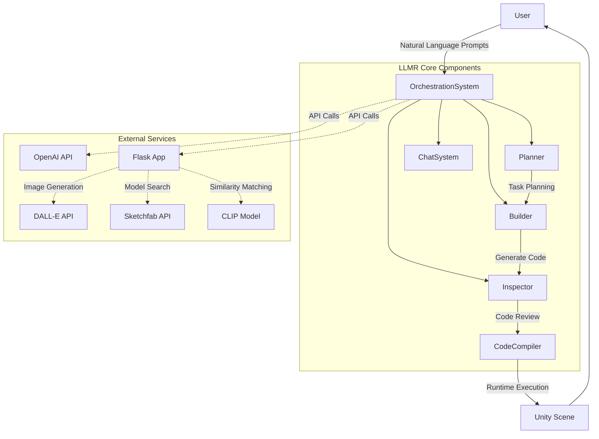
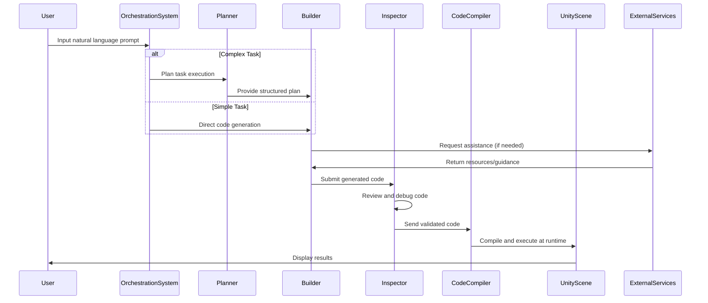
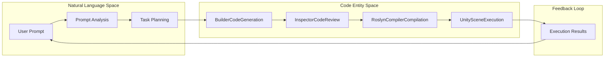
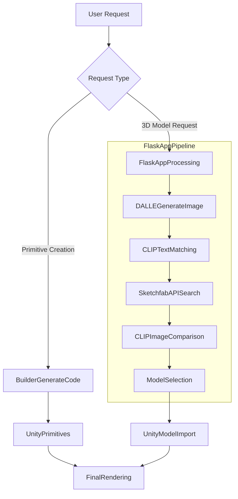

<!-- source: DeepWiki mcp.deepwiki.com · repo microsoft/LLMR · page 1 Overview · fetched 2026-10-26 -->

# Overview

Relevant source files

The following files were used as context for generating this wiki page:

- [README.md](README.md)
- [Transparency FAQ.md](Transparency FAQ.md)

The Large Language Model for Mixed Reality (LLMR) framework enables real-time creation and modification of interactive 3D environments within Unity using natural language prompts. This document introduces the framework's architecture, components, and capabilities, serving as an entry point to understand the system as a whole.

For instructions on setting up the environment, see [Getting Started](#1.2). For detailed architectural information, refer to [System Architecture](#2).

## Purpose and Capabilities

LLMR serves as a prototype for "Speaking the world into existence," allowing users to create and manipulate 3D content in real-time through natural language. The framework combines Large Language Models (LLMs) with a runtime compiler inside Unity, enabling spontaneous generation of dynamic content in 3D environments.

Key capabilities include:
- **Object Creation**: Generate objects using Unity primitives or models from online repositories
- **Behavior Programming**: Endow objects with properties and behaviors at runtime
- **Scene Editing**: Modify existing scenes dynamically
- **External Service Integration**: Leverage AI services like DALL-E and CLIP for enhanced capabilities

Sources: [README.md:5-15](), [Transparency FAQ.md:3-24]()

## High-Level System Architecture

Sources: [README.md:5-15](), [README.md:95-101](), [Transparency FAQ.md:3-10]()

## Processing Pipeline

Sources: [README.md:86-101](), [Transparency FAQ.md:27-39]()

## Framework Components

LLMR consists of several key components working together to process natural language requests and transform them into interactive 3D content:

| Component | Purpose | Key Functionality |
|-----------|---------|------------------|
| **Orchestration System** | Coordinates framework components | Manages communication flow between modules |
| **Planner** | Breaks down complex tasks | Analyzes prompts and creates execution strategies |
| **Builder** | Generates implementation code | Converts plans into executable C# code |
| **Inspector** | Reviews and refines code | Checks for errors and suggests improvements |
| **Code Compiler** | Processes generated code | Compiles C# at runtime using Roslyn compiler |
| **Flask Application** | Extends capabilities | Handles image generation and model retrieval |

For detailed information about each component, see [Core Modules](#4).

Sources: [README.md:95-101](), [Transparency FAQ.md:11-23]()

## Natural Language to Code Workflow

Sources: [README.md:89-94](), [Transparency FAQ.md:30-40]()

## External Integrations

LLMR integrates with several external services to enhance its capabilities:

1. **OpenAI API**: Powers the LLM functionality for code generation and planning
2. **DALL-E**: Generates reference images for 3D model matching
3. **CLIP**: Performs similarity matching between images and text
4. **Sketchfab API**: Provides access to a repository of 3D models

These integrations allow the system to create more complex and visually appealing content than would be possible with Unity primitives alone. For detailed information about these integrations, see [External Integrations](#3).

Sources: [README.md:102-127](), [Transparency FAQ.md:15-20]()

## Performance and Limitations

LLMR significantly improves the reliability of generating functioning interactive 3D content compared to standard code-writing LLMs. According to evaluations, it outperforms standard GPT-4 by 4x in average error rate. However, the framework has some limitations:

- Multiple LLM API calls lead to longer wait times and higher token costs
- Complex tasks may require decomposition through the Planner component
- Inherits biases and potential toxicity from the base LLM used

For more detailed information about performance metrics and evaluations, see [Technical Reference](#5).

Sources: [Transparency FAQ.md:32-52]()

## Use Cases

LLMR supports a variety of use cases, including:

1. **Object Creation**: "Create a rotating cube that changes color every second"
2. **Scene Building**: "Create a kitchen scene using primitives"
3. **Tool Creation**: "Make a timer that stops when countdown reaches zero"
4. **Accessibility Modifications**: "Change colors to be suitable for color-blind users"
5. **Complex Scene Generation**: "Create a farm with 2 cows and a horse"

The framework can be extended to support new capabilities through its modular architecture and Skill Library LLM module.

Sources: [README.md:10-14](), [README.md:86-94](), [Transparency FAQ.md:10-23]()

LLMR represents an innovative approach to natural language-driven content creation in 3D environments, combining large language models, image generation, visual understanding, and 3D model retrieval into a unified system.

---

