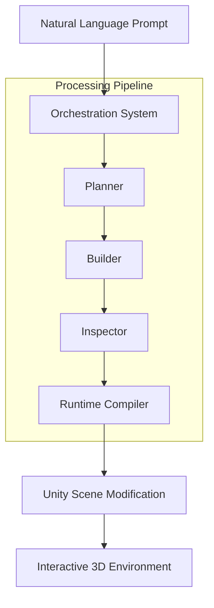
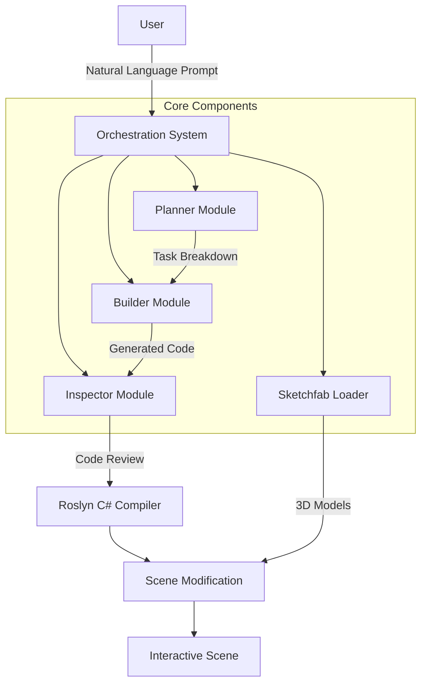
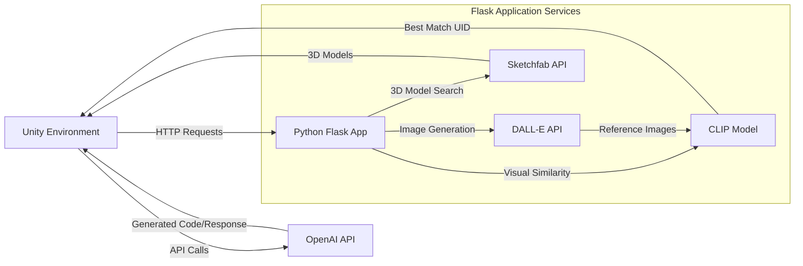
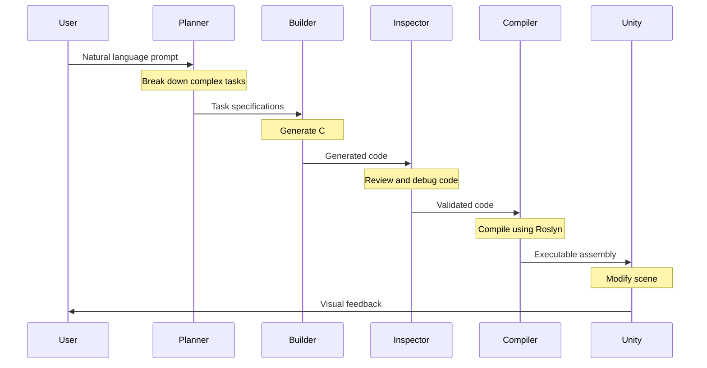
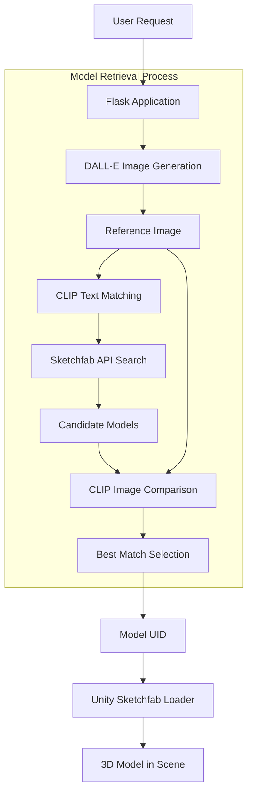

<!-- source: DeepWiki mcp.deepwiki.com · repo microsoft/LLMR · page 1.1 Key Concepts · fetched 2026-10-26 -->

# Key Concepts

Relevant source files

The following files were used as context for generating this wiki page:

- [README.md](README.md)
- [Transparency FAQ.md](Transparency FAQ.md)

This page explains the fundamental concepts, terminology, and components that form the backbone of the LLMR (Large Language Model for Mixed Reality) framework. Understanding these key concepts is essential for effectively working with the system and extending its capabilities. For information on setting up and running the system, see [Getting Started](#1.2).

## Core Framework Overview

LLMR is a framework that enables real-time creation and modification of interactive 3D environments in Unity using natural language prompts. It orchestrates various LLM modules to improve the reliability of generating functioning interactive 3D objects, tools, and scenes over standard code-writing LLMs.

The framework bridges the gap between natural language understanding and programmatic scene manipulation, allowing users to "speak the world into existence" through conversational prompts.

Sources: README.md:5-8, Transparency FAQ.md:3-7

## Key System Components

The LLMR framework consists of several interconnected modules, each with a specific role in transforming natural language into interactive 3D content:

### Orchestration System
The central coordinator that manages communication between different modules and maintains the overall state of the system. It routes user prompts to appropriate modules and orchestrates the entire processing pipeline.

### Planner Module
Analyzes complex user requests and breaks them down into manageable sub-tasks. For more involved requests, the Planner can expand on initially simple prompts to develop a comprehensive approach.

### Builder Module
Generates C# code based on the user's request (or the Planner's task breakdown). This module translates natural language descriptions into executable Unity code for creating or modifying 3D objects and behaviors.

### Inspector Module
Reviews the generated code, identifies potential issues, and suggests improvements. Works in tandem with debugging capabilities to ensure the code will run successfully.

### Runtime Compiler
Compiles the generated C# code at runtime using the Roslyn C# compiler, allowing for dynamic creation and modification of 3D content.

Sources: README.md:10-14, Transparency FAQ.md:9-23

## Interaction Patterns

LLMR supports several key interaction patterns for creating and modifying 3D content:

### Object Creation
Users can create objects using Unity primitives or retrieve models from external sources like Sketchfab. The system can generate simple geometric shapes with specified properties or find and import complex pre-made 3D models.

### Behavior Programming
Users can define interactive behaviors for objects through natural language. For example, creating a rotating cube that changes color every second or a timer that counts down and triggers an action when complete.

### Scene Editing
Users can modify existing scenes by changing object properties, relationships, or adding new elements. This enables runtime customization of environments for different purposes.

Sources: README.md:10-14, Transparency FAQ.md:15-23

## External Integrations

LLMR integrates with several external services to enhance its capabilities:

### OpenAI Integration
Provides access to large language models like GPT-4 for natural language understanding, code generation, and conversational capabilities.

### DALL-E and CLIP Integration
DALL-E generates reference images based on textual descriptions, while CLIP (Contrastive Language-Image Pre-training) compares these images with potential 3D models to find the best visual match.

### Sketchfab Integration
Enables searching and importing 3D models from Sketchfab's online repository based on textual and visual similarity to the user's request.

### Flask Application
A Python-based service that bridges Unity with DALL-E, CLIP, and Sketchfab, extending the system's capabilities beyond what's directly available in Unity.

Sources: README.md:54-77, README.md:102-127

## Natural Language to Code Pipeline

The transformation from natural language to functional 3D content involves several processing stages:

1. **Prompt Analysis**: The system interprets the user's natural language request, extracting key intentions and requirements.
   
2. **Task Planning**: For complex requests, the Planner breaks down the task into subtasks and develops a strategy for implementation.
   
3. **Code Generation**: The Builder translates the task specifications into executable C# code tailored for Unity.
   
4. **Code Review**: The Inspector analyzes the generated code for potential issues, ensuring it meets quality standards.
   
5. **Compilation**: The validated code is compiled at runtime using the Roslyn C# compiler.
   
6. **Scene Modification**: The compiled code is executed to create or modify objects in the Unity scene.
   
7. **Feedback Loop**: Users can iteratively refine their requests based on the results.

Sources: README.md:86-101, Transparency FAQ.md:30-40

## Model Retrieval System

For requests requiring complex 3D models, LLMR uses a sophisticated model retrieval system:

1. The system sends the user's description to a Flask application.
2. DALL-E generates a reference image based on the description.
3. CLIP performs text-based matching to find relevant models on Sketchfab.
4. Candidate models are compared to the reference image using CLIP for visual similarity.
5. The best matching model is identified and its UID is returned to Unity.
6. Unity downloads and imports the model into the scene.

Sources: README.md:102-127

## Technical Foundation

LLMR is built on several key technical capabilities:

### Runtime Code Generation and Compilation
The framework leverages the Roslyn C# compiler to dynamically generate, compile, and execute C# code at runtime, enabling on-the-fly creation of new behaviors and interactions.

### Assembly Management
Preloaded assembly DLLs are used to support the runtime compilation of code generated by LLMs. These assemblies provide the necessary references for the compiled code to function properly within Unity.

### Memory and Context Management
The system maintains context across multiple user interactions, allowing for iterative refinement and building upon previous creations or modifications.

Sources: README.md:16-33, Transparency FAQ.md:30-40

## System Limitations and Considerations

Understanding the limitations of LLMR is important for effective usage:

### Complexity Limitations
More complex tasks may require breaking down into simpler subtasks using the Planner component.

### Performance Considerations
Enhanced reliability comes at the cost of multiple LLM API calls, leading to longer wait times and higher token costs. This can be managed by limiting the number of correction iterations.

### Code Safety
By default, LLMR limits which C# namespaces are available for runtime compilation to prevent unsafe code execution.

Sources: Transparency FAQ.md:43-57

## Terminology Reference

| Term | Definition |
|------|------------|
| **LLMR** | Large Language Model for Mixed Reality - The overall framework for creating and modifying 3D content using natural language. |
| **LLM** | Large Language Model - AI models like GPT-4 that understand and generate human language. |
| **Orchestration** | The coordination system that manages the various components of LLMR. |
| **Planner** | Component that breaks down complex tasks into manageable subtasks. |
| **Builder** | Component responsible for generating C# code based on user requests. |
| **Inspector** | Component that reviews and validates generated code. |
| **CLIP** | Contrastive Language-Image Pre-training - Model that connects text and images for similarity matching. |
| **DALL-E** | AI system that creates images from textual descriptions. |

Sources: README.md:5-8, Transparency FAQ.md:3-7

---

