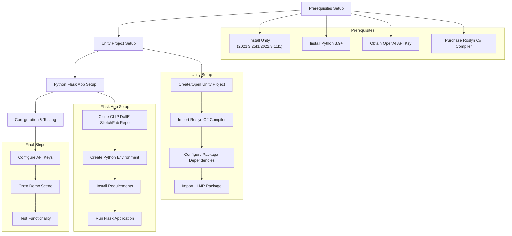
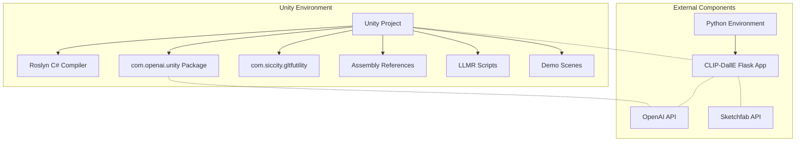
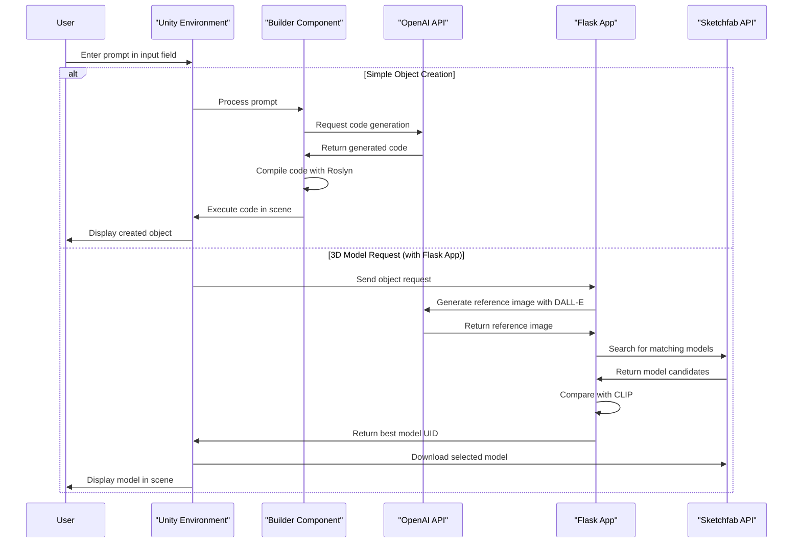

<!-- source: DeepWiki mcp.deepwiki.com · repo microsoft/LLMR · page 1.2 Getting Started · fetched 2026-10-26 -->

# Getting Started

<details>
<summary>Relevant source files</summary>

The following files were used as context for generating this wiki page:

- [.gitignore](.gitignore)
- [Packages/manifest.json](Packages/manifest.json)
- [Packages/packages-lock.json](Packages/packages-lock.json)
- [ProjectSettings/Packages/com.unity.testtools.codecoverage/Settings.json](ProjectSettings/Packages/com.unity.testtools.codecoverage/Settings.json)
- [README.md](README.md)
- [SUPPORT.md](SUPPORT.md)

</details>


This guide provides step-by-step instructions for setting up and running the LLMR (Large Language Model for Mixed Reality) framework in your environment. LLMR enables the real-time creation of objects, tools, and scenes in Unity through natural language prompts. For a conceptual overview of the system, see [Overview](#1) and [Key Concepts](#1.1).

## Prerequisites

Before beginning installation, ensure you have the following:

- Unity (versions 2021.3.25f1 or 2022.3.11f1 recommended)
- Python 3.9 or higher (for CLIP-DallE integration)
- OpenAI API key (for GPT and DALL-E services)
- Roslyn C# Compiler package from Unity Asset Store

Sources: [README.md:16-22]()

## Installation Flow

The following diagram illustrates the high-level installation process:



Sources: [README.md:16-76]()

## Setting Up Unity Project

### Creating a New Project

1. Launch Unity Hub and create a new project using Unity version 2021.3.25f1 or 2022.3.11f1.
2. Purchase and import the [Roslyn C# Runtime Compiler](https://assetstore.unity.com/packages/tools/integration/roslyn-c-runtime-compiler-142753) from the Unity Asset Store.

### Adding Required Packages

Add the required packages by editing the `manifest.json` file in the Packages folder:

1. Open your project's `Packages/manifest.json` file
2. Add the following dependencies:
   ```json
   "com.siccity.gltfutility": "https://github.com/siccity/gltfutility.git",
   "com.openai.unity": "4.3.0",
   ```
3. Add the scoped registries:
   ```json
   "scopedRegistries": [
     {
       "name": "OpenUPM",
       "url": "https://package.openupm.com",
       "scopes": [
         "com.openai",
         "com.utilities",
         "com.atteneder"
       ]
     }
   ]
   ```

### Assembly References Setup

1. Copy the Assemblies folder to the root directory of your Unity project (same level as the Assets folder)
2. Create Assembly Reference Assets using the Trivial Interactive package

Sources: [README.md:16-33](), [Packages/manifest.json:1-54]()

## Component Architecture During Setup

The following diagram shows the components and how they relate during the setup process:



Sources: [README.md:16-76](), [Packages/manifest.json:1-54](), [Packages/packages-lock.json:3-24]()

## Setting Up Python Flask App

The Flask app is required for DALL-E image generation and CLIP-based model matching functionality.

1. Clone the CLIP-DallE-SketchFab repository:
   ```
   git clone https://github.com/delamarifer/CLIP-DallE-SketchFab-001.git
   ```
   
2. Create and activate a Python virtual environment:
   ```
   cd CLIP-DallE-SketchFab-001
   python -m venv .venv
   source .venv/bin/activate  # On Windows, use .venv\Scripts\activate
   ```
   
3. Install the required packages:
   ```
   pip install -r requirements.txt
   ```
   
4. Start the Flask application:
   ```
   flask run
   ```

The Flask server will run on `localhost:5000` by default.

Sources: [README.md:54-76]()

## Demo Scenes and Basic Usage

### Empty Playground Scene

1. Open the `Playground_new` scene
2. In the Game window, use the input field at the bottom
3. Type your natural language instruction (e.g., "create a rotating cube that changes color every second")
4. Press **Tab** to send the request to GPT for processing
5. Wait for the message "Processing finished. Please enter the next request."
6. For more complex requests, use the Planner by pressing **Right Control** instead of Tab

### DALL-E & CLIP Integration Scene

1. Ensure the Flask app is running
2. Open the `Playground_DallE-CLIP_Refinement` scene
3. Use the input field to request objects (e.g., "a bowl", "a fork")
4. The system will use DALL-E to generate a reference image and find the closest matching 3D model from Sketchfab

Sources: [README.md:85-112]()

## Interaction Flow

This diagram illustrates the typical interaction flow when using the LLMR system:



Sources: [README.md:85-112]()

## Troubleshooting Common Issues

| Issue | Possible Cause | Solution |
|-------|---------------|----------|
| Missing assembly reference errors | DLL files not properly registered | Ensure Assembly References are correctly created in Unity |
| Cannot connect to Flask app | Flask server not running | Check if Flask app is running at localhost:5000 |
| DALL-E image generation fails | OpenAI API key issues | Verify your OpenAI API key is valid and has sufficient credits |
| Compilation errors in generated code | Incompatible code generation | Try rephrasing your prompt or use the Planner for more complex requests |
| Models not downloading from Sketchfab | Network issues or API limitations | Check your internet connection and Sketchfab API access |

Sources: [README.md:129-132]()

## Next Steps

After successfully setting up and running the LLMR system, you can:

- Explore the [System Architecture](#2) to understand how the components work together
- Learn about the [Core Modules](#4) that make up the LLMR system
- Understand how LLMR integrates with [External Services](#3)
- View the [Technical Reference](#5) for more detailed information

For issues not covered in this guide, refer to the [Troubleshooting](#6.2) section.

---

