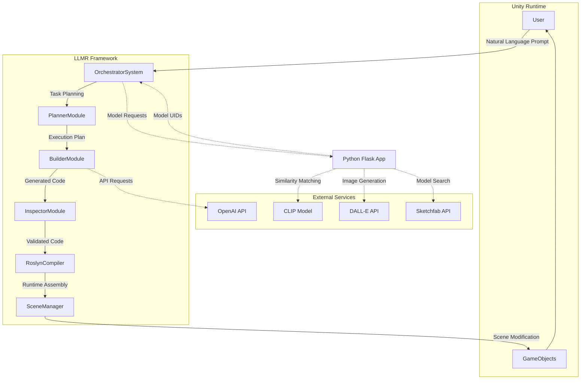
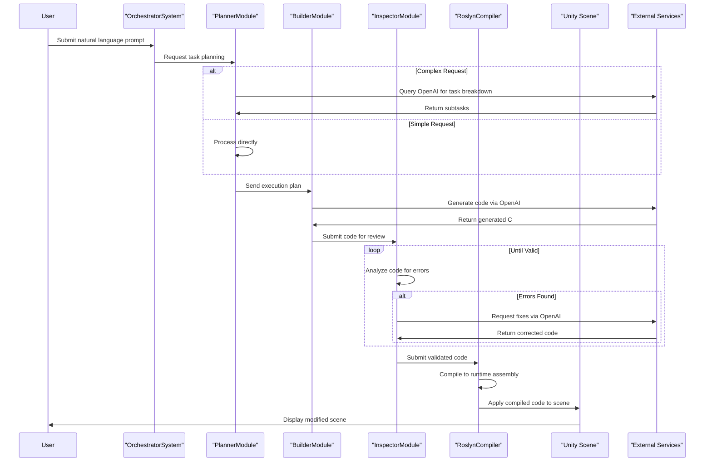
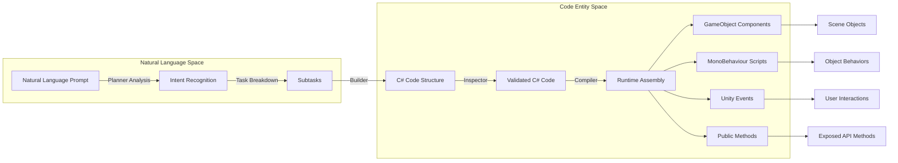
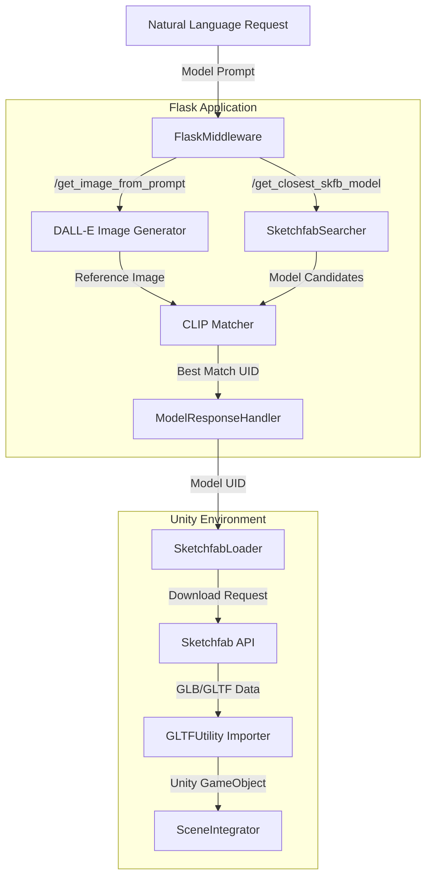
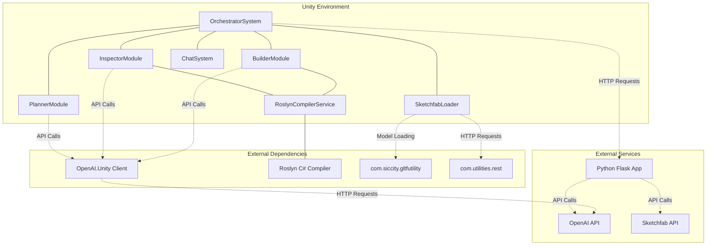
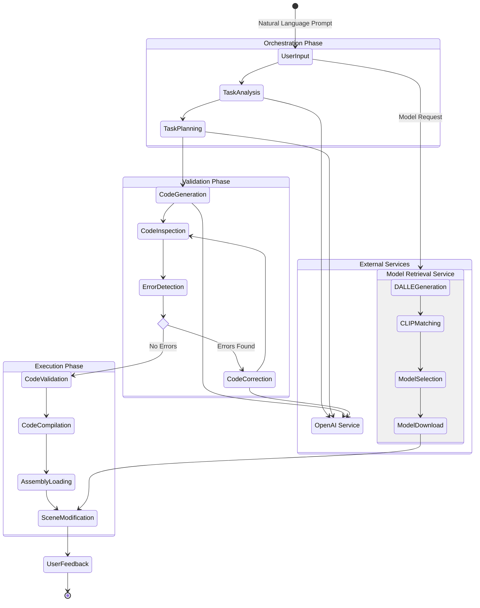

<!-- source: DeepWiki mcp.deepwiki.com · repo microsoft/LLMR · page 2 System Architecture · fetched 2026-10-26 -->

# System Architecture

Relevant source files

The following files were used as context for generating this wiki page:

- [README.md](README.md)
- [Transparency FAQ.md](Transparency FAQ.md)

## Purpose and Scope

This document provides a comprehensive overview of the LLMR (Large Language Model for Mixed Reality) system architecture. It details the core components, their interactions, and the processing pipeline that enables real-time creation and modification of interactive 3D environments through natural language prompts. 

For specific details about the Orchestration System that coordinates these components, see [Orchestration System](#2.1). For information on how natural language prompts are processed, see [Natural Language Processing](#2.2). For details on code generation and runtime compilation, see [Code Generation and Compilation](#2.3).

## Core Architecture Overview

LLMR implements a modular architecture that transforms natural language prompts into interactive 3D content within Unity. The framework orchestrates multiple AI components to generate, review, and execute code at runtime, creating objects with visual, behavioral, and interactive elements.

Sources: [README.md:5-15](), [Transparency FAQ.md:3-24]()

## System Components

LLMR consists of several interconnected components that work together to process natural language inputs and generate interactive 3D content.

| Component | Description | Primary Responsibility |
|-----------|-------------|------------------------|
| Orchestrator | Central coordination system | Manages workflow between components |
| Planner | Task planning module | Breaks complex requests into manageable subtasks |
| Builder | Code generation module | Transforms plans into executable C# code |
| Inspector | Code review module | Validates and fixes errors in generated code |
| RoslynCompiler | Runtime C# compiler | Compiles generated code into executable assemblies |
| Flask Application | Python-based service | Provides image generation and 3D model retrieval |
| Chat System | User interaction interface | Handles user input and displays system responses |

Sources: [README.md:8-14](), [Transparency FAQ.md:11-23]()

## Processing Pipeline

The LLMR system follows a multi-stage processing pipeline to transform natural language prompts into interactive 3D content.

Sources: [README.md:89-98](), [Transparency FAQ.md:30-39]()

## Natural Language to Code Entity Transformation

This diagram illustrates how natural language prompts are transformed into Unity code entities through LLMR's processing pipeline.

Sources: [README.md:10-14]()

## Model Retrieval System

The Model Retrieval System bridges natural language requests to 3D model entities through DALL-E image generation and CLIP-based matching.

Sources: [README.md:104-127]()

## Component Integration

The following diagram illustrates how the primary components of LLMR integrate with Unity and external services.

Sources: [README.md:18-34]()

## Development Environment

LLMR requires a specific development environment setup to function properly.

| Requirement | Description | Purpose |
|-------------|-------------|---------|
| Unity 2021.3.25f1+ | Game engine | Core platform for the framework |
| Roslyn C# Compiler | Runtime compiler | Enables dynamic code compilation |
| Assembly DLLs | Pre-loaded assemblies | Provides necessary references for compiled code |
| OpenAI API Key | Authentication | Access to OpenAI services |
| Python 3.9+ | Programming language | Required for Flask application |
| Flask | Web framework | Provides API endpoints for DALL-E and CLIP integration |

Sources: [README.md:17-34](), [README.md:54-81]()

## Subsystem Interactions

This section details the interactions between the core subsystems of LLMR.

### Planner-Builder Interaction

The Planner breaks down complex user requests into executable plans that the Builder can transform into code.

1. User submits natural language prompt
2. Orchestrator routes prompt to Planner
3. Planner analyzes prompt complexity
4. For complex requests, Planner breaks down into subtasks
5. Builder receives execution plan with context and constraints
6. Builder transforms plan into executable C# code

### Builder-Inspector Interaction

The Builder generates C# code that is reviewed and corrected by the Inspector.

1. Builder sends generated code to Inspector
2. Inspector analyzes code for compilation and runtime errors
3. If errors found, Inspector requests corrections
4. Code validation continues until all errors are fixed
5. Validated code is sent to compiler

### External Service Integration

LLMR integrates with multiple external services to extend its capabilities.

1. OpenAI API provides natural language processing and code generation
2. DALL-E API generates reference images for 3D models
3. CLIP performs visual similarity matching
4. Sketchfab API provides access to 3D model repository
5. Flask application bridges Unity with Python-based AI services

Sources: [README.md:104-127](), [Transparency FAQ.md:11-23]()

## Execution Flow

The following diagram illustrates the complete execution flow from user input to scene modification.

Sources: [README.md:88-101](), [Transparency FAQ.md:32-39]()

## Performance Considerations

LLMR's performance is affected by several factors that should be considered during implementation and use.

| Factor | Impact | Mitigation |
|--------|--------|------------|
| Multiple LLM API Calls | Longer wait times and higher token costs | Limit Inspector correction iterations |
| Complex Tasks | Lower success rate | Use Planner to break down into simpler tasks |
| Runtime Compilation | Performance overhead | Optimize code generation for efficiency |
| External Service Latency | Processing delays | Implement caching for frequent operations |
| 3D Model Complexity | Memory usage and rendering performance | Optimize downloaded models as needed |

Sources: [Transparency FAQ.md:43-57]()

## Security and Limitations

LLMR implements security measures and has certain limitations that should be understood.

1. C# namespace restrictions limit what code can be compiled at runtime
2. Inherited biases and potential toxic outputs from base LLMs
3. Limited to functionality available in the Unity environment
4. Dependency on external services and APIs
5. Performance constraints due to multiple API calls

Sources: [Transparency FAQ.md:43-57]()

---

