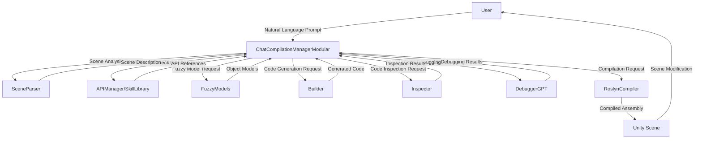
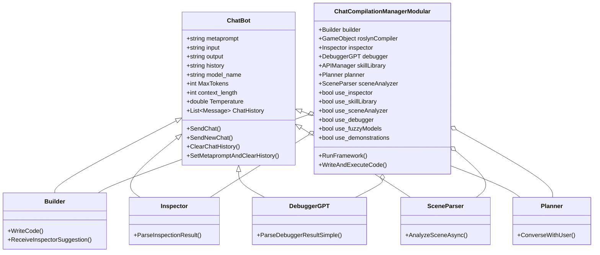
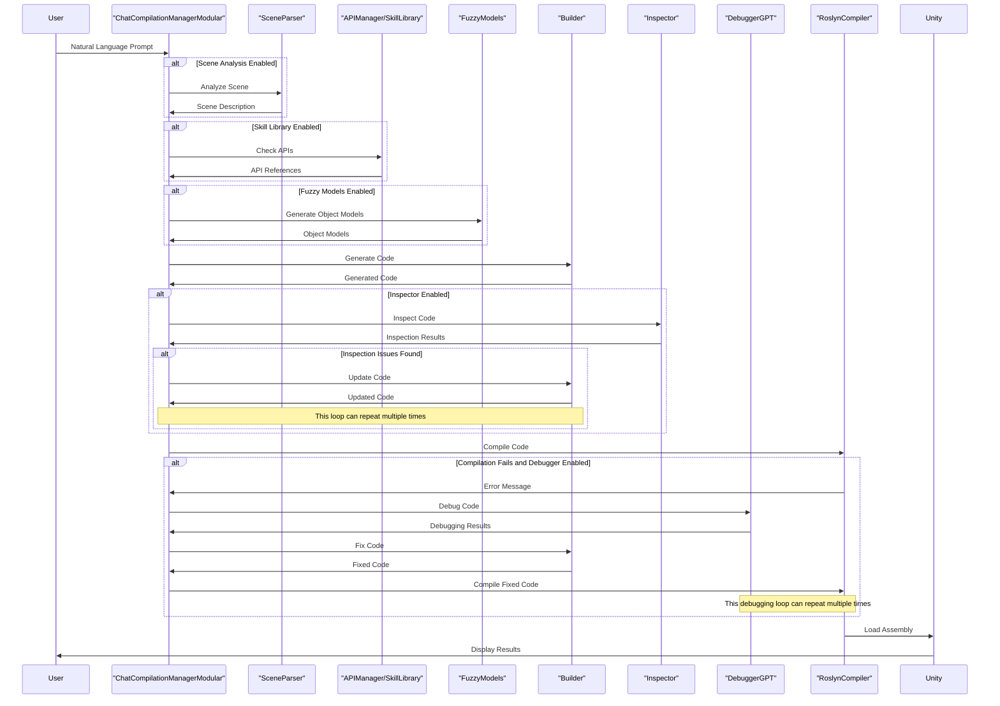
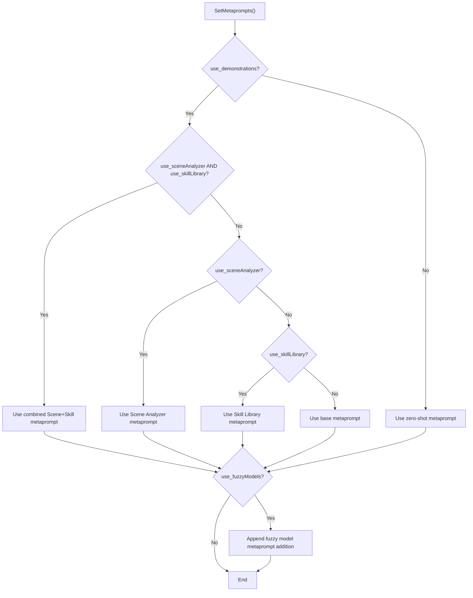

<!-- source: DeepWiki mcp.deepwiki.com · repo microsoft/LLMR · page 2.1 Orchestration System · fetched 2026-10-26 -->

# Orchestration System

Relevant source files

The following files were used as context for generating this wiki page:

- [Assets/Scripts/MR_Copilot/ChatCompilationManagerModular.cs](Assets/Scripts/MR_Copilot/ChatCompilationManagerModular.cs)
- [Assets/Scripts/MR_Copilot/Orchestration/ChatBot.cs](Assets/Scripts/MR_Copilot/Orchestration/ChatBot.cs)
- [Assets/Scripts/MR_Copilot/Orchestration/ChatTest.cs](Assets/Scripts/MR_Copilot/Orchestration/ChatTest.cs)

## Purpose and Scope

The Orchestration System is the central coordination mechanism of the LLMR framework. It manages the workflow between different components to process natural language prompts, generate code, and execute it in the Unity environment. This document explains how the orchestration system coordinates various modules to enable the transformation of natural language instructions into functional Unity code.

For information on Natural Language Processing specifically, see [Natural Language Processing](#2.2). For details on Code Generation and Compilation, see [Code Generation and Compilation](#2.3).

## System Architecture

The Orchestration System follows a modular architecture where different components handle specific tasks in the processing pipeline. The main orchestrator, `ChatCompilationManagerModular`, coordinates these components, many of which inherit from the `ChatBot` base class which provides LLM communication capabilities.

### Component Interaction Diagram

Sources: [Assets/Scripts/MR_Copilot/ChatCompilationManagerModular.cs:1-474]()

### Class Hierarchy

Sources: [Assets/Scripts/MR_Copilot/Orchestration/ChatBot.cs:1-324](), [Assets/Scripts/MR_Copilot/ChatCompilationManagerModular.cs:14-35]()

## Processing Pipeline

The Orchestration System follows a sequential processing pipeline to handle user prompts and execute appropriate actions.

### Request Processing Workflow

Sources: [Assets/Scripts/MR_Copilot/ChatCompilationManagerModular.cs:78-133](), [Assets/Scripts/MR_Copilot/ChatCompilationManagerModular.cs:194-214]()

## Key Components

### ChatCompilationManagerModular

The main orchestration component that coordinates all other modules in the LLMR framework. This class is responsible for:

1. Receiving user inputs
2. Deciding which components to engage based on configuration
3. Passing information between components
4. Managing the execution flow from input to code generation to compilation
5. Handling errors and redirecting to appropriate components

Key methods:
- `RunFramework()`: Initiates the processing pipeline
- `WriteAndExecuteCode()`: Coordinates code generation, inspection, debugging, and compilation
- `RunSA()`, `RunSkillLibrary()`, `RunFuzzyModels()`: Context-gathering methods
- `RunBuilder()`, `RunInspector()`, `RunDebugger()`: Code generation and validation methods
- `Compile()`: Triggers code compilation

Sources: [Assets/Scripts/MR_Copilot/ChatCompilationManagerModular.cs:11-21](), [Assets/Scripts/MR_Copilot/ChatCompilationManagerModular.cs:78-133]()

### ChatBot

A base class for chat-based interactions with large language models. It provides core functionality for:

1. Managing communication with language models
2. Handling chat history
3. Token management and context window optimization
4. Error handling and retries for API calls

Key methods:
- `SendChat()`: Sends a request to the language model
- `SendNewChat()`: Clears history and sends a new request
- `ClearChatHistory()`, `ClearChatMemory()`: Memory management methods
- `SetMetapromptAndClearHistory()`: Configures system prompts

Sources: [Assets/Scripts/MR_Copilot/Orchestration/ChatBot.cs:18-34](), [Assets/Scripts/MR_Copilot/Orchestration/ChatBot.cs:91-177]()

## Configuration and Extensibility

The Orchestration System is highly configurable through boolean flags that enable or disable specific components:

| Configuration Option | Description |
|----------------------|-------------|
| `use_inspector` | Enables code inspection to validate generated code |
| `use_skillLibrary` | Enables API reference lookup for code generation |
| `use_sceneAnalyzer` | Enables analysis of the current Unity scene |
| `use_debugger` | Enables automatic debugging of compilation errors |
| `use_fuzzyModels` | Enables generation of abstract object models |
| `use_demonstrations` | Enables example-based prompting for better code generation |

Sources: [Assets/Scripts/MR_Copilot/ChatCompilationManagerModular.cs:29-36](), [Assets/Scripts/MR_Copilot/ChatCompilationManagerModular.cs:460-473]()

## Metaprompt Management

The system uses different metaprompts (system prompts) based on which components are enabled:

Sources: [Assets/Scripts/MR_Copilot/ChatCompilationManagerModular.cs:294-333]()

## Memory Management

The ChatBot base class provides token and memory management strategies to prevent exceeding the language model's context limit:

| Memory Management Strategy | Description |
|----------------------------|-------------|
| `None` | No automatic management; throws error if context is exceeded |
| `FIFO` (First In, First Out) | Removes oldest conversation pairs until enough space is available |
| `Full_Reset` | Clears all chat history except the system prompt |

This allows the system to maintain long conversations without running into token limits.

Sources: [Assets/Scripts/MR_Copilot/Orchestration/ChatBot.cs:57-63](), [Assets/Scripts/MR_Copilot/Orchestration/ChatBot.cs:214-231]()

## Error Handling

The Orchestration System implements comprehensive error handling:

1. **Compilation Error Capture**: Captures Unity error logs and provides them to the debugging component
2. **Retry Mechanisms**: Multiple attempts for debugging and code generation
3. **Rate Limit Handling**: Automatic retry with backoff for API rate limits
4. **Error Aggregation**: Concatenates multiple errors for better context in debugging

Sources: [Assets/Scripts/MR_Copilot/ChatCompilationManagerModular.cs:387-421](), [Assets/Scripts/MR_Copilot/ChatCompilationManagerModular.cs:430-453](), [Assets/Scripts/MR_Copilot/Orchestration/ChatBot.cs:137-176]()

## Integration with External Services

The Orchestration System integrates with external services primarily through the ChatBot base class:

1. **OpenAI API**: For accessing GPT models
2. **Token Management**: Uses TikToken library to count tokens and manage context window
3. **Unity Integration**: Compiles and executes code in the Unity runtime environment

Sources: [Assets/Scripts/MR_Copilot/Orchestration/ChatBot.cs:123-176]()

## Conclusion

The Orchestration System serves as the backbone of the LLMR framework, coordinating the complex process of translating natural language prompts into executable Unity code. By managing the flow between specialized components, it enables a seamless user experience where mixed reality environments can be created and modified through natural language.

---

