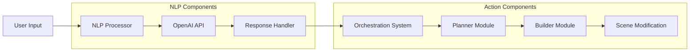
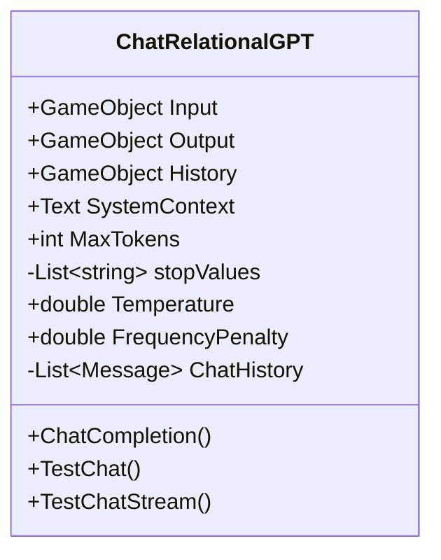
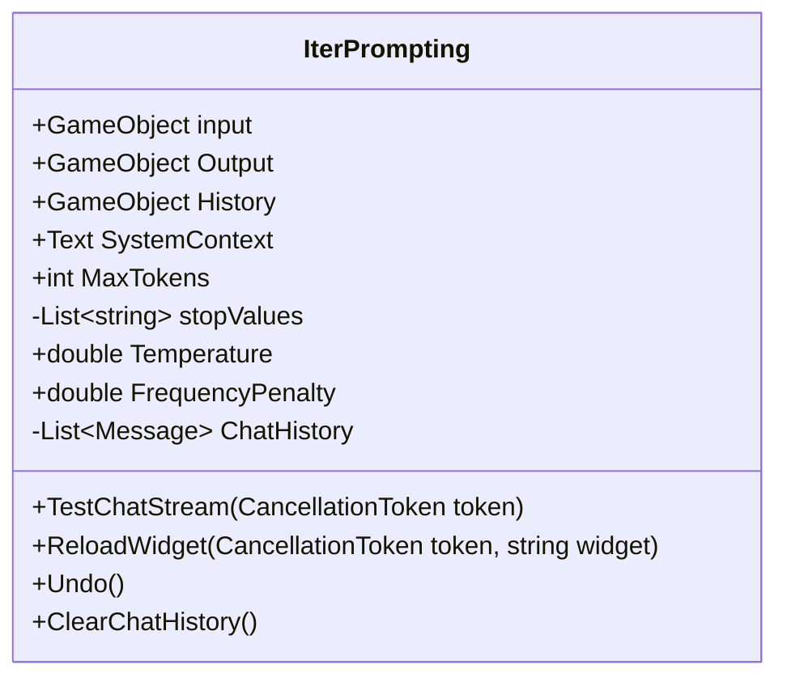
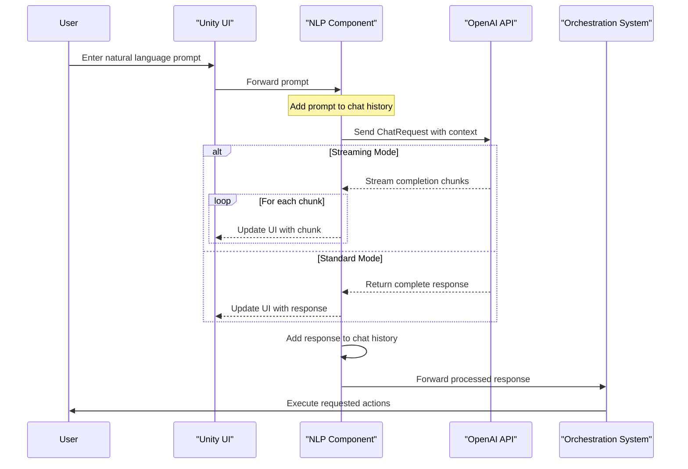
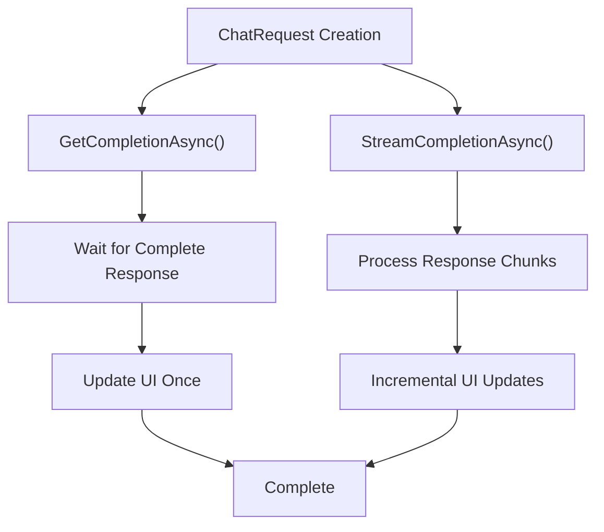
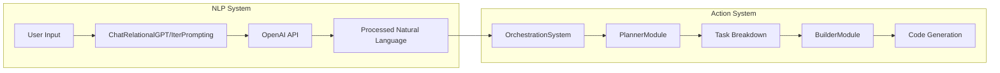

<!-- source: DeepWiki mcp.deepwiki.com · repo microsoft/LLMR · page 2.2 Natural Language Processing · fetched 2026-10-26 -->

# Natural Language Processing

<details>
<summary>Relevant source files</summary>

The following files were used as context for generating this wiki page:

- [Assets/Scripts/MR_Copilot/ChatRelationalGPT.cs](Assets/Scripts/MR_Copilot/ChatRelationalGPT.cs)
- [Assets/Scripts/MR_Copilot/IterPrompting.cs](Assets/Scripts/MR_Copilot/IterPrompting.cs)

</details>


## Purpose and Scope

This document describes how the LLMR system processes and interprets natural language prompts from users. It covers the components responsible for handling communication with large language models (primarily OpenAI's GPT-4), maintaining conversation context, and facilitating the translation of natural language into actionable plans and code. For information about how the system turns these processed prompts into executable code, see [Code Generation and Compilation](#2.3).

## NLP Pipeline Overview

The LLMR system employs a straightforward but effective natural language processing pipeline that bridges user inputs to executable actions in the Unity environment.



Sources: [Assets/Scripts/MR_Copilot/ChatRelationalGPT.cs](), [Assets/Scripts/MR_Copilot/IterPrompting.cs]()

## Core NLP Components

The natural language processing functionality is primarily implemented through two key classes that handle different aspects of LLM interaction:

### ChatRelationalGPT

The `ChatRelationalGPT` class provides the foundation for managing conversations with OpenAI's GPT models. It maintains a chat history, formats messages according to OpenAI's requirements, and handles both synchronous and streaming completions.

Key features:
- Maintains conversation context through chat history
- Supports both single-response and streaming completion modes
- Configurable temperature and token limits
- UI integration for displaying responses



Sources: [Assets/Scripts/MR_Copilot/ChatRelationalGPT.cs:11-134]()

### IterPrompting

The `IterPrompting` class extends the basic chat functionality with support for iterative prompting workflows. It provides additional features for managing longer conversations and handling interruptions.

Key features:
- Supports cancellation tokens for interrupting API calls
- Provides undo functionality to remove the most recent prompt and response
- Allows clearing the entire chat history
- Widget reloading functionality for UI elements



Sources: [Assets/Scripts/MR_Copilot/IterPrompting.cs:13-143]()

## Message Processing Flow

The following diagram illustrates the detailed flow of messages through the NLP components:



Sources: [Assets/Scripts/MR_Copilot/ChatRelationalGPT.cs:56-111](), [Assets/Scripts/MR_Copilot/IterPrompting.cs:44-106]()

## Technical Implementation Details

### Chat History Management

Both NLP components maintain a structured conversation history using OpenAI's Message format, with roles (System, User, Assistant) to distinguish between different message types:

```
List<Message> ChatHistory = new List<Message>();
ChatHistory.Add(new Message(Role.System, SystemContext.text)); // System prompt initialization
```

This approach ensures that each conversation maintains appropriate context over time, allowing the language model to understand user requests in relation to previous interactions.

Sources: [Assets/Scripts/MR_Copilot/ChatRelationalGPT.cs:28-38](), [Assets/Scripts/MR_Copilot/IterPrompting.cs:30-38]()

### API Configuration and Parameters

The NLP components provide configurable parameters for model interaction:

| Parameter | Purpose | Default |
|-----------|---------|---------|
| MaxTokens | Maximum response length | 512 |
| Temperature | Controls response randomness | 0.7 |
| FrequencyPenalty | Reduces repetition | 0 |
| Model | Language model to use | GPT-4 |

These parameters allow fine-tuning the model's behavior for different types of interactions.

Sources: [Assets/Scripts/MR_Copilot/ChatRelationalGPT.cs:19-26](), [Assets/Scripts/MR_Copilot/IterPrompting.cs:21-28]()

### Streaming vs. Standard Completion

The system supports two modes of interaction with the OpenAI API:

1. **Standard Completion** (`TestChat` method)
   - Sends a request and waits for the complete response
   - Simpler implementation but less responsive for long outputs

2. **Streaming Completion** (`TestChatStream` method)
   - Receives and processes response chunks as they become available
   - Provides better user experience for longer responses
   - Supports cancellation for interrupting ongoing requests



Sources: [Assets/Scripts/MR_Copilot/ChatRelationalGPT.cs:56-78](), [Assets/Scripts/MR_Copilot/ChatRelationalGPT.cs:80-111](), [Assets/Scripts/MR_Copilot/IterPrompting.cs:44-74]()

### Error Handling and Cancellation

The `IterPrompting` class implements cancellation support for streaming API calls:

```
await api.ChatEndpoint.StreamCompletionAsync(chatRequest, result =>
{
    // Process result
    token.ThrowIfCancellationRequested(); // Check for cancellation
},
token // Pass the cancellation token
);
```

This allows for gracefully interrupting an ongoing API call when needed, such as when the user wants to cancel a request or change their prompt.

Sources: [Assets/Scripts/MR_Copilot/IterPrompting.cs:58-67]()

## Integration with Other System Components

The NLP components serve as the bridge between user intent and system action. While they don't directly implement planning or building functionality, they provide the processed natural language that drives these components.



This integration ensures that user intentions expressed in natural language are correctly transformed into specific actions in the Unity environment.

Sources: [Assets/Scripts/MR_Copilot/ChatRelationalGPT.cs](), [Assets/Scripts/MR_Copilot/IterPrompting.cs]()

## Summary

The Natural Language Processing component of LLMR provides a robust foundation for translating user intent into system actions. By leveraging OpenAI's GPT models and implementing features like conversation history, streaming responses, and cancellation support, the system delivers a responsive and contextually aware interface for interacting with the mixed reality environment.

---

