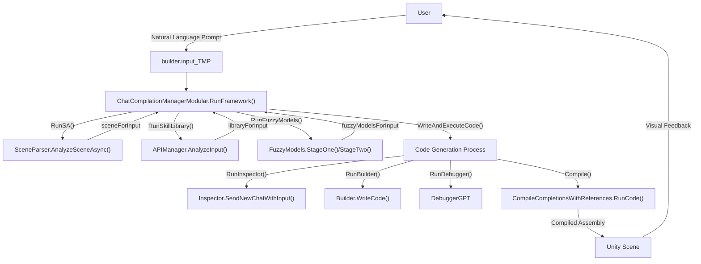
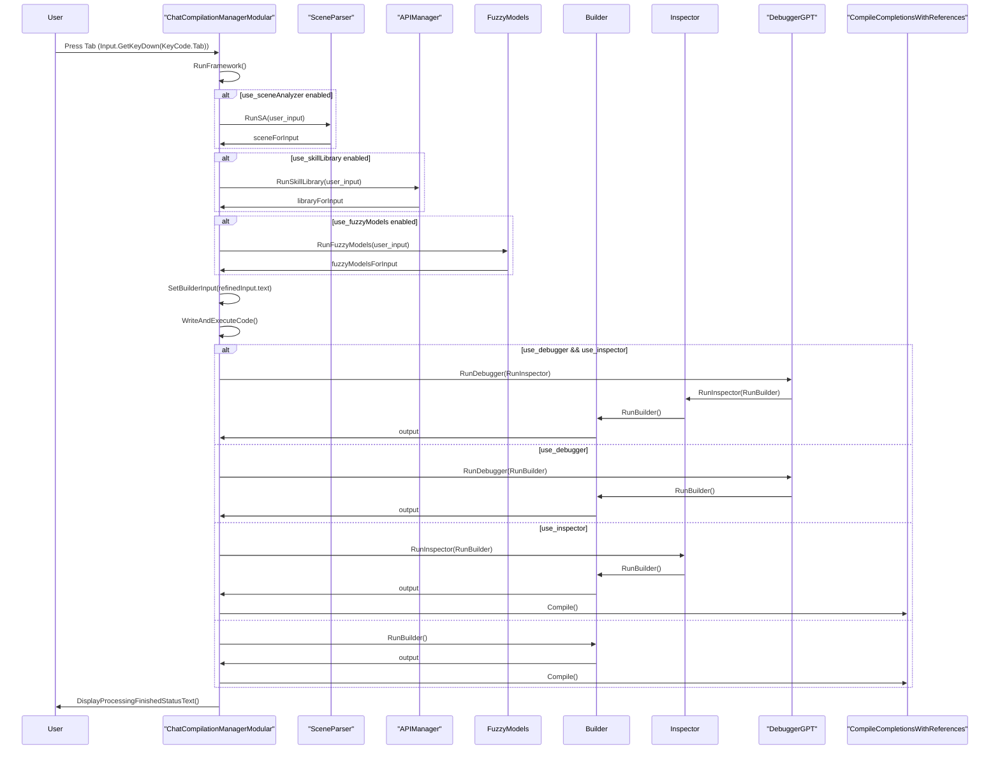
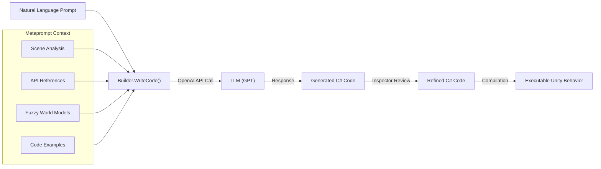
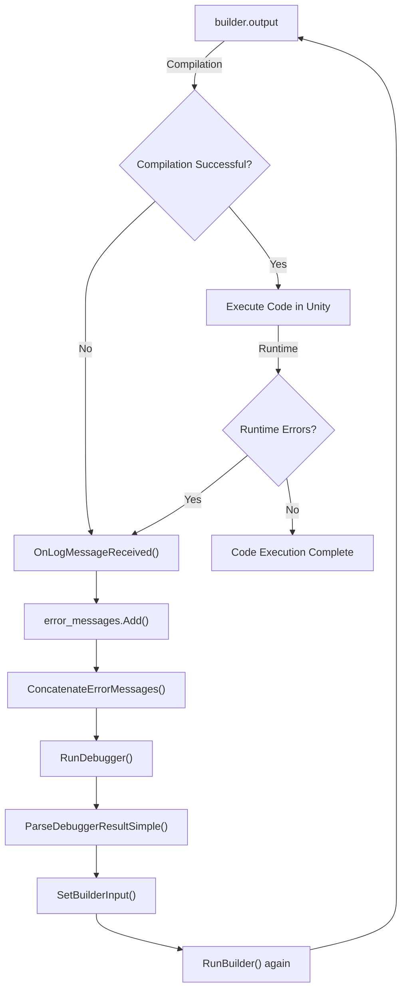

<!-- source: DeepWiki mcp.deepwiki.com · repo microsoft/LLMR · page 2.3 Code Generation and Compilation · fetched 2026-10-26 -->

# Code Generation and Compilation

<details>
<summary>Relevant source files</summary>

The following files were used as context for generating this wiki page:

- [Assets/Scripts/MR_Copilot/ChatCompilationManagerModular.cs](Assets/Scripts/MR_Copilot/ChatCompilationManagerModular.cs)
- [README.md](README.md)

</details>


## Introduction

The code generation and compilation system is a core component of the LLMR framework that enables the translation of natural language prompts into executable C# code within Unity at runtime. This system allows users to create and modify 3D objects, behaviors, and entire scenes through natural language descriptions without requiring any coding knowledge. For information about how natural language is initially processed before code generation begins, see [Natural Language Processing](#2.2).

## System Architecture

The code generation and compilation pipeline consists of several interconnected components orchestrated by the `ChatCompilationManagerModular` class, which transforms natural language prompts into executable Unity code.

### System Components Diagram



Sources: [Assets/Scripts/MR_Copilot/ChatCompilationManagerModular.cs:11-36]()

The key components of the system include:

- **Builder**: Generates C# code based on the user's natural language prompt using OpenAI's LLMs
- **Inspector**: Reviews the generated code for potential issues before compilation
- **DebuggerGPT**: Handles errors that occur during compilation or execution
- **Roslyn Compiler**: Compiles the generated C# code at runtime using the `CompileCompletionsWithReferences` component
- **Scene Analyzer**: Provides context about the current Unity scene
- **Skill Library**: Provides access to relevant APIs and functions
- **Fuzzy Models**: Provides additional world models for objects

## Code Generation Process

The code generation process is initiated when a user enters a natural language prompt and presses Tab, which triggers the `RunFramework` method in `ChatCompilationManagerModular`.

### Code Generation Flow



Sources: [Assets/Scripts/MR_Copilot/ChatCompilationManagerModular.cs:78-133](), [Assets/Scripts/MR_Copilot/ChatCompilationManagerModular.cs:50-71]()

The process involves these key steps:

1. **Context Generation**: Depending on enabled components, the system gathers context:
   - If `use_sceneAnalyzer` is enabled, `RunSA` analyzes the current scene
   - If `use_skillLibrary` is enabled, `RunSkillLibrary` gathers relevant APIs
   - If `use_fuzzyModels` is enabled, `RunFuzzyModels` generates world models

2. **Builder Input Preparation**: The `SetBuilderInput` method combines the user input with the generated context.

3. **Code Generation and Inspection**: The `WriteAndExecuteCode` method orchestrates this process:
   - `RunBuilder` generates initial code using the Builder component
   - If enabled, `RunInspector` reviews the code for potential issues
   - If enabled, `RunDebugger` handles any compilation or runtime errors

4. **Compilation**: The `Compile` method invokes the Roslyn compiler to compile the generated code.

## LLM Prompt to Code Translation

A critical part of the process is the translation from natural language to executable code. This is handled by the Builder component which uses metaprompts and context to guide the language model.



Sources: [Assets/Scripts/MR_Copilot/ChatCompilationManagerModular.cs:294-332]()

The system uses different metaprompts depending on which components are enabled:
- Basic metaprompt (`builder_Base_metaprompt` or `builder_zero_shot_metaprompt`)
- Scene-aware metaprompt (`builder_SceneAnalyzer_metaprompt`)
- API-aware metaprompt (`builder_SkillLibrary_metaprompt`)
- Combined metaprompt (`builder_SceneAnalyzer_SkillLibrary_metaprompt`)
- Enhanced with fuzzy models (`builder_FuzzyModelsAddition_metaprompt`)

## Compilation System

The compilation system uses the Roslyn C# compiler to compile the generated code at runtime. This is implemented in the `Compile` method of `ChatCompilationManagerModular`.

```csharp
void Compile()
{
    Debug.Log("Now running Compiler");
    roslynCompiler.GetComponent<CompileCompletionsWithReferences>().RunCode();
}
```

Sources: [Assets/Scripts/MR_Copilot/ChatCompilationManagerModular.cs:424-428](), [README.md:18-22]()

The compilation process involves:

1. Receiving the generated code from the Builder in the `builder.output` variable
2. Calling the `RunCode` method of the `CompileCompletionsWithReferences` component
3. Loading necessary assembly references from the Assemblies folder
4. Compiling the code using the Roslyn compiler
5. Attaching the compiled code to GameObjects in the Unity scene

The system relies on preloaded assembly DLLs in the Assemblies folder. These assemblies provide the necessary references for the compiled code to interact with Unity's systems.

## Error Handling and Debugging

The system includes robust error handling through the `Inspector` and `DebuggerGPT` components that identify and fix errors in the generated code.



Sources: [Assets/Scripts/MR_Copilot/ChatCompilationManagerModular.cs:388-421](), [Assets/Scripts/MR_Copilot/ChatCompilationManagerModular.cs:430-453]()

The error handling process works as follows:

1. **Error Capturing**: Unity's logging system captures error messages via `OnLogMessageReceived`, adding them to the `error_messages` list.

2. **Error Analysis**: The `RunDebugger` method runs in a loop (up to `debugger.max_debugging_count` times) to:
   - Try to compile the code
   - Catch any exceptions
   - Collect error messages using `ConcatenateErrorMessages`
   - Pass errors to `debugger.ParseDebuggerResultSimple`
   - Update the input to the Builder with the corrected prompt
   - Try again with the updated input

This approach allows the system to automatically recover from many compilation and runtime errors without user intervention.

## Integration with Other Components

The code generation and compilation system integrates with other LLMR components to enhance context-awareness:

| Component | Integration Method | Purpose |
|-----------|-------------------|---------|
| Scene Analyzer | `RunSA` | Provides scene information through `sceneForInput` |
| Skill Library | `RunSkillLibrary` | Provides API references through `libraryForInput` |
| Fuzzy Models | `RunFuzzyModels` | Provides world models through `fuzzyModelsForInput` |
| Planner | `Chat_with_Planner` | Helps refine complex user prompts |

Sources: [Assets/Scripts/MR_Copilot/ChatCompilationManagerModular.cs:268-290]()

The modularity of the system allows components to be enabled or disabled as needed:
- `use_inspector` - Enables code inspection before compilation
- `use_skillLibrary` - Enables access to API references
- `use_sceneAnalyzer` - Enables scene analysis for context
- `use_debugger` - Enables automatic error correction
- `use_fuzzyModels` - Enables world model generation
- `use_demonstrations` - Enables example-based metaprompts

This flexibility allows the system to be tailored for different use cases and complexity levels.

## Summary

The code generation and compilation system within LLMR represents a powerful bridge between natural language and executable code. By leveraging LLMs, contextual understanding, and runtime code compilation, it enables users to dynamically create and modify 3D content and behaviors in Unity without writing code manually. The system's error handling capabilities and integration with other components make it robust and versatile for a wide range of applications in mixed reality environments.

---

