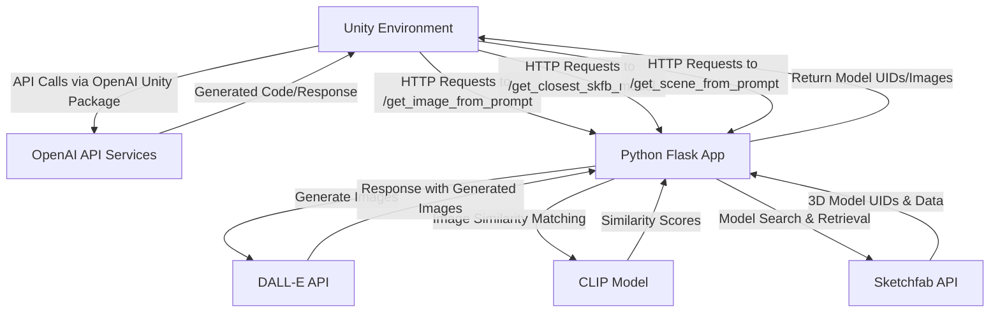
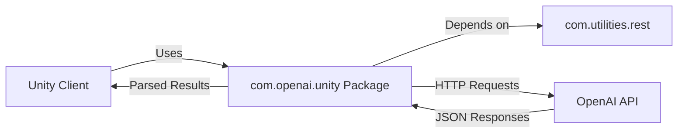
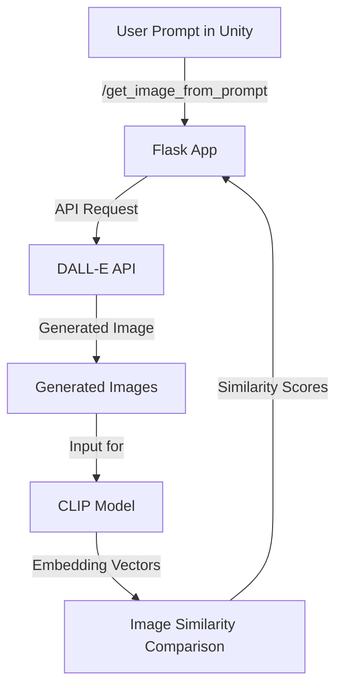
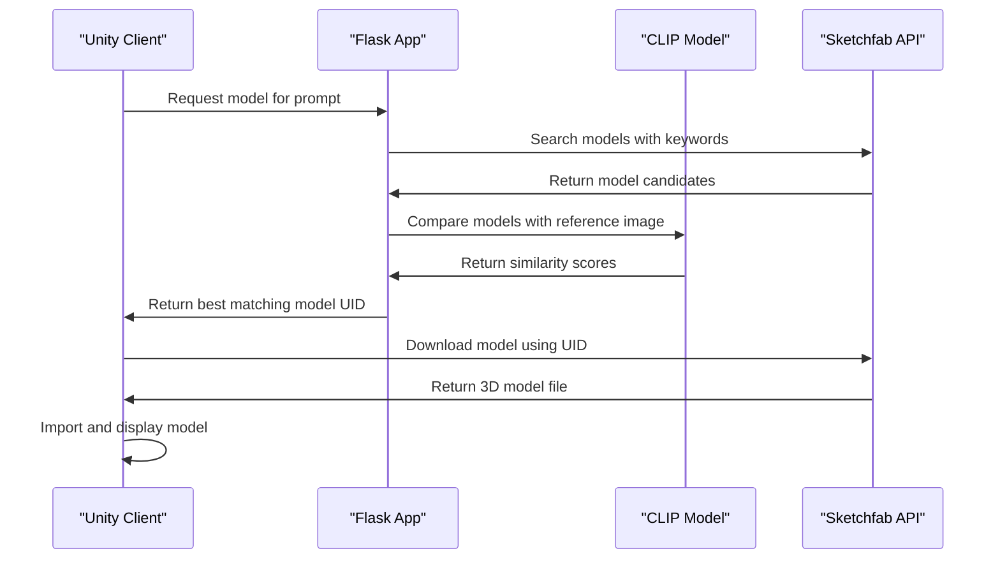
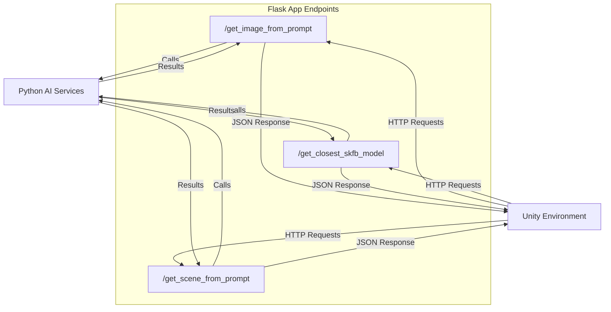
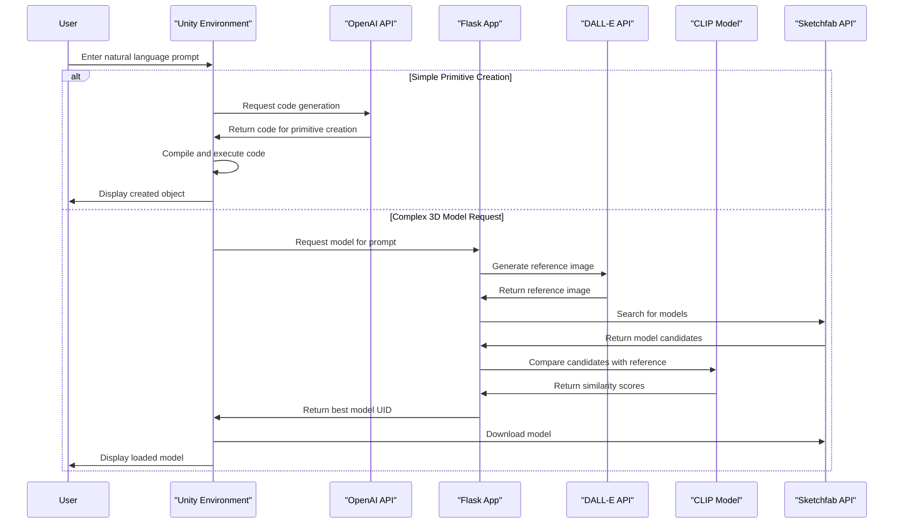

<!-- source: DeepWiki mcp.deepwiki.com · repo microsoft/LLMR · page 3 External Integrations · fetched 2026-10-26 -->

# External Integrations

Relevant source files

The following files were used as context for generating this wiki page:

- [.gitignore](.gitignore)
- [Packages/manifest.json](Packages/manifest.json)
- [Packages/packages-lock.json](Packages/packages-lock.json)
- [ProjectSettings/Packages/com.unity.testtools.codecoverage/Settings.json](ProjectSettings/Packages/com.unity.testtools.codecoverage/Settings.json)
- [README.md](README.md)

This document provides a comprehensive overview of the external services and APIs integrated with the LLMR system. The LLMR framework leverages several external tools and services to enhance its capabilities for natural language-driven 3D content creation and manipulation in Unity environments.

For information about the overall system architecture, see [System Architecture](#2), and for details on how these integrations are utilized by the core modules, see [Core Modules](#4).

## Integration Overview

The LLMR system integrates with multiple external services to provide its functionality. These integrations span from language processing to image generation and 3D model retrieval.

Sources: [README.md:105-124]()

## External Services Dependencies

The LLMR system has several external dependencies that are managed through Unity's package system:

| Package | Version | Purpose |
|---------|---------|---------|
| com.openai.unity | 7.7.9 | Provides integration with OpenAI services |
| com.siccity.gltfutility | GitHub | Handles GLTF file format for 3D models |
| com.utilities.rest | 2.1.8 | Facilitates REST API communications |
| com.utilities.encoder.wav | 1.0.6 | Audio encoding utilities |

Sources: [Packages/manifest.json:1-54](), [Packages/packages-lock.json:3-236]()

## OpenAI Integration

The LLMR system integrates with OpenAI's services for natural language processing and code generation capabilities.

### Key Features

- Natural language understanding for processing user prompts
- Code generation for creating 3D objects and behaviors in Unity
- Code review and debugging assistance

Sources: [Packages/manifest.json:3](), [Packages/packages-lock.json:3-12]()

## DALL-E and CLIP Integration

The LLMR system uses DALL-E for image generation and CLIP for image similarity matching through a Python Flask application.

### Key Features

- Image generation from text descriptions using DALL-E
- Visual similarity matching using CLIP embeddings
- Bridge between text descriptions and visual representations

Sources: [README.md:122-124]()

## Sketchfab Integration

LLMR integrates with Sketchfab to search for and retrieve 3D models that match user prompts.

### Key Features

- Text-based search for 3D models on Sketchfab
- Filtering and ranking models based on visual similarity
- Downloading and importing models directly into Unity

Sources: [README.md:103-108](), [README.md:120-121]()

## Flask Application Bridge

The Flask application serves as a bridge between Unity and Python-based AI services.

### Key Features

- RESTful API endpoints for Unity to access Python-based services
- Image generation and processing capabilities
- 3D model search and retrieval services

### Setup and Configuration

To set up the Flask application:

1. Navigate to the `CLIP-DallE-SketchFab-001` directory
2. Create a Python virtual environment
3. Install required dependencies with `pip install -r requirements.txt`
4. Run the application with `flask run`

Sources: [README.md:54-81]()

## End-to-End Integration Flow

The following diagram illustrates the complete flow of a user request through the system:

This diagram shows the two main pathways for object creation in LLMR:
1. Using OpenAI to generate code for creating Unity primitives
2. Using a combination of DALL-E, CLIP, and Sketchfab to find and load appropriate 3D models

Sources: [README.md:10-14](), [README.md:103-110](), [README.md:120-124]()

## Integration Usage Examples

### Creating Objects with Primitives

When a user requests an object that can be created with Unity primitives, the system uses the OpenAI integration to generate the necessary code.

Example prompt: "Create a rotating cube that changes color every second."

### Finding and Loading 3D Models

When a user requests more complex objects, the system leverages the DALL-E, CLIP, and Sketchfab integrations.

Example prompt: "Add a realistic horse to the scene."

Sources: [README.md:90-94](), [README.md:105-108]()

---

