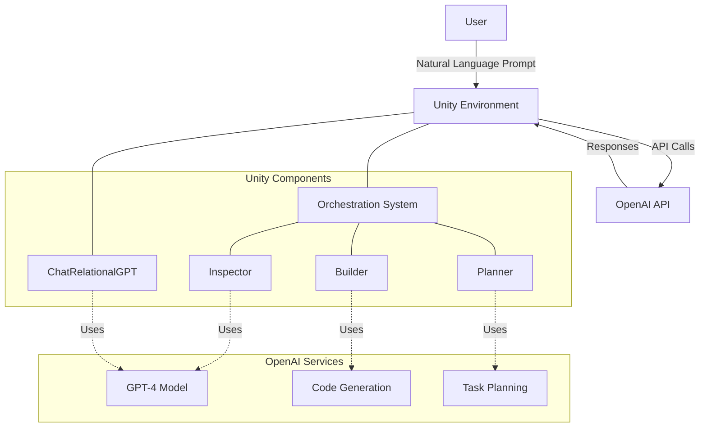
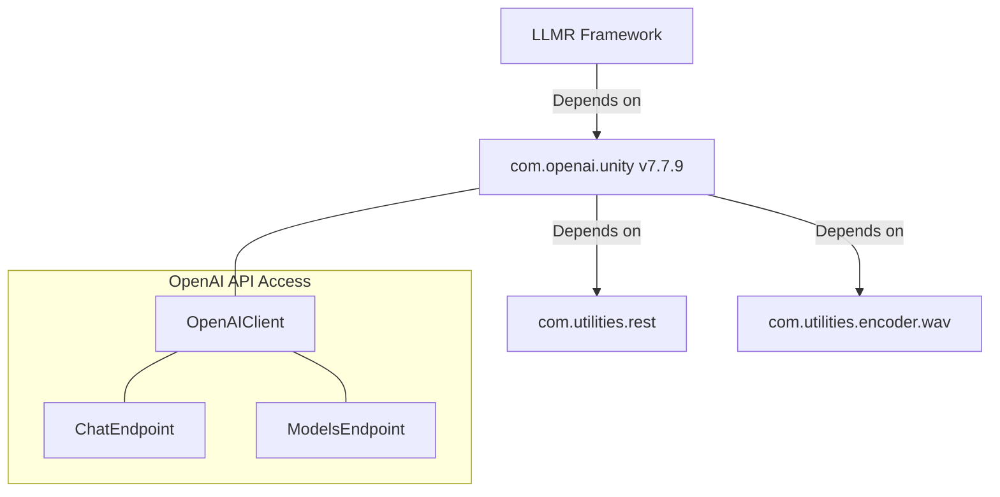
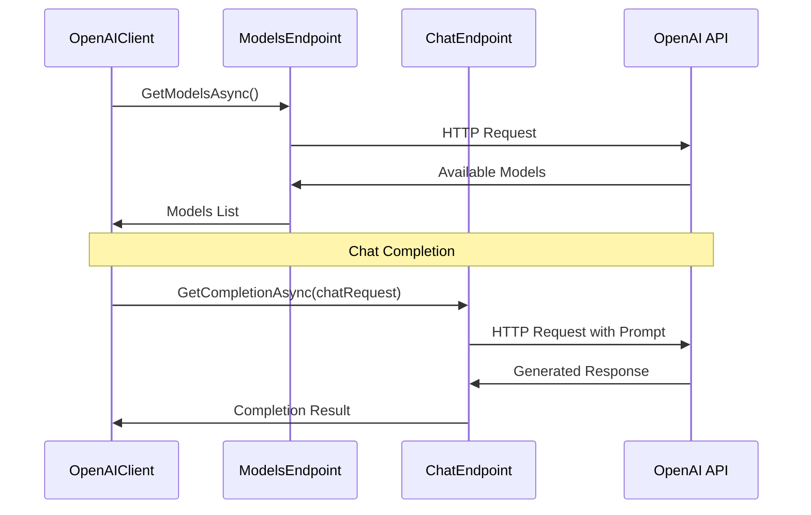
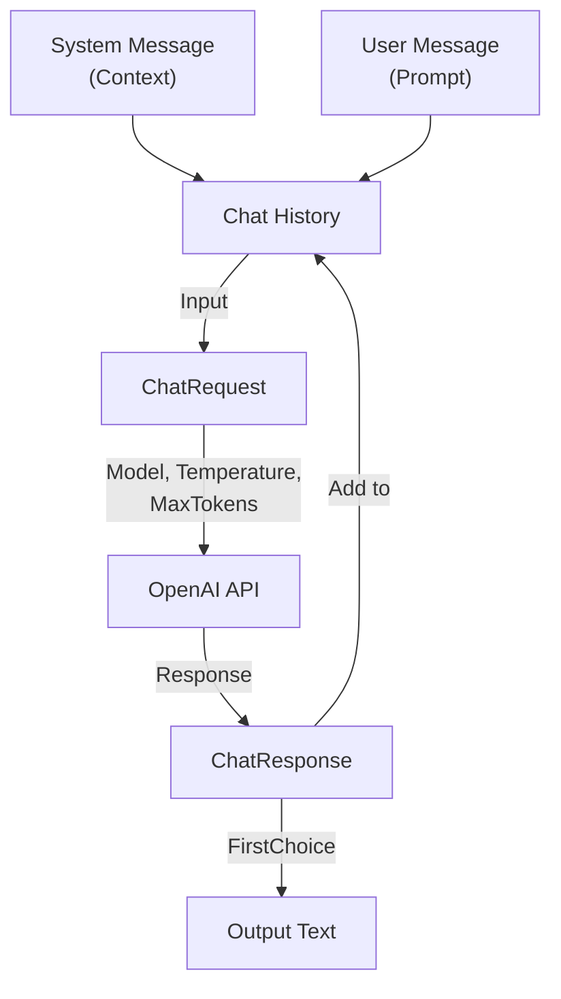
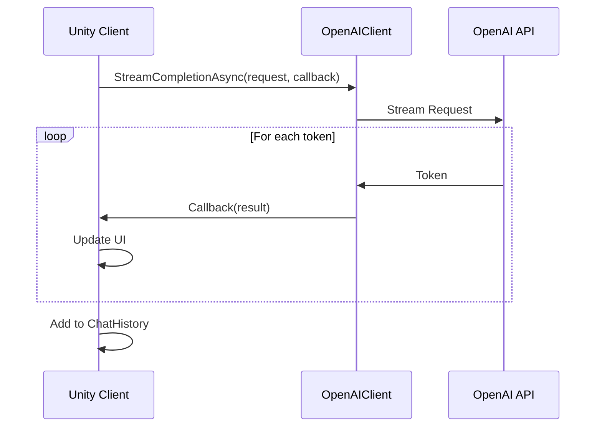
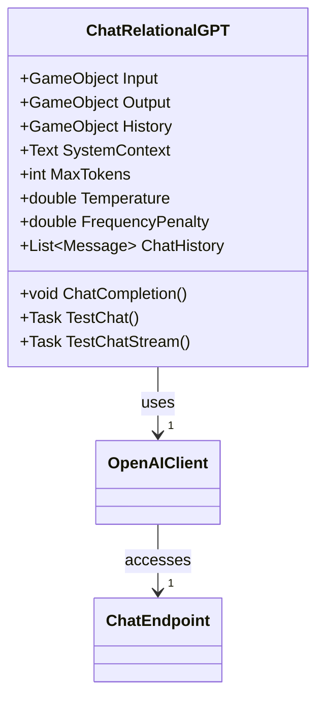

<!-- source: DeepWiki mcp.deepwiki.com · repo microsoft/LLMR · page 3.1 OpenAI Integration · fetched 2026-10-26 -->

# OpenAI Integration

<details>
<summary>Relevant source files</summary>

The following files were used as context for generating this wiki page:

- [.gitignore](.gitignore)
- [Assets/Scripts/MR_Copilot/ChatRelationalGPT.cs](Assets/Scripts/MR_Copilot/ChatRelationalGPT.cs)
- [NOTICE.md](NOTICE.md)
- [Packages/manifest.json](Packages/manifest.json)
- [Packages/packages-lock.json](Packages/packages-lock.json)
- [ProjectSettings/Packages/com.unity.testtools.codecoverage/Settings.json](ProjectSettings/Packages/com.unity.testtools.codecoverage/Settings.json)

</details>


This document details how the LLMR system integrates with OpenAI's services, primarily focusing on the GPT models used for language processing, code generation, and scene manipulation. For information about DALL-E image generation, see [DALL-E and CLIP Integration](#3.2).

## 1. Overview

The LLMR system leverages OpenAI's large language models to interpret natural language instructions and generate code that manipulates Unity scenes. This integration is central to the system's ability to transform user prompts into 3D environment modifications.



Sources: [ChatRelationalGPT.cs:56-78](), [manifest.json:3](), [NOTICE.md:5-6]()

## 2. OpenAI Package Integration

LLMR incorporates the OpenAI Unity package from RageAgainstThePixel, which provides a C# wrapper around OpenAI's APIs.



Sources: [manifest.json:3](), [Packages/packages-lock.json:3-11](), [ChatRelationalGPT.cs:1-3]()

## 3. Authentication and Client Initialization

The system instantiates an `OpenAIClient` to communicate with OpenAI's services. Authentication can be configured either with an API key directly or through an authentication object.

```
// Basic client initialization with default authentication
var api = new OpenAIClient();

// Client initialization with explicit API key
var auth = new OpenAIAuthentication("API KEY");
var api = new OpenAIClient(auth);
```

Sources: [ChatRelationalGPT.cs:59](), [ChatRelationalGPT.cs:122-123]()

## 4. Language Model Interaction

### 4.1 Models Used

LLMR primarily uses GPT-4 for its natural language processing capabilities. The system can query available models through the ModelsEndpoint.



Sources: [ChatRelationalGPT.cs:124-129](), [ChatRelationalGPT.cs:70]()

### 4.2 Chat Completion

The primary method of interaction with OpenAI's language models is through the Chat Completion API. LLMR maintains a conversation history to provide context for each request.



Sources: [ChatRelationalGPT.cs:37](), [ChatRelationalGPT.cs:61-77]()

## 5. Request Configuration

LLMR configures OpenAI requests with several parameters to control the output:

| Parameter | Description | Example Value |
|-----------|-------------|---------------|
| Model | The OpenAI model to use | GPT-4 |
| Temperature | Controls randomness (0-1) | 0.7 |
| MaxTokens | Maximum response length | 512 |
| StopValues | Tokens that stop generation | ["/*", "</"] |
| FrequencyPenalty | Reduces repetition (0-2) | 0.0 |

Sources: [ChatRelationalGPT.cs:19-26](), [ChatRelationalGPT.cs:34-35](), [ChatRelationalGPT.cs:70]()

## 6. Streaming Responses

For longer responses, LLMR supports streaming completions, which return tokens as they're generated rather than waiting for the complete response.



Sources: [ChatRelationalGPT.cs:80-111]()

## 7. Implementation in LLMR Components

The OpenAI integration is used across multiple LLMR components:

### 7.1 Chat System

The `ChatRelationalGPT` class provides a direct interface for users to interact with the GPT models, maintaining conversation history and context.



Sources: [ChatRelationalGPT.cs:11-134]()

### 7.2 Builder, Planner, and Inspector

These components use OpenAI's language models to:
- Plan complex tasks (Planner)
- Generate code to modify the Unity scene (Builder)
- Validate and debug the generated code (Inspector)

```mermaid
flowchart LR
    UserPrompt["User Prompt"] --> Orchestrator["Orchestration System"]
    Orchestrator --> Planner["Planner Module"]
    Planner -->|"Uses OpenAI for\ntask planning"| Plan["Task Plan"]
    Plan --> Builder["Builder Module"]
    Builder -->|"Uses OpenAI for\ncode generation"| GeneratedCode["Generated C# Code"]
    GeneratedCode --> Inspector["Inspector Module"]
    Inspector -->|"Uses OpenAI for\ncode validation"| ValidatedCode["Validated Code"]
    ValidatedCode --> Execution["Code Execution"]
```



Sources: [based on system diagrams and overall architecture]

## 8. Configuration

To use LLMR with OpenAI services, you need to:

1. Ensure the OpenAI Unity package is installed (it's included in the repository dependencies)
2. Configure your OpenAI API key in the appropriate location
3. Adjust model parameters (temperature, max tokens, etc.) as needed for your use case

Sources: [manifest.json:3](), [ChatRelationalGPT.cs:19-26]()

## 9. Key Considerations

- **API Usage**: Be mindful of OpenAI API usage costs and rate limits
- **Response Time**: Complex generations may take several seconds to complete
- **Model Selection**: Different models offer trade-offs between quality, speed, and cost
- **Context Management**: Effective prompt engineering and context management are essential for getting useful results

Sources: [based on general OpenAI API considerations]

---

