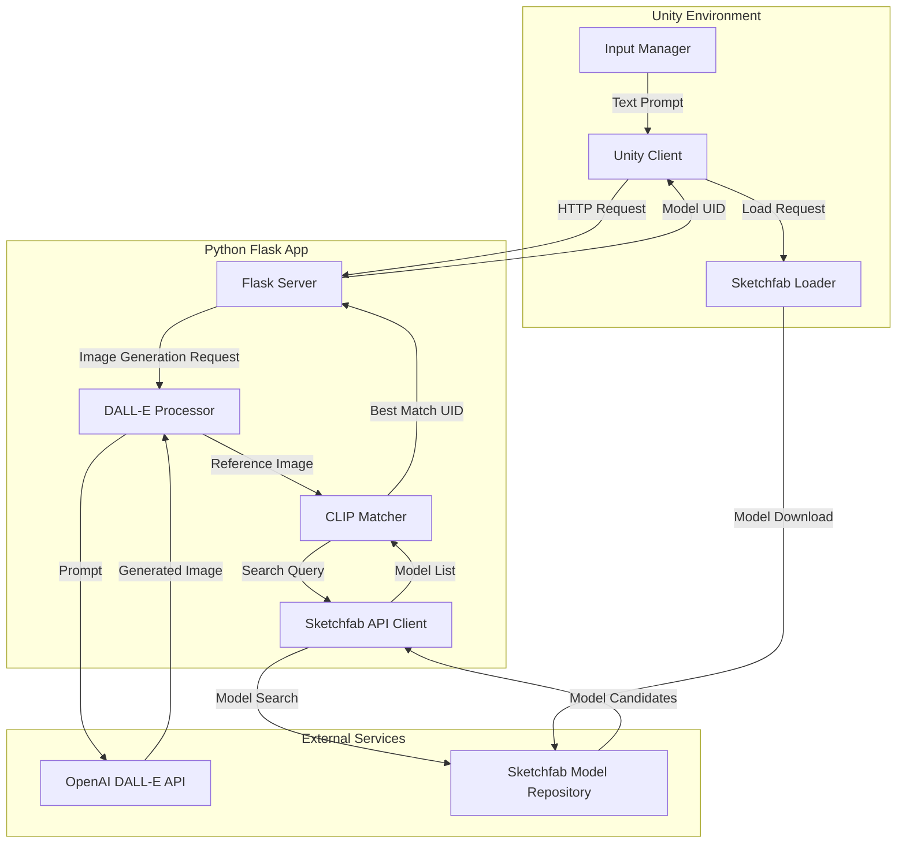
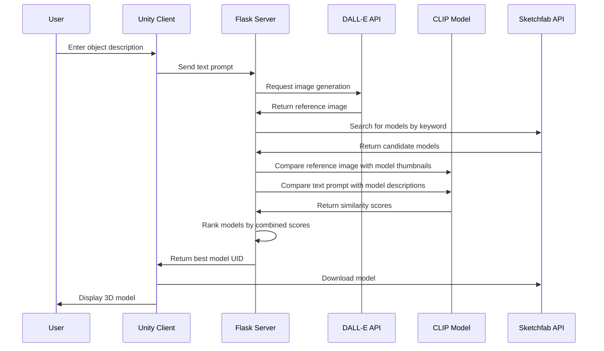
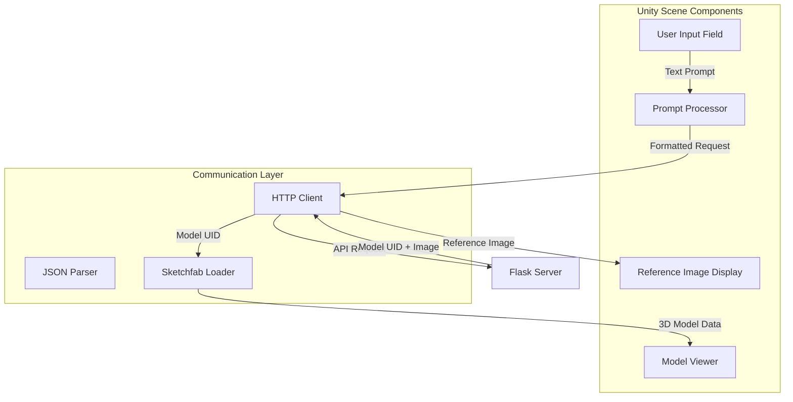
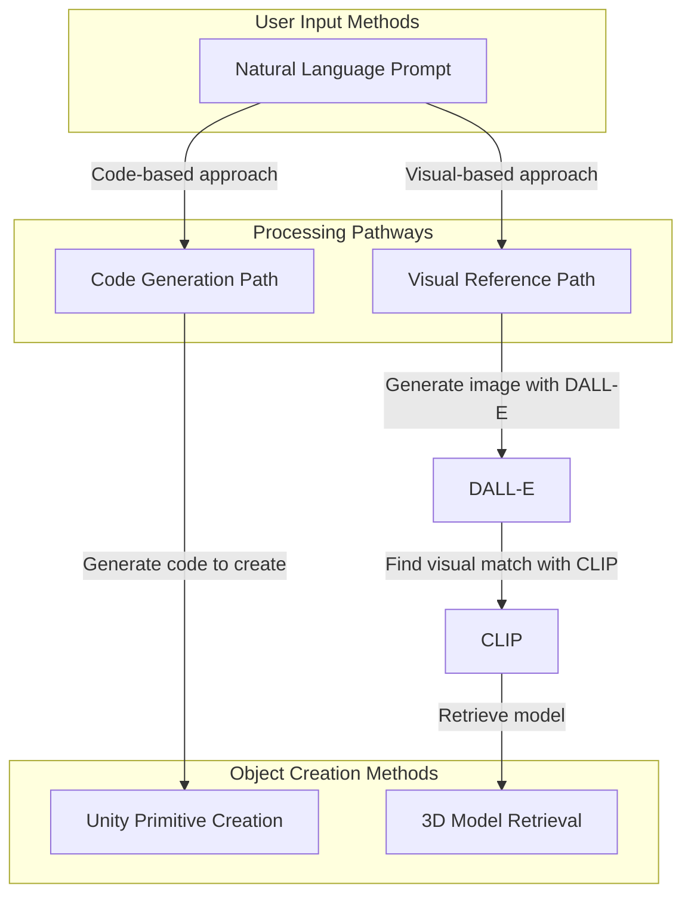

<!-- source: DeepWiki mcp.deepwiki.com · repo microsoft/LLMR · page 3.2 DALL-E and CLIP Integration · fetched 2026-10-26 -->

# DALL-E and CLIP Integration

Relevant source files

The following files were used as context for generating this wiki page:

- [Assets/Scenes/Playground_DallE-CLIP_Refinement.unity](Assets/Scenes/Playground_DallE-CLIP_Refinement.unity)
- [CLIP-DallE-SketchFab-001-main/requirements.txt](CLIP-DallE-SketchFab-001-main/requirements.txt)
- [README.md](README.md)

This page documents how the LLMR system integrates OpenAI's DALL-E image generation model and CLIP (Contrastive Language-Image Pre-training) for finding visually similar 3D models. These capabilities enable users to request objects using natural language and have the system retrieve appropriate models that closely match the description.

For information about the broader OpenAI integration, see [OpenAI Integration](#3.1). For details on how Sketchfab models are used, see [Sketchfab Integration](#3.3).

## Purpose and Components

The DALL-E and CLIP integration serves to bridge the gap between natural language descriptions and visual 3D models by:

1. Generating reference images based on text descriptions using DALL-E
2. Using CLIP to compare generated images with potential 3D model renderings
3. Finding and retrieving the best matching 3D models from Sketchfab

This process enables a more intuitive and flexible object creation workflow compared to primitive-based approaches.

Sources: [README.md:107-111]()

## System Architecture

The integration consists of several interconnected components that work together to transform text descriptions into 3D objects.

Sources: [README.md:54-75]()

## DALL-E and CLIP Processing Pipeline

The process of finding an appropriate 3D model based on a text prompt involves multiple steps of processing and matching.

Sources: [README.md:104-126]()

## Flask Application Setup

The Flask application serves as the bridge between Unity and the AI services. It provides endpoints for generating images and finding similar 3D models.

### Requirements

The Flask application requires the following Python dependencies:

| Dependency | Purpose |
|------------|---------|
| Flask | Web framework for API endpoints |
| OpenAI | Access to DALL-E API |
| PyTorch | Deep learning framework for CLIP |
| CLIP | Visual-language model for similarity matching |
| Werkzeug | Utilities for Flask |

Sources: [CLIP-DallE-SketchFab-001-main/requirements.txt:1-7]()

### Setup Instructions

1. Create a Python environment in the local folder
2. Install the required dependencies
3. Run the Flask application
4. The application will be available for Unity to connect to

Sources: [README.md:54-81]()

## API Endpoints

The Flask application provides several key endpoints that enable the DALL-E and CLIP functionality:

| Endpoint | Purpose | Parameters | Response |
|----------|---------|------------|----------|
| `/get_image_from_prompt` | Generate a reference image for a single object using DALL-E | Text prompt | Generated image |
| `/get_closest_skfb_model` | Find the closest Sketchfab model using CLIP | Image, text prompt | Sketchfab model UID |
| `/get_scene_from_prompt` | Generate a reference image for an entire scene | Scene description | Generated scene image |

Sources: [README.md:122-124]()

## Unity Integration

The LLMR system includes a specialized Unity scene called `Playground_DallE-CLIP_Refinement` that demonstrates the integration with DALL-E and CLIP.

### Scene Components

The Unity integration consists of:

1. User interface for text input
2. HTTP client for communicating with the Flask server
3. Image display components for visualization
4. Sketchfab model loader for importing retrieved models

Sources: [Assets/Scenes/Playground_DallE-CLIP_Refinement.unity:105-126]()

## Example Usage Workflow

1. User enters a text description (e.g., "a fork", "a bowl") in the Unity interface
2. The description is sent to the Flask server
3. DALL-E generates a reference image based on the description
4. The Flask server searches Sketchfab for model candidates
5. CLIP compares the reference image with model thumbnails to find the best match
6. The best matching model's UID is returned to Unity
7. Unity downloads and displays the model

Sources: [README.md:104-110]()

## Technical Considerations

- The system requires active internet connections to both OpenAI and Sketchfab services
- Image generation and processing can introduce some latency
- The quality of the match depends on both the DALL-E generated image and available models in Sketchfab
- The Flask application needs to run locally alongside Unity

Sources: [README.md:77-81]()

## Performance Optimization

To optimize the performance of the DALL-E and CLIP integration:

1. Model search results are filtered first by text similarity before visual comparison
2. A subset of the most relevant models is selected for detailed CLIP comparison
3. The combined text and visual similarity scores are used for final ranking

Sources: [README.md:122-124]()

## Integration with Other LLMR Components

The DALL-E and CLIP integration complements the primitive-based object creation approach in LLMR, providing users with multiple options for creating 3D content.

Sources: [README.md:10-14]()

## Conclusion

The integration of DALL-E and CLIP in the LLMR system provides a powerful method for retrieving visually appropriate 3D models based on natural language descriptions. This approach complements the code generation capabilities of LLMR, offering users flexibility in how they create and populate their 3D environments.

---

