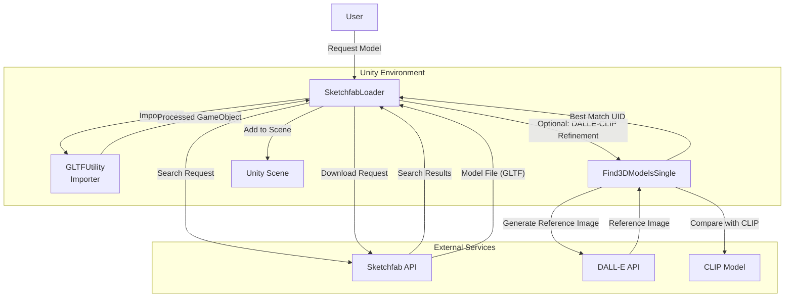
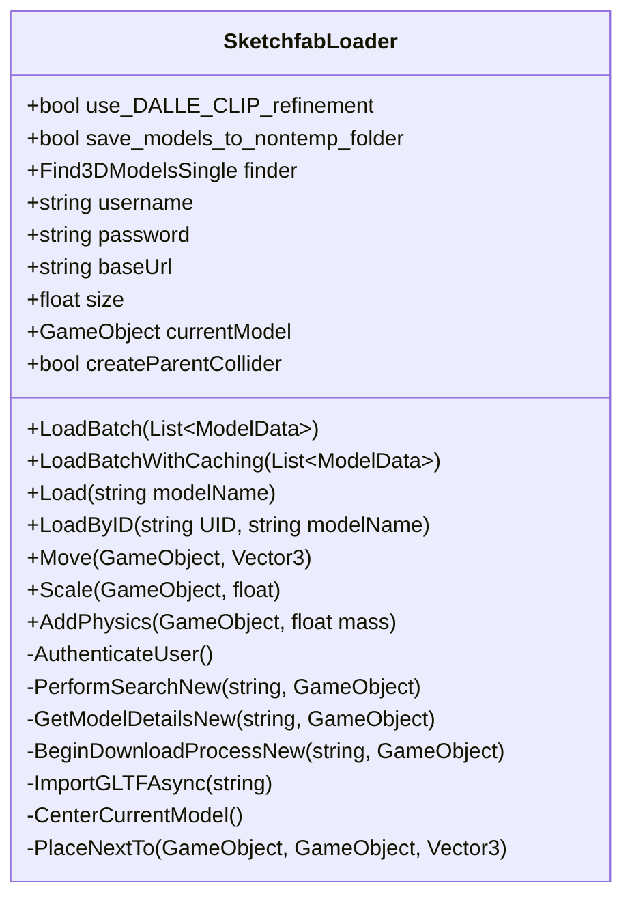
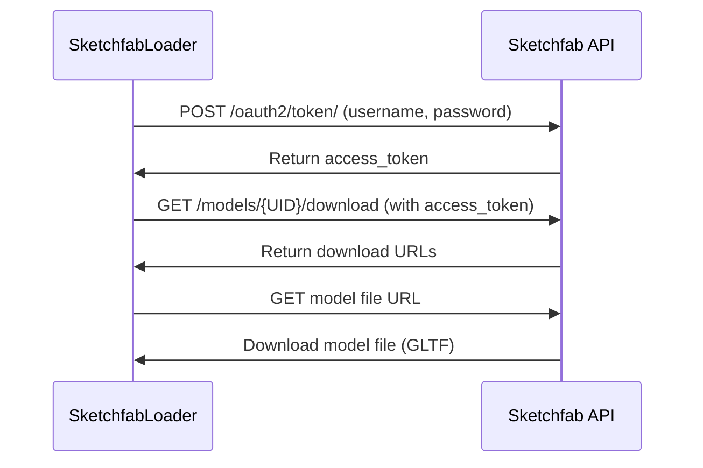
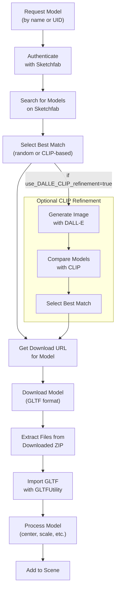
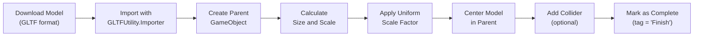
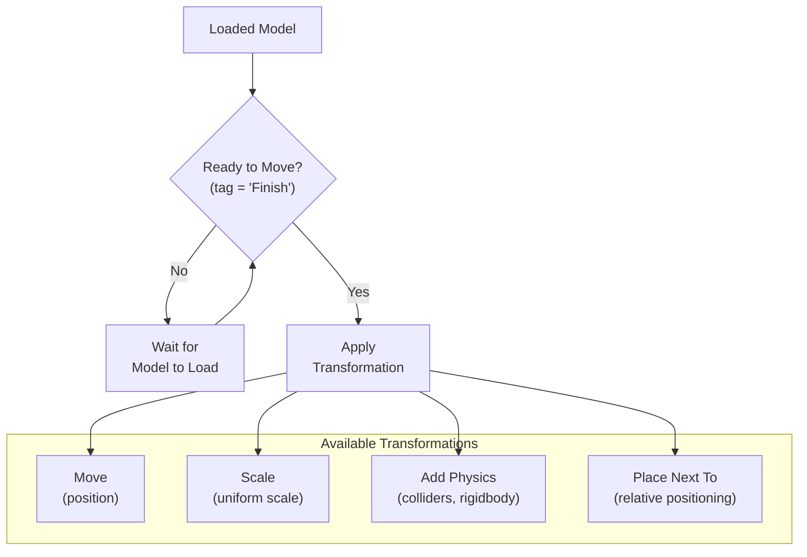
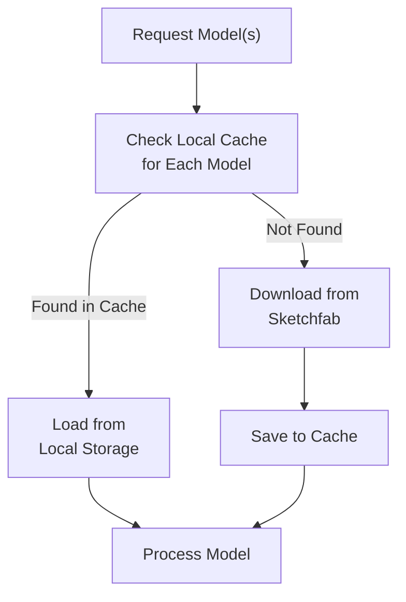
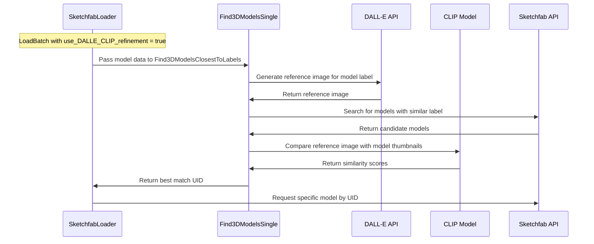

<!-- source: DeepWiki mcp.deepwiki.com · repo microsoft/LLMR · page 3.3 Sketchfab Integration · fetched 2026-10-26 -->

# Sketchfab Integration

<details>
<summary>Relevant source files</summary>

The following files were used as context for generating this wiki page:

- [Assets/Scripts/MR_Copilot/Sketchfab/LegacySketchfabLoader.cs](Assets/Scripts/MR_Copilot/Sketchfab/LegacySketchfabLoader.cs)
- [Assets/Scripts/MR_Copilot/Sketchfab/SketchfabAPIManager.cs](Assets/Scripts/MR_Copilot/Sketchfab/SketchfabAPIManager.cs)
- [Assets/Scripts/MR_Copilot/Sketchfab/SketchfabLoader.cs](Assets/Scripts/MR_Copilot/Sketchfab/SketchfabLoader.cs)

</details>


## Purpose and Scope

This document details the Sketchfab integration component of the LLMR system, which allows the retrieval, downloading, and integration of 3D models from the Sketchfab platform into Unity scenes. The integration provides functionality for searching models by keywords, downloading them, processing them for optimal use in the scene, and manipulating their position, scale, and physical properties.

For information about the general external integrations architecture, see [External Integrations](#3). For details about how DALL-E and CLIP can enhance model search, see [DALL-E and CLIP Integration](#3.2).

Sources: [Assets/Scripts/MR_Copilot/Sketchfab/SketchfabLoader.cs:17-18]()

## System Architecture

The Sketchfab integration consists of several components that work together to search, download, and process 3D models from Sketchfab for use in Unity environments.

### Component Overview



Sources: [Assets/Scripts/MR_Copilot/Sketchfab/SketchfabLoader.cs:17-239](), [Assets/Scripts/MR_Copilot/Sketchfab/SketchfabLoader.cs:350-359]()

### Class Structure

The `SketchfabLoader` class is the central component that handles the Sketchfab integration:



Sources: [Assets/Scripts/MR_Copilot/Sketchfab/SketchfabLoader.cs:221-249](), [Assets/Scripts/MR_Copilot/Sketchfab/SketchfabLoader.cs:479-550]()

## Authentication and API Integration

The Sketchfab integration uses OAuth 2.0 for authentication with the Sketchfab API.

### Authentication Flow



The `SketchfabLoader` authenticates with Sketchfab using the configured username and password, obtaining an access token used for subsequent API requests.

Sources: [Assets/Scripts/MR_Copilot/Sketchfab/SketchfabLoader.cs:643-682](), [Assets/Scripts/MR_Copilot/Sketchfab/SketchfabLoader.cs:788-802]()

### API Endpoints

The integration uses the following Sketchfab API endpoints:

| Endpoint | Purpose | Implementation |
|----------|---------|----------------|
| `/oauth2/token/` | Authentication | `AuthenticateUser()` method |
| `/v3/search?type=models` | Searching for models | `PerformSearchNew()` method |
| `/v3/models/{UID}/download` | Getting model download URLs | `GetSpecificModelDetailsNew()` method |

Sources: [Assets/Scripts/MR_Copilot/Sketchfab/SketchfabLoader.cs:653](), [Assets/Scripts/MR_Copilot/Sketchfab/SketchfabLoader.cs:705](), [Assets/Scripts/MR_Copilot/Sketchfab/SketchfabLoader.cs:806]()

## Model Retrieval Workflow

The model retrieval process follows these main steps:

### Model Search and Download Workflow



Sources: [Assets/Scripts/MR_Copilot/Sketchfab/SketchfabLoader.cs:479-550](), [Assets/Scripts/MR_Copilot/Sketchfab/SketchfabLoader.cs:685-787](), [Assets/Scripts/MR_Copilot/Sketchfab/SketchfabLoader.cs:830-876](), [Assets/Scripts/MR_Copilot/Sketchfab/SketchfabLoader.cs:350-359]()

### Methods for Model Retrieval

The `SketchfabLoader` class provides several methods for retrieving models:

1. **Load**: Searches for and loads a model by name
   ```csharp
   public GameObject Load(string modelName)
   ```

2. **LoadByID**: Loads a specific model by its Sketchfab UID
   ```csharp
   public GameObject LoadByID(string UID, string modelName)
   ```

3. **LoadBatch**: Loads multiple models defined by `ModelData` objects
   ```csharp
   public void LoadBatch(List<ModelData> models)
   ```

4. **LoadBatchWithCaching**: Loads multiple models with local caching for efficiency
   ```csharp
   public void LoadBatchWithCaching(List<ModelData> models)
   ```

Sources: [Assets/Scripts/MR_Copilot/Sketchfab/SketchfabLoader.cs:479-484](), [Assets/Scripts/MR_Copilot/Sketchfab/SketchfabLoader.cs:501-506](), [Assets/Scripts/MR_Copilot/Sketchfab/SketchfabLoader.cs:348-371](), [Assets/Scripts/MR_Copilot/Sketchfab/SketchfabLoader.cs:274-345]()

## Model Processing

After a model is downloaded, it undergoes several processing steps to prepare it for use in the Unity scene.

### Import and Processing



The `CenterCurrentModel` method performs several important tasks:
1. Creates a parent GameObject to contain the model
2. Calculates the model's bounding box
3. Applies uniform scaling to match the target size
4. Centers the model within its parent
5. Optionally adds a collider to the parent GameObject
6. Marks the model as "Finish" to indicate completion

Sources: [Assets/Scripts/MR_Copilot/Sketchfab/SketchfabLoader.cs:894-996](), [Assets/Scripts/MR_Copilot/Sketchfab/SketchfabLoader.cs:936-996]()

## Model Manipulation

The `SketchfabLoader` provides several methods for manipulating models after they have been loaded:

### Movement and Transformation



The available manipulation methods include:

1. **Move**: Positions a model at a specified location
   ```csharp
   public void Move(GameObject model, Vector3 move)
   ```

2. **Scale**: Applies uniform scaling to a model
   ```csharp
   public void Scale(GameObject model, float scale)
   ```

3. **AddPhysics**: Adds physics components (colliders and Rigidbody) to a model
   ```csharp
   public void AddPhysics(GameObject model, float mass = 1)
   ```

4. **PlaceNextTo**: Positions a model relative to another model
   ```csharp
   public void PlaceNextTo(GameObject originalObj, GameObject objToPlace, Vector3 placement)
   ```

Sources: [Assets/Scripts/MR_Copilot/Sketchfab/SketchfabLoader.cs:509-594](), [Assets/Scripts/MR_Copilot/Sketchfab/SketchfabLoader.cs:1097-1157]()

## Model Caching

The system supports caching of downloaded models to improve performance and reduce redundant downloads.

### Caching Workflow



The `LoadBatchWithCaching` method first checks if requested models already exist in the local cache before downloading them from Sketchfab.

When saving models, the system can use either:
- Temporary cache path (`Application.temporaryCachePath`)
- Persistent data path (`Application.persistentDataPath`)

The behavior is controlled by the `save_models_to_nontemp_folder` boolean property.

Sources: [Assets/Scripts/MR_Copilot/Sketchfab/SketchfabLoader.cs:274-345](), [Assets/Scripts/MR_Copilot/Sketchfab/SketchfabLoader.cs:397-434](), [Assets/Scripts/MR_Copilot/Sketchfab/SketchfabLoader.cs:851-871]()

## DALL-E and CLIP Integration

The `SketchfabLoader` can optionally use DALL-E and CLIP for more refined model search results.

### DALL-E and CLIP Refinement Process



When `use_DALLE_CLIP_refinement` is set to `true`, the system uses the `Find3DModelsSingle` component to:
1. Generate a reference image with DALL-E based on the model label
2. Search for models on Sketchfab
3. Use CLIP to compare the reference image with model thumbnails
4. Select the best match based on visual similarity

This approach improves search accuracy by considering visual similarity in addition to text matching.

Sources: [Assets/Scripts/MR_Copilot/Sketchfab/SketchfabLoader.cs:221-222](), [Assets/Scripts/MR_Copilot/Sketchfab/SketchfabLoader.cs:350-359]()

## Usage Examples

Here are some common usage patterns for the Sketchfab integration:

### Basic Model Loading

```csharp
// Load a model by name
GameObject chair = sketchfabLoader.Load("chair");

// After the model is loaded (asynchronously)
sketchfabLoader.Move(chair, new Vector3(0, 0, 2));
sketchfabLoader.Scale(chair, 1.5f);
```

### Loading Multiple Models with Caching

```csharp
// Define models to load
List<ModelData> models = new List<ModelData>
{
    new ModelData { label = "table", position = new Vector3(0, 0, 0), scale = 1.0f },
    new ModelData { label = "chair", position = new Vector3(1, 0, 0), scale = 0.8f },
    new ModelData { label = "lamp", position = new Vector3(-1, 0, 0), scale = 0.5f }
};

// Load models with caching
sketchfabLoader.LoadBatchWithCaching(models);
```

### Loading a Specific Model by ID

```csharp
// Load a model using its Sketchfab UID
GameObject specificModel = sketchfabLoader.LoadByID("cf4194d4ce404273a62c7711447f5f51", "specificModelName");
```

### Positioning Models Relative to Each Other

```csharp
// Load two models
GameObject table = sketchfabLoader.Load("table");
GameObject vase = sketchfabLoader.Load("vase");

// Place the vase on the table
sketchfabLoader.MoveNextTo(table, vase, new Vector3(0, 1, 0));
```

Sources: [Assets/Scripts/MR_Copilot/Sketchfab/SketchfabLoader.cs:479-535](), [Assets/Scripts/MR_Copilot/Sketchfab/SketchfabLoader.cs:274-277](), [Assets/Scripts/MR_Copilot/Sketchfab/SketchfabLoader.cs:526-529]()

## Configuration Options

The `SketchfabLoader` provides several configuration options:

| Property | Type | Description |
|----------|------|-------------|
| `use_DALLE_CLIP_refinement` | bool | Enables DALL-E and CLIP for refining search results |
| `save_models_to_nontemp_folder` | bool | Saves models to persistent path instead of temporary cache |
| `size` | float | Default size for loaded models (uniform scale) |
| `maximumPageLimit` | int | Maximum number of pages to retrieve in search results |
| `createParentCollider` | bool | Whether to add a collider to the parent GameObject |
| `username` | string | Sketchfab username for authentication |
| `password` | string | Sketchfab password for authentication |

Sources: [Assets/Scripts/MR_Copilot/Sketchfab/SketchfabLoader.cs:221-249]()

## Technical Limitations and Considerations

1. **Authentication**: Requires valid Sketchfab credentials with download permissions
2. **Asynchronous Operations**: All model loading operations are asynchronous and require coroutines
3. **Model Format**: Only supports GLTF/GLB format models
4. **Model Complexity**: Very large or complex models may impact performance
5. **Rate Limiting**: Sketchfab API has rate limits that may affect batch operations
6. **DALL-E Integration**: Requires proper setup of the Flask app and API keys for OpenAI

Sources: [Assets/Scripts/MR_Copilot/Sketchfab/SketchfabLoader.cs:643-682](), [Assets/Scripts/MR_Copilot/Sketchfab/SketchfabLoader.cs:539-550]()

## Key Helper Classes

The `SketchfabLoader` includes several helper classes for working with the Sketchfab API:

| Class | Purpose |
|-------|---------|
| `Result` | Represents a single model result from a search |
| `SFSearchResults` | Contains a page of search results |
| `ImplicitAccessToken` | Stores OAuth authentication token |
| `_ModelDownloadMetaData` | Contains download URLs for a model |
| `Archives` | Information about available model formats |

Sources: [Assets/Scripts/MR_Copilot/Sketchfab/SketchfabLoader.cs:21-218]()

---

