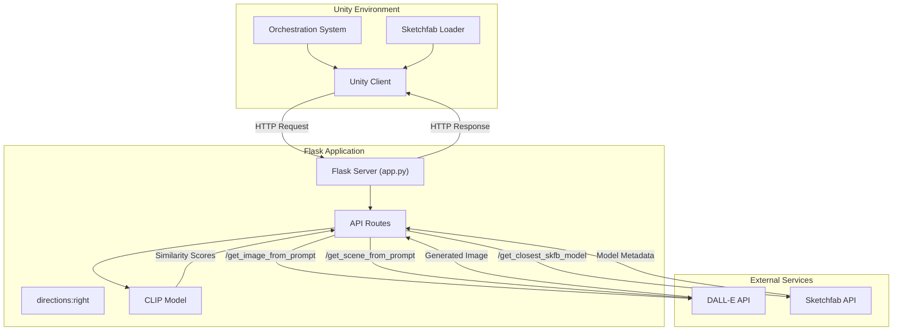
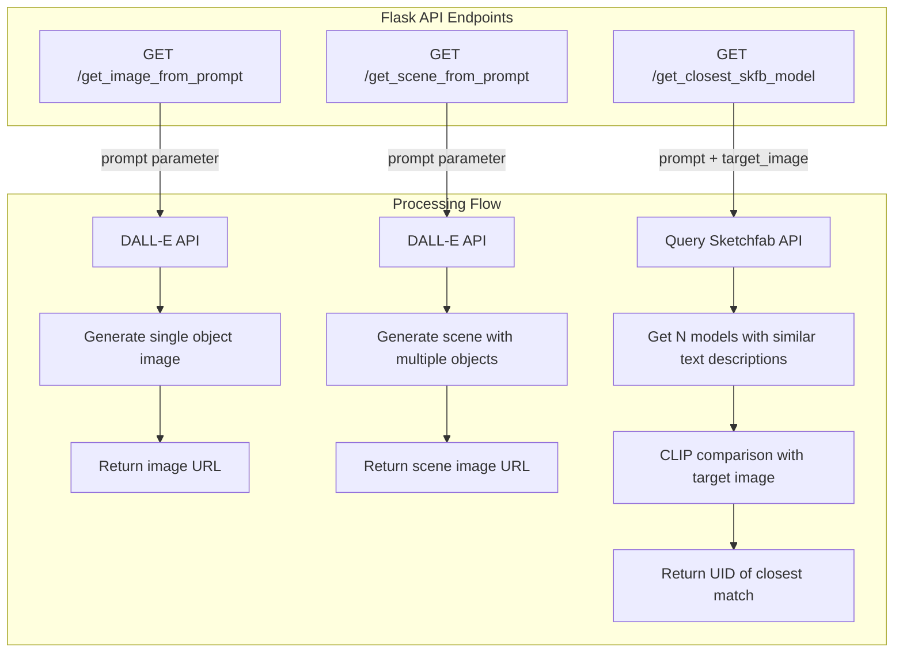
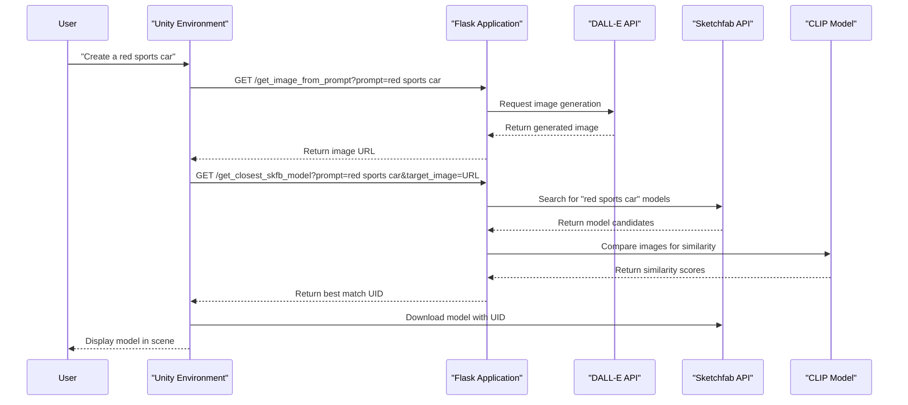
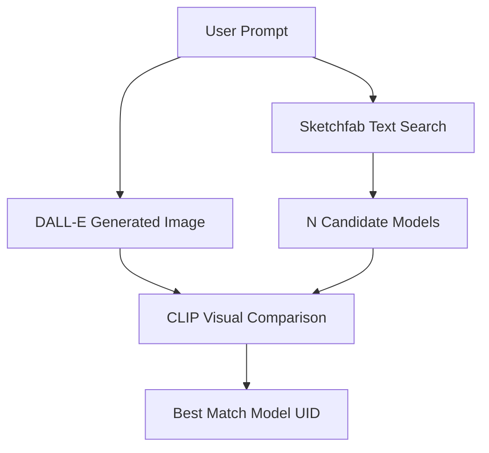

<!-- source: DeepWiki mcp.deepwiki.com · repo microsoft/LLMR · page 3.4 Flask Application · fetched 2026-10-26 -->

# Flask Application

<details>
<summary>Relevant source files</summary>

The following files were used as context for generating this wiki page:

- [CLIP-DallE-SketchFab-001-main/requirements.txt](CLIP-DallE-SketchFab-001-main/requirements.txt)
- [README.md](README.md)

</details>


## Purpose and Scope

This document describes the Flask application that serves as a bridge between the Unity environment in LLMR and various external AI services. The Flask app provides critical functionality for finding and retrieving appropriate 3D models and images based on natural language prompts by integrating DALL-E for image generation, CLIP for similarity matching, and Sketchfab for 3D model retrieval. This document covers the app's architecture, setup process, API endpoints, and integration with Unity.

For information about the specific implementation details of DALL-E and CLIP, see [DALL-E and CLIP Integration](#3.2). For details about how Sketchfab models are used within Unity, see [Sketchfab Integration](#3.3).

Sources: [README.md:54-78](), [README.md:116-127]()

## System Architecture

The Flask application acts as a middleware service between the Unity front-end of LLMR and multiple external AI and 3D model services. It processes requests from Unity, interacts with the required external APIs, performs AI-based processing, and returns results that Unity can use to enhance the 3D environment.



Sources: [README.md:116-127]()

## Setup and Installation

The Flask application requires Python 3.9 or higher and several dependencies. Follow these steps to set up and run the application:

1. Navigate to the `CLIP-DallE-SketchFab-001` directory after cloning the repository
2. Create and activate a Python virtual environment:
   ```
   python -m venv .venv
   source .venv/bin/activate  # On Windows: .venv\Scripts\activate
   ```
3. Install the required dependencies:
   ```
   pip install -r requirements.txt
   ```
4. Run the Flask application:
   ```
   flask run
   ```

The application will start a local server (typically at http://127.0.0.1:5000), which the Unity application can then communicate with.

### Dependencies

| Dependency | Version | Purpose |
|------------|---------|---------|
| Flask | 2.0.2 | Web framework for creating the API endpoints |
| gunicorn | - | WSGI HTTP server for deploying the application |
| openai | 0.27.8 | Client for OpenAI's API (DALL-E) |
| torch | - | Deep learning framework required by CLIP |
| torchvision | - | Computer vision utilities for PyTorch |
| openai-clip | - | Implementation of the CLIP model |
| Werkzeug | 2.2.2 | WSGI utility library used by Flask |

Sources: [README.md:54-78](), [CLIP-DallE-SketchFab-001-main/requirements.txt:1-7]()

## API Endpoints

The Flask application exposes three main API endpoints that provide different functionalities within the LLMR system:



### 1. `/get_image_from_prompt`

**Purpose**: Generates an image of a single 3D object based on a text prompt using DALL-E.

**Parameters**:
- `prompt`: Text description of the object to generate

**Response**: URL of the generated image

**Usage**: This endpoint is typically called when a user requests a specific object in Unity. The generated image serves as a visual target for matching with 3D models.

### 2. `/get_scene_from_prompt`

**Purpose**: Generates an image of a scene with multiple objects based on a text prompt using DALL-E.

**Parameters**:
- `prompt`: Text description of the scene to generate

**Response**: URL of the generated scene image

**Usage**: Called when a user requests a complex scene with multiple objects. Unity can use this image to determine the placement of objects within the scene.

### 3. `/get_closest_skfb_model`

**Purpose**: Finds the closest matching 3D model from Sketchfab based on both text similarity and visual similarity.

**Parameters**:
- `prompt`: Text description of the desired model
- `target_image`: URL of a reference image (typically generated by DALL-E)

**Response**: UID of the closest matching Sketchfab model

**Usage**: After generating an image with DALL-E, this endpoint finds a 3D model on Sketchfab that most closely matches the desired object, enabling Unity to download and display it.

Sources: [README.md:116-127]()

## Integration with Unity

The Unity environment in LLMR communicates with the Flask application through HTTP requests to retrieve appropriate 3D models based on user prompts. The following diagram illustrates the typical workflow:



In the Unity implementation, the communication with the Flask app happens through HTTP requests made by the `UnityWebRequest` system. The results from the Flask app are used by Unity's Sketchfab loader to download and instantiate the appropriate 3D models in the scene.

Sources: [README.md:104-112]()

## Technical Implementation

### CLIP-Based Model Matching

The Flask application uses a two-stage approach to find the most appropriate 3D model:

1. **Text Similarity Matching**: The application first queries the Sketchfab API to find models with text descriptions similar to the user's prompt, creating a subset of candidate models.

2. **Visual Similarity Matching**: The CLIP model then compares the visual features of the DALL-E generated image with thumbnail images of the candidate models to find the closest visual match.

This dual approach ensures that the selected model is both semantically and visually similar to what the user requested.



### Scene Generation Process

For more complex scene generation, the process involves:

1. Generating a scene image with DALL-E
2. Potentially analyzing the image to identify individual objects
3. Finding appropriate models for each identified object
4. Arranging the models in the Unity scene according to their positions in the generated image

Sources: [README.md:120-125]()

## Usage Examples

### Example 1: Creating a Single Object

When a user in Unity requests "a red sports car", the system:

1. Calls `/get_image_from_prompt` to generate a reference image
2. Calls `/get_closest_skfb_model` with the prompt and reference image
3. Downloads and displays the returned model

### Example 2: Creating a Complex Scene

For a prompt like "farm with 2 cows and a horse":

1. Calls `/get_scene_from_prompt` to generate a reference scene image
2. Analyzes the scene to identify individual objects
3. For each object, calls `/get_closest_skfb_model` to find appropriate models
4. Places models in the Unity scene according to their positions in the reference image

Sources: [README.md:104-112](), [README.md:116-127]()

## Limitations and Future Improvements

- The Flask application currently runs locally and needs to be started separately from Unity
- Communication is limited to HTTP requests, which may introduce latency
- More advanced scene composition capabilities could be implemented
- The system is dependent on the availability and quality of models in the Sketchfab repository

Sources: [README.md:130-132]()

---

