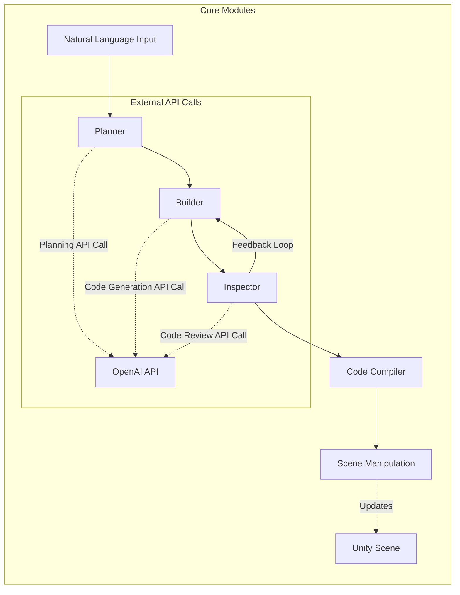
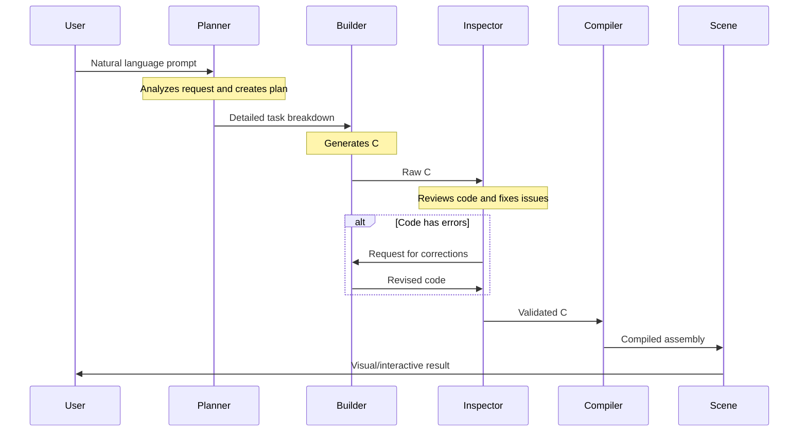
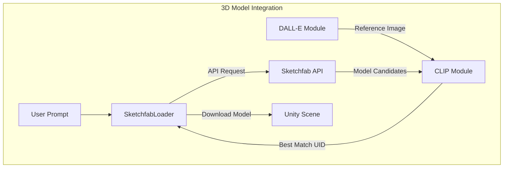

<!-- source: DeepWiki mcp.deepwiki.com · repo microsoft/LLMR · page 4 Core Modules · fetched 2026-10-26 -->

# Core Modules

Relevant source files

The following files were used as context for generating this wiki page:

- [README.md](README.md)
- [Transparency FAQ.md](Transparency FAQ.md)

## Purpose and Scope

This page provides a technical overview of the core functional modules that make up the LLMR system. These modules work together to transform natural language prompts into interactive 3D content within Unity. The Core Modules implement the primary processing pipeline and form the backbone of the system's ability to understand, plan, generate, and validate code for 3D scene creation and modification.

For system architecture details and how these modules are orchestrated, see [System Architecture](#2). For information about external integrations that these modules utilize, see [External Integrations](#3).

Sources: [README.md:5-15]()

## Module Architecture Overview

The LLMR Core Modules form a processing pipeline that transforms natural language requests into executable code that modifies the Unity scene. Each module is specialized for a specific task in this pipeline, with well-defined inputs and outputs.

The diagram above illustrates the primary flow between core modules and their interactions with external services. Each module uses the OpenAI API to perform specialized cognitive tasks, transforming the input progressively from natural language to executable code.

Sources: [README.md:96-101]()

## Module Responsibilities and Dataflow

The following table outlines the key responsibilities of each core module and the data transformations they perform:

| Module | Input | Output | Primary Responsibility |
|--------|-------|--------|------------------------|
| Planner | Natural language prompt | Structured task plan | Break down complex tasks into manageable steps |
| Builder | Task plan | C# code | Generate executable code to implement the plan |
| Inspector | C# code | Validated/corrected code | Analyze code for errors and fix issues |
| Code Compiler | Validated C# code | Runtime assembly | Compile code and prepare for execution |

Sources: [README.md:90-101]()

## Functional Pipeline Diagram

This sequence diagram shows the typical flow of a request through the core modules, including the feedback loop where the Inspector may request code revisions from the Builder.

Sources: [README.md:94-95]()

## Planner Module

The Planner is the first module in the pipeline and serves as the entry point for natural language requests. It acts as a chat agent that analyzes user requests, breaks them down into actionable steps, and expands simple prompts into more comprehensive instructions.

### Key Responsibilities:
- Parse natural language requests to understand user intent
- Break complex tasks into simpler, manageable steps
- Expand ambiguous requests by asking clarifying questions
- Maintain conversation context for iterative development
- Provide the Builder with structured, detailed instructions

The Planner is activated when users press Right Control (instead of Tab) to send requests, indicating they want a more careful planning process for complex tasks.

Sources: [README.md:98-100]()

## Builder Module

The Builder module transforms the planner's structured instructions into executable C# code that can modify the Unity scene. It is responsible for generating code that creates, modifies, or destroys objects and defines their behaviors.

### Key Responsibilities:
- Generate syntactically correct C# code based on task plans
- Implement behaviors and interactions as specified
- Create Unity GameObjects and components
- Apply materials, physics, animations, and other properties
- Track the history of generated code and objects for future reference

The Builder maintains output and history fields that can be inspected to review the generated code and conversation history.

Sources: [README.md:94-95]()

## Inspector Module

The Inspector module serves as a quality control system that reviews and validates the C# code produced by the Builder. It identifies and fixes compilation or runtime errors before code execution.

### Key Responsibilities:
- Analyze code for syntax errors, logical flaws, and potential runtime issues
- Fix identified issues independently or request corrections from the Builder
- Ensure code adheres to Unity best practices
- Verify code will execute efficiently and safely
- Provide feedback on code quality and improvements

The Inspector significantly improves reliability by catching and resolving errors before they impact the user experience, resulting in a 4x reduction in average error rates compared to standard GPT-4.

Sources: [Transparency FAQ.md:13-14]()

## Code Compilation and Execution

Once the Inspector has validated the code, it is passed to the Code Compiler module which uses the Roslyn C# compiler to generate runtime assemblies. These assemblies are then loaded and executed within the Unity environment.

### Key Components:
- Roslyn C# compiler integration
- Assembly management
- Dynamic code loading
- GameObject attachment

The system uses a purchased implementation of the Roslyn C# compiler from Trivial Interactive, which provides functionality for attaching compiled code to GameObjects.

Sources: [README.md:19-21]()

## Additional Core Components

### Terrain Building

The Terrain Building module provides specialized functionality for generating and manipulating terrain features within the Unity environment. This capability allows users to create landscapes, modify terrain height and texture, and add natural elements like vegetation and water.

### SketchfabLoader

The SketchfabLoader integrates with the Sketchfab API to search for, download, and incorporate 3D models into the Unity scene. This component works with the DALL-E and CLIP integration to find models that visually match the user's prompt.

Sources: [README.md:104-112]()

## Memory and Context Management

The core modules maintain context across multiple interactions by implementing memory systems that track:

1. Previously created objects and their properties
2. Prior modifications to the scene
3. Conversation history for contextual understanding
4. Code snippets that have been generated and compiled

This contextual awareness allows the system to handle references to previously created objects and perform iterative development, where new prompts can build upon or modify existing elements in the scene.

Sources: [Transparency FAQ.md:13-14]()

## Technical Implementation Notes

- The core modules interact primarily through API calls to the OpenAI service
- Each module uses specially crafted system prompts to direct the LLM toward its specific task
- The system limits which C# namespaces are available for compilation to maintain safety
- The framework is designed to be extensible through additional modules and skills

Sources: [README.md:131-132](), [Transparency FAQ.md:55-56]()

---

