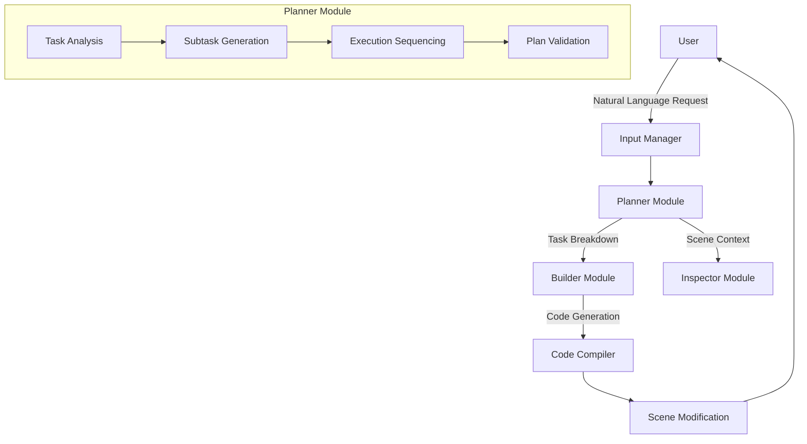
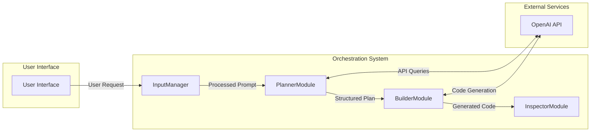
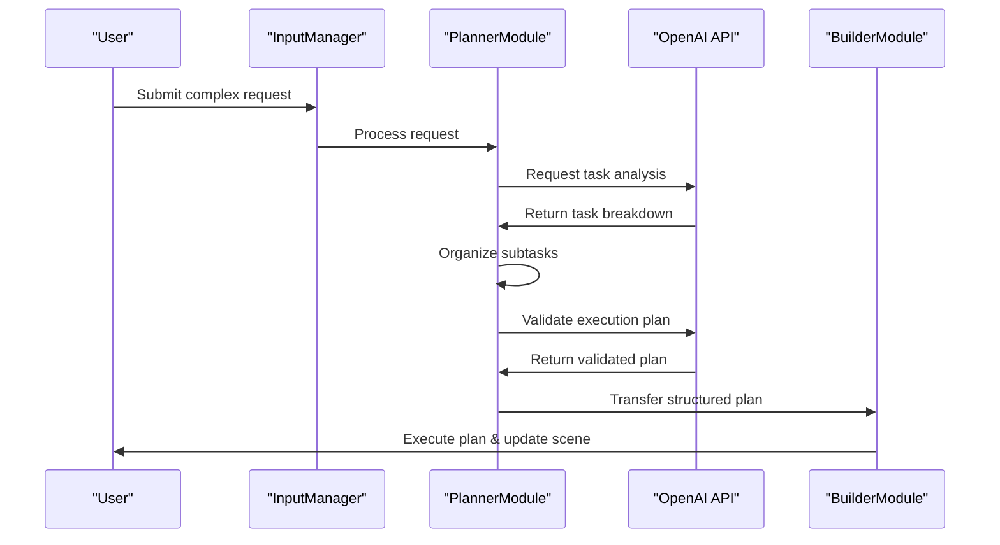
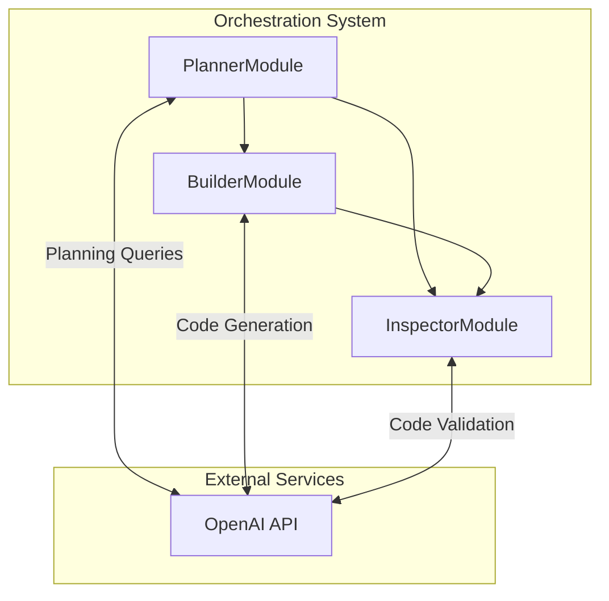

<!-- source: DeepWiki mcp.deepwiki.com · repo microsoft/LLMR · page 4.1 Planner Module · fetched 2026-10-26 -->

# Planner Module

Relevant source files

The following files were used as context for generating this wiki page:

- [README.md](README.md)
- [Transparency FAQ.md](Transparency FAQ.md)

## Purpose and Scope

The Planner Module is a crucial component of the LLMR framework that manages the breakdown of complex user requests into simpler, executable tasks. It serves as an intelligent intermediary between raw user input and the Builder Module, enhancing the system's ability to handle sophisticated scene creation and modification requests. For information about the implementation of generated plans, see [Builder Module](#4.2).

Sources: [README.md:98-100]()

## Overview

The Planner Module functions as a specialized chat agent within the LLMR framework. When users submit complex requests that require multiple steps or sophisticated reasoning, the Planner breaks these down into logical sub-tasks, creates a structured plan, and coordinates with other system modules to execute this plan effectively.

Sources: [README.md:98-100]()

## Position in System Architecture

The Planner Module sits between the user input processing and the code generation components. It receives processed user requests from the Input Manager and forwards structured task plans to the Builder Module, which then generates the necessary code to implement these plans.

Sources: [README.md:98-100]()

## Activation and Usage

Users can specifically invoke the Planner Module for complex tasks by pressing **Right Control** instead of Tab when submitting a request. This explicit invocation signals the system to engage in more thorough planning before code generation.

| Command | Action | Result |
|---------|--------|--------|
| Tab | Direct processing | Sends request directly to Builder Module |
| Right Control | Planning mode | Activates Planner Module for detailed task analysis |

Sources: [README.md:98-100]()

## Planning Process

The Planner Module follows a systematic approach to analyze user requests and develop executable plans:

1. **Request Analysis**: Interprets the natural language request to understand the user's intent
2. **Task Decomposition**: Breaks complex requests into manageable sub-tasks
3. **Dependency Mapping**: Identifies dependencies between sub-tasks
4. **Execution Planning**: Creates a sequential plan for implementing all sub-tasks
5. **Context Integration**: Incorporates current scene state into the planning process

Sources: [README.md:98-100]()

## Key Functions

The Planner Module expands on originally simple prompts by:

1. **Contextual Understanding**: Analyzing the current state of the scene
2. **Requirement Expansion**: Identifying implied requirements not explicitly stated
3. **Error Anticipation**: Predicting potential issues in implementation
4. **Resource Management**: Planning efficient use of system resources

### Example Planning Scenarios

| Original Request | Expanded Planning |
|------------------|-------------------|
| "Create a kitchen" | 1. Define kitchen boundaries 2. Create floor, walls, ceiling 3. Add countertops 4. Place appliances (stove, refrigerator) 5. Add cabinets and drawers 6. Place smaller items (utensils, dishes) |
| "Make a timer" | 1. Create visual representation 2. Implement countdown logic 3. Add start/stop functionality 4. Create completion notification 5. Add reset capability |
| "Build a farm" | 1. Create terrain with pastures 2. Add barn structure 3. Place farm animals 4. Add farmer character 5. Create farming equipment |

Sources: [README.md:98-100]()

## Integration with Other Modules

The Planner Module works closely with other components of the LLMR system:

Sources: [README.md:98-100]()

## Performance Considerations

Using the Planner Module provides significant benefits for complex tasks but comes with trade-offs:

| Aspect | Impact |
|--------|--------|
| Success Rate | Significantly higher for complex requests |
| Processing Time | Longer due to additional planning steps |
| API Token Usage | Higher (multiple LLM calls) |
| Code Quality | Improved structure and reliability |

To optimize performance, users can:
- Use direct processing (Tab) for simple requests
- Use the Planner (Right Control) for complex, multi-step tasks
- Be specific in request formulation to reduce ambiguity

Sources: [README.md:98-100](), [Transparency FAQ.md:44-50]()

## Summary

The Planner Module serves as a critical bridge between user intent and code execution in the LLMR framework. By breaking down complex tasks into manageable components and creating structured plans, it significantly improves the system's ability to handle sophisticated requests, resulting in a 4x reduction in average error rates compared to standard GPT-4 implementations.

Sources: [Transparency FAQ.md:11-13]()

---

