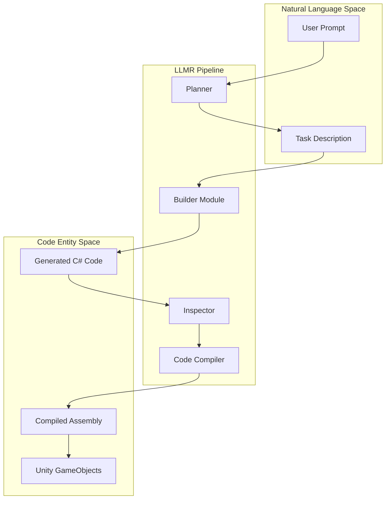
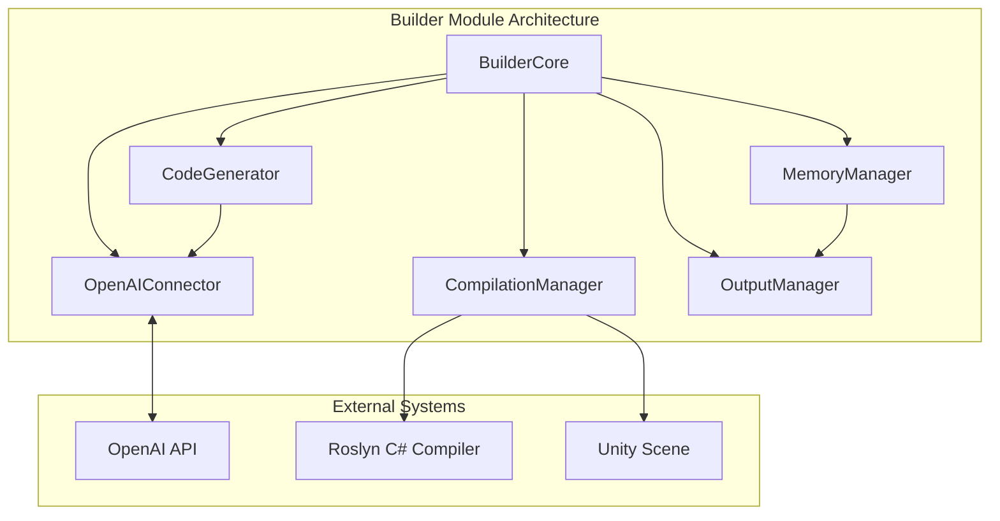
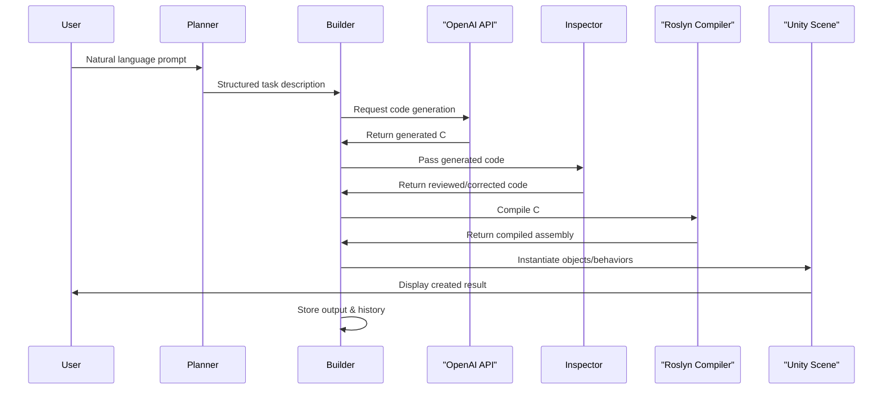

<!-- source: DeepWiki mcp.deepwiki.com · repo microsoft/LLMR · page 4.2 Builder Module · fetched 2026-10-26 -->

# Builder Module

Relevant source files

The following files were used as context for generating this wiki page:

- [README.md](README.md)
- [Transparency FAQ.md](Transparency FAQ.md)

## Purpose and Scope

The Builder Module is a core component of the LLMR (Large Language Model for Mixed Reality) framework responsible for translating natural language prompts into executable Unity code. It acts as the primary creation and modification engine, generating C# code at runtime that manipulates GameObjects, adds components, and implements behaviors in the Unity scene.

This document covers the Builder's architecture, workflow, integration with OpenAI, code generation process, and execution mechanisms. For information about task planning, see [Planner Module](#4.1). For details on code review and debugging, see [Inspector Module](#4.3).

Sources: [README.md:92-94]()

## System Overview

The Builder Module sits at the center of the LLMR creation pipeline, receiving task descriptions from the Planner and generating code that is subsequently reviewed by the Inspector. It transforms natural language intent into functional Unity components through a series of orchestrated steps.

Sources: [README.md:90-94]()

## Architecture

The Builder Module operates through a series of interconnected components that handle different aspects of the code generation process.

Sources: [README.md:18-21]()

## Workflow

The Builder follows a systematic workflow to convert natural language prompts into functional Unity objects and behaviors.

Sources: [README.md:90-94]()

## Code Generation Process

The Builder Module uses structured prompting techniques to guide the OpenAI model in generating appropriate Unity code. It maintains context about the current scene state, available Unity APIs, and user intent to produce effective code.

### Prompting Strategy

The Builder constructs specialized prompts that:

1. Provide context about the Unity environment and available APIs
2. Describe the specific creation or modification task
3. Specify expected code format and constraints
4. Include example patterns for common operations

### Generated Code Structure

The Builder typically generates code in standardized formats:

- Complete MonoBehaviour classes for behaviors
- Instantiation code for creating objects
- Property modification code for changing existing objects
- Event handling code for interactive elements

Sources: [README.md:11-14](), [README.md:92-94]()

## Code Execution and Memory

### Output Fields and History

The Builder maintains two important public fields for tracking the results of code generation:

1. **Output**: Contains the actual code executed for the most recent request
2. **History**: Contains the full conversation history, including user prompts and system responses

These fields provide transparency into the code generation process and aid in debugging.

### Runtime Compilation

The Builder uses the Roslyn C# compiler (through Trivial Interactive's implementation) to compile the generated code at runtime. This compilation process:

1. References necessary assembly DLLs (stored in the Assemblies folder)
2. Creates a compiled assembly from the generated code
3. Attaches the compiled code to GameObjects in the scene

### Object Creation Methods

The Builder can create objects through two main approaches:

| Approach | Description | Use Case |
|----------|-------------|----------|
| Unity Primitives | Generating code that creates and manipulates Unity's built-in primitive shapes | Simple geometric shapes, basic behaviors |
| External Models | Using DALL-E and CLIP to find visually similar 3D models from Sketchfab | Complex objects with realistic appearances |

Sources: [README.md:18-21](), [README.md:92-94](), [README.md:102-108]()

## Integration with Other Modules

### Planner Integration

The Builder receives task descriptions from the Planner, which breaks down complex user requests into manageable steps. This integration improves the success rate for complex creation tasks.

### Inspector Integration 

After generating code, the Builder passes it to the Inspector module, which reviews the code for errors and suggests corrections. This review process helps ensure the generated code will compile and run correctly.

### DallE-CLIP Integration

For complex object creation, the Builder can integrate with the DallE-CLIP pipeline to locate and import 3D models that match the user's description, rather than attempting to construct complex objects from primitives.

Sources: [README.md:98-101](), [README.md:102-108]()

## Error Handling and Debugging

The Builder implements several strategies to handle errors and improve code generation reliability:

1. Multiple generation attempts for failed code
2. Context enrichment with error messages
3. Integration with the Inspector for code review
4. Fallback to simpler approaches when complex generation fails

Users can check the Console window to see if the generated code produced any compilation or runtime errors.

Sources: [README.md:92-94]()

## Usage Example

A typical interaction with the Builder Module through the LLMR framework:

1. User enters a prompt in the input field: "Create a rotating cube that changes color every second"
2. The prompt is processed by the Planner (if enabled) or sent directly to the Builder
3. The Builder generates appropriate C# code for a color-changing, rotating cube
4. The code is reviewed by the Inspector and compiled
5. A cube appears in the scene with the requested behavior
6. The system displays "Processing finished. Please enter the next request."

Sources: [README.md:90-94]()

## Technical Considerations

### Performance Impact

The Builder's code generation process involves multiple API calls to OpenAI, which can introduce latency in the creation process. Complex requests may require more time to process.

### Memory Management

The Builder maintains state across interactions, allowing it to remember previously created objects and their properties. This enables iterative refinement of created content.

### Best Practices

- Use clear, specific language when describing desired objects and behaviors
- Break complex requests into smaller steps
- Check the Console for errors if created objects don't behave as expected
- Examine the Output field on the Builder GameObject to understand the generated code

Sources: [README.md:96-101]()

---

