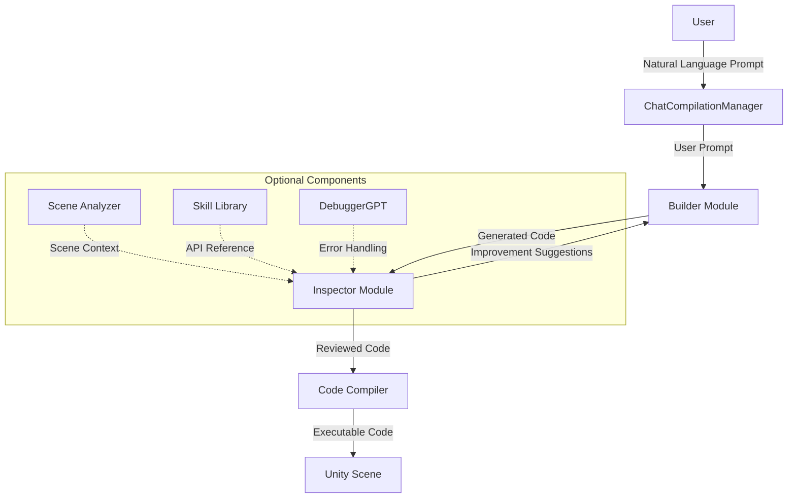
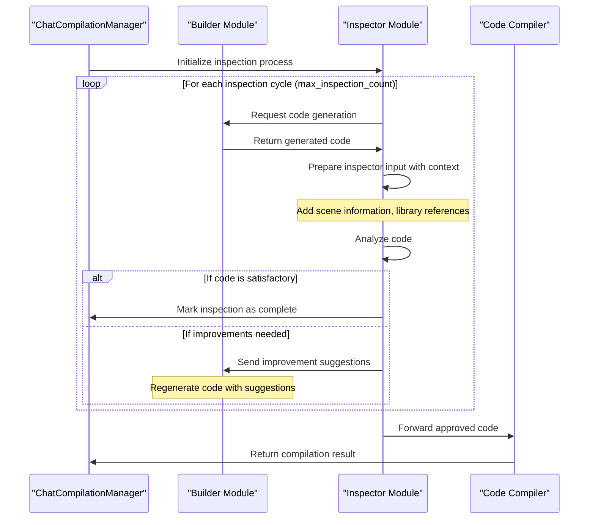
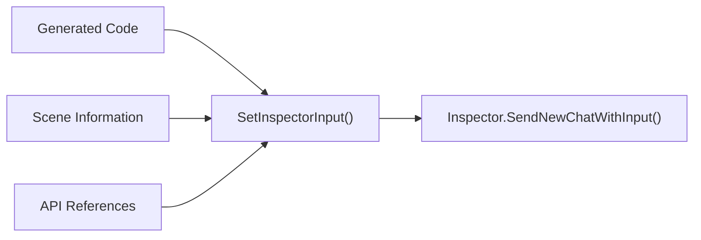
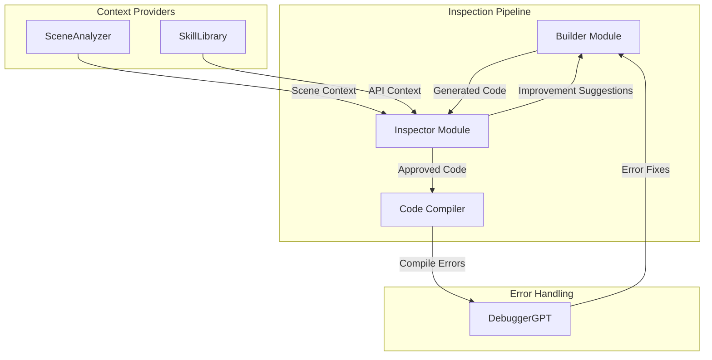
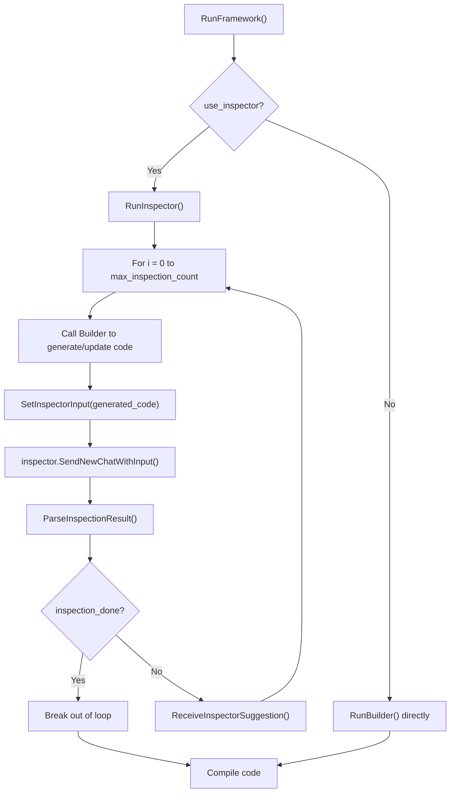

<!-- source: DeepWiki mcp.deepwiki.com · repo microsoft/LLMR · page 4.3 Inspector Module · fetched 2026-10-26 -->

# Inspector Module

Relevant source files

The following files were used as context for generating this wiki page:

- [Assets/Scripts/MR_Copilot/ChatCompilationManagerModular.cs](Assets/Scripts/MR_Copilot/ChatCompilationManagerModular.cs)
- [README.md](README.md)
- [Transparency FAQ.md](Transparency FAQ.md)

The Inspector Module is a critical component in the LLMR (Large Language Model for Mixed Reality) framework that analyzes and provides feedback on generated code. It acts as a quality assurance layer between code generation and execution, helping to reduce errors and improve code reliability before compilation. This page documents the Inspector Module's purpose, architecture, operation flow, and integration with other LLMR components.

For information about code generation, see [Builder Module](#4.2), and for information about handling compilation and runtime errors, see [Code Generation and Compilation](#2.3).

## Purpose and Functionality

The Inspector Module serves as a specialized code reviewer that performs the following key functions:

1. **Code Analysis**: Examines code generated by the Builder Module for potential issues, bugs, or inefficiencies
2. **Quality Improvement**: Provides suggestions to improve code quality and functionality
3. **Error Prevention**: Identifies and helps fix issues before code compilation to reduce runtime errors
4. **Contextual Awareness**: Utilizes scene information to ensure code is appropriate for the current environment

By implementing these functions, the Inspector Module significantly enhances the reliability of generated code, contributing to the 4x reduction in average error rate compared to standard LLM code generation.

Sources: [ChatCompilationManagerModular.cs:359-386](), [README.md:1-133]()

## System Integration

The Inspector Module operates within a pipeline of code generation, review, and execution. It acts as a bridge between the Builder Module (which generates code) and the compilation/execution process.

Sources: [ChatCompilationManagerModular.cs:16](), [ChatCompilationManagerModular.cs:194-215]()

## Operation Flow

The Inspector Module operates iteratively, with a configurable maximum number of inspection cycles. This allows it to progressively improve code quality through multiple rounds of feedback.

Sources: [ChatCompilationManagerModular.cs:359-386](), [ChatCompilationManagerModular.cs:343-351]()

## Input Preparation

The Inspector Module requires context about both the code it's reviewing and the environment in which the code will operate. The system prepares this input by combining:

1. **Generated Code**: The code produced by the Builder Module
2. **Scene Information**: Context about the current Unity scene (if Scene Analyzer is enabled)
3. **API References**: Information about available libraries and APIs (if Skill Library is enabled)

This combined input provides the Inspector with the necessary context to make informed suggestions.

Sources: [ChatCompilationManagerModular.cs:343-351](), [ChatCompilationManagerModular.cs:371-373]()

## Configuration Settings

The Inspector Module can be configured through several settings:

| Setting | Description | Default | 
|---------|-------------|---------|
| max_inspection_count | Maximum number of inspection cycles | Varies by configuration |
| metaprompt | Instructions that guide the Inspector's behavior | Based on enabled modules |
| use_inspector | Toggle to enable/disable the Inspector | Configurable via UI |

Different metaprompts can be assigned to the Inspector based on which other modules are active:

- Base metaprompt
- SkillLibrary-aware metaprompt
- SceneAnalyzer-aware metaprompt

Sources: [ChatCompilationManagerModular.cs:294-334](), [ChatCompilationManagerModular.cs:468-473]()

## Interaction with Other Modules

The Inspector Module interacts with several other components in the LLMR framework:

### Builder Module

The Inspector receives code from the Builder and provides suggestions for improvement. These suggestions are then incorporated by the Builder in subsequent code generation attempts.

### Scene Analyzer

When enabled, the Scene Analyzer provides the Inspector with detailed information about the current Unity scene. This context helps the Inspector ensure that generated code is appropriate for the scene environment.

### Skill Library

The Skill Library provides the Inspector with information about available APIs and libraries. This helps the Inspector verify that the generated code uses available functions correctly.

### Debugger

The Debugger works in conjunction with the Inspector to handle runtime errors that might occur even after code inspection. The Inspector focuses on preventing errors before compilation, while the Debugger addresses errors that occur during execution.

Sources: [ChatCompilationManagerModular.cs:46-458]()

## Process Flow Detail

The following diagram illustrates the detailed process flow of how the Inspector Module operates within the code generation workflow:

Sources: [ChatCompilationManagerModular.cs:194-215](), [ChatCompilationManagerModular.cs:359-386]()

## Key Inspector Methods

The Inspector Module implements several key methods that facilitate code analysis and improvement:

1. **SendNewChatWithInput(input)**: Sends the code and context to the LLM for analysis
2. **ParseInspectionResult(code, isMemoryless)**: Processes the LLM's response to extract actionable suggestions
3. **SetMetapromptAndClearHistory(metaprompt)**: Configures the Inspector with specific instructions

These methods enable the Inspector to perform its core functions and integrate with the rest of the LLMR system.

Sources: [ChatCompilationManagerModular.cs:359-386](), [ChatCompilationManagerModular.cs:307-313]()

## Conclusion

The Inspector Module serves as a critical component in the LLMR framework's code generation pipeline. By analyzing generated code before compilation and execution, it helps prevent errors and improve code quality. Its iterative approach to code improvement, along with its awareness of scene context and available APIs, contributes significantly to the reliability of the LLMR system.

The Inspector demonstrates how LLMs can be used not only for code generation but also for code review and quality assurance, showcasing a more comprehensive approach to AI-assisted programming in mixed reality environments.

---

