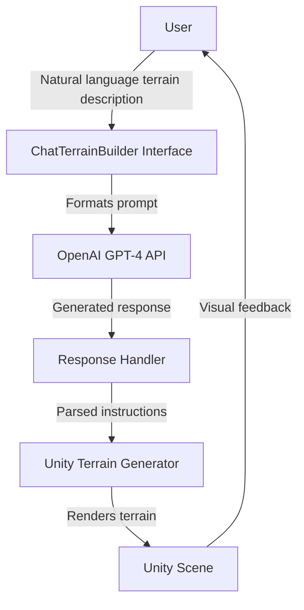
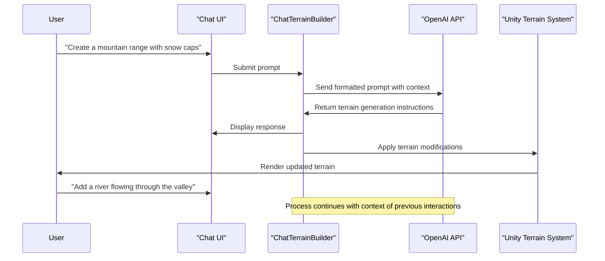
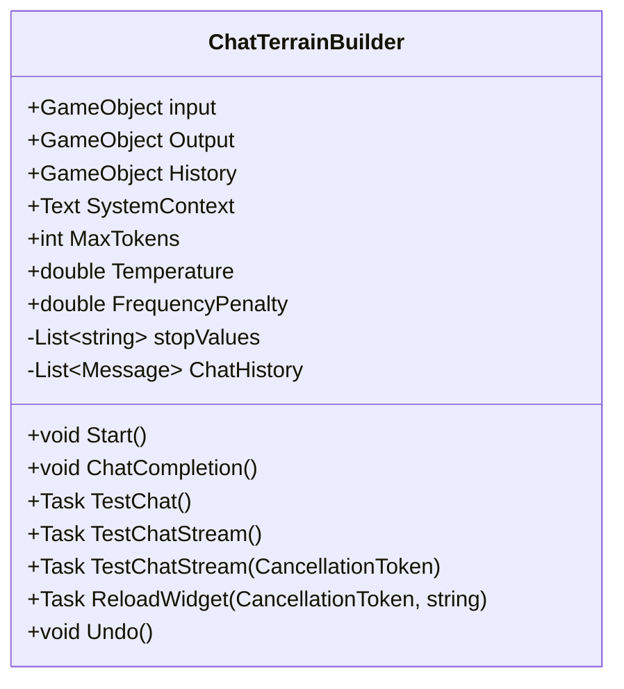
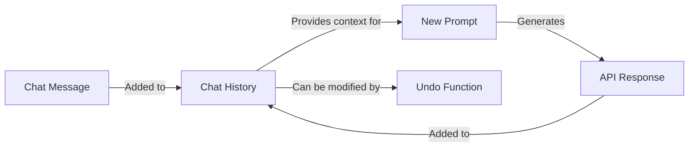
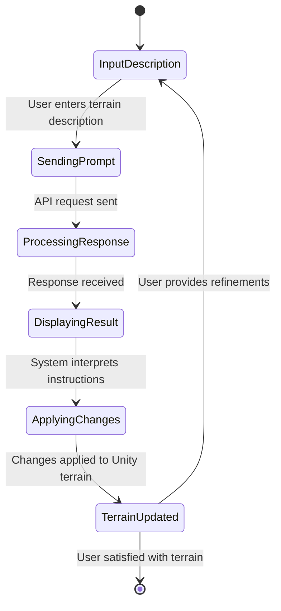
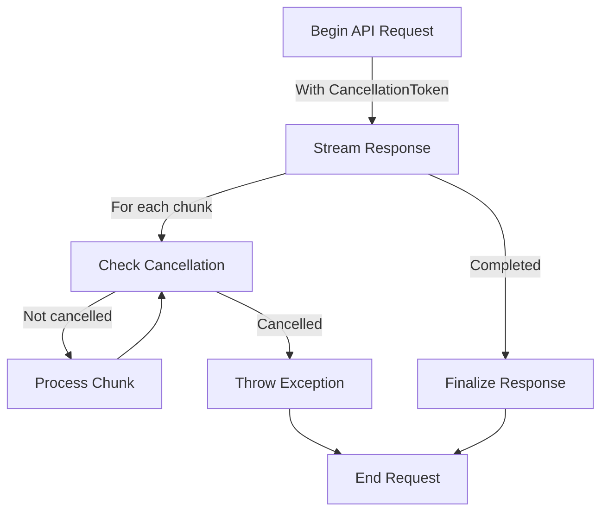

<!-- source: DeepWiki mcp.deepwiki.com · repo microsoft/LLMR · page 4.4 Terrain Building · fetched 2026-10-26 -->

# Terrain Building

Relevant source files

The following files were used as context for generating this wiki page:

- [Assets/Scripts/MR_Copilot/ChatTerrainBuilder.cs](Assets/Scripts/MR_Copilot/ChatTerrainBuilder.cs)

## Purpose and Scope

This document details the terrain building functionality within the LLMR system. The terrain building component enables users to create, modify, and customize 3D terrain environments through natural language commands. This page covers the implementation, architecture, and usage of the terrain generation system.

For information about the general Builder Module that handles broader object creation tasks, see [Builder Module](#4.2).

## System Overview

The terrain building system in LLMR uses a chat-based interface to allow users to describe terrain features using natural language. These descriptions are processed by OpenAI's GPT-4 model, which generates appropriate responses that the system then interprets to create or modify terrain within the Unity environment.

Sources: [Assets/Scripts/MR_Copilot/ChatTerrainBuilder.cs:1-223]()

## Key Components

The terrain building system consists of the following key components:

| Component | Purpose |
|-----------|---------|
| ChatTerrainBuilder | Core class that handles user input, API communication, and response management |
| OpenAI API Client | Processes natural language requests and generates terrain-building instructions |
| UI Elements | Input fields, output display, and history panels for user interaction |
| Unity Terrain System | The underlying Unity system that executes the terrain modifications |

Sources: [Assets/Scripts/MR_Copilot/ChatTerrainBuilder.cs:14-223]()

## Chat-Based Terrain Generation Process

The terrain building system uses a conversation-based approach where users can iteratively describe and refine terrain features through natural language.

Sources: [Assets/Scripts/MR_Copilot/ChatTerrainBuilder.cs:45-149]()

## Implementation Details

### ChatTerrainBuilder Class

The `ChatTerrainBuilder` class serves as the main controller for the terrain building functionality. It inherits from MonoBehaviour and manages:

1. User input collection and formatting
2. Communication with the OpenAI API
3. Response processing and display
4. Chat history management

Sources: [Assets/Scripts/MR_Copilot/ChatTerrainBuilder.cs:14-223]()

### OpenAI Integration

The terrain builder establishes a connection to OpenAI's GPT-4 model through the OpenAI Unity client. This integration allows for:

1. Sending terrain description prompts to the API
2. Processing API responses for terrain generation
3. Supporting both synchronous and streaming response modes

Key methods handling API communication include:
- `TestChat()`: Sends a complete chat request and waits for full response
- `TestChatStream()`: Streams the API response progressively, updating the UI in real-time

Sources: [Assets/Scripts/MR_Copilot/ChatTerrainBuilder.cs:50-149]()

## Chat History Management

The system maintains a conversation history to provide context for ongoing terrain modifications. The chat history:

1. Includes both user inputs and system responses
2. Preserves the context of previous terrain modifications
3. Allows for iterative refinement of terrain features

The history management includes:
- Adding new messages to the chat history
- Displaying the full conversation in the UI
- Supporting undo functionality to remove recent prompts

Sources: [Assets/Scripts/MR_Copilot/ChatTerrainBuilder.cs:31-31](), [Assets/Scripts/MR_Copilot/ChatTerrainBuilder.cs:192-199]()

## User Interface Components

The terrain builder's UI consists of several key components:

| Component | Property Name | Purpose |
|-----------|---------------|---------|
| Input Field | `input` | Accepts user's natural language terrain descriptions |
| Output Display | `Output` | Shows the current response from the API |
| History Panel | `History` | Displays the full conversation history |
| System Context | `SystemContext` | Contains system instructions for the AI |

These UI elements create a conversational interface where users can describe terrain features and see the API's responses before they are applied to the scene.

Sources: [Assets/Scripts/MR_Copilot/ChatTerrainBuilder.cs:16-19]()

## Configuration Options

The terrain builder offers several configuration options to control the behavior of the language model:

| Parameter | Purpose | Default Value |
|-----------|---------|---------------|
| `MaxTokens` | Maximum length of generated responses | 512 |
| `Temperature` | Controls randomness of responses (0-1) | 0.7 |
| `FrequencyPenalty` | Reduces repetition in responses (0-2) | - |
| `stopValues` | List of strings to stop generation | ["/*", "</"] |

These parameters allow for fine-tuning the terrain generation responses to achieve the desired level of detail and creativity.

Sources: [Assets/Scripts/MR_Copilot/ChatTerrainBuilder.cs:22-29]()

## Usage Flow

Sources: [Assets/Scripts/MR_Copilot/ChatTerrainBuilder.cs:45-149]()

## Technical Considerations

### Streaming vs. Non-Streaming Responses

The terrain builder supports two methods for retrieving API responses:

1. **Non-streaming** (`TestChat`): Waits for the complete response before updating the UI and processing the result
2. **Streaming** (`TestChatStream`): Updates the UI progressively as response chunks arrive, providing better user feedback for long responses

The streaming approach is particularly useful for complex terrain descriptions that may generate lengthy responses.

Sources: [Assets/Scripts/MR_Copilot/ChatTerrainBuilder.cs:50-107]()

### Cancellation Support

For improved responsiveness, the terrain builder implements cancellation token support, allowing users to cancel ongoing API requests if needed.

Sources: [Assets/Scripts/MR_Copilot/ChatTerrainBuilder.cs:112-149]()

## Integration with LLMR System

The terrain building functionality fits into the broader LLMR system as a specialized capability for terrain manipulation. While the general Builder module handles object creation and scene modification, the terrain builder focuses specifically on creating natural landscapes and terrain features using Unity's terrain system.

Sources: [Assets/Scripts/MR_Copilot/ChatTerrainBuilder.cs:1-223]()

## Limitations and Future Work

Based on the current implementation, there are some limitations to note:

1. The direct code for actual terrain manipulation in Unity is not visible in the provided files, suggesting integration with Unity's terrain system happens elsewhere
2. The chat interface provides natural language interaction but doesn't show the underlying terrain generation code
3. The system relies heavily on the quality of the OpenAI API responses to generate appropriate terrain

Potential future enhancements could include:
- More direct control over specific terrain parameters
- Integration with procedural terrain generation techniques
- Support for terrain texturing and vegetation placement through natural language

Sources: [Assets/Scripts/MR_Copilot/ChatTerrainBuilder.cs:1-223]()

---

