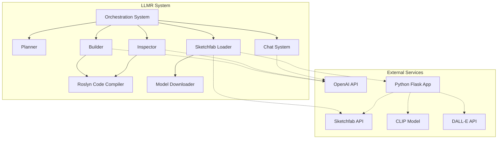
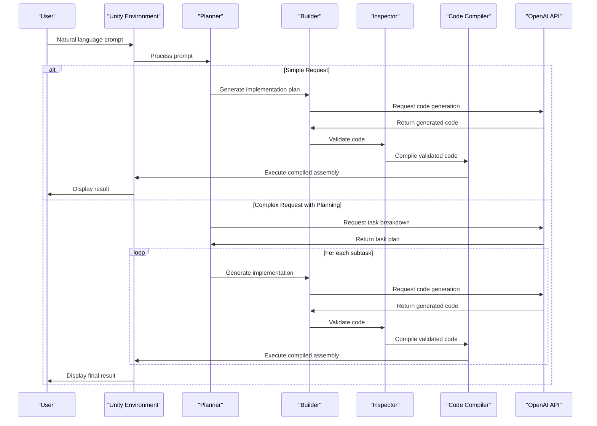
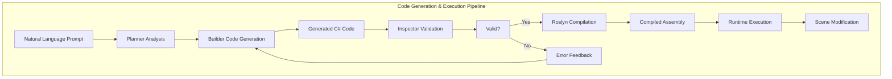
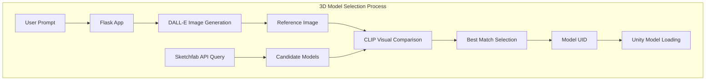
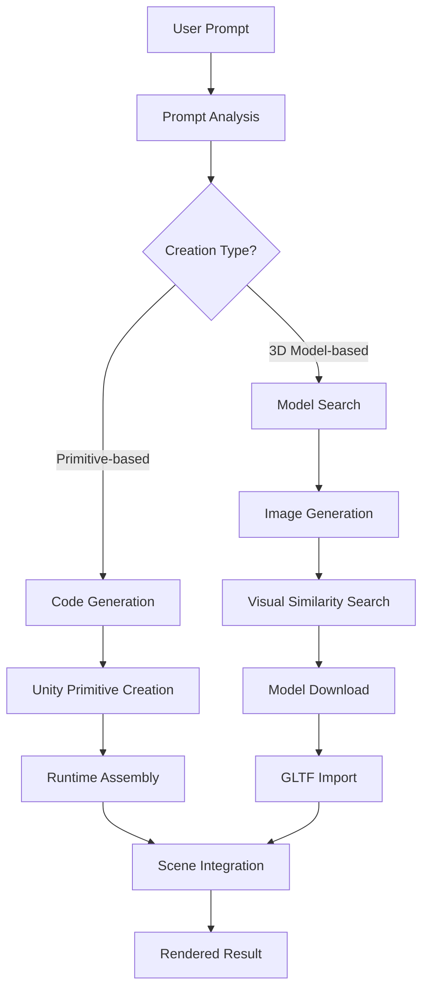
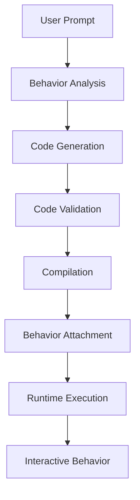

<!-- source: DeepWiki mcp.deepwiki.com · repo microsoft/LLMR · page 5 Technical Reference · fetched 2026-10-26 -->

# Technical Reference

Relevant source files

The following files were used as context for generating this wiki page:

- [.gitignore](.gitignore)
- [Packages/manifest.json](Packages/manifest.json)
- [Packages/packages-lock.json](Packages/packages-lock.json)
- [ProjectSettings/Packages/com.unity.testtools.codecoverage/Settings.json](ProjectSettings/Packages/com.unity.testtools.codecoverage/Settings.json)
- [README.md](README.md)

This document provides detailed technical specifications, architecture information, and implementation details for developers working with the LLMR system. It covers system components, dependencies, code structure, and integration points to help developers understand and extend the framework. For getting started with LLMR, see [Getting Started](#1.2), and for a higher-level conceptual overview, see [Overview](#1).

## System Requirements and Dependencies

LLMR has several critical dependencies that need to be configured properly for the system to function:

### Unity Requirements
- Unity versions 2021.3.25f1 or 2022.3.11f1 (tested and verified)
- Roslyn C# Runtime Compiler by Trivial Interactive

### External Dependencies
- OpenAI API access
- Python 3.9+ (for CLIP-DallE integration)
- Sketchfab API access (for 3D model retrieval)

### Package Dependencies

The table below outlines the key package dependencies required by LLMR:

| Package | Version | Purpose |
|---------|---------|---------|
| com.openai.unity | 7.7.9 | OpenAI API integration |
| com.siccity.gltfutility | Git | GLTF model loading utility |
| com.utilities.rest | 2.1.8 | REST API communication |
| com.utilities.encoder.wav | 1.0.6 | Audio encoding |
| com.unity.nuget.newtonsoft-json | 3.2.1 | JSON serialization |

Sources: [Packages/manifest.json:3-4](), [Packages/packages-lock.json:3-21]()

## System Architecture

### Component Overview

The LLMR system is organized into several interconnected components, each responsible for specific functionality within the framework:

Sources: [README.md:10-15]()

### Processing Pipeline

The following diagram illustrates the sequence of operations that occur when a user enters a natural language prompt:

Sources: [README.md:91-101]()

## Core Components

### Orchestration System

The Orchestration System serves as the central coordination point for all LLMR components. It manages the workflow between components and delegates tasks appropriately.

Key responsibilities:
- Routing user prompts to appropriate subsystems
- Managing the state of the processing pipeline
- Coordinating between components for complex operations
- Handling errors and fallbacks

### Planner

The Planner component analyzes natural language prompts and determines how to break down complex requests into manageable tasks.

Key responsibilities:
- Parsing and understanding user prompts
- Breaking down complex tasks into smaller subtasks
- Determining which components should be involved
- Supporting iterative planning for multi-step operations

When the Right Control key is used instead of Tab to send a request, the Planner is activated to carefully expand on simpler prompts for more complex operations.

Sources: [README.md:100-101]()

### Builder

The Builder component is responsible for generating C# code that implements the desired functionality.

Key responsibilities:
- Constructing prompts for the OpenAI API to generate code
- Managing code templates and providing context for generation
- Processing the generated code before passing it to the Inspector
- Tracking created objects and their properties

The code generated by the Builder and the conversation history can be found in the public fields **Output** and **History** on the **Builder** GameObject.

Sources: [README.md:94-95]()

### Inspector

The Inspector component validates and reviews generated code before compilation.

Key responsibilities:
- Analyzing generated code for potential issues
- Ensuring code adheres to safety constraints
- Suggesting fixes for problematic code
- Logging validation results

### Code Compiler

The Code Compiler component utilizes the Roslyn C# compiler to compile and execute generated code at runtime.

Key responsibilities:
- Setting up the compilation environment
- Loading required assembly references
- Compiling C# code into executable assemblies
- Attaching compiled code to GameObjects

Sources: [README.md:19-21](), [README.md:91-94]()

## External Integrations

### OpenAI Integration

LLMR integrates with the OpenAI API for natural language processing, code generation, and other AI-powered features.

Key integration points:
- GPT models for code generation
- Natural language understanding for planning
- Chat-based interaction for complex requests

Implementation:
- Uses the com.openai.unity package (version 7.7.9)
- API calls are managed through REST API communication

Sources: [Packages/manifest.json:3](), [README.md:133]()

### DALL-E and CLIP Integration

The system integrates with DALL-E for image generation and CLIP for visual similarity matching through a Python Flask application.

Key functionalities:
- `/get_image_from_prompt`: Generates images using DALL-E from text prompts
- `/get_closest_skfb_model`: Uses CLIP to find visually similar models on Sketchfab
- `/get_scene_from_prompt`: Generates scene layouts with multiple objects

Sources: [README.md:103-110](), [README.md:120-125]()

### Sketchfab Integration

The system integrates with Sketchfab to find and download 3D models that match user prompts.

Key integration points:
- Sketchfab API for model searching
- Model downloading and importing into Unity
- Visual similarity matching with reference images

The integration workflow:
1. User requests a specific 3D object
2. System generates a reference image with DALL-E
3. System searches Sketchfab for models with matching descriptions
4. CLIP compares models visually to the reference image
5. Best match is downloaded and imported into Unity

Sources: [README.md:12](), [README.md:120-125]()

### Flask Application

A Python Flask application provides additional capabilities beyond what's directly available in Unity:

Key endpoints:
- `/get_image_from_prompt`: Generate images using DALL-E
- `/get_closest_skfb_model`: Find visually similar models on Sketchfab
- `/get_scene_from_prompt`: Generate scene layouts

Setup requirements:
- Python 3.9 or higher
- Dependencies installed via `pip install -r requirements.txt`
- Flask app running locally (`flask run`)

Sources: [README.md:54-77](), [README.md:114-127]()

## Runtime Environment

### Assembly Loading

The runtime code compilation depends on preloaded assembly DLLs located in the Assemblies folder. These must be registered as Assembly Reference Assets using the Trivial Interactive package.

Key considerations:
- Assembly references must be properly configured
- Required assemblies must be available at runtime
- Missing assembly references will cause compilation errors

Sources: [README.md:21-22]()

### Unity-Specific Configuration

The LLMR system has been tested on specific Unity versions and requires particular setup:

- Unity versions: 2021.3.25f1 and 2022.3.11f1
- Project structure requirements:
  - Assemblies folder at root directory level
  - Modified manifest.json with required dependencies
  - Proper scoped registry configuration for OpenUPM

Sources: [README.md:18-19](), [README.md:24-49]()

## Technical Workflows

### Object Creation Workflow

Sources: [README.md:12]()

### Behavior Programming Workflow

Sources: [README.md:13]()

## Project Structure

The LLMR project follows a specific structure with several key components:

- **Root Directory**
  - `Assemblies/`: Contains required assembly DLLs
  - `Assets/`: Unity project assets
  - `CLIP-DallE-SketchFab-001/`: Python Flask application
  - `Packages/`: Package dependencies
  - `ProjectSettings/`: Unity project settings

- **External Dependencies**
  - Roslyn C# compiler (Trivial Interactive)
  - OpenAI Unity package
  - GLTF Utility package

Sources: [README.md:24-49]()

## Performance Considerations

When working with LLMR, consider the following performance aspects:

1. **Runtime Compilation Overhead**: Code compilation at runtime introduces latency
2. **API Call Latency**: External API calls to OpenAI and Sketchfab add latency
3. **Model Download Size**: Large 3D models can impact performance
4. **Memory Management**: Generated code and downloaded models consume memory
5. **Python Flask App Communication**: HTTP communication adds network overhead

## Troubleshooting

Common technical issues when working with LLMR:

1. **Missing Assembly References**: Error message "The required namespace xxx cannot be found"
   - Solution: Ensure all required DLLs are in the Assemblies folder and properly referenced

2. **OpenAI API Rate Limits**: API calls failing due to rate limiting
   - Solution: Implement request throttling or upgrade API tier

3. **Flask App Connection Issues**: Unity unable to connect to Flask app
   - Solution: Verify Flask app is running and accessible at the expected URL

4. **Code Compilation Errors**: Generated code fails to compile
   - Solution: Check console for specific error messages and adjust prompts

Sources: [README.md:131-132]()

---

