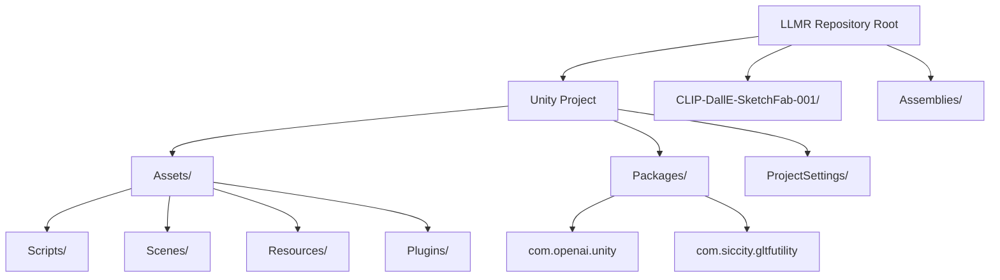
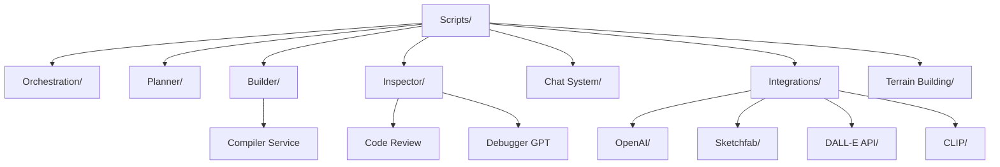
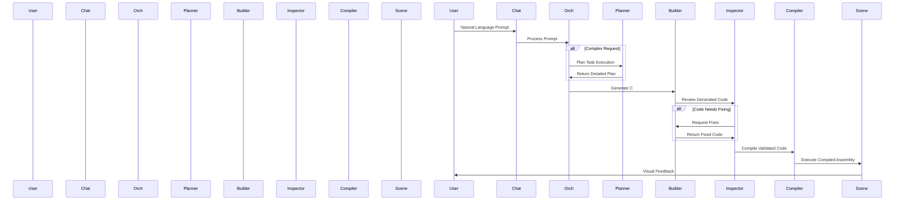
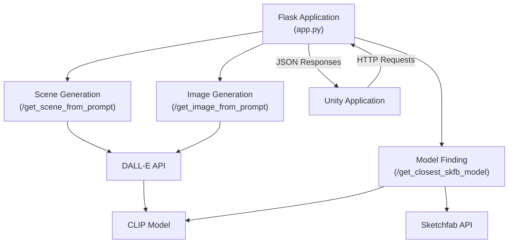
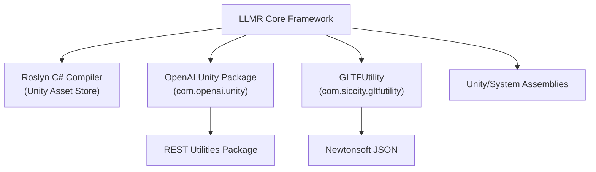
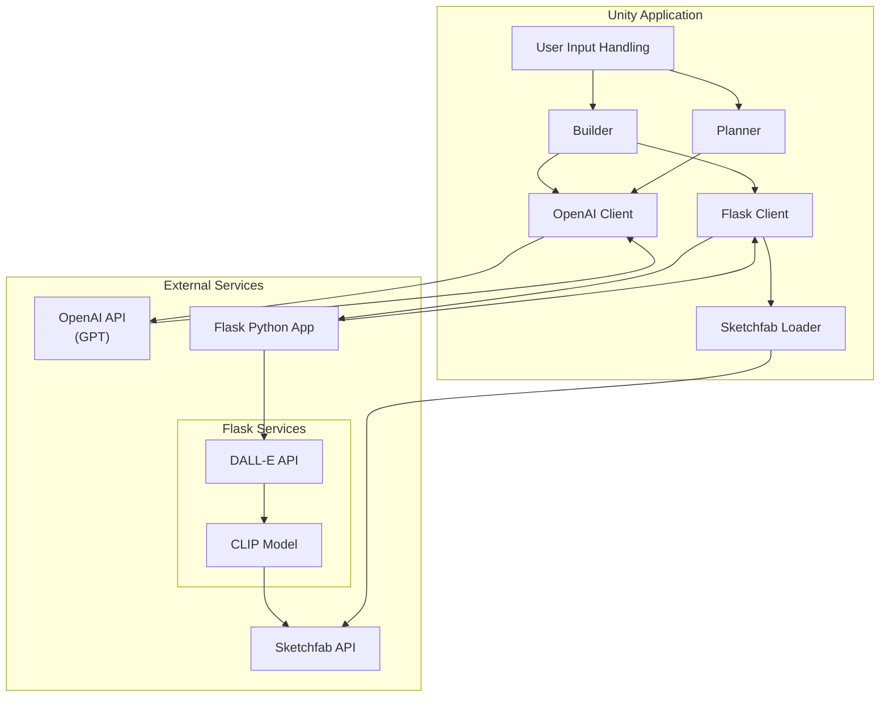

<!-- source: DeepWiki mcp.deepwiki.com · repo microsoft/LLMR · page 5.1 Project Structure · fetched 2026-10-26 -->

# Project Structure

Relevant source files

The following files were used as context for generating this wiki page:

- [Assets/Scenes/Playground_new.unity](Assets/Scenes/Playground_new.unity)
- [README.md](README.md)

This document provides a technical overview of the LLMR project's file and directory organization, helping developers understand where to find specific components and how they relate to each other. For information about the system architecture and how components interact at a high level, see [System Architecture](#2).

## Repository Overview

The LLMR repository is structured as a Unity project with an auxiliary Python Flask application. The project follows a modular organization centered around the core components detailed in the system architecture.

### High-Level Directory Structure

Sources: [README.md:16-53]()

## Core Unity Components

The main functionality of LLMR is implemented through several key components organized in the Unity project. These components correspond to the systems illustrated in the overall architecture.

Sources: [README.md:85-101]()

### Component Responsibilities

| Component | Description | Key Files |
|-----------|-------------|-----------|
| Orchestration | Coordinates workflow between different components | OrchestratorManager.cs |
| Planner | Breaks down complex tasks into smaller steps | PlannerAgent.cs |
| Builder | Generates code to create and modify objects in the scene | Builder.cs |
| Inspector | Reviews and validates generated code | Inspector.cs |
| Chat System | Processes natural language input and manages conversation | ChatManager.cs |
| Compiler Service | Compiles and executes generated code at runtime | CompilerService.cs |

Sources: [README.md:85-101]()

## Code Generation and Execution Flow

The following sequence diagram illustrates how the different components interact during the typical flow of processing a user prompt:

Sources: [README.md:85-101]()

## Python Flask Application

The CLIP-DallE-SketchFab-001 directory contains a Python Flask application that provides additional AI capabilities through several key endpoints:

Sources: [README.md:54-77](), [README.md:108-127]()

### Flask Application Endpoints

| Endpoint | Purpose | Input | Output |
|----------|---------|-------|--------|
| `/get_scene_from_prompt` | Generate scene image | Text prompt | Scene image |
| `/get_image_from_prompt` | Generate image for single object | Text prompt | Object image |
| `/get_closest_skfb_model` | Find matching 3D model | Text prompt, target image | Sketchfab model UID |

Sources: [README.md:114-124]()

## Unity Scenes

The project includes several demo scenes showcasing different capabilities:

| Scene Name | Path | Purpose |
|------------|------|---------|
| Playground_new | Assets/Scenes/Playground_new.unity | Empty environment for creating objects with natural language |
| Playground_DallE-CLIP_Refinement | Assets/Scenes/Playground_DallE-CLIP_Refinement.unity | Environment for finding and importing Sketchfab models |

Sources: [README.md:85-112]()

## Dependencies

LLMR relies on several key dependencies:

Sources: [README.md:16-33]()

### Assembly References

The runtime code compilation depends on preloaded assembly DLLs located in the `Assemblies/` directory. These are required for the Roslyn C# Compiler to properly generate and compile code at runtime.

Sources: [README.md:21-26]()

## Implementation Notes

1. The project follows a modular design pattern where components are loosely coupled but coordinated through the Orchestration system.

2. Generated code is stored in the `Builder` GameObject's public fields, accessible through the Unity Inspector:
   - **Output**: Contains the latest executed code
   - **History**: Contains the conversation history

3. User interaction occurs primarily through an input field in the game window, with different trigger keys for different processes:
   - **Tab**: Direct code generation
   - **Right Control**: Planning-based generation

Sources: [README.md:87-101]()

## External Service Communication

Sources: [README.md:114-127]()

The LLMR project structure reflects its modular architecture, with clear separation between the core Unity components and the supplementary Python Flask application. This organization facilitates both the runtime code generation capabilities within Unity and the advanced AI-based model matching functionality provided by the Flask application.

Sources: [README.md:1-160]()

---

