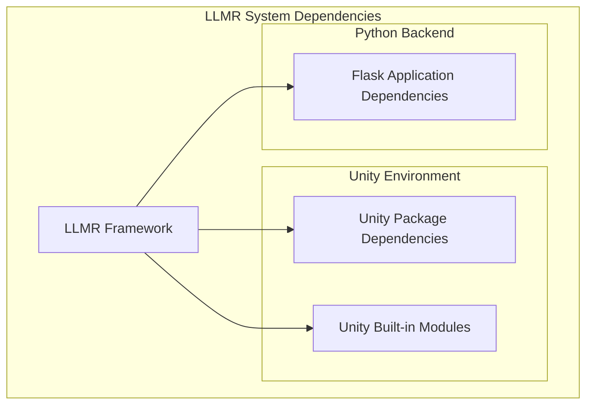
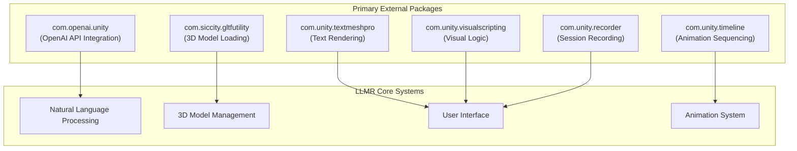
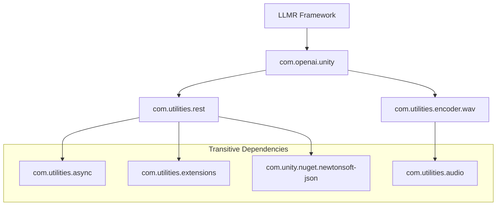
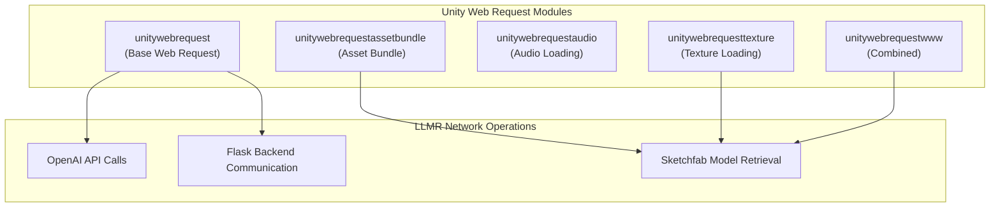
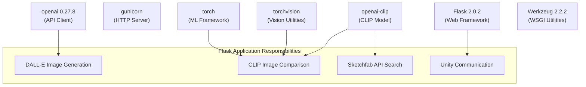
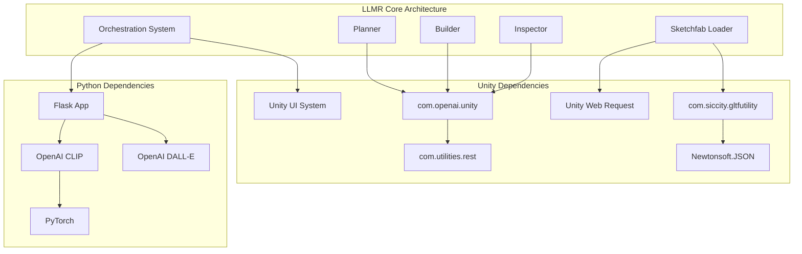
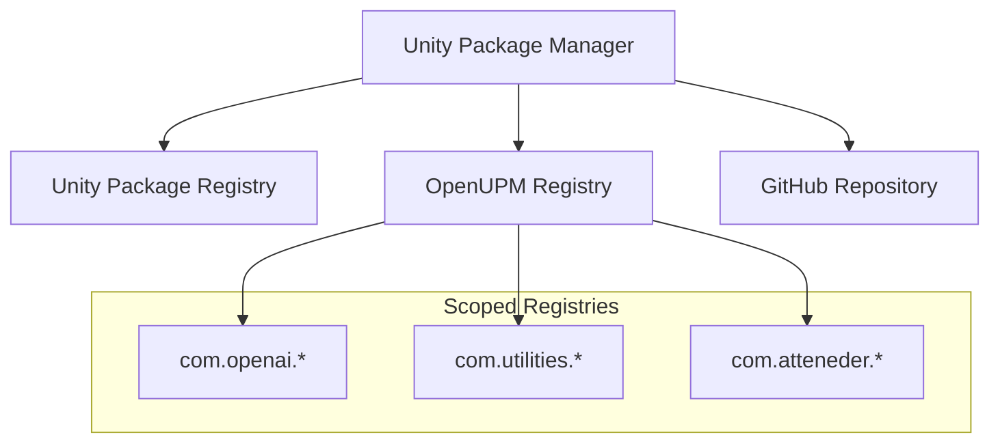

<!-- source: DeepWiki mcp.deepwiki.com · repo microsoft/LLMR · page 5.2 Dependencies · fetched 2026-10-26 -->

# Dependencies

<details>
<summary>Relevant source files</summary>

The following files were used as context for generating this wiki page:

- [.gitignore](.gitignore)
- [CLIP-DallE-SketchFab-001-main/requirements.txt](CLIP-DallE-SketchFab-001-main/requirements.txt)
- [NOTICE.md](NOTICE.md)
- [Packages/manifest.json](Packages/manifest.json)
- [Packages/packages-lock.json](Packages/packages-lock.json)
- [ProjectSettings/Packages/com.unity.testtools.codecoverage/Settings.json](ProjectSettings/Packages/com.unity.testtools.codecoverage/Settings.json)

</details>


This document provides a comprehensive overview of the external dependencies required by the LLMR (Large Language Model for Mixed Reality) system. Understanding these dependencies is crucial for developers working with the codebase, setting up a development environment, or deploying the system.

For information about the overall project structure, see [Project Structure](#5.1). For details on external API integrations, see [External Integrations](#3).

## 1. Overview of Dependency Categories

The LLMR system relies on several categories of dependencies to function properly:

1. **Unity Package Dependencies**: External packages that extend Unity's functionality
2. **Unity Built-in Modules**: Standard modules provided by the Unity engine
3. **Python Backend Dependencies**: Libraries required by the Flask service
4. **Transitive Dependencies**: Libraries automatically included by direct dependencies



Sources: [Packages/manifest.json:1-55](), [CLIP-DallE-SketchFab-001-main/requirements.txt:1-8]()

## 2. Unity Package Dependencies

The LLMR system relies on several essential third-party Unity packages to provide core functionality.

### 2.1 Primary External Packages

| Package | Version | Purpose | Source |
|---------|---------|---------|--------|
| `com.openai.unity` | 7.7.9 | Provides OpenAI API integration for Unity | OpenUPM |
| `com.siccity.gltfutility` | GitHub | Handles glTF 3D model loading and processing | GitHub |
| `com.unity.recorder` | 4.0.2 | Enables recording of Unity sessions | Unity Package Registry |
| `com.unity.textmeshpro` | 3.0.6 | Advanced text rendering | Unity Package Registry |
| `com.unity.timeline` | 1.7.6 | Timeline sequencing capabilities | Unity Package Registry |
| `com.unity.visualscripting` | 1.9.4 | Visual scripting functionality | Unity Package Registry |



Sources: [Packages/manifest.json:2-11](), [Packages/packages-lock.json:3-25](), [Packages/packages-lock.json:103-111](), [Packages/packages-lock.json:140-169]()

### 2.2 Development Dependencies

The project includes several packages primarily used during development:

| Package | Purpose |
|---------|---------|
| `com.unity.collab-proxy` | Unity collaboration tools |
| `com.unity.ide.visualstudio` | Visual Studio integration |
| `com.unity.ide.rider` | JetBrains Rider integration |
| `com.unity.ide.vscode` | Visual Studio Code integration |
| `com.unity.test-framework` | Unity testing tools |
| `com.unity.performance.profile-analyzer` | Performance profiling |
| `com.unity.testtools.codecoverage` | Code coverage analysis |

These are all included as part of the `com.unity.feature.development` package.

Sources: [Packages/manifest.json:5-6](), [Packages/packages-lock.json:43-56]()

### 2.3 OpenAI Unity Package Dependencies

The `com.openai.unity` package has its own dependencies that are crucial for LLMR functionality:

| Package | Purpose |
|---------|---------|
| `com.utilities.rest` | REST API communication utilities |
| `com.utilities.encoder.wav` | WAV audio encoding support |

These packages in turn depend on additional utilities:



Sources: [Packages/packages-lock.json:3-11](), [Packages/packages-lock.json:180-236]()

### 2.4 glTF Utility Dependencies

The `com.siccity.gltfutility` package, which handles 3D model loading, depends on:

- `com.unity.nuget.newtonsoft-json` - JSON serialization/deserialization

This is crucial for parsing glTF format files when loading 3D models.

Sources: [Packages/packages-lock.json:13-21](), [Packages/packages-lock.json:89-95]()

## 3. Unity Built-in Modules

LLMR uses numerous built-in Unity modules that provide core engine functionality. These modules are referenced in the project manifest and do not require separate installation.

### 3.1 Key Built-in Modules

| Module Category | Modules | Purpose |
|-----------------|---------|---------|
| **Core Functionality** | `ui`, `imgui`, `uielements`, `jsonserialize` | UI system and data handling |
| **Physics** | `physics`, `physics2d`, `terrainphysics` | Physics simulation |
| **Graphics & Rendering** | `terrain`, `animation`, `particlesystem` | Visual elements |
| **Networking** | `unitywebrequest` family | Web communication |
| **Platform** | `xr`, `vr`, `androidjni` | Platform-specific functionality |

### 3.2 Web Request Modules

The web request modules are particularly important for LLMR's functionality:



Sources: [Packages/manifest.json:11-42](), [Packages/packages-lock.json:237-479]()

## 4. Python Backend Dependencies

The LLMR system includes a Python Flask application that handles CLIP image processing, DALL-E image generation, and Sketchfab model searching.

### 4.1 Flask Application Dependencies

| Dependency | Version | Purpose |
|------------|---------|---------|
| `Flask` | 2.0.2 | Web application framework |
| `gunicorn` | - | WSGI HTTP server |
| `openai` | 0.27.8 | OpenAI API client |
| `torch` | - | PyTorch ML framework |
| `torchvision` | - | Computer vision utilities |
| `openai-clip` | - | OpenAI CLIP model |
| `Werkzeug` | 2.2.2 | WSGI utility library |



Sources: [CLIP-DallE-SketchFab-001-main/requirements.txt:1-8]()

## 5. Dependency Connections to LLMR Architecture

The following diagram illustrates how the major dependencies connect to the key components of the LLMR system architecture:



Sources: [Packages/manifest.json:1-55](), [CLIP-DallE-SketchFab-001-main/requirements.txt:1-8](), [Packages/packages-lock.json:3-25]()

## 6. Dependency Management

### 6.1 Unity Package Management

LLMR uses Unity's package management system with the following package sources:

1. **Unity Package Registry** - Standard Unity packages
2. **OpenUPM** - For `com.openai.unity` and utilities packages
3. **GitHub** - For `com.siccity.gltfutility`

The project uses the Unity Package Manager configured with scoped registries to access these packages.



Sources: [Packages/manifest.json:44-54]()

### 6.2 Python Dependency Management

The Python backend uses a standard `requirements.txt` file for dependency management. Packages can be installed using pip:

```
pip install -r CLIP-DallE-SketchFab-001-main/requirements.txt
```

Sources: [CLIP-DallE-SketchFab-001-main/requirements.txt:1-8]()

## 7. Licensing Considerations

The LLMR project uses third-party components subject to their own licenses:

- **OpenAI Unity SDK**: Used under MIT license from RageAgainstThePixel
- **glTF Utility**: GitHub project with its own licensing terms
- **Various Python libraries**: Including Flask, PyTorch, etc., each with their own licenses

Be aware of these license terms when using or modifying LLMR.

Sources: [NOTICE.md:1-7]()

## 8. Version Compatibility

For proper functioning of the LLMR system, ensure compatible versions of all dependencies:

| Component | Required Version |
|-----------|------------------|
| Unity | 2022.3.0f1 or newer |
| com.openai.unity | 7.7.9 |
| Flask | 2.0.2 |
| openai (Python) | 0.27.8 |
| Werkzeug | 2.2.2 |

Using incompatible versions may result in runtime errors or unexpected behavior.

Sources: [Packages/manifest.json:3](), [CLIP-DallE-SketchFab-001-main/requirements.txt:1-8]()

---

