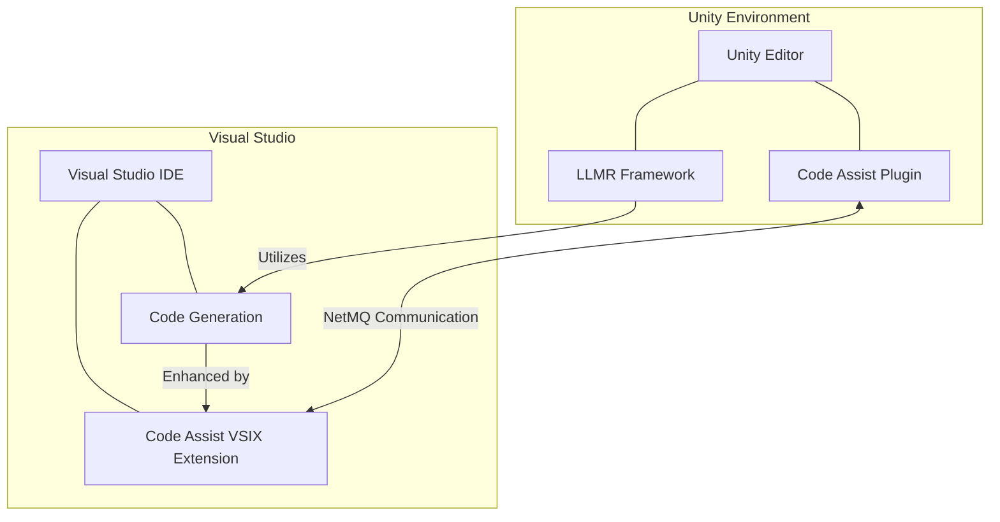
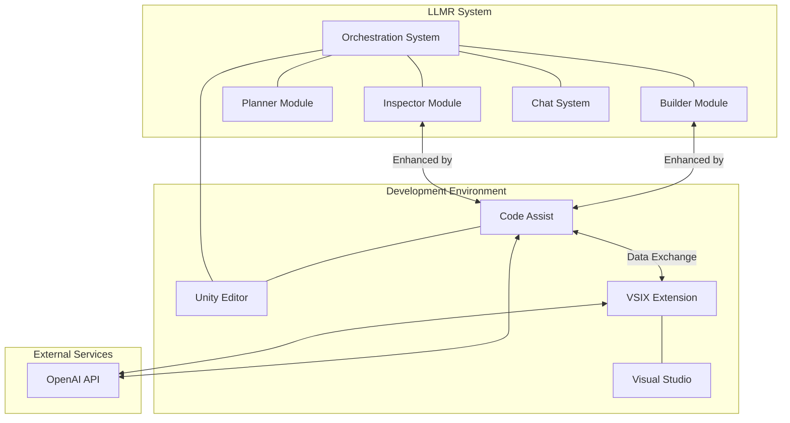
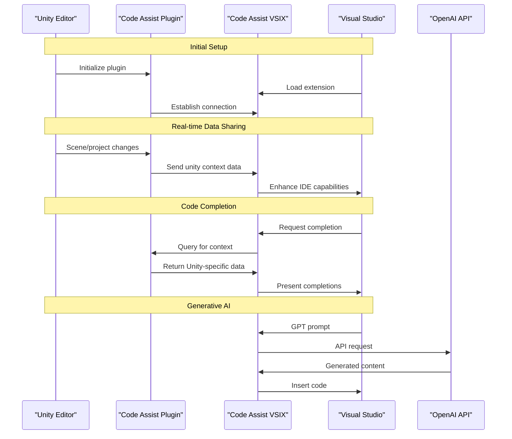

<!-- source: DeepWiki mcp.deepwiki.com · repo microsoft/LLMR · page 5.3 Code Assist Integration · fetched 2026-10-26 -->

# Code Assist Integration

Relevant source files

The following files were used as context for generating this wiki page:

- [Assets/Plugins/CodeAssist/CHANGELOG.TXT](Assets/Plugins/CodeAssist/CHANGELOG.TXT)
- [Assets/Plugins/CodeAssist/Editor/Assister.cs](Assets/Plugins/CodeAssist/Editor/Assister.cs)
- [Assets/Plugins/CodeAssist/README.TXT](Assets/Plugins/CodeAssist/README.TXT)

## Purpose and Scope

This document describes how Code Assist, a Visual Studio extension for Unity development, integrates with the LLMR framework. Code Assist enhances the development experience by providing intelligent code completion, inline visualizations, code analysis, and generative AI capabilities. This page covers the integration details, setup process, and how to leverage Code Assist features when developing with LLMR.

For information about dependencies in general, see [Dependencies](#5.2).

Sources: [Assets/Plugins/CodeAssist/README.TXT:1-5]()

## Overview of Code Assist

Code Assist is a plugin that bridges Unity and Visual Studio to provide an enhanced coding experience. It enables data sharing between the game editor and IDE, offering features like context-aware code completion, code analysis, and generative AI-powered assistance.

Key features of Code Assist relevant to LLMR development:

- **Context-aware code completion**: Provides Unity-specific suggestions including tags, layers, and input methods
- **Code analysis**: Identifies performance issues and suggests optimizations
- **Inline visualizations**: Displays visual representations of code elements (colors, values)
- **Generative AI integration**: Uses OpenAI's GPT models for code assistance

Sources: [Assets/Plugins/CodeAssist/README.TXT:1-48](), [Assets/Plugins/CodeAssist/Editor/Assister.cs:11-22]()

## Integration Architecture

The following diagram shows how Code Assist fits into the LLMR system architecture:

Code Assist communicates with Visual Studio through a bidirectional channel, providing real-time data about the Unity environment. This integration enables:

1. Enhanced code generation in the Builder module
2. Improved code inspection and debugging
3. Streamlined access to the OpenAI API for natural language processing
4. Sharing of Unity-specific context (tags, layers, objects) with the IDE

Sources: [Assets/Plugins/CodeAssist/Editor/Assister.cs:244-260]()

## Setup and Configuration

### Prerequisites

- Unity 2020.3 or newer
- Visual Studio 2022 (not compatible with VS Code, VS for Mac, or Rider)
- An OpenAI API key for GPT functionality (optional)

### Installation Steps

1. Import the Code Assist asset under the "Assets" folder
2. Install the VSIX extension from `Assets/Plugins/CodeAssist/Meryel.UnityCodeAssist.VSIX.vsix`
3. Open your Unity project with Visual Studio
4. Verify the installation by checking the status: In Unity, go to Tools → Code Assist → Status

### OpenAI Integration Configuration (Optional)

To enable generative AI features:

1. Obtain an OpenAI API key from https://platform.openai.com/account/api-keys
2. Configure the key using one of these methods:
   - Create an environment variable named `OPENAI_API_KEY`
   - Create a file named `.openai` in your user profile directory containing the API key
   - Set the API key in Visual Studio: Tools → Options → Unity Code Assist → Generative AI → Authentication

Sources: [Assets/Plugins/CodeAssist/README.TXT:35-63]()

## Communication Framework

Code Assist establishes a communication channel between Unity and Visual Studio using NetMQ. This channel allows for real-time data exchange, enabling features like context-aware code completion.

The communication system shares various Unity-specific data:

- **Tags and Layers**: Available through `SendTagsAndLayers()` method
- **SortingLayers**: Used for 2D rendering order
- **Game Objects**: Structure and properties of scene objects
- **Input System**: Information about input controls

Sources: [Assets/Plugins/CodeAssist/Editor/Assister.cs:73-90](), [Assets/Plugins/CodeAssist/Editor/Assister.cs:244-260]()

## Key Features for LLMR Development

### Context-Aware Code Completion

Code Assist provides intelligent code suggestions based on the current Unity project context:

| Completion Type | Description | Example |
|----------------|-------------|---------|
| Tags | Suggests available tags defined in Unity | `CompareTag("Player")` |
| Layers | Suggests available layers | `LayerMask.NameToLayer("Default")` |
| Input Methods | Completes Input API calls | `Input.GetButton("Fire1")` |
| PlayerPrefs | Suggests PlayerPrefs methods | `PlayerPrefs.GetInt("Score")` |

### Code Analysis and Performance Optimization

Identifies common performance issues in Unity code and suggests optimizations:

- Vector3.magnitude vs Vector3.sqrMagnitude optimizations
- String concatenation improvements
- Unnecessary allocations detection

### Generative AI Integration

Code Assist integrates with OpenAI's GPT models to provide AI-assisted code generation:

1. Type `//gpt ` followed by your prompt
2. Press Enter
3. GPT will generate code based on your prompt

This feature is particularly useful for:
- Generating boilerplate code
- Creating complex algorithms
- Implementing design patterns
- Adding documentation

Sources: [Assets/Plugins/CodeAssist/README.TXT:51-69](), [Assets/Plugins/CodeAssist/CHANGELOG.TXT:3-6]()

## Integration with LLMR Components

Code Assist enhances several LLMR framework components:

### Planner Module Integration

The Planner module can benefit from Code Assist's GPT integration to improve natural language processing and task planning.

### Builder Module Integration

The Builder module utilizes Code Assist's code generation and completion features to:
- Generate more accurate Unity-specific code
- Access context-aware Unity API information
- Leverage generative AI for complex code generation

### Inspector Module Integration

The Inspector module can leverage Code Assist's code analysis capabilities to:
- Identify potential issues in generated code
- Suggest performance optimizations
- Ensure Unity best practices are followed

Sources: [Assets/Plugins/CodeAssist/CHANGELOG.TXT:51-56]()

## Troubleshooting

### Common Issues

If you encounter issues with Code Assist integration:

1. Ensure Code Assist is properly installed:
   - In Unity, verify "Tools" → "Code Assist" → "Status" is available
   - In Visual Studio, check "Extensions" → "Unity Code Assist" menu exists

2. If Visual Studio has just started, wait approximately one minute for Code Assist to fully load

3. Try re-synchronizing: In Unity, select "Tools" → "Code Assist" → "Synchronize"

4. If problems persist, restart both Unity and Visual Studio

### Error Reporting

To report errors:

1. Open the feedback window:
   - In Unity: "Tools" → "Code Assist" → "Report error"
   - In Visual Studio: "Extensions" → "Unity Code Assist" → "Report error"

2. The window provides access to recent logs and full logs of both Unity and Visual Studio

3. Report issues via:
   - Email: merryyellow@outlook.com
   - Discord: https://discord.gg/2CgKHDq
   - GitHub: https://github.com/merryyellow/Unity-Code-Assist/issues/new

Sources: [Assets/Plugins/CodeAssist/README.TXT:72-87]()

## Version Information

The current version of Code Assist integrated with LLMR is 1.1.11. Recent updates include:

- Fixed GPT completion endpoint for OpenAI API changes
- Bug fixes for Input Manager monitor
- Improved logging to Visual Studio output window
- Bug fixes for the About window

For a complete changelog, refer to the CHANGELOG.TXT file in the Code Assist plugin directory.

Sources: [Assets/Plugins/CodeAssist/Editor/Assister.cs:15](), [Assets/Plugins/CodeAssist/CHANGELOG.TXT:3-7]()

---

