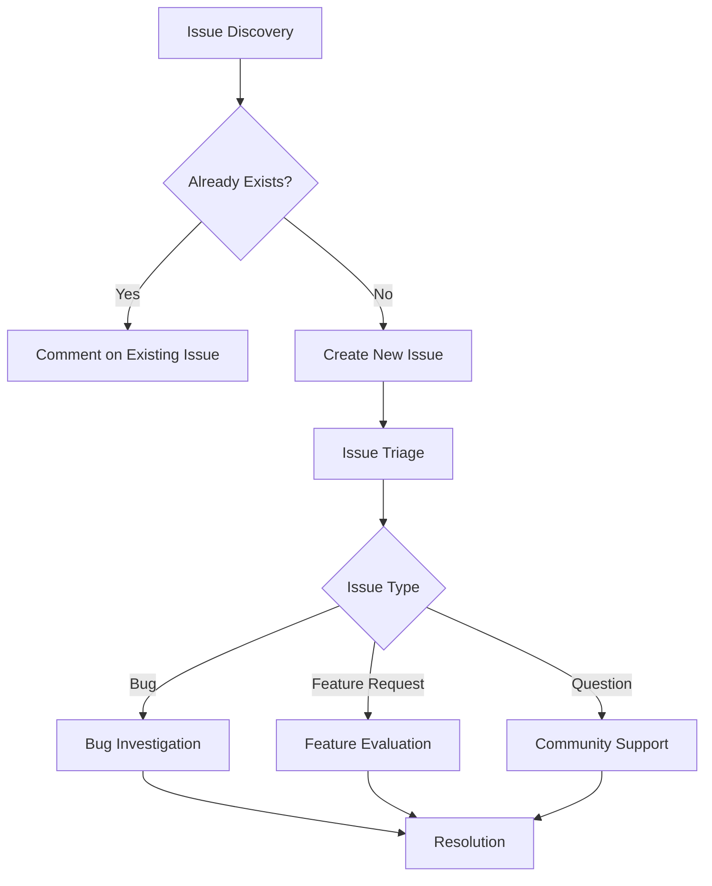
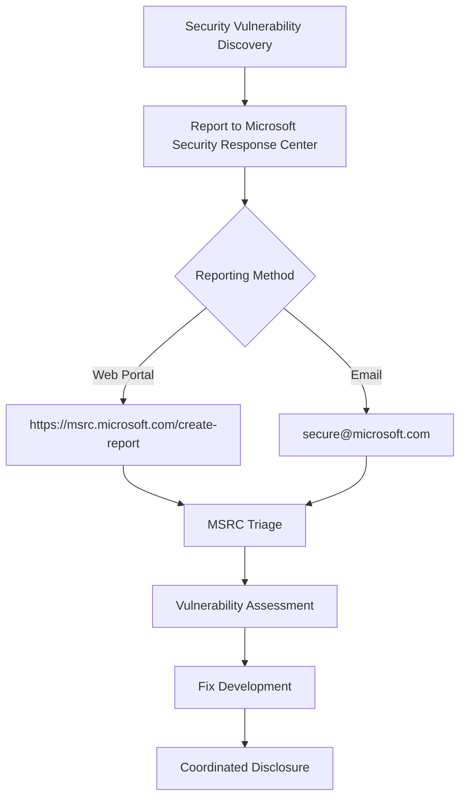
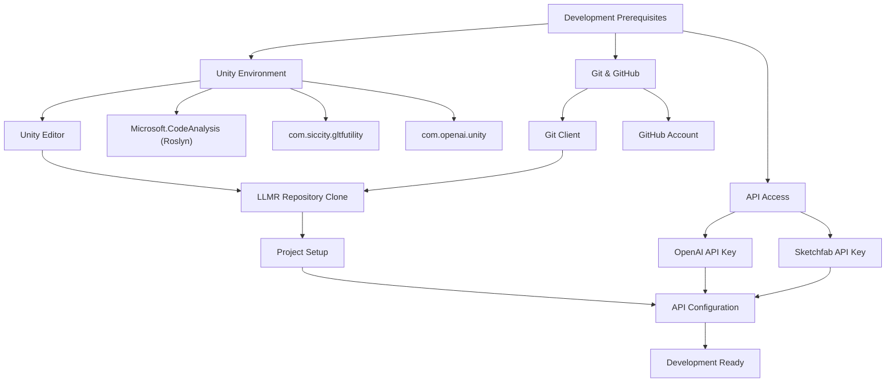
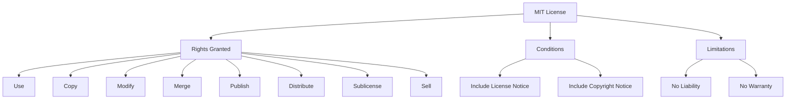
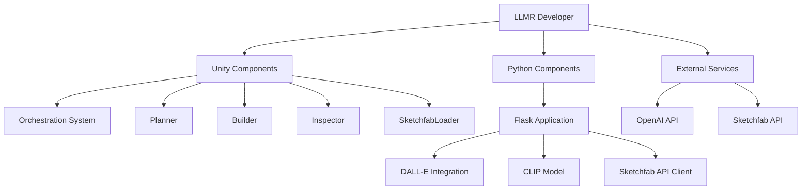
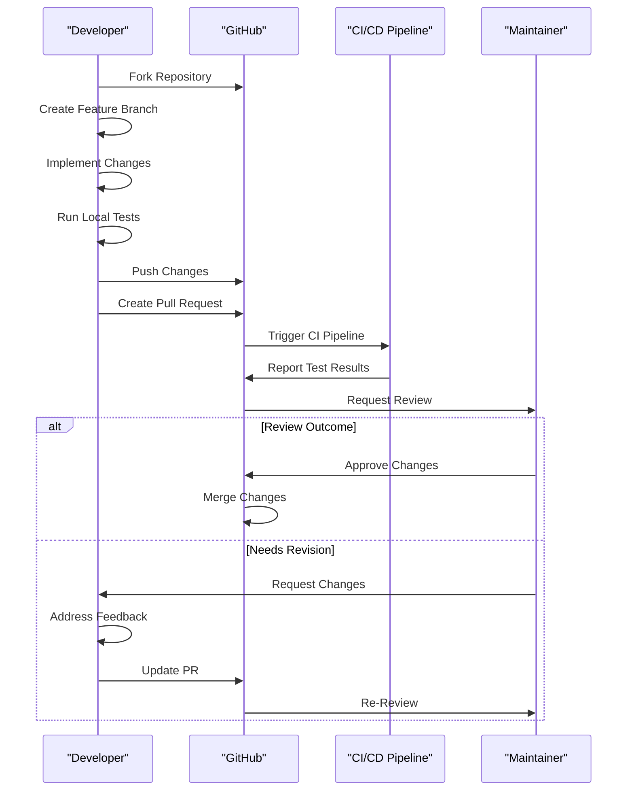
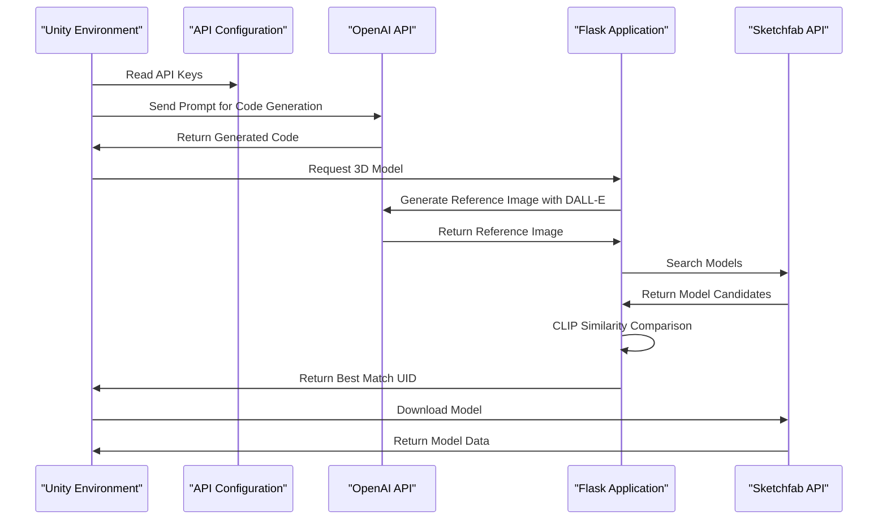

<!-- source: DeepWiki mcp.deepwiki.com · repo microsoft/LLMR · page 6 Development and Support · fetched 2026-10-26 -->

# Development and Support

Relevant source files

The following files were used as context for generating this wiki page:

- [LICENSE](LICENSE)
- [SECURITY.md](SECURITY.md)
- [SUPPORT.md](SUPPORT.md)

This page provides essential resources for developers working with or contributing to the LLMR (Large Language Model for Mixed Reality) project. It covers how to get support, report issues, understand the development process, and access necessary resources. For specific contribution guidelines, see [Contributing Guidelines](#6.1), and for solutions to common problems, refer to [Troubleshooting](#6.2).

## Support Channels

The LLMR project uses GitHub Issues as the primary channel for tracking bugs and feature requests. Before filing new issues, search existing ones to avoid duplicates.

### Issue Management Workflow

Sources: [SUPPORT.md:3-7]()

## Security Vulnerability Reporting

Security vulnerabilities should not be reported through public GitHub issues. Instead, follow the established security reporting process.

### Security Reporting Process

Sources: [SECURITY.md:9-29]()

## LLMR Development Environment

To contribute to LLMR, you'll need to set up a proper development environment with the following components:

## License Information

LLMR is licensed under the MIT License, which is a permissive open-source license.

### MIT License Key Components

Sources: [LICENSE:1-21]()

## Support Resources Matrix

Below is a matrix of support resources available for different LLMR components:

| Component | Primary Support Channel | Secondary Resources |
|-----------|-------------------------|---------------------|
| Core Framework | GitHub Issues | Project Documentation |
| OpenAI Integration | GitHub Issues | OpenAI Documentation |
| Unity Components | GitHub Issues | Unity Forums |
| Sketchfab Integration | GitHub Issues | Sketchfab Documentation |
| Flask Application | GitHub Issues | Flask Documentation |
| Setup Issues | GitHub Issues | [Troubleshooting Guide](#6.2) |

Sources: [SUPPORT.md:3-11]()

## System Components for Developers

Understanding the LLMR system architecture is crucial for effective development. The following diagram shows the key components that developers will interact with.

### LLMR Component Architecture

## Contribution Process Flow

The following diagram illustrates the detailed process flow for contributing to LLMR:

## API Integration in LLMR

The following diagram illustrates how LLMR components interact with external APIs:

---

