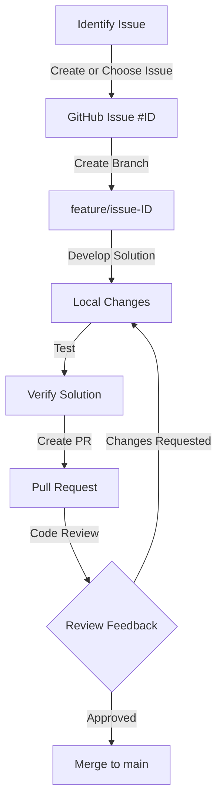
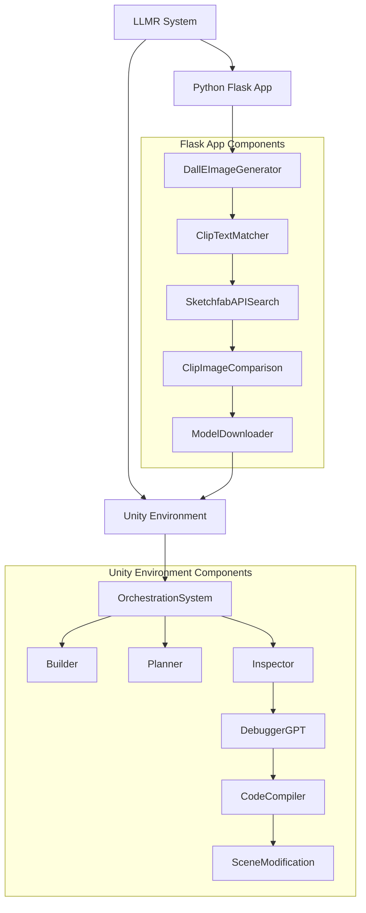

<!-- source: DeepWiki mcp.deepwiki.com · repo microsoft/LLMR · page 6.1 Contributing Guidelines · fetched 2026-10-26 -->

# Contributing Guidelines

Relevant source files

The following files were used as context for generating this wiki page:

- [LICENSE](LICENSE)
- [SECURITY.md](SECURITY.md)
- [SUPPORT.md](SUPPORT.md)

This document outlines the process for contributing to the LLMR (Large Language Model for Mixed Reality) project. It provides guidance on submitting issues, creating pull requests, and understanding the project structure for potential contributors. For troubleshooting help while working with LLMR, please refer to the [Troubleshooting](#6.2) page.

## Getting Started

Before contributing to LLMR, ensure you have:

1. Forked the repository at https://github.com/microsoft/LLMR
2. Set up your development environment as outlined in [Getting Started](#1.2)
3. Familiarized yourself with the [System Architecture](#2) and [Core Modules](#4)

## Contribution Process

The following diagram illustrates the standard contribution workflow for the LLMR project:

Sources: [SUPPORT.md:3-7]()

### Filing Issues

When filing issues for the LLMR project:

1. Search existing issues to avoid duplicates
2. Use a clear, descriptive title
3. Include detailed reproduction steps for bugs
4. For feature requests, clearly describe the problem and proposed solution
5. Follow the issue template if one is provided

### Pull Request Guidelines

For successful pull requests:

- Reference the related issue number in your PR description
- Keep changes focused on a single issue or feature
- Include tests for new functionality
- Update documentation to reflect your changes
- Ensure all CI checks pass
- Be responsive to review feedback

## LLMR Component Structure for Contributors

The following diagram shows the main components of the LLMR system that you might contribute to:

Sources: Based on system overview diagrams

## Common Contribution Areas

| Area | Description | Components |
|------|-------------|------------|
| Unity Environment | Modify or extend core Unity components | Orchestration System, Builder, Planner, Inspector |
| Flask Application | Enhance Python backend services | DALL-E integration, CLIP processing, Sketchfab API |
| Documentation | Improve project documentation | Wiki pages, code comments, examples |
| Testing | Create or improve tests | Unit tests, integration tests, UI tests |
| Bug Fixes | Fix reported issues | Various components |

## Coding Standards

### Code Style Guidelines

- **C# Code**: Follow established C# conventions for Unity scripts
- **Python Code**: Follow PEP 8 guidelines for the Flask application
- **Naming**: Use clear, descriptive names for variables, functions, and classes
- **Comments**: Document public APIs and complex logic
- **Organization**: Keep methods focused with clear responsibilities

### Documentation Requirements

- Update relevant documentation for any changes
- For significant features, consider updating wiki pages
- Include examples for new APIs or functionality
- Document known limitations or edge cases

## Testing Guidelines

When contributing changes, ensure:

- Unit tests are written for new functionality
- Existing tests pass with your changes
- UI components are tested across different resolutions
- Integrations with external services have appropriate mock tests

## Security Considerations

If you discover a security vulnerability in LLMR:

1. **Do not report security vulnerabilities through public GitHub issues**
2. Report them to the Microsoft Security Response Center (MSRC)
3. Follow the reporting methods described in the Security Policy

See the [SECURITY.md:9-27]() file for detailed instructions on reporting security vulnerabilities.

## License Information

The LLMR project is licensed under the MIT License:
- You may use, modify, and distribute the software
- Include the original copyright notice in all copies
- The software is provided "as is" without warranty

Source: [LICENSE:1-21]()

## Additional Resources

- For a high-level overview of the system, see [Overview](#1)
- For details on external integrations, see [External Integrations](#3)
- For technical reference information, see [Technical Reference](#5)

---

