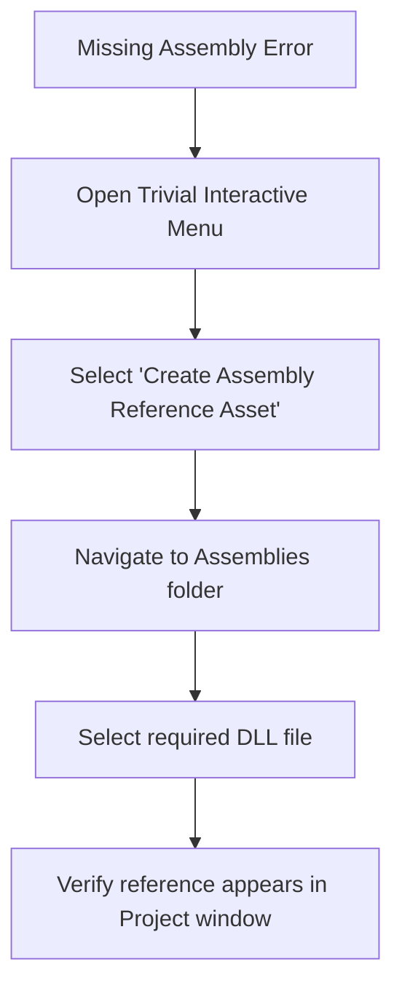
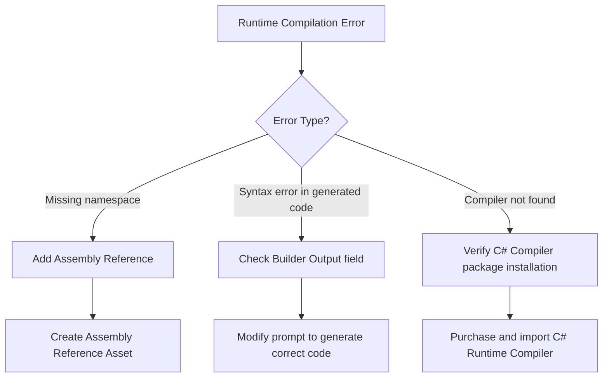
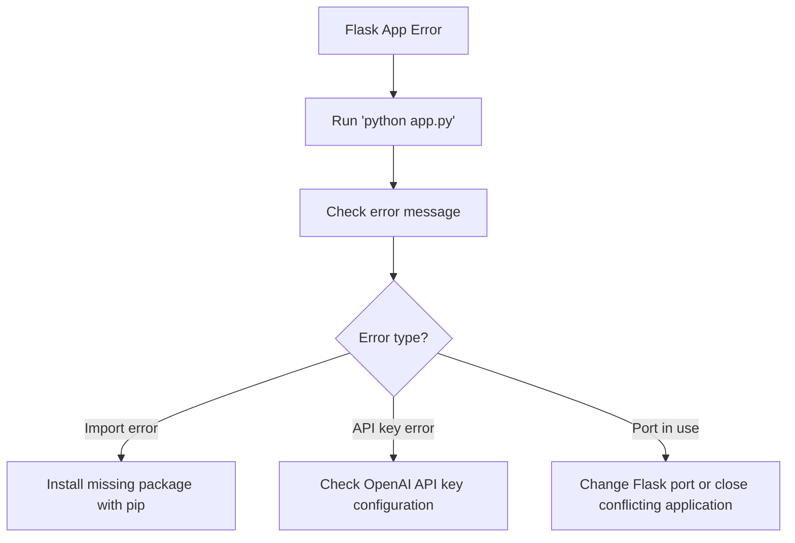
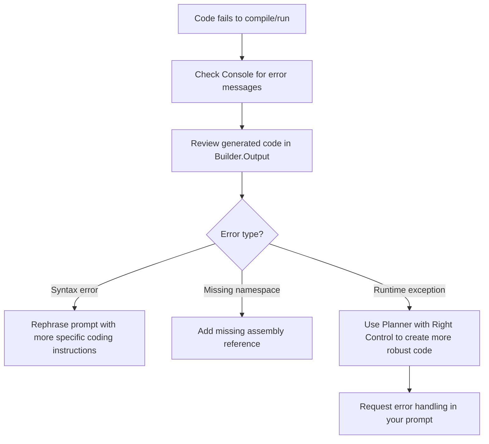
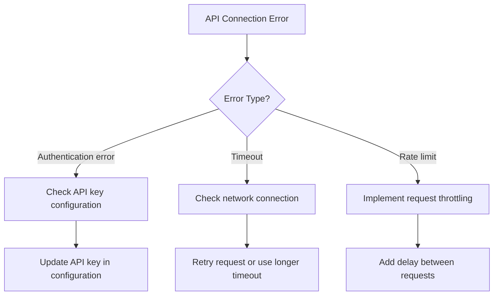
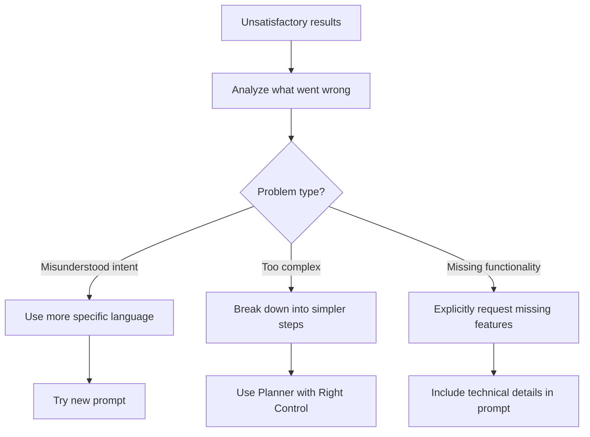
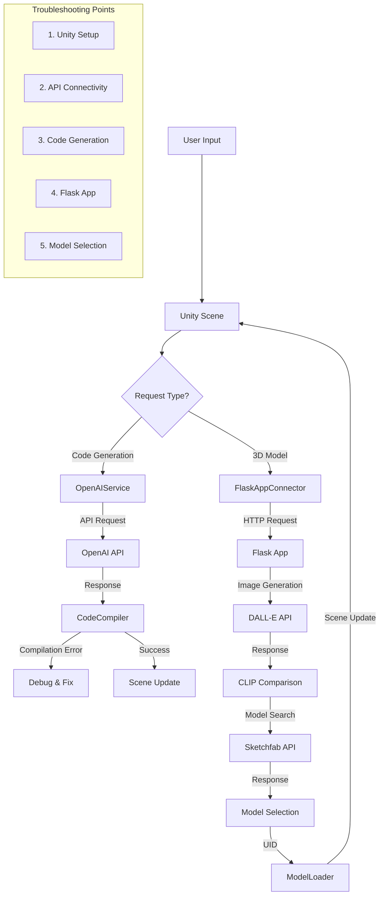
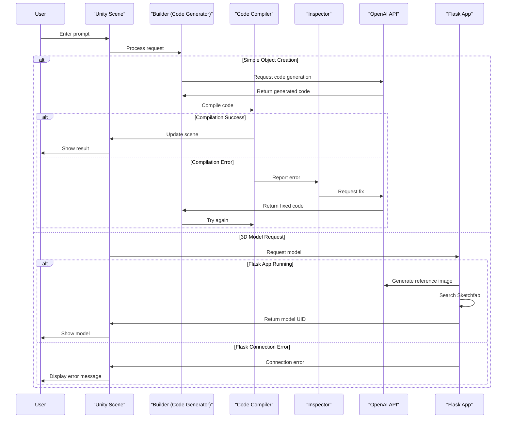

<!-- source: DeepWiki mcp.deepwiki.com · repo microsoft/LLMR · page 6.2 Troubleshooting · fetched 2026-10-26 -->

# Troubleshooting

Relevant source files

The following files were used as context for generating this wiki page:

- [README.md](README.md)
- [SUPPORT.md](SUPPORT.md)

This document provides solutions for common issues encountered when setting up and using the LLMR framework. It covers installation problems, runtime errors, API integration issues, and general usage challenges. For information about contributing to the project, see [Contributing Guidelines](#6.1).

## Setup and Installation Issues

### Unity Setup Problems

Common issues encountered during initial setup of the LLMR framework in Unity:

| Issue | Cause | Solution |
|-------|-------|----------|
| Project fails to load properly | Missing required packages or dependencies | Ensure all packages from manifest.json are properly imported, especially the OpenAI Unity package and gltfutility |
| Unity version compatibility | Using unsupported Unity version | Use Unity versions 2021.3.25f1 or 2022.3.11f1 as specified in the documentation |
| Assembly reference errors | Missing DLL files or Assembly References | Verify all DLLs in the Assemblies folder are correctly referenced |

#### Creating Assembly References

If you encounter missing namespace errors, you may need to create Assembly Reference Assets:

Sources: [README.md:19-21]()

### C# Compiler Integration Issues

The LLMR system requires the Roslyn C# compiler to function properly:

| Issue | Solution |
|-------|----------|
| "C# Compiler not found" error | Purchase and import Roslyn C# Runtime Compiler from Unity Asset Store |
| Code not compiling at runtime | Check that all required DLLs are in the Assemblies folder and properly referenced |
| "Missing assembly reference" errors | Create Assembly Reference Assets for each required DLL |

Sources: [README.md:18-21](), [README.md:131-132]()

### Python Flask App Setup Issues

Common problems when setting up the Flask application for DALL-E and CLIP integration:

| Issue | Cause | Solution |
|-------|-------|----------|
| Import errors | Missing Python dependencies | Run `pip install -r requirements.txt` in the CLIP-DallE-SketchFab-001 directory |
| Flask app not starting | Python version incompatibility | Ensure Python 3.9 or higher is installed |
| Connection refused from Unity | Flask app not running on expected port | Verify Flask is running on the default port (typically 5000) |

To diagnose specific Flask app issues:

Sources: [README.md:54-81]()

## Runtime Issues

### Code Generation and Compilation Errors

When LLM-generated code fails to compile or run correctly:

| Issue | Solution |
|-------|----------|
| Syntax errors in generated code | Check the output in the Builder GameObject's Output field and modify your prompt to be more specific |
| Missing namespaces | Ensure all required assemblies are referenced and available |
| Runtime exceptions | Use more specific prompts that handle edge cases and exceptions |

Sources: [README.md:92-94](), [README.md:96-101]()

### External API Connection Problems

Issues with OpenAI API, Sketchfab API, and other external services:

| Issue | Cause | Solution |
|-------|-------|----------|
| "API key not valid" | Missing or invalid API key | Verify API keys are correctly set in the appropriate configuration files |
| Timeout errors | Slow network connection or server issues | Implement retry logic or try again later |
| Rate limiting | Exceeding API request limits | Implement throttling or wait before sending more requests |

#### API Connectivity Troubleshooting Flow

Sources: [README.md:127-124]()

### DALL-E & CLIP Integration Issues

Common problems with the image generation and model matching pipeline:

| Issue | Cause | Solution |
|-------|-------|----------|
| No models found for prompt | Sketchfab search returning no results | Try a more generic prompt or manually select a model |
| Poor model matches | CLIP similarity not finding good matches | Refine your prompt to be more specific about visual characteristics |
| Image generation fails | DALL-E API issues | Check API key and quota; try a different prompt |

Sources: [README.md:104-112]()

## Usage and Prompt Engineering

### Improving Prompt Effectiveness

The quality of results depends heavily on how prompts are phrased:

| Issue | Solution |
|-------|----------|
| GPT misunderstands request | Try rephrasing with more specific details |
| Complex requests fail | Use the Planner agent by pressing Right Control instead of Tab |
| Generated code doesn't match expectations | Include specific requirements about functionality, appearance, or behavior |

#### Effective Prompting Workflow

Sources: [README.md:97-101]()

### Object and Scene Creation Troubleshooting

When creating objects or scenes produces unexpected results:

| Issue | Solution |
|-------|-------|
| Objects not positioned correctly | Specify exact coordinates or relative positions in your prompt |
| Objects lack expected behavior | Describe behaviors in detail, including triggers and effects |
| Scene doesn't match mental image | Start with basic elements, then build up complexity gradually |

Sources: [README.md:10-14](), [README.md:104-112]()

## Common Error Messages and Solutions

### Unity Console Errors

| Error Message | Likely Cause | Solution |
|---------------|--------------|----------|
| "The required namespace XXX cannot be found" | Missing assembly reference | Add missing DLL references as described in the README |
| "Error compiling generated code" | Syntax errors in LLM output | Check the Builder.Output field and refine your prompt |
| "Timeout waiting for response from API" | Network issues or API downtime | Check internet connection and API status |

Sources: [README.md:131-132]()

### Python Flask App Errors

| Error Message | Solution |
|---------------|----------|
| "ModuleNotFoundError: No module named X" | Run `pip install X` to install the missing module |
| "Address already in use" | Another process is using port 5000. Change the port or stop the conflicting process |
| "Invalid API key" | Update your OpenAI API key in the configuration |

Sources: [README.md:74-81]()

## System Connectivity Diagram

## Error Handling Flow

## Frequently Asked Questions

### General Issues

**Q: The system seems to misunderstand my prompts. What can I do?**  
A: Try rephrasing your prompt to be more specific. For complex requests, use the Planner by pressing Right Control instead of Tab.

**Q: Can I use this framework with earlier Unity versions?**  
A: The framework has only been tested with Unity 2021.3.25f1 and 2022.3.11f1. Earlier versions may work but are not officially supported.

### Installation Questions

**Q: Do I need to purchase the C# compiler?**  
A: Yes, this project depends on the Roslyn C# Runtime Compiler by Trivial Interactive, which must be purchased from the Unity Asset Store.

**Q: What Python version do I need for the Flask app?**  
A: Python 3.9 or higher is required for the Flask application.

### Runtime Questions

**Q: Why do some objects not behave as expected?**  
A: LLM-generated code may have limitations. Check the Console for errors and try to make your prompt more specific about the desired behavior.

**Q: How can I troubleshoot model loading issues?**  
A: Ensure the Flask app is running properly and check the Unity Console for specific error messages related to model downloading or loading.

Sources: [README.md:96-101](), [README.md:18-21](), [README.md:131-132](), [README.md:54-81]()