# Page: Overview

# Overview

<details>
<summary>Relevant source files</summary>

The following files were used as context for generating this wiki page:

- [README.md](README.md)
- [Transparency FAQ.md](Transparency FAQ.md)

</details>


The Large Language Model for Mixed Reality (LLMR) framework enables real-time creation and modification of interactive 3D environments within Unity using natural language prompts. This document introduces the framework's architecture, components, and capabilities, serving as an entry point to understand the system as a whole.

For instructions on setting up the environment, see [Getting Started](#1.2). For detailed architectural information, refer to [System Architecture](#2).

## Purpose and Capabilities

LLMR serves as a prototype for "Speaking the world into existence," allowing users to create and manipulate 3D content in real-time through natural language. The framework combines Large Language Models (LLMs) with a runtime compiler inside Unity, enabling spontaneous generation of dynamic content in 3D environments.

Key capabilities include:
- **Object Creation**: Generate objects using Unity primitives or models from online repositories
- **Behavior Programming**: Endow objects with properties and behaviors at runtime
- **Scene Editing**: Modify existing scenes dynamically
- **External Service Integration**: Leverage AI services like DALL-E and CLIP for enhanced capabilities

Sources: [README.md:5-15](), [Transparency FAQ.md:3-24]()

## High-Level System Architecture

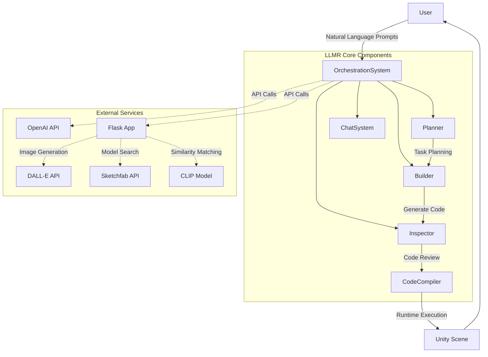

Sources: [README.md:5-15](), [README.md:95-101](), [Transparency FAQ.md:3-10]()

## Processing Pipeline

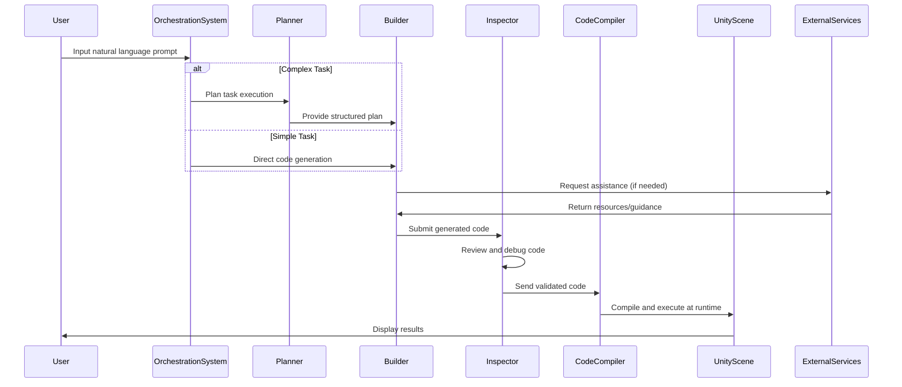

Sources: [README.md:86-101](), [Transparency FAQ.md:27-39]()

## Framework Components

LLMR consists of several key components working together to process natural language requests and transform them into interactive 3D content:

| Component | Purpose | Key Functionality |
|-----------|---------|------------------|
| **Orchestration System** | Coordinates framework components | Manages communication flow between modules |
| **Planner** | Breaks down complex tasks | Analyzes prompts and creates execution strategies |
| **Builder** | Generates implementation code | Converts plans into executable C# code |
| **Inspector** | Reviews and refines code | Checks for errors and suggests improvements |
| **Code Compiler** | Processes generated code | Compiles C# at runtime using Roslyn compiler |
| **Flask Application** | Extends capabilities | Handles image generation and model retrieval |

For detailed information about each component, see [Core Modules](#4).

Sources: [README.md:95-101](), [Transparency FAQ.md:11-23]()

## Natural Language to Code Workflow

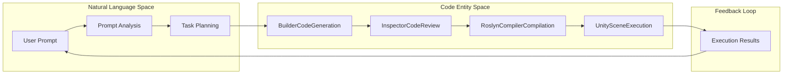

Sources: [README.md:89-94](), [Transparency FAQ.md:30-40]()

## External Integrations

LLMR integrates with several external services to enhance its capabilities:

1. **OpenAI API**: Powers the LLM functionality for code generation and planning
2. **DALL-E**: Generates reference images for 3D model matching
3. **CLIP**: Performs similarity matching between images and text
4. **Sketchfab API**: Provides access to a repository of 3D models

These integrations allow the system to create more complex and visually appealing content than would be possible with Unity primitives alone. For detailed information about these integrations, see [External Integrations](#3).

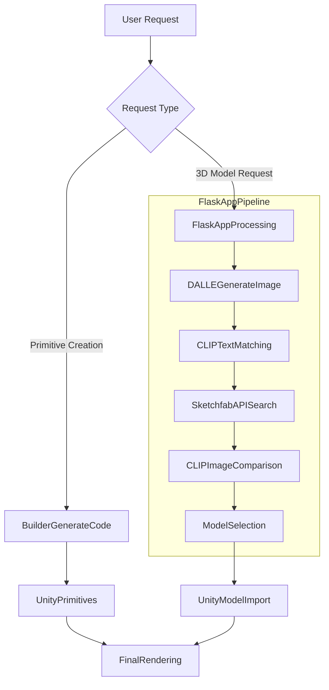

Sources: [README.md:102-127](), [Transparency FAQ.md:15-20]()

## Performance and Limitations

LLMR significantly improves the reliability of generating functioning interactive 3D content compared to standard code-writing LLMs. According to evaluations, it outperforms standard GPT-4 by 4x in average error rate. However, the framework has some limitations:

- Multiple LLM API calls lead to longer wait times and higher token costs
- Complex tasks may require decomposition through the Planner component
- Inherits biases and potential toxicity from the base LLM used

For more detailed information about performance metrics and evaluations, see [Technical Reference](#5).

Sources: [Transparency FAQ.md:32-52]()

## Use Cases

LLMR supports a variety of use cases, including:

1. **Object Creation**: "Create a rotating cube that changes color every second"
2. **Scene Building**: "Create a kitchen scene using primitives"
3. **Tool Creation**: "Make a timer that stops when countdown reaches zero"
4. **Accessibility Modifications**: "Change colors to be suitable for color-blind users"
5. **Complex Scene Generation**: "Create a farm with 2 cows and a horse"

The framework can be extended to support new capabilities through its modular architecture and Skill Library LLM module.

Sources: [README.md:10-14](), [README.md:86-94](), [Transparency FAQ.md:10-23]()

LLMR represents an innovative approach to natural language-driven content creation in 3D environments, combining large language models, image generation, visual understanding, and 3D model retrieval into a unified system.

---

# Page: Key Concepts

# Key Concepts

<details>
<summary>Relevant source files</summary>

The following files were used as context for generating this wiki page:

- [README.md](README.md)
- [Transparency FAQ.md](Transparency FAQ.md)

</details>


This page explains the fundamental concepts, terminology, and components that form the backbone of the LLMR (Large Language Model for Mixed Reality) framework. Understanding these key concepts is essential for effectively working with the system and extending its capabilities. For information on setting up and running the system, see [Getting Started](#1.2).

## Core Framework Overview

LLMR is a framework that enables real-time creation and modification of interactive 3D environments in Unity using natural language prompts. It orchestrates various LLM modules to improve the reliability of generating functioning interactive 3D objects, tools, and scenes over standard code-writing LLMs.

The framework bridges the gap between natural language understanding and programmatic scene manipulation, allowing users to "speak the world into existence" through conversational prompts.

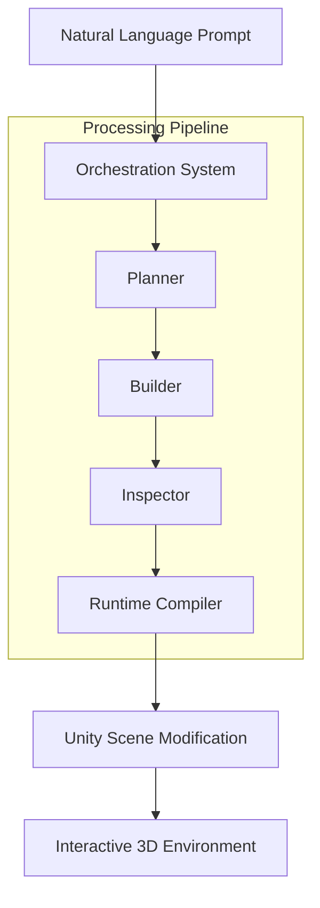

Sources: README.md:5-8, Transparency FAQ.md:3-7

## Key System Components

The LLMR framework consists of several interconnected modules, each with a specific role in transforming natural language into interactive 3D content:

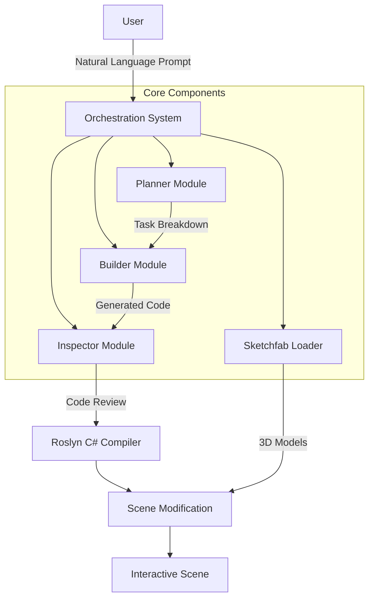

### Orchestration System
The central coordinator that manages communication between different modules and maintains the overall state of the system. It routes user prompts to appropriate modules and orchestrates the entire processing pipeline.

### Planner Module
Analyzes complex user requests and breaks them down into manageable sub-tasks. For more involved requests, the Planner can expand on initially simple prompts to develop a comprehensive approach.

### Builder Module
Generates C# code based on the user's request (or the Planner's task breakdown). This module translates natural language descriptions into executable Unity code for creating or modifying 3D objects and behaviors.

### Inspector Module
Reviews the generated code, identifies potential issues, and suggests improvements. Works in tandem with debugging capabilities to ensure the code will run successfully.

### Runtime Compiler
Compiles the generated C# code at runtime using the Roslyn C# compiler, allowing for dynamic creation and modification of 3D content.

Sources: README.md:10-14, Transparency FAQ.md:9-23

## Interaction Patterns

LLMR supports several key interaction patterns for creating and modifying 3D content:

### Object Creation
Users can create objects using Unity primitives or retrieve models from external sources like Sketchfab. The system can generate simple geometric shapes with specified properties or find and import complex pre-made 3D models.

### Behavior Programming
Users can define interactive behaviors for objects through natural language. For example, creating a rotating cube that changes color every second or a timer that counts down and triggers an action when complete.

### Scene Editing
Users can modify existing scenes by changing object properties, relationships, or adding new elements. This enables runtime customization of environments for different purposes.

Sources: README.md:10-14, Transparency FAQ.md:15-23

## External Integrations

LLMR integrates with several external services to enhance its capabilities:

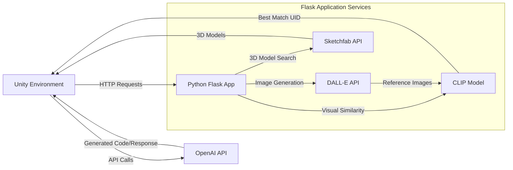

### OpenAI Integration
Provides access to large language models like GPT-4 for natural language understanding, code generation, and conversational capabilities.

### DALL-E and CLIP Integration
DALL-E generates reference images based on textual descriptions, while CLIP (Contrastive Language-Image Pre-training) compares these images with potential 3D models to find the best visual match.

### Sketchfab Integration
Enables searching and importing 3D models from Sketchfab's online repository based on textual and visual similarity to the user's request.

### Flask Application
A Python-based service that bridges Unity with DALL-E, CLIP, and Sketchfab, extending the system's capabilities beyond what's directly available in Unity.

Sources: README.md:54-77, README.md:102-127

## Natural Language to Code Pipeline

The transformation from natural language to functional 3D content involves several processing stages:

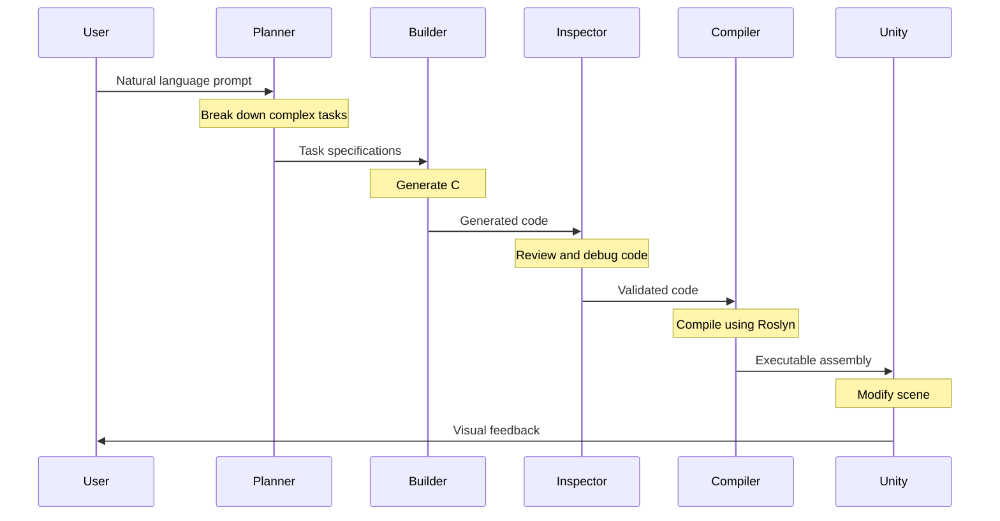

1. **Prompt Analysis**: The system interprets the user's natural language request, extracting key intentions and requirements.
   
2. **Task Planning**: For complex requests, the Planner breaks down the task into subtasks and develops a strategy for implementation.
   
3. **Code Generation**: The Builder translates the task specifications into executable C# code tailored for Unity.
   
4. **Code Review**: The Inspector analyzes the generated code for potential issues, ensuring it meets quality standards.
   
5. **Compilation**: The validated code is compiled at runtime using the Roslyn C# compiler.
   
6. **Scene Modification**: The compiled code is executed to create or modify objects in the Unity scene.
   
7. **Feedback Loop**: Users can iteratively refine their requests based on the results.

Sources: README.md:86-101, Transparency FAQ.md:30-40

## Model Retrieval System

For requests requiring complex 3D models, LLMR uses a sophisticated model retrieval system:

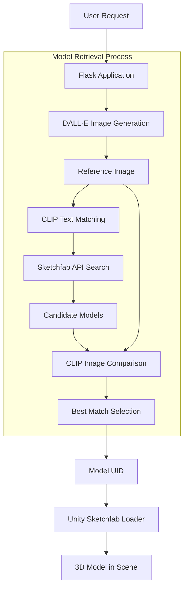

1. The system sends the user's description to a Flask application.
2. DALL-E generates a reference image based on the description.
3. CLIP performs text-based matching to find relevant models on Sketchfab.
4. Candidate models are compared to the reference image using CLIP for visual similarity.
5. The best matching model is identified and its UID is returned to Unity.
6. Unity downloads and imports the model into the scene.

Sources: README.md:102-127

## Technical Foundation

LLMR is built on several key technical capabilities:

### Runtime Code Generation and Compilation
The framework leverages the Roslyn C# compiler to dynamically generate, compile, and execute C# code at runtime, enabling on-the-fly creation of new behaviors and interactions.

### Assembly Management
Preloaded assembly DLLs are used to support the runtime compilation of code generated by LLMs. These assemblies provide the necessary references for the compiled code to function properly within Unity.

### Memory and Context Management
The system maintains context across multiple user interactions, allowing for iterative refinement and building upon previous creations or modifications.

Sources: README.md:16-33, Transparency FAQ.md:30-40

## System Limitations and Considerations

Understanding the limitations of LLMR is important for effective usage:

### Complexity Limitations
More complex tasks may require breaking down into simpler subtasks using the Planner component.

### Performance Considerations
Enhanced reliability comes at the cost of multiple LLM API calls, leading to longer wait times and higher token costs. This can be managed by limiting the number of correction iterations.

### Code Safety
By default, LLMR limits which C# namespaces are available for runtime compilation to prevent unsafe code execution.

Sources: Transparency FAQ.md:43-57

## Terminology Reference

| Term | Definition |
|------|------------|
| **LLMR** | Large Language Model for Mixed Reality - The overall framework for creating and modifying 3D content using natural language. |
| **LLM** | Large Language Model - AI models like GPT-4 that understand and generate human language. |
| **Orchestration** | The coordination system that manages the various components of LLMR. |
| **Planner** | Component that breaks down complex tasks into manageable subtasks. |
| **Builder** | Component responsible for generating C# code based on user requests. |
| **Inspector** | Component that reviews and validates generated code. |
| **CLIP** | Contrastive Language-Image Pre-training - Model that connects text and images for similarity matching. |
| **DALL-E** | AI system that creates images from textual descriptions. |

Sources: README.md:5-8, Transparency FAQ.md:3-7

---

# Page: Getting Started

# Getting Started

<details>
<summary>Relevant source files</summary>

The following files were used as context for generating this wiki page:

- [.gitignore](.gitignore)
- [Packages/manifest.json](Packages/manifest.json)
- [Packages/packages-lock.json](Packages/packages-lock.json)
- [ProjectSettings/Packages/com.unity.testtools.codecoverage/Settings.json](ProjectSettings/Packages/com.unity.testtools.codecoverage/Settings.json)
- [README.md](README.md)
- [SUPPORT.md](SUPPORT.md)

</details>


This guide provides step-by-step instructions for setting up and running the LLMR (Large Language Model for Mixed Reality) framework in your environment. LLMR enables the real-time creation of objects, tools, and scenes in Unity through natural language prompts. For a conceptual overview of the system, see [Overview](#1) and [Key Concepts](#1.1).

## Prerequisites

Before beginning installation, ensure you have the following:

- Unity (versions 2021.3.25f1 or 2022.3.11f1 recommended)
- Python 3.9 or higher (for CLIP-DallE integration)
- OpenAI API key (for GPT and DALL-E services)
- Roslyn C# Compiler package from Unity Asset Store

Sources: [README.md:16-22]()

## Installation Flow

The following diagram illustrates the high-level installation process:

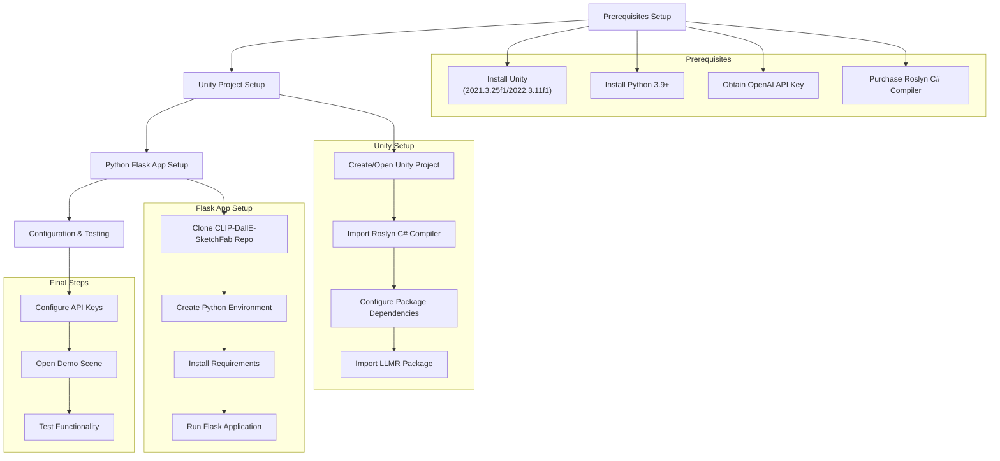

Sources: [README.md:16-76]()

## Setting Up Unity Project

### Creating a New Project

1. Launch Unity Hub and create a new project using Unity version 2021.3.25f1 or 2022.3.11f1.
2. Purchase and import the [Roslyn C# Runtime Compiler](https://assetstore.unity.com/packages/tools/integration/roslyn-c-runtime-compiler-142753) from the Unity Asset Store.

### Adding Required Packages

Add the required packages by editing the `manifest.json` file in the Packages folder:

1. Open your project's `Packages/manifest.json` file
2. Add the following dependencies:
   ```json
   "com.siccity.gltfutility": "https://github.com/siccity/gltfutility.git",
   "com.openai.unity": "4.3.0",
   ```
3. Add the scoped registries:
   ```json
   "scopedRegistries": [
     {
       "name": "OpenUPM",
       "url": "https://package.openupm.com",
       "scopes": [
         "com.openai",
         "com.utilities",
         "com.atteneder"
       ]
     }
   ]
   ```

### Assembly References Setup

1. Copy the Assemblies folder to the root directory of your Unity project (same level as the Assets folder)
2. Create Assembly Reference Assets using the Trivial Interactive package

Sources: [README.md:16-33](), [Packages/manifest.json:1-54]()

## Component Architecture During Setup

The following diagram shows the components and how they relate during the setup process:

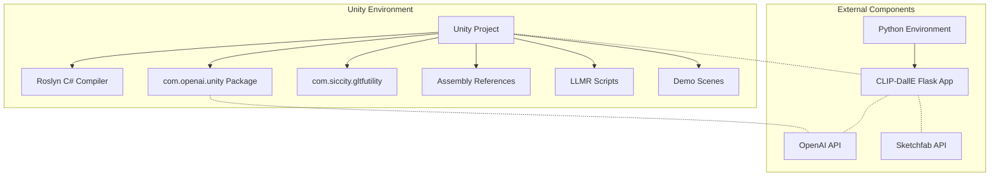

Sources: [README.md:16-76](), [Packages/manifest.json:1-54](), [Packages/packages-lock.json:3-24]()

## Setting Up Python Flask App

The Flask app is required for DALL-E image generation and CLIP-based model matching functionality.

1. Clone the CLIP-DallE-SketchFab repository:
   ```
   git clone https://github.com/delamarifer/CLIP-DallE-SketchFab-001.git
   ```
   
2. Create and activate a Python virtual environment:
   ```
   cd CLIP-DallE-SketchFab-001
   python -m venv .venv
   source .venv/bin/activate  # On Windows, use .venv\Scripts\activate
   ```
   
3. Install the required packages:
   ```
   pip install -r requirements.txt
   ```
   
4. Start the Flask application:
   ```
   flask run
   ```

The Flask server will run on `localhost:5000` by default.

Sources: [README.md:54-76]()

## Demo Scenes and Basic Usage

### Empty Playground Scene

1. Open the `Playground_new` scene
2. In the Game window, use the input field at the bottom
3. Type your natural language instruction (e.g., "create a rotating cube that changes color every second")
4. Press **Tab** to send the request to GPT for processing
5. Wait for the message "Processing finished. Please enter the next request."
6. For more complex requests, use the Planner by pressing **Right Control** instead of Tab

### DALL-E & CLIP Integration Scene

1. Ensure the Flask app is running
2. Open the `Playground_DallE-CLIP_Refinement` scene
3. Use the input field to request objects (e.g., "a bowl", "a fork")
4. The system will use DALL-E to generate a reference image and find the closest matching 3D model from Sketchfab

Sources: [README.md:85-112]()

## Interaction Flow

This diagram illustrates the typical interaction flow when using the LLMR system:

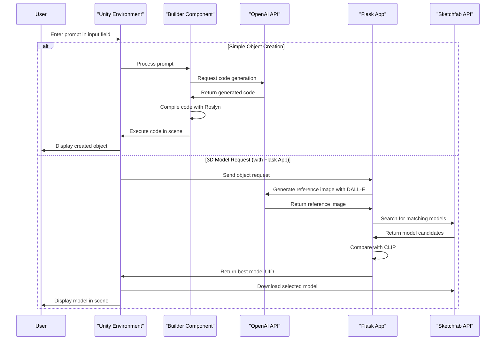

Sources: [README.md:85-112]()

## Troubleshooting Common Issues

| Issue | Possible Cause | Solution |
|-------|---------------|----------|
| Missing assembly reference errors | DLL files not properly registered | Ensure Assembly References are correctly created in Unity |
| Cannot connect to Flask app | Flask server not running | Check if Flask app is running at localhost:5000 |
| DALL-E image generation fails | OpenAI API key issues | Verify your OpenAI API key is valid and has sufficient credits |
| Compilation errors in generated code | Incompatible code generation | Try rephrasing your prompt or use the Planner for more complex requests |
| Models not downloading from Sketchfab | Network issues or API limitations | Check your internet connection and Sketchfab API access |

Sources: [README.md:129-132]()

## Next Steps

After successfully setting up and running the LLMR system, you can:

- Explore the [System Architecture](#2) to understand how the components work together
- Learn about the [Core Modules](#4) that make up the LLMR system
- Understand how LLMR integrates with [External Services](#3)
- View the [Technical Reference](#5) for more detailed information

For issues not covered in this guide, refer to the [Troubleshooting](#6.2) section.

---

# Page: System Architecture

# System Architecture

<details>
<summary>Relevant source files</summary>

The following files were used as context for generating this wiki page:

- [README.md](README.md)
- [Transparency FAQ.md](Transparency FAQ.md)

</details>


## Purpose and Scope

This document provides a comprehensive overview of the LLMR (Large Language Model for Mixed Reality) system architecture. It details the core components, their interactions, and the processing pipeline that enables real-time creation and modification of interactive 3D environments through natural language prompts. 

For specific details about the Orchestration System that coordinates these components, see [Orchestration System](#2.1). For information on how natural language prompts are processed, see [Natural Language Processing](#2.2). For details on code generation and runtime compilation, see [Code Generation and Compilation](#2.3).

## Core Architecture Overview

LLMR implements a modular architecture that transforms natural language prompts into interactive 3D content within Unity. The framework orchestrates multiple AI components to generate, review, and execute code at runtime, creating objects with visual, behavioral, and interactive elements.

```mermaid
graph TD
    User["User"] -->|"Natural Language Prompt"| Orchestrator["OrchestratorSystem"]
    
    subgraph "LLMR Framework"
        Orchestrator -->|"Task Planning"| Planner["PlannerModule"]
        Planner -->|"Execution Plan"| Builder["BuilderModule"]
        Builder -->|"Generated Code"| Inspector["InspectorModule"]
        Inspector -->|"Validated Code"| Compiler["RoslynCompiler"]
        Compiler -->|"Runtime Assembly"| SceneManager["SceneManager"]
    end
    
    subgraph "External Services"
        Builder -.->|"API Requests"| OpenAI["OpenAI API"]
        CLIP["CLIP Model"]
        DALLE["DALL-E API"]
        Sketchfab["Sketchfab API"]
    end
    
    subgraph "Unity Runtime"
        SceneManager -->|"Scene Modification"| GameObjects["GameObjects"]
        GameObjects --> User
    end
    
    Orchestrator -.->|"Model Requests"| Flask["Python Flask App"]
    Flask -.->|"Image Generation"| DALLE
    Flask -.->|"Similarity Matching"| CLIP
    Flask -.->|"Model Search"| Sketchfab
    Flask -.->|"Model UIDs"| Orchestrator
```

Sources: [README.md:5-15](), [Transparency FAQ.md:3-24]()

## System Components

LLMR consists of several interconnected components that work together to process natural language inputs and generate interactive 3D content.

| Component | Description | Primary Responsibility |
|-----------|-------------|------------------------|
| Orchestrator | Central coordination system | Manages workflow between components |
| Planner | Task planning module | Breaks complex requests into manageable subtasks |
| Builder | Code generation module | Transforms plans into executable C# code |
| Inspector | Code review module | Validates and fixes errors in generated code |
| RoslynCompiler | Runtime C# compiler | Compiles generated code into executable assemblies |
| Flask Application | Python-based service | Provides image generation and 3D model retrieval |
| Chat System | User interaction interface | Handles user input and displays system responses |

Sources: [README.md:8-14](), [Transparency FAQ.md:11-23]()

## Processing Pipeline

The LLMR system follows a multi-stage processing pipeline to transform natural language prompts into interactive 3D content.

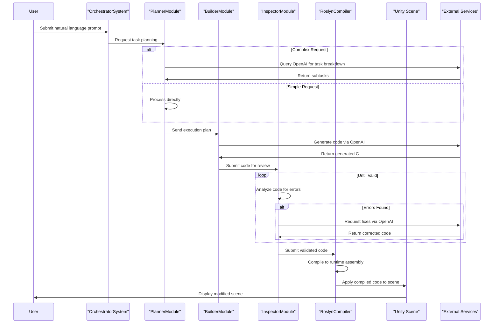

Sources: [README.md:89-98](), [Transparency FAQ.md:30-39]()

## Natural Language to Code Entity Transformation

This diagram illustrates how natural language prompts are transformed into Unity code entities through LLMR's processing pipeline.

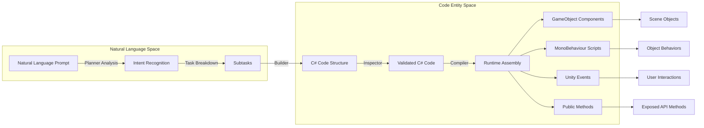

Sources: [README.md:10-14]()

## Model Retrieval System

The Model Retrieval System bridges natural language requests to 3D model entities through DALL-E image generation and CLIP-based matching.

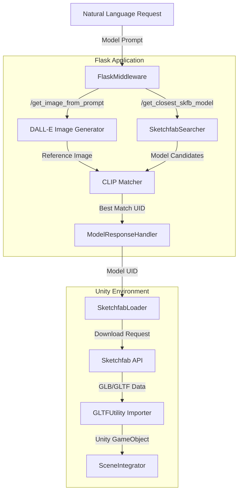

Sources: [README.md:104-127]()

## Component Integration

The following diagram illustrates how the primary components of LLMR integrate with Unity and external services.

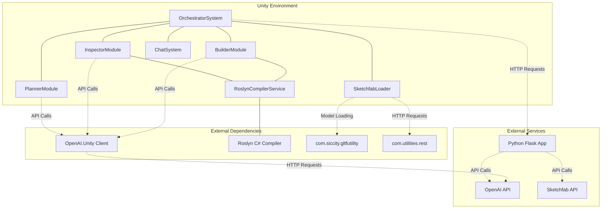

Sources: [README.md:18-34]()

## Development Environment

LLMR requires a specific development environment setup to function properly.

| Requirement | Description | Purpose |
|-------------|-------------|---------|
| Unity 2021.3.25f1+ | Game engine | Core platform for the framework |
| Roslyn C# Compiler | Runtime compiler | Enables dynamic code compilation |
| Assembly DLLs | Pre-loaded assemblies | Provides necessary references for compiled code |
| OpenAI API Key | Authentication | Access to OpenAI services |
| Python 3.9+ | Programming language | Required for Flask application |
| Flask | Web framework | Provides API endpoints for DALL-E and CLIP integration |

Sources: [README.md:17-34](), [README.md:54-81]()

## Subsystem Interactions

This section details the interactions between the core subsystems of LLMR.

### Planner-Builder Interaction

The Planner breaks down complex user requests into executable plans that the Builder can transform into code.

1. User submits natural language prompt
2. Orchestrator routes prompt to Planner
3. Planner analyzes prompt complexity
4. For complex requests, Planner breaks down into subtasks
5. Builder receives execution plan with context and constraints
6. Builder transforms plan into executable C# code

### Builder-Inspector Interaction

The Builder generates C# code that is reviewed and corrected by the Inspector.

1. Builder sends generated code to Inspector
2. Inspector analyzes code for compilation and runtime errors
3. If errors found, Inspector requests corrections
4. Code validation continues until all errors are fixed
5. Validated code is sent to compiler

### External Service Integration

LLMR integrates with multiple external services to extend its capabilities.

1. OpenAI API provides natural language processing and code generation
2. DALL-E API generates reference images for 3D models
3. CLIP performs visual similarity matching
4. Sketchfab API provides access to 3D model repository
5. Flask application bridges Unity with Python-based AI services

Sources: [README.md:104-127](), [Transparency FAQ.md:11-23]()

## Execution Flow

The following diagram illustrates the complete execution flow from user input to scene modification.

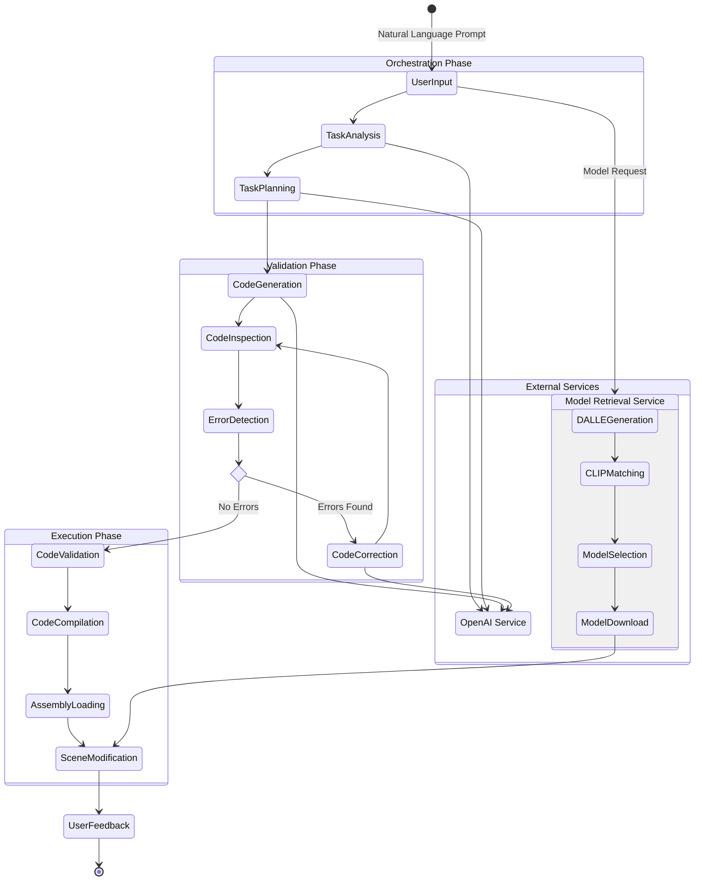

Sources: [README.md:88-101](), [Transparency FAQ.md:32-39]()

## Performance Considerations

LLMR's performance is affected by several factors that should be considered during implementation and use.

| Factor | Impact | Mitigation |
|--------|--------|------------|
| Multiple LLM API Calls | Longer wait times and higher token costs | Limit Inspector correction iterations |
| Complex Tasks | Lower success rate | Use Planner to break down into simpler tasks |
| Runtime Compilation | Performance overhead | Optimize code generation for efficiency |
| External Service Latency | Processing delays | Implement caching for frequent operations |
| 3D Model Complexity | Memory usage and rendering performance | Optimize downloaded models as needed |

Sources: [Transparency FAQ.md:43-57]()

## Security and Limitations

LLMR implements security measures and has certain limitations that should be understood.

1. C# namespace restrictions limit what code can be compiled at runtime
2. Inherited biases and potential toxic outputs from base LLMs
3. Limited to functionality available in the Unity environment
4. Dependency on external services and APIs
5. Performance constraints due to multiple API calls

Sources: [Transparency FAQ.md:43-57]()

---

# Page: Orchestration System

# Orchestration System

<details>
<summary>Relevant source files</summary>

The following files were used as context for generating this wiki page:

- [Assets/Scripts/MR_Copilot/ChatCompilationManagerModular.cs](Assets/Scripts/MR_Copilot/ChatCompilationManagerModular.cs)
- [Assets/Scripts/MR_Copilot/Orchestration/ChatBot.cs](Assets/Scripts/MR_Copilot/Orchestration/ChatBot.cs)
- [Assets/Scripts/MR_Copilot/Orchestration/ChatTest.cs](Assets/Scripts/MR_Copilot/Orchestration/ChatTest.cs)

</details>


## Purpose and Scope

The Orchestration System is the central coordination mechanism of the LLMR framework. It manages the workflow between different components to process natural language prompts, generate code, and execute it in the Unity environment. This document explains how the orchestration system coordinates various modules to enable the transformation of natural language instructions into functional Unity code.

For information on Natural Language Processing specifically, see [Natural Language Processing](#2.2). For details on Code Generation and Compilation, see [Code Generation and Compilation](#2.3).

## System Architecture

The Orchestration System follows a modular architecture where different components handle specific tasks in the processing pipeline. The main orchestrator, `ChatCompilationManagerModular`, coordinates these components, many of which inherit from the `ChatBot` base class which provides LLM communication capabilities.

### Component Interaction Diagram

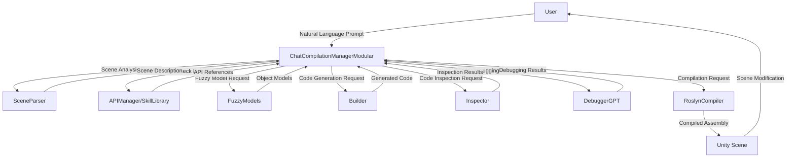

Sources: [Assets/Scripts/MR_Copilot/ChatCompilationManagerModular.cs:1-474]()

### Class Hierarchy

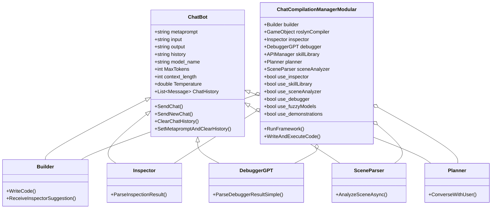

Sources: [Assets/Scripts/MR_Copilot/Orchestration/ChatBot.cs:1-324](), [Assets/Scripts/MR_Copilot/ChatCompilationManagerModular.cs:14-35]()

## Processing Pipeline

The Orchestration System follows a sequential processing pipeline to handle user prompts and execute appropriate actions.

### Request Processing Workflow

```mermaid
sequenceDiagram
    participant User
    participant CCM as "ChatCompilationManagerModular"
    participant SA as "SceneParser"
    participant SL as "APIManager/SkillLibrary"
    participant FM as "FuzzyModels"
    participant B as "Builder"
    participant I as "Inspector"
    participant D as "DebuggerGPT"
    participant RC as "RoslynCompiler"
    participant Unity
    
    User->>CCM: Natural Language Prompt
    
    alt Scene Analysis Enabled
        CCM->>SA: Analyze Scene
        SA->>CCM: Scene Description
    end
    
    alt Skill Library Enabled
        CCM->>SL: Check APIs
        SL->>CCM: API References
    end
    
    alt Fuzzy Models Enabled
        CCM->>FM: Generate Object Models
        FM->>CCM: Object Models
    end
    
    CCM->>B: Generate Code
    B->>CCM: Generated Code
    
    alt Inspector Enabled
        CCM->>I: Inspect Code
        I->>CCM: Inspection Results
        alt Inspection Issues Found
            CCM->>B: Update Code
            B->>CCM: Updated Code
            note over B,CCM: This loop can repeat multiple times
        end
    end
    
    CCM->>RC: Compile Code
    
    alt Compilation Fails and Debugger Enabled
        RC->>CCM: Error Message
        CCM->>D: Debug Code
        D->>CCM: Debugging Results
        CCM->>B: Fix Code
        B->>CCM: Fixed Code
        CCM->>RC: Compile Fixed Code
        note over D,RC: This debugging loop can repeat multiple times
    end
    
    RC->>Unity: Load Assembly
    Unity->>User: Display Results
```

Sources: [Assets/Scripts/MR_Copilot/ChatCompilationManagerModular.cs:78-133](), [Assets/Scripts/MR_Copilot/ChatCompilationManagerModular.cs:194-214]()

## Key Components

### ChatCompilationManagerModular

The main orchestration component that coordinates all other modules in the LLMR framework. This class is responsible for:

1. Receiving user inputs
2. Deciding which components to engage based on configuration
3. Passing information between components
4. Managing the execution flow from input to code generation to compilation
5. Handling errors and redirecting to appropriate components

Key methods:
- `RunFramework()`: Initiates the processing pipeline
- `WriteAndExecuteCode()`: Coordinates code generation, inspection, debugging, and compilation
- `RunSA()`, `RunSkillLibrary()`, `RunFuzzyModels()`: Context-gathering methods
- `RunBuilder()`, `RunInspector()`, `RunDebugger()`: Code generation and validation methods
- `Compile()`: Triggers code compilation

Sources: [Assets/Scripts/MR_Copilot/ChatCompilationManagerModular.cs:11-21](), [Assets/Scripts/MR_Copilot/ChatCompilationManagerModular.cs:78-133]()

### ChatBot

A base class for chat-based interactions with large language models. It provides core functionality for:

1. Managing communication with language models
2. Handling chat history
3. Token management and context window optimization
4. Error handling and retries for API calls

Key methods:
- `SendChat()`: Sends a request to the language model
- `SendNewChat()`: Clears history and sends a new request
- `ClearChatHistory()`, `ClearChatMemory()`: Memory management methods
- `SetMetapromptAndClearHistory()`: Configures system prompts

Sources: [Assets/Scripts/MR_Copilot/Orchestration/ChatBot.cs:18-34](), [Assets/Scripts/MR_Copilot/Orchestration/ChatBot.cs:91-177]()

## Configuration and Extensibility

The Orchestration System is highly configurable through boolean flags that enable or disable specific components:

| Configuration Option | Description |
|----------------------|-------------|
| `use_inspector` | Enables code inspection to validate generated code |
| `use_skillLibrary` | Enables API reference lookup for code generation |
| `use_sceneAnalyzer` | Enables analysis of the current Unity scene |
| `use_debugger` | Enables automatic debugging of compilation errors |
| `use_fuzzyModels` | Enables generation of abstract object models |
| `use_demonstrations` | Enables example-based prompting for better code generation |

Sources: [Assets/Scripts/MR_Copilot/ChatCompilationManagerModular.cs:29-36](), [Assets/Scripts/MR_Copilot/ChatCompilationManagerModular.cs:460-473]()

## Metaprompt Management

The system uses different metaprompts (system prompts) based on which components are enabled:

```mermaid
flowchart TD
    Start["SetMetaprompts()"] --> UseDemo{"use_demonstrations?"}
    UseDemo -->|No| ZeroShot["Use zero-shot metaprompt"]
    UseDemo -->|Yes| SceneAndSkill{"use_sceneAnalyzer AND use_skillLibrary?"}
    
    SceneAndSkill -->|Yes| Combined["Use combined Scene+Skill metaprompt"]
    SceneAndSkill -->|No| SceneOnly{"use_sceneAnalyzer?"}
    
    SceneOnly -->|Yes| Scene["Use Scene Analyzer metaprompt"]
    SceneOnly -->|No| SkillOnly{"use_skillLibrary?"}
    
    SkillOnly -->|Yes| Skill["Use Skill Library metaprompt"]
    SkillOnly -->|No| Base["Use base metaprompt"]
    
    Combined --> FuzzyCheck
    Scene --> FuzzyCheck
    Skill --> FuzzyCheck
    Base --> FuzzyCheck
    ZeroShot --> FuzzyCheck
    
    FuzzyCheck{"use_fuzzyModels?"} -->|Yes| AppendFuzzy["Append fuzzy model metaprompt addition"]
    FuzzyCheck -->|No| Finish["End"]
    AppendFuzzy --> Finish
```

Sources: [Assets/Scripts/MR_Copilot/ChatCompilationManagerModular.cs:294-333]()

## Memory Management

The ChatBot base class provides token and memory management strategies to prevent exceeding the language model's context limit:

| Memory Management Strategy | Description |
|----------------------------|-------------|
| `None` | No automatic management; throws error if context is exceeded |
| `FIFO` (First In, First Out) | Removes oldest conversation pairs until enough space is available |
| `Full_Reset` | Clears all chat history except the system prompt |

This allows the system to maintain long conversations without running into token limits.

Sources: [Assets/Scripts/MR_Copilot/Orchestration/ChatBot.cs:57-63](), [Assets/Scripts/MR_Copilot/Orchestration/ChatBot.cs:214-231]()

## Error Handling

The Orchestration System implements comprehensive error handling:

1. **Compilation Error Capture**: Captures Unity error logs and provides them to the debugging component
2. **Retry Mechanisms**: Multiple attempts for debugging and code generation
3. **Rate Limit Handling**: Automatic retry with backoff for API rate limits
4. **Error Aggregation**: Concatenates multiple errors for better context in debugging

Sources: [Assets/Scripts/MR_Copilot/ChatCompilationManagerModular.cs:387-421](), [Assets/Scripts/MR_Copilot/ChatCompilationManagerModular.cs:430-453](), [Assets/Scripts/MR_Copilot/Orchestration/ChatBot.cs:137-176]()

## Integration with External Services

The Orchestration System integrates with external services primarily through the ChatBot base class:

1. **OpenAI API**: For accessing GPT models
2. **Token Management**: Uses TikToken library to count tokens and manage context window
3. **Unity Integration**: Compiles and executes code in the Unity runtime environment

Sources: [Assets/Scripts/MR_Copilot/Orchestration/ChatBot.cs:123-176]()

## Conclusion

The Orchestration System serves as the backbone of the LLMR framework, coordinating the complex process of translating natural language prompts into executable Unity code. By managing the flow between specialized components, it enables a seamless user experience where mixed reality environments can be created and modified through natural language.

---

# Page: Natural Language Processing

# Natural Language Processing

<details>
<summary>Relevant source files</summary>

The following files were used as context for generating this wiki page:

- [Assets/Scripts/MR_Copilot/ChatRelationalGPT.cs](Assets/Scripts/MR_Copilot/ChatRelationalGPT.cs)
- [Assets/Scripts/MR_Copilot/IterPrompting.cs](Assets/Scripts/MR_Copilot/IterPrompting.cs)

</details>


## Purpose and Scope

This document describes how the LLMR system processes and interprets natural language prompts from users. It covers the components responsible for handling communication with large language models (primarily OpenAI's GPT-4), maintaining conversation context, and facilitating the translation of natural language into actionable plans and code. For information about how the system turns these processed prompts into executable code, see [Code Generation and Compilation](#2.3).

## NLP Pipeline Overview

The LLMR system employs a straightforward but effective natural language processing pipeline that bridges user inputs to executable actions in the Unity environment.

```mermaid
flowchart LR
    User["User Input"] --> NLPProcessor["NLP Processor"]
    NLPProcessor --> OpenAI["OpenAI API"]
    OpenAI --> ResponseHandler["Response Handler"]
    ResponseHandler --> Orchestrator["Orchestration System"]
    
    subgraph "NLP Components"
        NLPProcessor
        OpenAI
        ResponseHandler
    end
    
    subgraph "Action Components"
        Orchestrator --> Planner["Planner Module"]
        Planner --> Builder["Builder Module"]
        Builder --> Scene["Scene Modification"]
    end
```

Sources: [Assets/Scripts/MR_Copilot/ChatRelationalGPT.cs](), [Assets/Scripts/MR_Copilot/IterPrompting.cs]()

## Core NLP Components

The natural language processing functionality is primarily implemented through two key classes that handle different aspects of LLM interaction:

### ChatRelationalGPT

The `ChatRelationalGPT` class provides the foundation for managing conversations with OpenAI's GPT models. It maintains a chat history, formats messages according to OpenAI's requirements, and handles both synchronous and streaming completions.

Key features:
- Maintains conversation context through chat history
- Supports both single-response and streaming completion modes
- Configurable temperature and token limits
- UI integration for displaying responses

```mermaid
classDiagram
    class ChatRelationalGPT {
        +GameObject Input
        +GameObject Output
        +GameObject History
        +Text SystemContext
        +int MaxTokens
        -List~string~ stopValues
        +double Temperature
        +double FrequencyPenalty
        -List~Message~ ChatHistory
        +ChatCompletion()
        +TestChat()
        +TestChatStream()
    }
```

Sources: [Assets/Scripts/MR_Copilot/ChatRelationalGPT.cs:11-134]()

### IterPrompting

The `IterPrompting` class extends the basic chat functionality with support for iterative prompting workflows. It provides additional features for managing longer conversations and handling interruptions.

Key features:
- Supports cancellation tokens for interrupting API calls
- Provides undo functionality to remove the most recent prompt and response
- Allows clearing the entire chat history
- Widget reloading functionality for UI elements

```mermaid
classDiagram
    class IterPrompting {
        +GameObject input
        +GameObject Output
        +GameObject History
        +Text SystemContext
        +int MaxTokens
        -List~string~ stopValues
        +double Temperature
        +double FrequencyPenalty
        -List~Message~ ChatHistory
        +TestChatStream(CancellationToken token)
        +ReloadWidget(CancellationToken token, string widget)
        +Undo()
        +ClearChatHistory()
    }
```

Sources: [Assets/Scripts/MR_Copilot/IterPrompting.cs:13-143]()

## Message Processing Flow

The following diagram illustrates the detailed flow of messages through the NLP components:

```mermaid
sequenceDiagram
    participant User
    participant UI as "Unity UI"
    participant NLP as "NLP Component"
    participant OpenAI as "OpenAI API"
    participant Orchestrator as "Orchestration System"
    
    User->>UI: Enter natural language prompt
    UI->>NLP: Forward prompt
    
    Note over NLP: Add prompt to chat history
    
    NLP->>OpenAI: Send ChatRequest with context
    
    alt Streaming Mode
        OpenAI-->>NLP: Stream completion chunks
        loop For each chunk
            NLP-->>UI: Update UI with chunk
        end
    else Standard Mode
        OpenAI-->>NLP: Return complete response
        NLP-->>UI: Update UI with response
    end
    
    NLP->>NLP: Add response to chat history
    NLP->>Orchestrator: Forward processed response
    Orchestrator->>User: Execute requested actions
```

Sources: [Assets/Scripts/MR_Copilot/ChatRelationalGPT.cs:56-111](), [Assets/Scripts/MR_Copilot/IterPrompting.cs:44-106]()

## Technical Implementation Details

### Chat History Management

Both NLP components maintain a structured conversation history using OpenAI's Message format, with roles (System, User, Assistant) to distinguish between different message types:

```
List<Message> ChatHistory = new List<Message>();
ChatHistory.Add(new Message(Role.System, SystemContext.text)); // System prompt initialization
```

This approach ensures that each conversation maintains appropriate context over time, allowing the language model to understand user requests in relation to previous interactions.

Sources: [Assets/Scripts/MR_Copilot/ChatRelationalGPT.cs:28-38](), [Assets/Scripts/MR_Copilot/IterPrompting.cs:30-38]()

### API Configuration and Parameters

The NLP components provide configurable parameters for model interaction:

| Parameter | Purpose | Default |
|-----------|---------|---------|
| MaxTokens | Maximum response length | 512 |
| Temperature | Controls response randomness | 0.7 |
| FrequencyPenalty | Reduces repetition | 0 |
| Model | Language model to use | GPT-4 |

These parameters allow fine-tuning the model's behavior for different types of interactions.

Sources: [Assets/Scripts/MR_Copilot/ChatRelationalGPT.cs:19-26](), [Assets/Scripts/MR_Copilot/IterPrompting.cs:21-28]()

### Streaming vs. Standard Completion

The system supports two modes of interaction with the OpenAI API:

1. **Standard Completion** (`TestChat` method)
   - Sends a request and waits for the complete response
   - Simpler implementation but less responsive for long outputs

2. **Streaming Completion** (`TestChatStream` method)
   - Receives and processes response chunks as they become available
   - Provides better user experience for longer responses
   - Supports cancellation for interrupting ongoing requests

```mermaid
flowchart TD
    Request["ChatRequest Creation"]
    
    Request --> StandardPath["GetCompletionAsync()"]
    Request --> StreamPath["StreamCompletionAsync()"]
    
    StandardPath --> CompleteResponse["Wait for Complete Response"]
    StreamPath --> ChunkProcessing["Process Response Chunks"]
    
    CompleteResponse --> UpdateUI["Update UI Once"]
    ChunkProcessing --> IncrementalUI["Incremental UI Updates"]
    
    UpdateUI --> Complete["Complete"]
    IncrementalUI --> Complete
```

Sources: [Assets/Scripts/MR_Copilot/ChatRelationalGPT.cs:56-78](), [Assets/Scripts/MR_Copilot/ChatRelationalGPT.cs:80-111](), [Assets/Scripts/MR_Copilot/IterPrompting.cs:44-74]()

### Error Handling and Cancellation

The `IterPrompting` class implements cancellation support for streaming API calls:

```
await api.ChatEndpoint.StreamCompletionAsync(chatRequest, result =>
{
    // Process result
    token.ThrowIfCancellationRequested(); // Check for cancellation
},
token // Pass the cancellation token
);
```

This allows for gracefully interrupting an ongoing API call when needed, such as when the user wants to cancel a request or change their prompt.

Sources: [Assets/Scripts/MR_Copilot/IterPrompting.cs:58-67]()

## Integration with Other System Components

The NLP components serve as the bridge between user intent and system action. While they don't directly implement planning or building functionality, they provide the processed natural language that drives these components.

```mermaid
flowchart LR
    subgraph "NLP System"
        direction TB
        UserInput["User Input"] --> ChatClass["ChatRelationalGPT/IterPrompting"]
        ChatClass --> ModelAPI["OpenAI API"]
        ModelAPI --> ProcessedLanguage["Processed Natural Language"]
    end
    
    subgraph "Action System"
        direction TB
        ProcessedLanguage --> OrchestratorSystem["OrchestrationSystem"]
        OrchestratorSystem --> PlannerModule["PlannerModule"]
        PlannerModule --> TaskBreakdown["Task Breakdown"]
        TaskBreakdown --> BuilderModule["BuilderModule"]
        BuilderModule --> CodeGeneration["Code Generation"]
    end
```

This integration ensures that user intentions expressed in natural language are correctly transformed into specific actions in the Unity environment.

Sources: [Assets/Scripts/MR_Copilot/ChatRelationalGPT.cs](), [Assets/Scripts/MR_Copilot/IterPrompting.cs]()

## Summary

The Natural Language Processing component of LLMR provides a robust foundation for translating user intent into system actions. By leveraging OpenAI's GPT models and implementing features like conversation history, streaming responses, and cancellation support, the system delivers a responsive and contextually aware interface for interacting with the mixed reality environment.

---

# Page: Code Generation and Compilation

# Code Generation and Compilation

<details>
<summary>Relevant source files</summary>

The following files were used as context for generating this wiki page:

- [Assets/Scripts/MR_Copilot/ChatCompilationManagerModular.cs](Assets/Scripts/MR_Copilot/ChatCompilationManagerModular.cs)
- [README.md](README.md)

</details>


## Introduction

The code generation and compilation system is a core component of the LLMR framework that enables the translation of natural language prompts into executable C# code within Unity at runtime. This system allows users to create and modify 3D objects, behaviors, and entire scenes through natural language descriptions without requiring any coding knowledge. For information about how natural language is initially processed before code generation begins, see [Natural Language Processing](#2.2).

## System Architecture

The code generation and compilation pipeline consists of several interconnected components orchestrated by the `ChatCompilationManagerModular` class, which transforms natural language prompts into executable Unity code.

### System Components Diagram

```mermaid
graph TD
    User["User"] -->|"Natural Language Prompt"| Input["builder.input_TMP"]
    Input --> ChatManager["ChatCompilationManagerModular.RunFramework()"]
    
    ChatManager -->|"RunSA()"| SceneAnalyzer["SceneParser.AnalyzeSceneAsync()"]
    ChatManager -->|"RunSkillLibrary()"| SkillLibrary["APIManager.AnalyzeInput()"]
    ChatManager -->|"RunFuzzyModels()"| FuzzyModels["FuzzyModels.StageOne()/StageTwo()"]
    
    ChatManager -->|"WriteAndExecuteCode()"| CodeGen["Code Generation Process"]
    CodeGen -->|"RunInspector()"| Inspector["Inspector.SendNewChatWithInput()"]
    CodeGen -->|"RunBuilder()"| Builder["Builder.WriteCode()"]
    CodeGen -->|"RunDebugger()"| Debugger["DebuggerGPT"]
    CodeGen -->|"Compile()"| Compiler["CompileCompletionsWithReferences.RunCode()"]
    
    SceneAnalyzer -->|"sceneForInput"| ChatManager
    SkillLibrary -->|"libraryForInput"| ChatManager
    FuzzyModels -->|"fuzzyModelsForInput"| ChatManager
    
    Compiler -->|"Compiled Assembly"| Unity["Unity Scene"]
    Unity -->|"Visual Feedback"| User
```

Sources: [Assets/Scripts/MR_Copilot/ChatCompilationManagerModular.cs:11-36]()

The key components of the system include:

- **Builder**: Generates C# code based on the user's natural language prompt using OpenAI's LLMs
- **Inspector**: Reviews the generated code for potential issues before compilation
- **DebuggerGPT**: Handles errors that occur during compilation or execution
- **Roslyn Compiler**: Compiles the generated C# code at runtime using the `CompileCompletionsWithReferences` component
- **Scene Analyzer**: Provides context about the current Unity scene
- **Skill Library**: Provides access to relevant APIs and functions
- **Fuzzy Models**: Provides additional world models for objects

## Code Generation Process

The code generation process is initiated when a user enters a natural language prompt and presses Tab, which triggers the `RunFramework` method in `ChatCompilationManagerModular`.

### Code Generation Flow

```mermaid
sequenceDiagram
    participant User
    participant Manager as "ChatCompilationManagerModular"
    participant SceneAnalyzer as "SceneParser"
    participant SkillLibrary as "APIManager"
    participant FuzzyModels
    participant Builder
    participant Inspector
    participant Debugger as "DebuggerGPT"
    participant Compiler as "CompileCompletionsWithReferences"
    
    User->>Manager: Press Tab (Input.GetKeyDown(KeyCode.Tab))
    Manager->>Manager: RunFramework()
    
    alt use_sceneAnalyzer enabled
        Manager->>SceneAnalyzer: RunSA(user_input)
        SceneAnalyzer->>Manager: sceneForInput
    end
    
    alt use_skillLibrary enabled
        Manager->>SkillLibrary: RunSkillLibrary(user_input)
        SkillLibrary->>Manager: libraryForInput
    end
    
    alt use_fuzzyModels enabled
        Manager->>FuzzyModels: RunFuzzyModels(user_input)
        FuzzyModels->>Manager: fuzzyModelsForInput
    end
    
    Manager->>Manager: SetBuilderInput(refinedInput.text)
    Manager->>Manager: WriteAndExecuteCode()
    
    alt use_debugger && use_inspector
        Manager->>Debugger: RunDebugger(RunInspector)
        Debugger->>Inspector: RunInspector(RunBuilder)
        Inspector->>Builder: RunBuilder()
        Builder->>Manager: output
    else use_debugger
        Manager->>Debugger: RunDebugger(RunBuilder)
        Debugger->>Builder: RunBuilder()
        Builder->>Manager: output
    else use_inspector
        Manager->>Inspector: RunInspector(RunBuilder)
        Inspector->>Builder: RunBuilder()
        Builder->>Manager: output
        Manager->>Compiler: Compile()
    else
        Manager->>Builder: RunBuilder()
        Builder->>Manager: output
        Manager->>Compiler: Compile()
    end
    
    Manager->>User: DisplayProcessingFinishedStatusText()
```

Sources: [Assets/Scripts/MR_Copilot/ChatCompilationManagerModular.cs:78-133](), [Assets/Scripts/MR_Copilot/ChatCompilationManagerModular.cs:50-71]()

The process involves these key steps:

1. **Context Generation**: Depending on enabled components, the system gathers context:
   - If `use_sceneAnalyzer` is enabled, `RunSA` analyzes the current scene
   - If `use_skillLibrary` is enabled, `RunSkillLibrary` gathers relevant APIs
   - If `use_fuzzyModels` is enabled, `RunFuzzyModels` generates world models

2. **Builder Input Preparation**: The `SetBuilderInput` method combines the user input with the generated context.

3. **Code Generation and Inspection**: The `WriteAndExecuteCode` method orchestrates this process:
   - `RunBuilder` generates initial code using the Builder component
   - If enabled, `RunInspector` reviews the code for potential issues
   - If enabled, `RunDebugger` handles any compilation or runtime errors

4. **Compilation**: The `Compile` method invokes the Roslyn compiler to compile the generated code.

## LLM Prompt to Code Translation

A critical part of the process is the translation from natural language to executable code. This is handled by the Builder component which uses metaprompts and context to guide the language model.

```mermaid
graph LR
    A["Natural Language Prompt"] --> B["Builder.WriteCode()"]
    B -->|"OpenAI API Call"| C["LLM (GPT)"]
    C -->|"Response"| D["Generated C# Code"]
    D -->|"Inspector Review"| E["Refined C# Code"]
    E -->|"Compilation"| F["Executable Unity Behavior"]
    
    subgraph "Metaprompt Context"
        G["Scene Analysis"]
        H["API References"]
        I["Fuzzy World Models"]
        J["Code Examples"]
    end
    
    G --> B
    H --> B
    I --> B
    J --> B
```

Sources: [Assets/Scripts/MR_Copilot/ChatCompilationManagerModular.cs:294-332]()

The system uses different metaprompts depending on which components are enabled:
- Basic metaprompt (`builder_Base_metaprompt` or `builder_zero_shot_metaprompt`)
- Scene-aware metaprompt (`builder_SceneAnalyzer_metaprompt`)
- API-aware metaprompt (`builder_SkillLibrary_metaprompt`)
- Combined metaprompt (`builder_SceneAnalyzer_SkillLibrary_metaprompt`)
- Enhanced with fuzzy models (`builder_FuzzyModelsAddition_metaprompt`)

## Compilation System

The compilation system uses the Roslyn C# compiler to compile the generated code at runtime. This is implemented in the `Compile` method of `ChatCompilationManagerModular`.

```csharp
void Compile()
{
    Debug.Log("Now running Compiler");
    roslynCompiler.GetComponent<CompileCompletionsWithReferences>().RunCode();
}
```

Sources: [Assets/Scripts/MR_Copilot/ChatCompilationManagerModular.cs:424-428](), [README.md:18-22]()

The compilation process involves:

1. Receiving the generated code from the Builder in the `builder.output` variable
2. Calling the `RunCode` method of the `CompileCompletionsWithReferences` component
3. Loading necessary assembly references from the Assemblies folder
4. Compiling the code using the Roslyn compiler
5. Attaching the compiled code to GameObjects in the Unity scene

The system relies on preloaded assembly DLLs in the Assemblies folder. These assemblies provide the necessary references for the compiled code to interact with Unity's systems.

## Error Handling and Debugging

The system includes robust error handling through the `Inspector` and `DebuggerGPT` components that identify and fix errors in the generated code.

```mermaid
graph TD
    A["builder.output"] -->|"Compilation"| B{"Compilation Successful?"}
    B -->|"Yes"| C["Execute Code in Unity"]
    B -->|"No"| D["OnLogMessageReceived()"]
    D --> E["error_messages.Add()"]
    E --> F["ConcatenateErrorMessages()"]
    F --> G["RunDebugger()"]
    G --> H["ParseDebuggerResultSimple()"]
    H --> I["SetBuilderInput()"]
    I --> J["RunBuilder() again"]
    J --> A
    
    C -->|"Runtime"| K{"Runtime Errors?"}
    K -->|"Yes"| D
    K -->|"No"| L["Code Execution Complete"]
```

Sources: [Assets/Scripts/MR_Copilot/ChatCompilationManagerModular.cs:388-421](), [Assets/Scripts/MR_Copilot/ChatCompilationManagerModular.cs:430-453]()

The error handling process works as follows:

1. **Error Capturing**: Unity's logging system captures error messages via `OnLogMessageReceived`, adding them to the `error_messages` list.

2. **Error Analysis**: The `RunDebugger` method runs in a loop (up to `debugger.max_debugging_count` times) to:
   - Try to compile the code
   - Catch any exceptions
   - Collect error messages using `ConcatenateErrorMessages`
   - Pass errors to `debugger.ParseDebuggerResultSimple`
   - Update the input to the Builder with the corrected prompt
   - Try again with the updated input

This approach allows the system to automatically recover from many compilation and runtime errors without user intervention.

## Integration with Other Components

The code generation and compilation system integrates with other LLMR components to enhance context-awareness:

| Component | Integration Method | Purpose |
|-----------|-------------------|---------|
| Scene Analyzer | `RunSA` | Provides scene information through `sceneForInput` |
| Skill Library | `RunSkillLibrary` | Provides API references through `libraryForInput` |
| Fuzzy Models | `RunFuzzyModels` | Provides world models through `fuzzyModelsForInput` |
| Planner | `Chat_with_Planner` | Helps refine complex user prompts |

Sources: [Assets/Scripts/MR_Copilot/ChatCompilationManagerModular.cs:268-290]()

The modularity of the system allows components to be enabled or disabled as needed:
- `use_inspector` - Enables code inspection before compilation
- `use_skillLibrary` - Enables access to API references
- `use_sceneAnalyzer` - Enables scene analysis for context
- `use_debugger` - Enables automatic error correction
- `use_fuzzyModels` - Enables world model generation
- `use_demonstrations` - Enables example-based metaprompts

This flexibility allows the system to be tailored for different use cases and complexity levels.

## Summary

The code generation and compilation system within LLMR represents a powerful bridge between natural language and executable code. By leveraging LLMs, contextual understanding, and runtime code compilation, it enables users to dynamically create and modify 3D content and behaviors in Unity without writing code manually. The system's error handling capabilities and integration with other components make it robust and versatile for a wide range of applications in mixed reality environments.

---

# Page: External Integrations

# External Integrations

<details>
<summary>Relevant source files</summary>

The following files were used as context for generating this wiki page:

- [.gitignore](.gitignore)
- [Packages/manifest.json](Packages/manifest.json)
- [Packages/packages-lock.json](Packages/packages-lock.json)
- [ProjectSettings/Packages/com.unity.testtools.codecoverage/Settings.json](ProjectSettings/Packages/com.unity.testtools.codecoverage/Settings.json)
- [README.md](README.md)

</details>


This document provides a comprehensive overview of the external services and APIs integrated with the LLMR system. The LLMR framework leverages several external tools and services to enhance its capabilities for natural language-driven 3D content creation and manipulation in Unity environments.

For information about the overall system architecture, see [System Architecture](#2), and for details on how these integrations are utilized by the core modules, see [Core Modules](#4).

## Integration Overview

The LLMR system integrates with multiple external services to provide its functionality. These integrations span from language processing to image generation and 3D model retrieval.

```mermaid
graph TD
    Unity["Unity Environment"]
    OpenAI["OpenAI API Services"]
    Flask["Python Flask App"]
    DallE["DALL-E API"]
    CLIP["CLIP Model"]
    Sketchfab["Sketchfab API"]
    
    Unity -->|"API Calls via OpenAI Unity Package"| OpenAI
    Unity -->|"HTTP Requests to /get_image_from_prompt"| Flask
    Unity -->|"HTTP Requests to /get_closest_skfb_model"| Flask
    Unity -->|"HTTP Requests to /get_scene_from_prompt"| Flask
    
    Flask -->|"Generate Images"| DallE
    Flask -->|"Image Similarity Matching"| CLIP
    Flask -->|"Model Search & Retrieval"| Sketchfab
    
    DallE -->|"Response with Generated Images"| Flask
    CLIP -->|"Similarity Scores"| Flask
    Sketchfab -->|"3D Model UIDs & Data"| Flask
    
    Flask -->|"Return Model UIDs/Images"| Unity
    OpenAI -->|"Generated Code/Response"| Unity
```

Sources: [README.md:105-124]()

## External Services Dependencies

The LLMR system has several external dependencies that are managed through Unity's package system:

| Package | Version | Purpose |
|---------|---------|---------|
| com.openai.unity | 7.7.9 | Provides integration with OpenAI services |
| com.siccity.gltfutility | GitHub | Handles GLTF file format for 3D models |
| com.utilities.rest | 2.1.8 | Facilitates REST API communications |
| com.utilities.encoder.wav | 1.0.6 | Audio encoding utilities |

Sources: [Packages/manifest.json:1-54](), [Packages/packages-lock.json:3-236]()

## OpenAI Integration

The LLMR system integrates with OpenAI's services for natural language processing and code generation capabilities.

```mermaid
graph LR
    Unity["Unity Client"]
    OpenAIPackage["com.openai.unity Package"]
    RestUtilities["com.utilities.rest"]
    OpenAIAPI["OpenAI API"]
    
    Unity -->|"Uses"| OpenAIPackage
    OpenAIPackage -->|"Depends on"| RestUtilities
    OpenAIPackage -->|"HTTP Requests"| OpenAIAPI
    OpenAIAPI -->|"JSON Responses"| OpenAIPackage
    OpenAIPackage -->|"Parsed Results"| Unity
```

### Key Features

- Natural language understanding for processing user prompts
- Code generation for creating 3D objects and behaviors in Unity
- Code review and debugging assistance

Sources: [Packages/manifest.json:3](), [Packages/packages-lock.json:3-12]()

## DALL-E and CLIP Integration

The LLMR system uses DALL-E for image generation and CLIP for image similarity matching through a Python Flask application.

```mermaid
flowchart TD
    UserPrompt["User Prompt in Unity"]
    Flask["Flask App"]
    DallE["DALL-E API"]
    CLIP["CLIP Model"]
    Images["Generated Images"]
    Comparison["Image Similarity Comparison"]
    
    UserPrompt -->|"/get_image_from_prompt"| Flask
    Flask -->|"API Request"| DallE
    DallE -->|"Generated Image"| Images
    Images -->|"Input for"| CLIP
    CLIP -->|"Embedding Vectors"| Comparison
    Comparison -->|"Similarity Scores"| Flask
```

### Key Features

- Image generation from text descriptions using DALL-E
- Visual similarity matching using CLIP embeddings
- Bridge between text descriptions and visual representations

Sources: [README.md:122-124]()

## Sketchfab Integration

LLMR integrates with Sketchfab to search for and retrieve 3D models that match user prompts.

```mermaid
sequenceDiagram
    participant Unity as "Unity Client"
    participant Flask as "Flask App"
    participant CLIP as "CLIP Model"
    participant Sketchfab as "Sketchfab API"
    
    Unity->>Flask: Request model for prompt
    Flask->>Sketchfab: Search models with keywords
    Sketchfab->>Flask: Return model candidates
    Flask->>CLIP: Compare models with reference image
    CLIP->>Flask: Return similarity scores
    Flask->>Unity: Return best matching model UID
    Unity->>Sketchfab: Download model using UID
    Sketchfab->>Unity: Return 3D model file
    Unity->>Unity: Import and display model
```

### Key Features

- Text-based search for 3D models on Sketchfab
- Filtering and ranking models based on visual similarity
- Downloading and importing models directly into Unity

Sources: [README.md:103-108](), [README.md:120-121]()

## Flask Application Bridge

The Flask application serves as a bridge between Unity and Python-based AI services.

```mermaid
graph TB
    subgraph "Flask App Endpoints"
        GetImage["/get_image_from_prompt"]
        GetModel["/get_closest_skfb_model"]
        GetScene["/get_scene_from_prompt"]
    end
    
    Unity["Unity Environment"]
    Python["Python AI Services"]
    
    Unity -->|"HTTP Requests"| GetImage
    Unity -->|"HTTP Requests"| GetModel
    Unity -->|"HTTP Requests"| GetScene
    
    GetImage -->|"Calls"| Python
    GetModel -->|"Calls"| Python
    GetScene -->|"Calls"| Python
    
    Python -->|"Results"| GetImage
    Python -->|"Results"| GetModel
    Python -->|"Results"| GetScene
    
    GetImage -->|"JSON Response"| Unity
    GetModel -->|"JSON Response"| Unity
    GetScene -->|"JSON Response"| Unity
```

### Key Features

- RESTful API endpoints for Unity to access Python-based services
- Image generation and processing capabilities
- 3D model search and retrieval services

### Setup and Configuration

To set up the Flask application:

1. Navigate to the `CLIP-DallE-SketchFab-001` directory
2. Create a Python virtual environment
3. Install required dependencies with `pip install -r requirements.txt`
4. Run the application with `flask run`

Sources: [README.md:54-81]()

## End-to-End Integration Flow

The following diagram illustrates the complete flow of a user request through the system:

```mermaid
sequenceDiagram
    participant User
    participant Unity as "Unity Environment"
    participant OpenAI as "OpenAI API"
    participant Flask as "Flask App"
    participant DallE as "DALL-E API"
    participant CLIP as "CLIP Model"
    participant Sketchfab as "Sketchfab API"
    
    User->>Unity: Enter natural language prompt
    
    alt Simple Primitive Creation
        Unity->>OpenAI: Request code generation
        OpenAI->>Unity: Return code for primitive creation
        Unity->>Unity: Compile and execute code
        Unity->>User: Display created object
    else Complex 3D Model Request
        Unity->>Flask: Request model for prompt
        Flask->>DallE: Generate reference image
        DallE->>Flask: Return reference image
        Flask->>Sketchfab: Search for models
        Sketchfab->>Flask: Return model candidates
        Flask->>CLIP: Compare candidates with reference
        CLIP->>Flask: Return similarity scores
        Flask->>Unity: Return best model UID
        Unity->>Sketchfab: Download model
        Unity->>User: Display loaded model
    end
```

This diagram shows the two main pathways for object creation in LLMR:
1. Using OpenAI to generate code for creating Unity primitives
2. Using a combination of DALL-E, CLIP, and Sketchfab to find and load appropriate 3D models

Sources: [README.md:10-14](), [README.md:103-110](), [README.md:120-124]()

## Integration Usage Examples

### Creating Objects with Primitives

When a user requests an object that can be created with Unity primitives, the system uses the OpenAI integration to generate the necessary code.

Example prompt: "Create a rotating cube that changes color every second."

### Finding and Loading 3D Models

When a user requests more complex objects, the system leverages the DALL-E, CLIP, and Sketchfab integrations.

Example prompt: "Add a realistic horse to the scene."

Sources: [README.md:90-94](), [README.md:105-108]()

---

# Page: OpenAI Integration

# OpenAI Integration

<details>
<summary>Relevant source files</summary>

The following files were used as context for generating this wiki page:

- [.gitignore](.gitignore)
- [Assets/Scripts/MR_Copilot/ChatRelationalGPT.cs](Assets/Scripts/MR_Copilot/ChatRelationalGPT.cs)
- [NOTICE.md](NOTICE.md)
- [Packages/manifest.json](Packages/manifest.json)
- [Packages/packages-lock.json](Packages/packages-lock.json)
- [ProjectSettings/Packages/com.unity.testtools.codecoverage/Settings.json](ProjectSettings/Packages/com.unity.testtools.codecoverage/Settings.json)

</details>


This document details how the LLMR system integrates with OpenAI's services, primarily focusing on the GPT models used for language processing, code generation, and scene manipulation. For information about DALL-E image generation, see [DALL-E and CLIP Integration](#3.2).

## 1. Overview

The LLMR system leverages OpenAI's large language models to interpret natural language instructions and generate code that manipulates Unity scenes. This integration is central to the system's ability to transform user prompts into 3D environment modifications.

```mermaid
flowchart TD
    User["User"] -->|"Natural Language Prompt"| Unity["Unity Environment"]
    Unity -->|"API Calls"| OpenAI["OpenAI API"]
    OpenAI -->|"Responses"| Unity
    
    subgraph "OpenAI Services"
        GPT4["GPT-4 Model"]
        CodeGen["Code Generation"]
        Planning["Task Planning"]
    end
    
    subgraph "Unity Components"
        ChatSystem["ChatRelationalGPT"]
        OrchestrSystem["Orchestration System"]
        PlannerModule["Planner"]
        BuilderModule["Builder"]
        InspectorModule["Inspector"]
    end
    
    Unity --- OrchestrSystem
    OrchestrSystem --- PlannerModule
    OrchestrSystem --- BuilderModule
    OrchestrSystem --- InspectorModule
    Unity --- ChatSystem
    
    PlannerModule -.->|"Uses"| Planning
    BuilderModule -.->|"Uses"| CodeGen
    InspectorModule -.->|"Uses"| GPT4
    ChatSystem -.->|"Uses"| GPT4
```

Sources: [ChatRelationalGPT.cs:56-78](), [manifest.json:3](), [NOTICE.md:5-6]()

## 2. OpenAI Package Integration

LLMR incorporates the OpenAI Unity package from RageAgainstThePixel, which provides a C# wrapper around OpenAI's APIs.

```mermaid
graph TD
    LLMR["LLMR Framework"] -->|"Depends on"| OpenAIUnity["com.openai.unity v7.7.9"]
    OpenAIUnity -->|"Depends on"| RestUtils["com.utilities.rest"]
    OpenAIUnity -->|"Depends on"| WAVEncoder["com.utilities.encoder.wav"]
    
    subgraph "OpenAI API Access"
        OpenAIClient["OpenAIClient"]
        ChatEndpoint["ChatEndpoint"]
        ModelsEndpoint["ModelsEndpoint"]
    end
    
    OpenAIUnity --- OpenAIClient
    OpenAIClient --- ChatEndpoint
    OpenAIClient --- ModelsEndpoint
```

Sources: [manifest.json:3](), [Packages/packages-lock.json:3-11](), [ChatRelationalGPT.cs:1-3]()

## 3. Authentication and Client Initialization

The system instantiates an `OpenAIClient` to communicate with OpenAI's services. Authentication can be configured either with an API key directly or through an authentication object.

```
// Basic client initialization with default authentication
var api = new OpenAIClient();

// Client initialization with explicit API key
var auth = new OpenAIAuthentication("API KEY");
var api = new OpenAIClient(auth);
```

Sources: [ChatRelationalGPT.cs:59](), [ChatRelationalGPT.cs:122-123]()

## 4. Language Model Interaction

### 4.1 Models Used

LLMR primarily uses GPT-4 for its natural language processing capabilities. The system can query available models through the ModelsEndpoint.

```mermaid
sequenceDiagram
    participant Client as OpenAIClient
    participant ModelsAPI as ModelsEndpoint
    participant ChatAPI as ChatEndpoint
    participant OpenAI as OpenAI API
    
    Client->>ModelsAPI: GetModelsAsync()
    ModelsAPI->>OpenAI: HTTP Request
    OpenAI->>ModelsAPI: Available Models
    ModelsAPI->>Client: Models List
    
    Note over Client, OpenAI: Chat Completion
    Client->>ChatAPI: GetCompletionAsync(chatRequest)
    ChatAPI->>OpenAI: HTTP Request with Prompt
    OpenAI->>ChatAPI: Generated Response
    ChatAPI->>Client: Completion Result
```

Sources: [ChatRelationalGPT.cs:124-129](), [ChatRelationalGPT.cs:70]()

### 4.2 Chat Completion

The primary method of interaction with OpenAI's language models is through the Chat Completion API. LLMR maintains a conversation history to provide context for each request.

```mermaid
flowchart TD
    SystemMessage["System Message\n(Context)"] --> ChatHistory["Chat History"]
    UserMessage["User Message\n(Prompt)"] --> ChatHistory
    ChatHistory -->|"Input"| ChatRequest["ChatRequest"]
    ChatRequest -->|"Model, Temperature,\nMaxTokens"| API["OpenAI API"]
    API -->|"Response"| Result["ChatResponse"]
    Result -->|"FirstChoice"| OutputText["Output Text"]
    Result -->|"Add to"| ChatHistory
```

Sources: [ChatRelationalGPT.cs:37](), [ChatRelationalGPT.cs:61-77]()

## 5. Request Configuration

LLMR configures OpenAI requests with several parameters to control the output:

| Parameter | Description | Example Value |
|-----------|-------------|---------------|
| Model | The OpenAI model to use | GPT-4 |
| Temperature | Controls randomness (0-1) | 0.7 |
| MaxTokens | Maximum response length | 512 |
| StopValues | Tokens that stop generation | ["/*", "</"] |
| FrequencyPenalty | Reduces repetition (0-2) | 0.0 |

Sources: [ChatRelationalGPT.cs:19-26](), [ChatRelationalGPT.cs:34-35](), [ChatRelationalGPT.cs:70]()

## 6. Streaming Responses

For longer responses, LLMR supports streaming completions, which return tokens as they're generated rather than waiting for the complete response.

```mermaid
sequenceDiagram
    participant Unity as Unity Client
    participant API as OpenAIClient
    participant OpenAI as OpenAI API
    
    Unity->>API: StreamCompletionAsync(request, callback)
    API->>OpenAI: Stream Request
    loop For each token
        OpenAI->>API: Token
        API->>Unity: Callback(result)
        Unity->>Unity: Update UI
    end
    Unity->>Unity: Add to ChatHistory
```

Sources: [ChatRelationalGPT.cs:80-111]()

## 7. Implementation in LLMR Components

The OpenAI integration is used across multiple LLMR components:

### 7.1 Chat System

The `ChatRelationalGPT` class provides a direct interface for users to interact with the GPT models, maintaining conversation history and context.

```mermaid
classDiagram
    class ChatRelationalGPT {
        +GameObject Input
        +GameObject Output
        +GameObject History
        +Text SystemContext
        +int MaxTokens
        +double Temperature
        +double FrequencyPenalty
        +List~Message~ ChatHistory
        +void ChatCompletion()
        +Task TestChat()
        +Task TestChatStream()
    }
    
    ChatRelationalGPT --> "1" OpenAIClient : uses
    OpenAIClient --> "1" ChatEndpoint : accesses
```

Sources: [ChatRelationalGPT.cs:11-134]()

### 7.2 Builder, Planner, and Inspector

These components use OpenAI's language models to:
- Plan complex tasks (Planner)
- Generate code to modify the Unity scene (Builder)
- Validate and debug the generated code (Inspector)

```mermaid
flowchart LR
    UserPrompt["User Prompt"] --> Orchestrator["Orchestration System"]
    Orchestrator --> Planner["Planner Module"]
    Planner -->|"Uses OpenAI for\ntask planning"| Plan["Task Plan"]
    Plan --> Builder["Builder Module"]
    Builder -->|"Uses OpenAI for\ncode generation"| GeneratedCode["Generated C# Code"]
    GeneratedCode --> Inspector["Inspector Module"]
    Inspector -->|"Uses OpenAI for\ncode validation"| ValidatedCode["Validated Code"]
    ValidatedCode --> Execution["Code Execution"]
```

Sources: [based on system diagrams and overall architecture]

## 8. Configuration

To use LLMR with OpenAI services, you need to:

1. Ensure the OpenAI Unity package is installed (it's included in the repository dependencies)
2. Configure your OpenAI API key in the appropriate location
3. Adjust model parameters (temperature, max tokens, etc.) as needed for your use case

Sources: [manifest.json:3](), [ChatRelationalGPT.cs:19-26]()

## 9. Key Considerations

- **API Usage**: Be mindful of OpenAI API usage costs and rate limits
- **Response Time**: Complex generations may take several seconds to complete
- **Model Selection**: Different models offer trade-offs between quality, speed, and cost
- **Context Management**: Effective prompt engineering and context management are essential for getting useful results

Sources: [based on general OpenAI API considerations]

---

# Page: DALL-E and CLIP Integration

# DALL-E and CLIP Integration

<details>
<summary>Relevant source files</summary>

The following files were used as context for generating this wiki page:

- [Assets/Scenes/Playground_DallE-CLIP_Refinement.unity](Assets/Scenes/Playground_DallE-CLIP_Refinement.unity)
- [CLIP-DallE-SketchFab-001-main/requirements.txt](CLIP-DallE-SketchFab-001-main/requirements.txt)
- [README.md](README.md)

</details>


This page documents how the LLMR system integrates OpenAI's DALL-E image generation model and CLIP (Contrastive Language-Image Pre-training) for finding visually similar 3D models. These capabilities enable users to request objects using natural language and have the system retrieve appropriate models that closely match the description.

For information about the broader OpenAI integration, see [OpenAI Integration](#3.1). For details on how Sketchfab models are used, see [Sketchfab Integration](#3.3).

## Purpose and Components

The DALL-E and CLIP integration serves to bridge the gap between natural language descriptions and visual 3D models by:

1. Generating reference images based on text descriptions using DALL-E
2. Using CLIP to compare generated images with potential 3D model renderings
3. Finding and retrieving the best matching 3D models from Sketchfab

This process enables a more intuitive and flexible object creation workflow compared to primitive-based approaches.

Sources: [README.md:107-111]()

## System Architecture

The integration consists of several interconnected components that work together to transform text descriptions into 3D objects.

```mermaid
flowchart TD
    subgraph "Unity Environment"
        UnityClient["Unity Client"]
        InputManager["Input Manager"]
        SketchfabLoader["Sketchfab Loader"]
    end

    subgraph "Python Flask App"
        FlaskServer["Flask Server"]
        DallEProcessor["DALL-E Processor"]
        CLIPMatcher["CLIP Matcher"]
        SketchfabAPI["Sketchfab API Client"]
    end

    subgraph "External Services"
        OpenAI["OpenAI DALL-E API"]
        Sketchfab["Sketchfab Model Repository"]
    end

    InputManager -->|"Text Prompt"| UnityClient
    UnityClient -->|"HTTP Request"| FlaskServer
    FlaskServer -->|"Image Generation Request"| DallEProcessor
    DallEProcessor -->|"Prompt"| OpenAI
    OpenAI -->|"Generated Image"| DallEProcessor
    DallEProcessor -->|"Reference Image"| CLIPMatcher
    CLIPMatcher -->|"Search Query"| SketchfabAPI
    SketchfabAPI -->|"Model Search"| Sketchfab
    Sketchfab -->|"Model Candidates"| SketchfabAPI
    SketchfabAPI -->|"Model List"| CLIPMatcher
    CLIPMatcher -->|"Best Match UID"| FlaskServer
    FlaskServer -->|"Model UID"| UnityClient
    UnityClient -->|"Load Request"| SketchfabLoader
    SketchfabLoader -->|"Model Download"| Sketchfab
```

Sources: [README.md:54-75]()

## DALL-E and CLIP Processing Pipeline

The process of finding an appropriate 3D model based on a text prompt involves multiple steps of processing and matching.

```mermaid
sequenceDiagram
    participant User
    participant Unity as Unity Client
    participant Flask as Flask Server
    participant DALL-E as DALL-E API
    participant CLIP as CLIP Model
    participant Sketchfab as Sketchfab API

    User->>Unity: Enter object description
    Unity->>Flask: Send text prompt
    Flask->>DALL-E: Request image generation
    DALL-E->>Flask: Return reference image
    Flask->>Sketchfab: Search for models by keyword
    Sketchfab->>Flask: Return candidate models
    Flask->>CLIP: Compare reference image with model thumbnails
    Flask->>CLIP: Compare text prompt with model descriptions
    CLIP->>Flask: Return similarity scores
    Flask->>Flask: Rank models by combined scores
    Flask->>Unity: Return best model UID
    Unity->>Sketchfab: Download model
    Unity->>User: Display 3D model
```

Sources: [README.md:104-126]()

## Flask Application Setup

The Flask application serves as the bridge between Unity and the AI services. It provides endpoints for generating images and finding similar 3D models.

### Requirements

The Flask application requires the following Python dependencies:

| Dependency | Purpose |
|------------|---------|
| Flask | Web framework for API endpoints |
| OpenAI | Access to DALL-E API |
| PyTorch | Deep learning framework for CLIP |
| CLIP | Visual-language model for similarity matching |
| Werkzeug | Utilities for Flask |

Sources: [CLIP-DallE-SketchFab-001-main/requirements.txt:1-7]()

### Setup Instructions

1. Create a Python environment in the local folder
2. Install the required dependencies
3. Run the Flask application
4. The application will be available for Unity to connect to

Sources: [README.md:54-81]()

## API Endpoints

The Flask application provides several key endpoints that enable the DALL-E and CLIP functionality:

| Endpoint | Purpose | Parameters | Response |
|----------|---------|------------|----------|
| `/get_image_from_prompt` | Generate a reference image for a single object using DALL-E | Text prompt | Generated image |
| `/get_closest_skfb_model` | Find the closest Sketchfab model using CLIP | Image, text prompt | Sketchfab model UID |
| `/get_scene_from_prompt` | Generate a reference image for an entire scene | Scene description | Generated scene image |

Sources: [README.md:122-124]()

## Unity Integration

The LLMR system includes a specialized Unity scene called `Playground_DallE-CLIP_Refinement` that demonstrates the integration with DALL-E and CLIP.

### Scene Components

The Unity integration consists of:

1. User interface for text input
2. HTTP client for communicating with the Flask server
3. Image display components for visualization
4. Sketchfab model loader for importing retrieved models

```mermaid
graph TD
    subgraph "Unity Scene Components"
        UserInput["User Input Field"]
        PromptProcessor["Prompt Processor"]
        ModelViewer["Model Viewer"]
        ImageDisplay["Reference Image Display"]
    end

    subgraph "Communication Layer"
        HTTPClient["HTTP Client"]
        JSONParser["JSON Parser"]
        SketchfabLoader["Sketchfab Loader"]
    end

    UserInput -->|"Text Prompt"| PromptProcessor
    PromptProcessor -->|"Formatted Request"| HTTPClient
    HTTPClient -->|"API Request"| FlaskServer["Flask Server"]
    FlaskServer -->|"Model UID + Image"| HTTPClient
    HTTPClient -->|"Reference Image"| ImageDisplay
    HTTPClient -->|"Model UID"| SketchfabLoader
    SketchfabLoader -->|"3D Model Data"| ModelViewer
```

Sources: [Assets/Scenes/Playground_DallE-CLIP_Refinement.unity:105-126]()

## Example Usage Workflow

1. User enters a text description (e.g., "a fork", "a bowl") in the Unity interface
2. The description is sent to the Flask server
3. DALL-E generates a reference image based on the description
4. The Flask server searches Sketchfab for model candidates
5. CLIP compares the reference image with model thumbnails to find the best match
6. The best matching model's UID is returned to Unity
7. Unity downloads and displays the model

Sources: [README.md:104-110]()

## Technical Considerations

- The system requires active internet connections to both OpenAI and Sketchfab services
- Image generation and processing can introduce some latency
- The quality of the match depends on both the DALL-E generated image and available models in Sketchfab
- The Flask application needs to run locally alongside Unity

Sources: [README.md:77-81]()

## Performance Optimization

To optimize the performance of the DALL-E and CLIP integration:

1. Model search results are filtered first by text similarity before visual comparison
2. A subset of the most relevant models is selected for detailed CLIP comparison
3. The combined text and visual similarity scores are used for final ranking

Sources: [README.md:122-124]()

## Integration with Other LLMR Components

The DALL-E and CLIP integration complements the primitive-based object creation approach in LLMR, providing users with multiple options for creating 3D content.

```mermaid
graph TD
    subgraph "User Input Methods"
        NLPrompt["Natural Language Prompt"]
    end

    subgraph "Processing Pathways"
        CodeGenPath["Code Generation Path"]
        VisualPath["Visual Reference Path"]
    end

    subgraph "Object Creation Methods"
        PrimitiveCreation["Unity Primitive Creation"]
        ModelRetrieval["3D Model Retrieval"]
    end

    NLPrompt -->|"Code-based approach"| CodeGenPath
    NLPrompt -->|"Visual-based approach"| VisualPath
    CodeGenPath -->|"Generate code to create"| PrimitiveCreation
    VisualPath -->|"Generate image with DALL-E"| DALLE["DALL-E"]
    DALLE -->|"Find visual match with CLIP"| CLIP["CLIP"]
    CLIP -->|"Retrieve model"| ModelRetrieval
```

Sources: [README.md:10-14]()

## Conclusion

The integration of DALL-E and CLIP in the LLMR system provides a powerful method for retrieving visually appropriate 3D models based on natural language descriptions. This approach complements the code generation capabilities of LLMR, offering users flexibility in how they create and populate their 3D environments.

---

# Page: Sketchfab Integration

# Sketchfab Integration

<details>
<summary>Relevant source files</summary>

The following files were used as context for generating this wiki page:

- [Assets/Scripts/MR_Copilot/Sketchfab/LegacySketchfabLoader.cs](Assets/Scripts/MR_Copilot/Sketchfab/LegacySketchfabLoader.cs)
- [Assets/Scripts/MR_Copilot/Sketchfab/SketchfabAPIManager.cs](Assets/Scripts/MR_Copilot/Sketchfab/SketchfabAPIManager.cs)
- [Assets/Scripts/MR_Copilot/Sketchfab/SketchfabLoader.cs](Assets/Scripts/MR_Copilot/Sketchfab/SketchfabLoader.cs)

</details>


## Purpose and Scope

This document details the Sketchfab integration component of the LLMR system, which allows the retrieval, downloading, and integration of 3D models from the Sketchfab platform into Unity scenes. The integration provides functionality for searching models by keywords, downloading them, processing them for optimal use in the scene, and manipulating their position, scale, and physical properties.

For information about the general external integrations architecture, see [External Integrations](#3). For details about how DALL-E and CLIP can enhance model search, see [DALL-E and CLIP Integration](#3.2).

Sources: [Assets/Scripts/MR_Copilot/Sketchfab/SketchfabLoader.cs:17-18]()

## System Architecture

The Sketchfab integration consists of several components that work together to search, download, and process 3D models from Sketchfab for use in Unity environments.

### Component Overview

```mermaid
graph TD
    subgraph "Unity Environment"
        SL["SketchfabLoader"]
        GLTF["GLTFUtility\nImporter"]
        F3D["Find3DModelsSingle"]
        Unity["Unity Scene"]
    end
    
    subgraph "External Services"
        SFAPI["Sketchfab API"]
        DALLE["DALL-E API"]
        CLIP["CLIP Model"]
    end
    
    User["User"] -->|"Request Model"| SL
    SL -->|"Search Request"| SFAPI
    SFAPI -->|"Search Results"| SL
    SL -->|"Optional: DALLE-CLIP Refinement"| F3D
    F3D -->|"Generate Reference Image"| DALLE
    DALLE -->|"Reference Image"| F3D
    F3D -->|"Compare with CLIP"| CLIP
    F3D -->|"Best Match UID"| SL
    SL -->|"Download Request"| SFAPI
    SFAPI -->|"Model File (GLTF)"| SL
    SL -->|"Import GLTF"| GLTF
    GLTF -->|"Processed GameObject"| SL
    SL -->|"Add to Scene"| Unity
```

Sources: [Assets/Scripts/MR_Copilot/Sketchfab/SketchfabLoader.cs:17-239](), [Assets/Scripts/MR_Copilot/Sketchfab/SketchfabLoader.cs:350-359]()

### Class Structure

The `SketchfabLoader` class is the central component that handles the Sketchfab integration:

```mermaid
classDiagram
    class SketchfabLoader {
        +bool use_DALLE_CLIP_refinement
        +bool save_models_to_nontemp_folder
        +Find3DModelsSingle finder
        +string username
        +string password
        +string baseUrl
        +float size
        +GameObject currentModel
        +bool createParentCollider
        +LoadBatch(List~ModelData~)
        +LoadBatchWithCaching(List~ModelData~)
        +Load(string modelName)
        +LoadByID(string UID, string modelName)
        +Move(GameObject, Vector3)
        +Scale(GameObject, float)
        +AddPhysics(GameObject, float mass)
        -AuthenticateUser()
        -PerformSearchNew(string, GameObject)
        -GetModelDetailsNew(string, GameObject)
        -BeginDownloadProcessNew(string, GameObject)
        -ImportGLTFAsync(string)
        -CenterCurrentModel()
        -PlaceNextTo(GameObject, GameObject, Vector3)
    }
```

Sources: [Assets/Scripts/MR_Copilot/Sketchfab/SketchfabLoader.cs:221-249](), [Assets/Scripts/MR_Copilot/Sketchfab/SketchfabLoader.cs:479-550]()

## Authentication and API Integration

The Sketchfab integration uses OAuth 2.0 for authentication with the Sketchfab API.

### Authentication Flow

```mermaid
sequenceDiagram
    participant Unity as SketchfabLoader
    participant SF as Sketchfab API
    
    Unity->>SF: POST /oauth2/token/ (username, password)
    SF->>Unity: Return access_token
    Unity->>SF: GET /models/{UID}/download (with access_token)
    SF->>Unity: Return download URLs
    Unity->>SF: GET model file URL
    SF->>Unity: Download model file (GLTF)
```

The `SketchfabLoader` authenticates with Sketchfab using the configured username and password, obtaining an access token used for subsequent API requests.

Sources: [Assets/Scripts/MR_Copilot/Sketchfab/SketchfabLoader.cs:643-682](), [Assets/Scripts/MR_Copilot/Sketchfab/SketchfabLoader.cs:788-802]()

### API Endpoints

The integration uses the following Sketchfab API endpoints:

| Endpoint | Purpose | Implementation |
|----------|---------|----------------|
| `/oauth2/token/` | Authentication | `AuthenticateUser()` method |
| `/v3/search?type=models` | Searching for models | `PerformSearchNew()` method |
| `/v3/models/{UID}/download` | Getting model download URLs | `GetSpecificModelDetailsNew()` method |

Sources: [Assets/Scripts/MR_Copilot/Sketchfab/SketchfabLoader.cs:653](), [Assets/Scripts/MR_Copilot/Sketchfab/SketchfabLoader.cs:705](), [Assets/Scripts/MR_Copilot/Sketchfab/SketchfabLoader.cs:806]()

## Model Retrieval Workflow

The model retrieval process follows these main steps:

### Model Search and Download Workflow

```mermaid
flowchart TD
    A["Request Model\n(by name or UID)"] --> B["Authenticate\nwith Sketchfab"]
    B --> C["Search for Models\non Sketchfab"]
    C --> D["Select Best Match\n(random or CLIP-based)"]
    D --> E["Get Download URL\nfor Model"]
    E --> F["Download Model\n(GLTF format)"]
    F --> G["Extract Files from\nDownloaded ZIP"]
    G --> H["Import GLTF\nwith GLTFUtility"]
    H --> I["Process Model\n(center, scale, etc.)"]
    I --> J["Add to Scene"]
    
    subgraph "Optional CLIP Refinement"
        D1["Generate Image\nwith DALL-E"] --> D2["Compare Models\nwith CLIP"]
        D2 --> D3["Select Best Match"]
    end
    
    D -->|"if use_DALLE_CLIP_refinement=true"| D1
    D3 --> E
```

Sources: [Assets/Scripts/MR_Copilot/Sketchfab/SketchfabLoader.cs:479-550](), [Assets/Scripts/MR_Copilot/Sketchfab/SketchfabLoader.cs:685-787](), [Assets/Scripts/MR_Copilot/Sketchfab/SketchfabLoader.cs:830-876](), [Assets/Scripts/MR_Copilot/Sketchfab/SketchfabLoader.cs:350-359]()

### Methods for Model Retrieval

The `SketchfabLoader` class provides several methods for retrieving models:

1. **Load**: Searches for and loads a model by name
   ```csharp
   public GameObject Load(string modelName)
   ```

2. **LoadByID**: Loads a specific model by its Sketchfab UID
   ```csharp
   public GameObject LoadByID(string UID, string modelName)
   ```

3. **LoadBatch**: Loads multiple models defined by `ModelData` objects
   ```csharp
   public void LoadBatch(List<ModelData> models)
   ```

4. **LoadBatchWithCaching**: Loads multiple models with local caching for efficiency
   ```csharp
   public void LoadBatchWithCaching(List<ModelData> models)
   ```

Sources: [Assets/Scripts/MR_Copilot/Sketchfab/SketchfabLoader.cs:479-484](), [Assets/Scripts/MR_Copilot/Sketchfab/SketchfabLoader.cs:501-506](), [Assets/Scripts/MR_Copilot/Sketchfab/SketchfabLoader.cs:348-371](), [Assets/Scripts/MR_Copilot/Sketchfab/SketchfabLoader.cs:274-345]()

## Model Processing

After a model is downloaded, it undergoes several processing steps to prepare it for use in the Unity scene.

### Import and Processing

```mermaid
flowchart LR
    A["Download Model\n(GLTF format)"] --> B["Import with\nGLTFUtility.Importer"]
    B --> C["Create Parent\nGameObject"]
    C --> D["Calculate\nSize and Scale"]
    D --> E["Apply Uniform\nScale Factor"]
    E --> F["Center Model\nin Parent"]
    F --> G["Add Collider\n(optional)"]
    G --> H["Mark as Complete\n(tag = 'Finish')"]
```

The `CenterCurrentModel` method performs several important tasks:
1. Creates a parent GameObject to contain the model
2. Calculates the model's bounding box
3. Applies uniform scaling to match the target size
4. Centers the model within its parent
5. Optionally adds a collider to the parent GameObject
6. Marks the model as "Finish" to indicate completion

Sources: [Assets/Scripts/MR_Copilot/Sketchfab/SketchfabLoader.cs:894-996](), [Assets/Scripts/MR_Copilot/Sketchfab/SketchfabLoader.cs:936-996]()

## Model Manipulation

The `SketchfabLoader` provides several methods for manipulating models after they have been loaded:

### Movement and Transformation

```mermaid
flowchart TD
    A["Loaded Model"] --> B{"Ready to Move?\n(tag = 'Finish')"}
    B -->|"No"| C["Wait for\nModel to Load"]
    C --> B
    B -->|"Yes"| D["Apply\nTransformation"]
    
    subgraph "Available Transformations"
        D1["Move\n(position)"]
        D2["Scale\n(uniform scale)"]
        D3["Add Physics\n(colliders, rigidbody)"]
        D4["Place Next To\n(relative positioning)"]
    end
    
    D --> D1
    D --> D2
    D --> D3
    D --> D4
```

The available manipulation methods include:

1. **Move**: Positions a model at a specified location
   ```csharp
   public void Move(GameObject model, Vector3 move)
   ```

2. **Scale**: Applies uniform scaling to a model
   ```csharp
   public void Scale(GameObject model, float scale)
   ```

3. **AddPhysics**: Adds physics components (colliders and Rigidbody) to a model
   ```csharp
   public void AddPhysics(GameObject model, float mass = 1)
   ```

4. **PlaceNextTo**: Positions a model relative to another model
   ```csharp
   public void PlaceNextTo(GameObject originalObj, GameObject objToPlace, Vector3 placement)
   ```

Sources: [Assets/Scripts/MR_Copilot/Sketchfab/SketchfabLoader.cs:509-594](), [Assets/Scripts/MR_Copilot/Sketchfab/SketchfabLoader.cs:1097-1157]()

## Model Caching

The system supports caching of downloaded models to improve performance and reduce redundant downloads.

### Caching Workflow

```mermaid
flowchart TD
    A["Request Model(s)"] --> B["Check Local Cache\nfor Each Model"]
    B -->|"Found in Cache"| C["Load from\nLocal Storage"]
    B -->|"Not Found"| D["Download from\nSketchfab"]
    D --> E["Save to Cache"]
    C --> F["Process Model"]
    E --> F
```

The `LoadBatchWithCaching` method first checks if requested models already exist in the local cache before downloading them from Sketchfab.

When saving models, the system can use either:
- Temporary cache path (`Application.temporaryCachePath`)
- Persistent data path (`Application.persistentDataPath`)

The behavior is controlled by the `save_models_to_nontemp_folder` boolean property.

Sources: [Assets/Scripts/MR_Copilot/Sketchfab/SketchfabLoader.cs:274-345](), [Assets/Scripts/MR_Copilot/Sketchfab/SketchfabLoader.cs:397-434](), [Assets/Scripts/MR_Copilot/Sketchfab/SketchfabLoader.cs:851-871]()

## DALL-E and CLIP Integration

The `SketchfabLoader` can optionally use DALL-E and CLIP for more refined model search results.

### DALL-E and CLIP Refinement Process

```mermaid
sequenceDiagram
    participant SL as SketchfabLoader
    participant F3D as Find3DModelsSingle
    participant DALLE as DALL-E API
    participant CLIP as CLIP Model
    participant SF as Sketchfab API
    
    Note over SL: LoadBatch with use_DALLE_CLIP_refinement = true
    SL->>F3D: Pass model data to Find3DModelsClosestToLabels
    F3D->>DALLE: Generate reference image for model label
    DALLE->>F3D: Return reference image
    F3D->>SF: Search for models with similar label
    SF->>F3D: Return candidate models
    F3D->>CLIP: Compare reference image with model thumbnails
    CLIP->>F3D: Return similarity scores
    F3D->>SL: Return best match UID
    SL->>SF: Request specific model by UID
```

When `use_DALLE_CLIP_refinement` is set to `true`, the system uses the `Find3DModelsSingle` component to:
1. Generate a reference image with DALL-E based on the model label
2. Search for models on Sketchfab
3. Use CLIP to compare the reference image with model thumbnails
4. Select the best match based on visual similarity

This approach improves search accuracy by considering visual similarity in addition to text matching.

Sources: [Assets/Scripts/MR_Copilot/Sketchfab/SketchfabLoader.cs:221-222](), [Assets/Scripts/MR_Copilot/Sketchfab/SketchfabLoader.cs:350-359]()

## Usage Examples

Here are some common usage patterns for the Sketchfab integration:

### Basic Model Loading

```csharp
// Load a model by name
GameObject chair = sketchfabLoader.Load("chair");

// After the model is loaded (asynchronously)
sketchfabLoader.Move(chair, new Vector3(0, 0, 2));
sketchfabLoader.Scale(chair, 1.5f);
```

### Loading Multiple Models with Caching

```csharp
// Define models to load
List<ModelData> models = new List<ModelData>
{
    new ModelData { label = "table", position = new Vector3(0, 0, 0), scale = 1.0f },
    new ModelData { label = "chair", position = new Vector3(1, 0, 0), scale = 0.8f },
    new ModelData { label = "lamp", position = new Vector3(-1, 0, 0), scale = 0.5f }
};

// Load models with caching
sketchfabLoader.LoadBatchWithCaching(models);
```

### Loading a Specific Model by ID

```csharp
// Load a model using its Sketchfab UID
GameObject specificModel = sketchfabLoader.LoadByID("cf4194d4ce404273a62c7711447f5f51", "specificModelName");
```

### Positioning Models Relative to Each Other

```csharp
// Load two models
GameObject table = sketchfabLoader.Load("table");
GameObject vase = sketchfabLoader.Load("vase");

// Place the vase on the table
sketchfabLoader.MoveNextTo(table, vase, new Vector3(0, 1, 0));
```

Sources: [Assets/Scripts/MR_Copilot/Sketchfab/SketchfabLoader.cs:479-535](), [Assets/Scripts/MR_Copilot/Sketchfab/SketchfabLoader.cs:274-277](), [Assets/Scripts/MR_Copilot/Sketchfab/SketchfabLoader.cs:526-529]()

## Configuration Options

The `SketchfabLoader` provides several configuration options:

| Property | Type | Description |
|----------|------|-------------|
| `use_DALLE_CLIP_refinement` | bool | Enables DALL-E and CLIP for refining search results |
| `save_models_to_nontemp_folder` | bool | Saves models to persistent path instead of temporary cache |
| `size` | float | Default size for loaded models (uniform scale) |
| `maximumPageLimit` | int | Maximum number of pages to retrieve in search results |
| `createParentCollider` | bool | Whether to add a collider to the parent GameObject |
| `username` | string | Sketchfab username for authentication |
| `password` | string | Sketchfab password for authentication |

Sources: [Assets/Scripts/MR_Copilot/Sketchfab/SketchfabLoader.cs:221-249]()

## Technical Limitations and Considerations

1. **Authentication**: Requires valid Sketchfab credentials with download permissions
2. **Asynchronous Operations**: All model loading operations are asynchronous and require coroutines
3. **Model Format**: Only supports GLTF/GLB format models
4. **Model Complexity**: Very large or complex models may impact performance
5. **Rate Limiting**: Sketchfab API has rate limits that may affect batch operations
6. **DALL-E Integration**: Requires proper setup of the Flask app and API keys for OpenAI

Sources: [Assets/Scripts/MR_Copilot/Sketchfab/SketchfabLoader.cs:643-682](), [Assets/Scripts/MR_Copilot/Sketchfab/SketchfabLoader.cs:539-550]()

## Key Helper Classes

The `SketchfabLoader` includes several helper classes for working with the Sketchfab API:

| Class | Purpose |
|-------|---------|
| `Result` | Represents a single model result from a search |
| `SFSearchResults` | Contains a page of search results |
| `ImplicitAccessToken` | Stores OAuth authentication token |
| `_ModelDownloadMetaData` | Contains download URLs for a model |
| `Archives` | Information about available model formats |

Sources: [Assets/Scripts/MR_Copilot/Sketchfab/SketchfabLoader.cs:21-218]()

---

# Page: Flask Application

# Flask Application

<details>
<summary>Relevant source files</summary>

The following files were used as context for generating this wiki page:

- [CLIP-DallE-SketchFab-001-main/requirements.txt](CLIP-DallE-SketchFab-001-main/requirements.txt)
- [README.md](README.md)

</details>


## Purpose and Scope

This document describes the Flask application that serves as a bridge between the Unity environment in LLMR and various external AI services. The Flask app provides critical functionality for finding and retrieving appropriate 3D models and images based on natural language prompts by integrating DALL-E for image generation, CLIP for similarity matching, and Sketchfab for 3D model retrieval. This document covers the app's architecture, setup process, API endpoints, and integration with Unity.

For information about the specific implementation details of DALL-E and CLIP, see [DALL-E and CLIP Integration](#3.2). For details about how Sketchfab models are used within Unity, see [Sketchfab Integration](#3.3).

Sources: [README.md:54-78](), [README.md:116-127]()

## System Architecture

The Flask application acts as a middleware service between the Unity front-end of LLMR and multiple external AI and 3D model services. It processes requests from Unity, interacts with the required external APIs, performs AI-based processing, and returns results that Unity can use to enhance the 3D environment.

```mermaid
flowchart TD
    subgraph "Unity Environment"
        Unity["Unity Client"]
        Orchestrator["Orchestration System"]
        SketchfabLoader["Sketchfab Loader"]
    end

    subgraph "Flask Application"
        directions:right
        Flask["Flask Server (app.py)"]
        Routes["API Routes"]
        CLIP["CLIP Model"]
    end

    subgraph "External Services"
        DALLE["DALL-E API"]
        SketchfabAPI["Sketchfab API"]
    end

    Unity -->|"HTTP Request"| Flask
    Flask -->|"HTTP Response"| Unity
    
    Orchestrator --> Unity
    SketchfabLoader --> Unity
    
    Flask --> Routes
    Routes -->|"/get_image_from_prompt"| DALLE
    Routes -->|"/get_scene_from_prompt"| DALLE
    Routes -->|"/get_closest_skfb_model"| SketchfabAPI
    
    DALLE -->|"Generated Image"| Routes
    SketchfabAPI -->|"Model Metadata"| Routes
    
    Routes --> CLIP
    CLIP -->|"Similarity Scores"| Routes
```

Sources: [README.md:116-127]()

## Setup and Installation

The Flask application requires Python 3.9 or higher and several dependencies. Follow these steps to set up and run the application:

1. Navigate to the `CLIP-DallE-SketchFab-001` directory after cloning the repository
2. Create and activate a Python virtual environment:
   ```
   python -m venv .venv
   source .venv/bin/activate  # On Windows: .venv\Scripts\activate
   ```
3. Install the required dependencies:
   ```
   pip install -r requirements.txt
   ```
4. Run the Flask application:
   ```
   flask run
   ```

The application will start a local server (typically at http://127.0.0.1:5000), which the Unity application can then communicate with.

### Dependencies

| Dependency | Version | Purpose |
|------------|---------|---------|
| Flask | 2.0.2 | Web framework for creating the API endpoints |
| gunicorn | - | WSGI HTTP server for deploying the application |
| openai | 0.27.8 | Client for OpenAI's API (DALL-E) |
| torch | - | Deep learning framework required by CLIP |
| torchvision | - | Computer vision utilities for PyTorch |
| openai-clip | - | Implementation of the CLIP model |
| Werkzeug | 2.2.2 | WSGI utility library used by Flask |

Sources: [README.md:54-78](), [CLIP-DallE-SketchFab-001-main/requirements.txt:1-7]()

## API Endpoints

The Flask application exposes three main API endpoints that provide different functionalities within the LLMR system:

```mermaid
graph TD
    subgraph "Flask API Endpoints"
        A["GET /get_image_from_prompt"]
        B["GET /get_scene_from_prompt"]
        C["GET /get_closest_skfb_model"]
    end
    
    subgraph "Processing Flow"
        A -->|"prompt parameter"| D["DALL-E API"]
        D --> E["Generate single object image"]
        E --> F["Return image URL"]
        
        B -->|"prompt parameter"| G["DALL-E API"]
        G --> H["Generate scene with multiple objects"]
        H --> I["Return scene image URL"]
        
        C -->|"prompt + target_image"| J["Query Sketchfab API"]
        J --> K["Get N models with similar text descriptions"]
        K --> L["CLIP comparison with target image"]
        L --> M["Return UID of closest match"]
    end
```

### 1. `/get_image_from_prompt`

**Purpose**: Generates an image of a single 3D object based on a text prompt using DALL-E.

**Parameters**:
- `prompt`: Text description of the object to generate

**Response**: URL of the generated image

**Usage**: This endpoint is typically called when a user requests a specific object in Unity. The generated image serves as a visual target for matching with 3D models.

### 2. `/get_scene_from_prompt`

**Purpose**: Generates an image of a scene with multiple objects based on a text prompt using DALL-E.

**Parameters**:
- `prompt`: Text description of the scene to generate

**Response**: URL of the generated scene image

**Usage**: Called when a user requests a complex scene with multiple objects. Unity can use this image to determine the placement of objects within the scene.

### 3. `/get_closest_skfb_model`

**Purpose**: Finds the closest matching 3D model from Sketchfab based on both text similarity and visual similarity.

**Parameters**:
- `prompt`: Text description of the desired model
- `target_image`: URL of a reference image (typically generated by DALL-E)

**Response**: UID of the closest matching Sketchfab model

**Usage**: After generating an image with DALL-E, this endpoint finds a 3D model on Sketchfab that most closely matches the desired object, enabling Unity to download and display it.

Sources: [README.md:116-127]()

## Integration with Unity

The Unity environment in LLMR communicates with the Flask application through HTTP requests to retrieve appropriate 3D models based on user prompts. The following diagram illustrates the typical workflow:

```mermaid
sequenceDiagram
    participant User
    participant Unity as "Unity Environment"
    participant Flask as "Flask Application"
    participant DALLE as "DALL-E API"
    participant Sketchfab as "Sketchfab API"
    participant CLIP as "CLIP Model"
    
    User->>Unity: "Create a red sports car"
    Unity->>Flask: GET /get_image_from_prompt?prompt=red sports car
    Flask->>DALLE: Request image generation
    DALLE-->>Flask: Return generated image
    Flask-->>Unity: Return image URL
    
    Unity->>Flask: GET /get_closest_skfb_model?prompt=red sports car&target_image=URL
    Flask->>Sketchfab: Search for "red sports car" models
    Sketchfab-->>Flask: Return model candidates
    Flask->>CLIP: Compare images for similarity
    CLIP-->>Flask: Return similarity scores
    Flask-->>Unity: Return best match UID
    
    Unity->>Sketchfab: Download model with UID
    Unity-->>User: Display model in scene
```

In the Unity implementation, the communication with the Flask app happens through HTTP requests made by the `UnityWebRequest` system. The results from the Flask app are used by Unity's Sketchfab loader to download and instantiate the appropriate 3D models in the scene.

Sources: [README.md:104-112]()

## Technical Implementation

### CLIP-Based Model Matching

The Flask application uses a two-stage approach to find the most appropriate 3D model:

1. **Text Similarity Matching**: The application first queries the Sketchfab API to find models with text descriptions similar to the user's prompt, creating a subset of candidate models.

2. **Visual Similarity Matching**: The CLIP model then compares the visual features of the DALL-E generated image with thumbnail images of the candidate models to find the closest visual match.

This dual approach ensures that the selected model is both semantically and visually similar to what the user requested.

```mermaid
flowchart TD
    A["User Prompt"] --> B["DALL-E Generated Image"]
    A --> C["Sketchfab Text Search"]
    C --> D["N Candidate Models"]
    B --> E["CLIP Visual Comparison"]
    D --> E
    E --> F["Best Match Model UID"]
```

### Scene Generation Process

For more complex scene generation, the process involves:

1. Generating a scene image with DALL-E
2. Potentially analyzing the image to identify individual objects
3. Finding appropriate models for each identified object
4. Arranging the models in the Unity scene according to their positions in the generated image

Sources: [README.md:120-125]()

## Usage Examples

### Example 1: Creating a Single Object

When a user in Unity requests "a red sports car", the system:

1. Calls `/get_image_from_prompt` to generate a reference image
2. Calls `/get_closest_skfb_model` with the prompt and reference image
3. Downloads and displays the returned model

### Example 2: Creating a Complex Scene

For a prompt like "farm with 2 cows and a horse":

1. Calls `/get_scene_from_prompt` to generate a reference scene image
2. Analyzes the scene to identify individual objects
3. For each object, calls `/get_closest_skfb_model` to find appropriate models
4. Places models in the Unity scene according to their positions in the reference image

Sources: [README.md:104-112](), [README.md:116-127]()

## Limitations and Future Improvements

- The Flask application currently runs locally and needs to be started separately from Unity
- Communication is limited to HTTP requests, which may introduce latency
- More advanced scene composition capabilities could be implemented
- The system is dependent on the availability and quality of models in the Sketchfab repository

Sources: [README.md:130-132]()

---

# Page: Core Modules

# Core Modules

<details>
<summary>Relevant source files</summary>

The following files were used as context for generating this wiki page:

- [README.md](README.md)
- [Transparency FAQ.md](Transparency FAQ.md)

</details>


## Purpose and Scope

This page provides a technical overview of the core functional modules that make up the LLMR system. These modules work together to transform natural language prompts into interactive 3D content within Unity. The Core Modules implement the primary processing pipeline and form the backbone of the system's ability to understand, plan, generate, and validate code for 3D scene creation and modification.

For system architecture details and how these modules are orchestrated, see [System Architecture](#2). For information about external integrations that these modules utilize, see [External Integrations](#3).

Sources: [README.md:5-15]()

## Module Architecture Overview

The LLMR Core Modules form a processing pipeline that transforms natural language requests into executable code that modifies the Unity scene. Each module is specialized for a specific task in this pipeline, with well-defined inputs and outputs.

```mermaid
flowchart TB
    subgraph "Core Modules"
        direction TB
        NaturalLanguageInput["Natural Language Input"] --> Planner
        Planner --> Builder
        Builder --> Inspector
        Inspector --> CodeCompiler["Code Compiler"]
        Inspector -->|Feedback Loop| Builder
        
        CodeCompiler --> SceneManipulation["Scene Manipulation"]
        
        subgraph "External API Calls"
            direction LR
            Planner -.->|"Planning API Call"| LLM["OpenAI API"]
            Builder -.->|"Code Generation API Call"| LLM
            Inspector -.->|"Code Review API Call"| LLM
        end
        
        SceneManipulation -.->|"Updates"| UnityScene["Unity Scene"]
        
        class NaturalLanguageInput input
        class UnityScene output
    end
```

The diagram above illustrates the primary flow between core modules and their interactions with external services. Each module uses the OpenAI API to perform specialized cognitive tasks, transforming the input progressively from natural language to executable code.

Sources: [README.md:96-101]()

## Module Responsibilities and Dataflow

The following table outlines the key responsibilities of each core module and the data transformations they perform:

| Module | Input | Output | Primary Responsibility |
|--------|-------|--------|------------------------|
| Planner | Natural language prompt | Structured task plan | Break down complex tasks into manageable steps |
| Builder | Task plan | C# code | Generate executable code to implement the plan |
| Inspector | C# code | Validated/corrected code | Analyze code for errors and fix issues |
| Code Compiler | Validated C# code | Runtime assembly | Compile code and prepare for execution |

Sources: [README.md:90-101]()

## Functional Pipeline Diagram

```mermaid
sequenceDiagram
    participant User
    participant Planner
    participant Builder
    participant Inspector
    participant Compiler
    participant Scene

    User->>Planner: Natural language prompt
    Note over Planner: Analyzes request and creates plan
    Planner->>Builder: Detailed task breakdown
    Note over Builder: Generates C# code
    Builder->>Inspector: Raw C# code
    Note over Inspector: Reviews code and fixes issues
    
    alt Code has errors
        Inspector->>Builder: Request for corrections
        Builder->>Inspector: Revised code
    end
    
    Inspector->>Compiler: Validated C# code
    Compiler->>Scene: Compiled assembly
    Scene->>User: Visual/interactive result
```

This sequence diagram shows the typical flow of a request through the core modules, including the feedback loop where the Inspector may request code revisions from the Builder.

Sources: [README.md:94-95]()

## Planner Module

The Planner is the first module in the pipeline and serves as the entry point for natural language requests. It acts as a chat agent that analyzes user requests, breaks them down into actionable steps, and expands simple prompts into more comprehensive instructions.

### Key Responsibilities:
- Parse natural language requests to understand user intent
- Break complex tasks into simpler, manageable steps
- Expand ambiguous requests by asking clarifying questions
- Maintain conversation context for iterative development
- Provide the Builder with structured, detailed instructions

The Planner is activated when users press Right Control (instead of Tab) to send requests, indicating they want a more careful planning process for complex tasks.

Sources: [README.md:98-100]()

## Builder Module

The Builder module transforms the planner's structured instructions into executable C# code that can modify the Unity scene. It is responsible for generating code that creates, modifies, or destroys objects and defines their behaviors.

### Key Responsibilities:
- Generate syntactically correct C# code based on task plans
- Implement behaviors and interactions as specified
- Create Unity GameObjects and components
- Apply materials, physics, animations, and other properties
- Track the history of generated code and objects for future reference

The Builder maintains output and history fields that can be inspected to review the generated code and conversation history.

Sources: [README.md:94-95]()

## Inspector Module

The Inspector module serves as a quality control system that reviews and validates the C# code produced by the Builder. It identifies and fixes compilation or runtime errors before code execution.

### Key Responsibilities:
- Analyze code for syntax errors, logical flaws, and potential runtime issues
- Fix identified issues independently or request corrections from the Builder
- Ensure code adheres to Unity best practices
- Verify code will execute efficiently and safely
- Provide feedback on code quality and improvements

The Inspector significantly improves reliability by catching and resolving errors before they impact the user experience, resulting in a 4x reduction in average error rates compared to standard GPT-4.

Sources: [Transparency FAQ.md:13-14]()

## Code Compilation and Execution

Once the Inspector has validated the code, it is passed to the Code Compiler module which uses the Roslyn C# compiler to generate runtime assemblies. These assemblies are then loaded and executed within the Unity environment.

### Key Components:
- Roslyn C# compiler integration
- Assembly management
- Dynamic code loading
- GameObject attachment

The system uses a purchased implementation of the Roslyn C# compiler from Trivial Interactive, which provides functionality for attaching compiled code to GameObjects.

Sources: [README.md:19-21]()

## Additional Core Components

### Terrain Building

The Terrain Building module provides specialized functionality for generating and manipulating terrain features within the Unity environment. This capability allows users to create landscapes, modify terrain height and texture, and add natural elements like vegetation and water.

### SketchfabLoader

The SketchfabLoader integrates with the Sketchfab API to search for, download, and incorporate 3D models into the Unity scene. This component works with the DALL-E and CLIP integration to find models that visually match the user's prompt.

```mermaid
graph TD
    subgraph "3D Model Integration"
        UserPrompt["User Prompt"] --> SketchfabLoader
        SketchfabLoader -->|"API Request"| SketchfabAPI["Sketchfab API"]
        DallEModule["DALL-E Module"] -->|"Reference Image"| CLIPModule["CLIP Module"]
        SketchfabAPI -->|"Model Candidates"| CLIPModule
        CLIPModule -->|"Best Match UID"| SketchfabLoader
        SketchfabLoader -->|"Download Model"| UnityScene["Unity Scene"]
    end
```

Sources: [README.md:104-112]()

## Memory and Context Management

The core modules maintain context across multiple interactions by implementing memory systems that track:

1. Previously created objects and their properties
2. Prior modifications to the scene
3. Conversation history for contextual understanding
4. Code snippets that have been generated and compiled

This contextual awareness allows the system to handle references to previously created objects and perform iterative development, where new prompts can build upon or modify existing elements in the scene.

Sources: [Transparency FAQ.md:13-14]()

## Technical Implementation Notes

- The core modules interact primarily through API calls to the OpenAI service
- Each module uses specially crafted system prompts to direct the LLM toward its specific task
- The system limits which C# namespaces are available for compilation to maintain safety
- The framework is designed to be extensible through additional modules and skills

Sources: [README.md:131-132](), [Transparency FAQ.md:55-56]()

---

# Page: Planner Module

# Planner Module

<details>
<summary>Relevant source files</summary>

The following files were used as context for generating this wiki page:

- [README.md](README.md)
- [Transparency FAQ.md](Transparency FAQ.md)

</details>


## Purpose and Scope

The Planner Module is a crucial component of the LLMR framework that manages the breakdown of complex user requests into simpler, executable tasks. It serves as an intelligent intermediary between raw user input and the Builder Module, enhancing the system's ability to handle sophisticated scene creation and modification requests. For information about the implementation of generated plans, see [Builder Module](#4.2).

Sources: [README.md:98-100]()

## Overview

The Planner Module functions as a specialized chat agent within the LLMR framework. When users submit complex requests that require multiple steps or sophisticated reasoning, the Planner breaks these down into logical sub-tasks, creates a structured plan, and coordinates with other system modules to execute this plan effectively.

```mermaid
graph TD
    User["User"] -->|"Natural Language Request"| InputManager["Input Manager"]
    InputManager --> Planner["Planner Module"]
    Planner -->|"Task Breakdown"| Builder["Builder Module"]
    Planner -->|"Scene Context"| Inspector["Inspector Module"]
    
    subgraph "Planner Module"
        TaskAnalysis["Task Analysis"] --> SubtaskGeneration["Subtask Generation"]
        SubtaskGeneration --> ExecutionSequencing["Execution Sequencing"]
        ExecutionSequencing --> PlanValidation["Plan Validation"]
    end
    
    Builder -->|"Code Generation"| CodeCompiler["Code Compiler"]
    CodeCompiler --> SceneModification["Scene Modification"]
    SceneModification --> User
```

Sources: [README.md:98-100]()

## Position in System Architecture

The Planner Module sits between the user input processing and the code generation components. It receives processed user requests from the Input Manager and forwards structured task plans to the Builder Module, which then generates the necessary code to implement these plans.

```mermaid
flowchart LR
    subgraph "User Interface"
        UI["User Interface"]
    end
    
    subgraph "Orchestration System"
        InputManager["InputManager"]
        PlannerModule["PlannerModule"]
        BuilderModule["BuilderModule"]
        InspectorModule["InspectorModule"]
    end
    
    subgraph "External Services"
        OpenAI["OpenAI API"]
    end
    
    UI -->|"User Request"| InputManager
    InputManager -->|"Processed Prompt"| PlannerModule
    PlannerModule <-->|"API Queries"| OpenAI
    PlannerModule -->|"Structured Plan"| BuilderModule
    BuilderModule <-->|"Code Generation"| OpenAI
    BuilderModule -->|"Generated Code"| InspectorModule
```

Sources: [README.md:98-100]()

## Activation and Usage

Users can specifically invoke the Planner Module for complex tasks by pressing **Right Control** instead of Tab when submitting a request. This explicit invocation signals the system to engage in more thorough planning before code generation.

| Command | Action | Result |
|---------|--------|--------|
| Tab | Direct processing | Sends request directly to Builder Module |
| Right Control | Planning mode | Activates Planner Module for detailed task analysis |

Sources: [README.md:98-100]()

## Planning Process

The Planner Module follows a systematic approach to analyze user requests and develop executable plans:

1. **Request Analysis**: Interprets the natural language request to understand the user's intent
2. **Task Decomposition**: Breaks complex requests into manageable sub-tasks
3. **Dependency Mapping**: Identifies dependencies between sub-tasks
4. **Execution Planning**: Creates a sequential plan for implementing all sub-tasks
5. **Context Integration**: Incorporates current scene state into the planning process

```mermaid
sequenceDiagram
    participant User as "User"
    participant Input as "InputManager"
    participant Planner as "PlannerModule"
    participant OpenAI as "OpenAI API"
    participant Builder as "BuilderModule"
    
    User->>Input: Submit complex request
    Input->>Planner: Process request
    Planner->>OpenAI: Request task analysis
    OpenAI->>Planner: Return task breakdown
    Planner->>Planner: Organize subtasks
    Planner->>OpenAI: Validate execution plan
    OpenAI->>Planner: Return validated plan
    Planner->>Builder: Transfer structured plan
    Builder->>User: Execute plan & update scene
```

Sources: [README.md:98-100]()

## Key Functions

The Planner Module expands on originally simple prompts by:

1. **Contextual Understanding**: Analyzing the current state of the scene
2. **Requirement Expansion**: Identifying implied requirements not explicitly stated
3. **Error Anticipation**: Predicting potential issues in implementation
4. **Resource Management**: Planning efficient use of system resources

### Example Planning Scenarios

| Original Request | Expanded Planning |
|------------------|-------------------|
| "Create a kitchen" | 1. Define kitchen boundaries<br>2. Create floor, walls, ceiling<br>3. Add countertops<br>4. Place appliances (stove, refrigerator)<br>5. Add cabinets and drawers<br>6. Place smaller items (utensils, dishes) |
| "Make a timer" | 1. Create visual representation<br>2. Implement countdown logic<br>3. Add start/stop functionality<br>4. Create completion notification<br>5. Add reset capability |
| "Build a farm" | 1. Create terrain with pastures<br>2. Add barn structure<br>3. Place farm animals<br>4. Add farmer character<br>5. Create farming equipment |

Sources: [README.md:98-100]()

## Integration with Other Modules

The Planner Module works closely with other components of the LLMR system:

```mermaid
graph TD
    subgraph "Orchestration System"
        direction LR
        PlannerModule["PlannerModule"] --> BuilderModule["BuilderModule"]
        PlannerModule --> InspectorModule["InspectorModule"]
        BuilderModule --> InspectorModule
    end
    
    subgraph "External Services"
        OpenAI["OpenAI API"]
    end
    
    PlannerModule <-->|"Planning Queries"| OpenAI
    BuilderModule <-->|"Code Generation"| OpenAI
    InspectorModule <-->|"Code Validation"| OpenAI
```

Sources: [README.md:98-100]()

## Performance Considerations

Using the Planner Module provides significant benefits for complex tasks but comes with trade-offs:

| Aspect | Impact |
|--------|--------|
| Success Rate | Significantly higher for complex requests |
| Processing Time | Longer due to additional planning steps |
| API Token Usage | Higher (multiple LLM calls) |
| Code Quality | Improved structure and reliability |

To optimize performance, users can:
- Use direct processing (Tab) for simple requests
- Use the Planner (Right Control) for complex, multi-step tasks
- Be specific in request formulation to reduce ambiguity

Sources: [README.md:98-100](), [Transparency FAQ.md:44-50]()

## Summary

The Planner Module serves as a critical bridge between user intent and code execution in the LLMR framework. By breaking down complex tasks into manageable components and creating structured plans, it significantly improves the system's ability to handle sophisticated requests, resulting in a 4x reduction in average error rates compared to standard GPT-4 implementations.

Sources: [Transparency FAQ.md:11-13]()

---

# Page: Builder Module

# Builder Module

<details>
<summary>Relevant source files</summary>

The following files were used as context for generating this wiki page:

- [README.md](README.md)
- [Transparency FAQ.md](Transparency FAQ.md)

</details>


## Purpose and Scope

The Builder Module is a core component of the LLMR (Large Language Model for Mixed Reality) framework responsible for translating natural language prompts into executable Unity code. It acts as the primary creation and modification engine, generating C# code at runtime that manipulates GameObjects, adds components, and implements behaviors in the Unity scene.

This document covers the Builder's architecture, workflow, integration with OpenAI, code generation process, and execution mechanisms. For information about task planning, see [Planner Module](#4.1). For details on code review and debugging, see [Inspector Module](#4.3).

Sources: [README.md:92-94]()

## System Overview

The Builder Module sits at the center of the LLMR creation pipeline, receiving task descriptions from the Planner and generating code that is subsequently reviewed by the Inspector. It transforms natural language intent into functional Unity components through a series of orchestrated steps.

```mermaid
graph TD
    subgraph "Natural Language Space"
        NLPrompt["User Prompt"]
        TaskDescription["Task Description"]
    end
    
    subgraph "LLMR Pipeline"
        Planner["Planner"]
        Builder["Builder Module"]
        Inspector["Inspector"]
        Compiler["Code Compiler"]
    end
    
    subgraph "Code Entity Space"
        CodeGeneration["Generated C# Code"]
        CompiledAssembly["Compiled Assembly"]
        SceneObjects["Unity GameObjects"]
    end
    
    NLPrompt --> Planner
    Planner --> TaskDescription
    TaskDescription --> Builder
    Builder --> CodeGeneration
    CodeGeneration --> Inspector
    Inspector --> Compiler
    Compiler --> CompiledAssembly
    CompiledAssembly --> SceneObjects
```

Sources: [README.md:90-94]()

## Architecture

The Builder Module operates through a series of interconnected components that handle different aspects of the code generation process.

```mermaid
graph TD
    subgraph "Builder Module Architecture"
        BuilderCore["BuilderCore"]
        OpenAIConnector["OpenAIConnector"]
        CodeGenerator["CodeGenerator"]
        CompilationManager["CompilationManager"]
        MemoryManager["MemoryManager"]
        OutputManager["OutputManager"]
    end
    
    subgraph "External Systems"
        OpenAI["OpenAI API"]
        RoslynCompiler["Roslyn C# Compiler"]
        UnityScene["Unity Scene"]
    end
    
    BuilderCore --> OpenAIConnector
    BuilderCore --> CodeGenerator
    BuilderCore --> CompilationManager
    BuilderCore --> MemoryManager
    BuilderCore --> OutputManager
    
    OpenAIConnector <--> OpenAI
    CodeGenerator --> OpenAIConnector
    CompilationManager --> RoslynCompiler
    CompilationManager --> UnityScene
    MemoryManager --> OutputManager
```

Sources: [README.md:18-21]()

## Workflow

The Builder follows a systematic workflow to convert natural language prompts into functional Unity objects and behaviors.

```mermaid
sequenceDiagram
    participant User
    participant Planner
    participant Builder
    participant OpenAI as "OpenAI API"
    participant Inspector
    participant Compiler as "Roslyn Compiler"
    participant Unity as "Unity Scene"
    
    User->>Planner: Natural language prompt
    Planner->>Builder: Structured task description
    
    Builder->>OpenAI: Request code generation
    OpenAI->>Builder: Return generated C# code
    
    Builder->>Inspector: Pass generated code
    Inspector->>Builder: Return reviewed/corrected code
    
    Builder->>Compiler: Compile C# code
    Compiler->>Builder: Return compiled assembly
    
    Builder->>Unity: Instantiate objects/behaviors
    Unity->>User: Display created result
    
    Builder->>Builder: Store output & history
```

Sources: [README.md:90-94]()

## Code Generation Process

The Builder Module uses structured prompting techniques to guide the OpenAI model in generating appropriate Unity code. It maintains context about the current scene state, available Unity APIs, and user intent to produce effective code.

### Prompting Strategy

The Builder constructs specialized prompts that:

1. Provide context about the Unity environment and available APIs
2. Describe the specific creation or modification task
3. Specify expected code format and constraints
4. Include example patterns for common operations

### Generated Code Structure

The Builder typically generates code in standardized formats:

- Complete MonoBehaviour classes for behaviors
- Instantiation code for creating objects
- Property modification code for changing existing objects
- Event handling code for interactive elements

Sources: [README.md:11-14](), [README.md:92-94]()

## Code Execution and Memory

### Output Fields and History

The Builder maintains two important public fields for tracking the results of code generation:

1. **Output**: Contains the actual code executed for the most recent request
2. **History**: Contains the full conversation history, including user prompts and system responses

These fields provide transparency into the code generation process and aid in debugging.

### Runtime Compilation

The Builder uses the Roslyn C# compiler (through Trivial Interactive's implementation) to compile the generated code at runtime. This compilation process:

1. References necessary assembly DLLs (stored in the Assemblies folder)
2. Creates a compiled assembly from the generated code
3. Attaches the compiled code to GameObjects in the scene

### Object Creation Methods

The Builder can create objects through two main approaches:

| Approach | Description | Use Case |
|----------|-------------|----------|
| Unity Primitives | Generating code that creates and manipulates Unity's built-in primitive shapes | Simple geometric shapes, basic behaviors |
| External Models | Using DALL-E and CLIP to find visually similar 3D models from Sketchfab | Complex objects with realistic appearances |

Sources: [README.md:18-21](), [README.md:92-94](), [README.md:102-108]()

## Integration with Other Modules

### Planner Integration

The Builder receives task descriptions from the Planner, which breaks down complex user requests into manageable steps. This integration improves the success rate for complex creation tasks.

### Inspector Integration 

After generating code, the Builder passes it to the Inspector module, which reviews the code for errors and suggests corrections. This review process helps ensure the generated code will compile and run correctly.

### DallE-CLIP Integration

For complex object creation, the Builder can integrate with the DallE-CLIP pipeline to locate and import 3D models that match the user's description, rather than attempting to construct complex objects from primitives.

Sources: [README.md:98-101](), [README.md:102-108]()

## Error Handling and Debugging

The Builder implements several strategies to handle errors and improve code generation reliability:

1. Multiple generation attempts for failed code
2. Context enrichment with error messages
3. Integration with the Inspector for code review
4. Fallback to simpler approaches when complex generation fails

Users can check the Console window to see if the generated code produced any compilation or runtime errors.

Sources: [README.md:92-94]()

## Usage Example

A typical interaction with the Builder Module through the LLMR framework:

1. User enters a prompt in the input field: "Create a rotating cube that changes color every second"
2. The prompt is processed by the Planner (if enabled) or sent directly to the Builder
3. The Builder generates appropriate C# code for a color-changing, rotating cube
4. The code is reviewed by the Inspector and compiled
5. A cube appears in the scene with the requested behavior
6. The system displays "Processing finished. Please enter the next request."

Sources: [README.md:90-94]()

## Technical Considerations

### Performance Impact

The Builder's code generation process involves multiple API calls to OpenAI, which can introduce latency in the creation process. Complex requests may require more time to process.

### Memory Management

The Builder maintains state across interactions, allowing it to remember previously created objects and their properties. This enables iterative refinement of created content.

### Best Practices

- Use clear, specific language when describing desired objects and behaviors
- Break complex requests into smaller steps
- Check the Console for errors if created objects don't behave as expected
- Examine the Output field on the Builder GameObject to understand the generated code

Sources: [README.md:96-101]()

---

# Page: Inspector Module

# Inspector Module

<details>
<summary>Relevant source files</summary>

The following files were used as context for generating this wiki page:

- [Assets/Scripts/MR_Copilot/ChatCompilationManagerModular.cs](Assets/Scripts/MR_Copilot/ChatCompilationManagerModular.cs)
- [README.md](README.md)
- [Transparency FAQ.md](Transparency FAQ.md)

</details>


The Inspector Module is a critical component in the LLMR (Large Language Model for Mixed Reality) framework that analyzes and provides feedback on generated code. It acts as a quality assurance layer between code generation and execution, helping to reduce errors and improve code reliability before compilation. This page documents the Inspector Module's purpose, architecture, operation flow, and integration with other LLMR components.

For information about code generation, see [Builder Module](#4.2), and for information about handling compilation and runtime errors, see [Code Generation and Compilation](#2.3).

## Purpose and Functionality

The Inspector Module serves as a specialized code reviewer that performs the following key functions:

1. **Code Analysis**: Examines code generated by the Builder Module for potential issues, bugs, or inefficiencies
2. **Quality Improvement**: Provides suggestions to improve code quality and functionality
3. **Error Prevention**: Identifies and helps fix issues before code compilation to reduce runtime errors
4. **Contextual Awareness**: Utilizes scene information to ensure code is appropriate for the current environment

By implementing these functions, the Inspector Module significantly enhances the reliability of generated code, contributing to the 4x reduction in average error rate compared to standard LLM code generation.

Sources: [ChatCompilationManagerModular.cs:359-386](), [README.md:1-133]()

## System Integration

The Inspector Module operates within a pipeline of code generation, review, and execution. It acts as a bridge between the Builder Module (which generates code) and the compilation/execution process.

```mermaid
graph TD
    User["User"] -->|"Natural Language Prompt"| Orchestration["ChatCompilationManager"]
    Orchestration -->|"User Prompt"| Builder["Builder Module"]
    Builder -->|"Generated Code"| Inspector["Inspector Module"]
    Inspector -->|"Reviewed Code"| Compiler["Code Compiler"]
    Inspector -->|"Improvement Suggestions"| Builder
    Compiler -->|"Executable Code"| Unity["Unity Scene"]
    
    subgraph "Optional Components"
        SA["Scene Analyzer"] -.->|"Scene Context"| Inspector
        SL["Skill Library"] -.->|"API Reference"| Inspector
        Debugger["DebuggerGPT"] -.->|"Error Handling"| Inspector
    end
```

Sources: [ChatCompilationManagerModular.cs:16](), [ChatCompilationManagerModular.cs:194-215]()

## Operation Flow

The Inspector Module operates iteratively, with a configurable maximum number of inspection cycles. This allows it to progressively improve code quality through multiple rounds of feedback.

```mermaid
sequenceDiagram
    participant Orchestrator as "ChatCompilationManager"
    participant Builder as "Builder Module"
    participant Inspector as "Inspector Module"
    participant Compiler as "Code Compiler"
    
    Orchestrator->>Inspector: Initialize inspection process
    loop For each inspection cycle (max_inspection_count)
        Inspector->>Builder: Request code generation
        Builder->>Inspector: Return generated code
        Inspector->>Inspector: Prepare inspector input with context
        Note over Inspector: Add scene information, library references
        Inspector->>Inspector: Analyze code
        alt If code is satisfactory
            Inspector->>Orchestrator: Mark inspection as complete
        else If improvements needed
            Inspector->>Builder: Send improvement suggestions
            Note over Builder: Regenerate code with suggestions
        end
    end
    Inspector->>Compiler: Forward approved code
    Compiler->>Orchestrator: Return compilation result
```

Sources: [ChatCompilationManagerModular.cs:359-386](), [ChatCompilationManagerModular.cs:343-351]()

## Input Preparation

The Inspector Module requires context about both the code it's reviewing and the environment in which the code will operate. The system prepares this input by combining:

1. **Generated Code**: The code produced by the Builder Module
2. **Scene Information**: Context about the current Unity scene (if Scene Analyzer is enabled)
3. **API References**: Information about available libraries and APIs (if Skill Library is enabled)

This combined input provides the Inspector with the necessary context to make informed suggestions.

```mermaid
graph LR
    CodeInput["Generated Code"] --> InputPreparation["SetInspectorInput()"]
    SceneInfo["Scene Information"] --> InputPreparation
    APIRefs["API References"] --> InputPreparation
    InputPreparation --> InspectorModule["Inspector.SendNewChatWithInput()"]
```

Sources: [ChatCompilationManagerModular.cs:343-351](), [ChatCompilationManagerModular.cs:371-373]()

## Configuration Settings

The Inspector Module can be configured through several settings:

| Setting | Description | Default | 
|---------|-------------|---------|
| max_inspection_count | Maximum number of inspection cycles | Varies by configuration |
| metaprompt | Instructions that guide the Inspector's behavior | Based on enabled modules |
| use_inspector | Toggle to enable/disable the Inspector | Configurable via UI |

Different metaprompts can be assigned to the Inspector based on which other modules are active:

- Base metaprompt
- SkillLibrary-aware metaprompt
- SceneAnalyzer-aware metaprompt

Sources: [ChatCompilationManagerModular.cs:294-334](), [ChatCompilationManagerModular.cs:468-473]()

## Interaction with Other Modules

The Inspector Module interacts with several other components in the LLMR framework:

### Builder Module

The Inspector receives code from the Builder and provides suggestions for improvement. These suggestions are then incorporated by the Builder in subsequent code generation attempts.

### Scene Analyzer

When enabled, the Scene Analyzer provides the Inspector with detailed information about the current Unity scene. This context helps the Inspector ensure that generated code is appropriate for the scene environment.

### Skill Library

The Skill Library provides the Inspector with information about available APIs and libraries. This helps the Inspector verify that the generated code uses available functions correctly.

### Debugger

The Debugger works in conjunction with the Inspector to handle runtime errors that might occur even after code inspection. The Inspector focuses on preventing errors before compilation, while the Debugger addresses errors that occur during execution.

```mermaid
graph TD
    subgraph "Inspection Pipeline"
        Builder["Builder Module"] -->|"Generated Code"| Inspector["Inspector Module"]
        Inspector -->|"Improvement Suggestions"| Builder
        Inspector -->|"Approved Code"| Compiler["Code Compiler"]
    end
    
    subgraph "Context Providers"
        SA["SceneAnalyzer"] -->|"Scene Context"| Inspector
        SL["SkillLibrary"] -->|"API Context"| Inspector
    end
    
    subgraph "Error Handling"
        Compiler -->|"Compile Errors"| Debugger["DebuggerGPT"]
        Debugger -->|"Error Fixes"| Builder
    end
```

Sources: [ChatCompilationManagerModular.cs:46-458]()

## Process Flow Detail

The following diagram illustrates the detailed process flow of how the Inspector Module operates within the code generation workflow:

```mermaid
flowchart TD
    Start["RunFramework()"] --> CheckInspector{"use_inspector?"}
    CheckInspector -->|"Yes"| RunInspector["RunInspector()"]
    CheckInspector -->|"No"| SkipInspection["RunBuilder() directly"]
    
    RunInspector --> Loop["For i = 0 to max_inspection_count"]
    Loop --> CallBuilder["Call Builder to generate/update code"]
    CallBuilder --> PrepareInput["SetInspectorInput(generated_code)"]
    PrepareInput --> SendChat["inspector.SendNewChatWithInput()"]
    SendChat --> ParseResult["ParseInspectionResult()"]
    
    ParseResult --> CheckDone{"inspection_done?"}
    CheckDone -->|"Yes"| BreakLoop["Break out of loop"]
    CheckDone -->|"No"| SendSuggestion["ReceiveInspectorSuggestion()"]
    SendSuggestion --> Loop
    
    BreakLoop --> Compile["Compile code"]
    SkipInspection --> Compile
```

Sources: [ChatCompilationManagerModular.cs:194-215](), [ChatCompilationManagerModular.cs:359-386]()

## Key Inspector Methods

The Inspector Module implements several key methods that facilitate code analysis and improvement:

1. **SendNewChatWithInput(input)**: Sends the code and context to the LLM for analysis
2. **ParseInspectionResult(code, isMemoryless)**: Processes the LLM's response to extract actionable suggestions
3. **SetMetapromptAndClearHistory(metaprompt)**: Configures the Inspector with specific instructions

These methods enable the Inspector to perform its core functions and integrate with the rest of the LLMR system.

Sources: [ChatCompilationManagerModular.cs:359-386](), [ChatCompilationManagerModular.cs:307-313]()

## Conclusion

The Inspector Module serves as a critical component in the LLMR framework's code generation pipeline. By analyzing generated code before compilation and execution, it helps prevent errors and improve code quality. Its iterative approach to code improvement, along with its awareness of scene context and available APIs, contributes significantly to the reliability of the LLMR system.

The Inspector demonstrates how LLMs can be used not only for code generation but also for code review and quality assurance, showcasing a more comprehensive approach to AI-assisted programming in mixed reality environments.

---

# Page: Terrain Building

# Terrain Building

<details>
<summary>Relevant source files</summary>

The following files were used as context for generating this wiki page:

- [Assets/Scripts/MR_Copilot/ChatTerrainBuilder.cs](Assets/Scripts/MR_Copilot/ChatTerrainBuilder.cs)

</details>


## Purpose and Scope

This document details the terrain building functionality within the LLMR system. The terrain building component enables users to create, modify, and customize 3D terrain environments through natural language commands. This page covers the implementation, architecture, and usage of the terrain generation system.

For information about the general Builder Module that handles broader object creation tasks, see [Builder Module](#4.2).

## System Overview

The terrain building system in LLMR uses a chat-based interface to allow users to describe terrain features using natural language. These descriptions are processed by OpenAI's GPT-4 model, which generates appropriate responses that the system then interprets to create or modify terrain within the Unity environment.

```mermaid
flowchart TD
    User["User"] -->|"Natural language terrain description"| ChatInterface["ChatTerrainBuilder Interface"]
    ChatInterface -->|"Formats prompt"| OpenAI["OpenAI GPT-4 API"]
    OpenAI -->|"Generated response"| ResponseHandler["Response Handler"]
    ResponseHandler -->|"Parsed instructions"| TerrainGenerator["Unity Terrain Generator"]
    TerrainGenerator -->|"Renders terrain"| Scene["Unity Scene"]
    Scene -->|"Visual feedback"| User
```

Sources: [Assets/Scripts/MR_Copilot/ChatTerrainBuilder.cs:1-223]()

## Key Components

The terrain building system consists of the following key components:

| Component | Purpose |
|-----------|---------|
| ChatTerrainBuilder | Core class that handles user input, API communication, and response management |
| OpenAI API Client | Processes natural language requests and generates terrain-building instructions |
| UI Elements | Input fields, output display, and history panels for user interaction |
| Unity Terrain System | The underlying Unity system that executes the terrain modifications |

Sources: [Assets/Scripts/MR_Copilot/ChatTerrainBuilder.cs:14-223]()

## Chat-Based Terrain Generation Process

The terrain building system uses a conversation-based approach where users can iteratively describe and refine terrain features through natural language.

```mermaid
sequenceDiagram
    participant User
    participant ChatUI as "Chat UI"
    participant ChatTB as "ChatTerrainBuilder"
    participant OpenAI as "OpenAI API"
    participant Unity as "Unity Terrain System"

    User->>ChatUI: "Create a mountain range with snow caps"
    ChatUI->>ChatTB: Submit prompt
    ChatTB->>OpenAI: Send formatted prompt with context
    OpenAI->>ChatTB: Return terrain generation instructions
    ChatTB->>ChatUI: Display response
    ChatTB->>Unity: Apply terrain modifications
    Unity->>User: Render updated terrain
    User->>ChatUI: "Add a river flowing through the valley"
    Note over ChatTB,OpenAI: Process continues with context of previous interactions
```

Sources: [Assets/Scripts/MR_Copilot/ChatTerrainBuilder.cs:45-149]()

## Implementation Details

### ChatTerrainBuilder Class

The `ChatTerrainBuilder` class serves as the main controller for the terrain building functionality. It inherits from MonoBehaviour and manages:

1. User input collection and formatting
2. Communication with the OpenAI API
3. Response processing and display
4. Chat history management

```mermaid
classDiagram
    class ChatTerrainBuilder {
        +GameObject input
        +GameObject Output
        +GameObject History
        +Text SystemContext
        +int MaxTokens
        +double Temperature
        +double FrequencyPenalty
        -List~string~ stopValues
        -List~Message~ ChatHistory
        +void Start()
        +void ChatCompletion()
        +Task TestChat()
        +Task TestChatStream()
        +Task TestChatStream(CancellationToken)
        +Task ReloadWidget(CancellationToken, string)
        +void Undo()
    }
```

Sources: [Assets/Scripts/MR_Copilot/ChatTerrainBuilder.cs:14-223]()

### OpenAI Integration

The terrain builder establishes a connection to OpenAI's GPT-4 model through the OpenAI Unity client. This integration allows for:

1. Sending terrain description prompts to the API
2. Processing API responses for terrain generation
3. Supporting both synchronous and streaming response modes

Key methods handling API communication include:
- `TestChat()`: Sends a complete chat request and waits for full response
- `TestChatStream()`: Streams the API response progressively, updating the UI in real-time

Sources: [Assets/Scripts/MR_Copilot/ChatTerrainBuilder.cs:50-149]()

## Chat History Management

The system maintains a conversation history to provide context for ongoing terrain modifications. The chat history:

1. Includes both user inputs and system responses
2. Preserves the context of previous terrain modifications
3. Allows for iterative refinement of terrain features

The history management includes:
- Adding new messages to the chat history
- Displaying the full conversation in the UI
- Supporting undo functionality to remove recent prompts

```mermaid
flowchart LR
    Chat["Chat Message"] -->|"Added to"| History["Chat History"]
    History -->|"Provides context for"| NewPrompt["New Prompt"]
    NewPrompt -->|"Generates"| Response["API Response"]
    Response -->|"Added to"| History
    History -->|"Can be modified by"| Undo["Undo Function"]
```

Sources: [Assets/Scripts/MR_Copilot/ChatTerrainBuilder.cs:31-31](), [Assets/Scripts/MR_Copilot/ChatTerrainBuilder.cs:192-199]()

## User Interface Components

The terrain builder's UI consists of several key components:

| Component | Property Name | Purpose |
|-----------|---------------|---------|
| Input Field | `input` | Accepts user's natural language terrain descriptions |
| Output Display | `Output` | Shows the current response from the API |
| History Panel | `History` | Displays the full conversation history |
| System Context | `SystemContext` | Contains system instructions for the AI |

These UI elements create a conversational interface where users can describe terrain features and see the API's responses before they are applied to the scene.

Sources: [Assets/Scripts/MR_Copilot/ChatTerrainBuilder.cs:16-19]()

## Configuration Options

The terrain builder offers several configuration options to control the behavior of the language model:

| Parameter | Purpose | Default Value |
|-----------|---------|---------------|
| `MaxTokens` | Maximum length of generated responses | 512 |
| `Temperature` | Controls randomness of responses (0-1) | 0.7 |
| `FrequencyPenalty` | Reduces repetition in responses (0-2) | - |
| `stopValues` | List of strings to stop generation | ["/*", "</"] |

These parameters allow for fine-tuning the terrain generation responses to achieve the desired level of detail and creativity.

Sources: [Assets/Scripts/MR_Copilot/ChatTerrainBuilder.cs:22-29]()

## Usage Flow

```mermaid
stateDiagram-v2
    [*] --> InputDescription
    InputDescription --> SendingPrompt: User enters terrain description
    SendingPrompt --> ProcessingResponse: API request sent
    ProcessingResponse --> DisplayingResult: Response received
    DisplayingResult --> ApplyingChanges: System interprets instructions
    ApplyingChanges --> TerrainUpdated: Changes applied to Unity terrain
    TerrainUpdated --> InputDescription: User provides refinements
    TerrainUpdated --> [*]: User satisfied with terrain
```

Sources: [Assets/Scripts/MR_Copilot/ChatTerrainBuilder.cs:45-149]()

## Technical Considerations

### Streaming vs. Non-Streaming Responses

The terrain builder supports two methods for retrieving API responses:

1. **Non-streaming** (`TestChat`): Waits for the complete response before updating the UI and processing the result
2. **Streaming** (`TestChatStream`): Updates the UI progressively as response chunks arrive, providing better user feedback for long responses

The streaming approach is particularly useful for complex terrain descriptions that may generate lengthy responses.

Sources: [Assets/Scripts/MR_Copilot/ChatTerrainBuilder.cs:50-107]()

### Cancellation Support

For improved responsiveness, the terrain builder implements cancellation token support, allowing users to cancel ongoing API requests if needed.

```mermaid
flowchart TD
    Start["Begin API Request"] -->|"With CancellationToken"| Stream["Stream Response"]
    Stream -->|"For each chunk"| Check["Check Cancellation"]
    Check -->|"Not cancelled"| Continue["Process Chunk"]
    Continue --> Check
    Check -->|"Cancelled"| Stop["Throw Exception"]
    Stop --> End["End Request"]
    Stream -->|"Completed"| Finish["Finalize Response"]
    Finish --> End
```

Sources: [Assets/Scripts/MR_Copilot/ChatTerrainBuilder.cs:112-149]()

## Integration with LLMR System

The terrain building functionality fits into the broader LLMR system as a specialized capability for terrain manipulation. While the general Builder module handles object creation and scene modification, the terrain builder focuses specifically on creating natural landscapes and terrain features using Unity's terrain system.

Sources: [Assets/Scripts/MR_Copilot/ChatTerrainBuilder.cs:1-223]()

## Limitations and Future Work

Based on the current implementation, there are some limitations to note:

1. The direct code for actual terrain manipulation in Unity is not visible in the provided files, suggesting integration with Unity's terrain system happens elsewhere
2. The chat interface provides natural language interaction but doesn't show the underlying terrain generation code
3. The system relies heavily on the quality of the OpenAI API responses to generate appropriate terrain

Potential future enhancements could include:
- More direct control over specific terrain parameters
- Integration with procedural terrain generation techniques
- Support for terrain texturing and vegetation placement through natural language

Sources: [Assets/Scripts/MR_Copilot/ChatTerrainBuilder.cs:1-223]()

---

# Page: Technical Reference

# Technical Reference

<details>
<summary>Relevant source files</summary>

The following files were used as context for generating this wiki page:

- [.gitignore](.gitignore)
- [Packages/manifest.json](Packages/manifest.json)
- [Packages/packages-lock.json](Packages/packages-lock.json)
- [ProjectSettings/Packages/com.unity.testtools.codecoverage/Settings.json](ProjectSettings/Packages/com.unity.testtools.codecoverage/Settings.json)
- [README.md](README.md)

</details>


This document provides detailed technical specifications, architecture information, and implementation details for developers working with the LLMR system. It covers system components, dependencies, code structure, and integration points to help developers understand and extend the framework. For getting started with LLMR, see [Getting Started](#1.2), and for a higher-level conceptual overview, see [Overview](#1).

## System Requirements and Dependencies

LLMR has several critical dependencies that need to be configured properly for the system to function:

### Unity Requirements
- Unity versions 2021.3.25f1 or 2022.3.11f1 (tested and verified)
- Roslyn C# Runtime Compiler by Trivial Interactive

### External Dependencies
- OpenAI API access
- Python 3.9+ (for CLIP-DallE integration)
- Sketchfab API access (for 3D model retrieval)

### Package Dependencies

The table below outlines the key package dependencies required by LLMR:

| Package | Version | Purpose |
|---------|---------|---------|
| com.openai.unity | 7.7.9 | OpenAI API integration |
| com.siccity.gltfutility | Git | GLTF model loading utility |
| com.utilities.rest | 2.1.8 | REST API communication |
| com.utilities.encoder.wav | 1.0.6 | Audio encoding |
| com.unity.nuget.newtonsoft-json | 3.2.1 | JSON serialization |

Sources: [Packages/manifest.json:3-4](), [Packages/packages-lock.json:3-21]()

## System Architecture

### Component Overview

The LLMR system is organized into several interconnected components, each responsible for specific functionality within the framework:

```mermaid
graph TD
    subgraph "LLMR System"
        Orchestrator["Orchestration System"]
        Planner["Planner"]
        Builder["Builder"]
        Inspector["Inspector"]
        ChatSystem["Chat System"]
        SketchfabLoader["Sketchfab Loader"]
        CodeCompiler["Roslyn Code Compiler"]
        ModelDL["Model Downloader"]
    end

    subgraph "External Services"
        OpenAIAPI["OpenAI API"]
        SketchfabAPI["Sketchfab API"]
        FlaskApp["Python Flask App"]
        CLIP["CLIP Model"]
        DallE["DALL-E API"]
    end

    Orchestrator --> Planner
    Orchestrator --> Builder
    Orchestrator --> Inspector
    Orchestrator --> ChatSystem
    Orchestrator --> SketchfabLoader
    
    Builder --> CodeCompiler
    Inspector --> CodeCompiler
    SketchfabLoader --> ModelDL
    
    Builder -.-> OpenAIAPI
    Inspector -.-> OpenAIAPI
    ChatSystem -.-> OpenAIAPI
    
    SketchfabLoader -.-> SketchfabAPI
    SketchfabLoader -.-> FlaskApp
    
    FlaskApp -.-> CLIP
    FlaskApp -.-> DallE
    FlaskApp -.-> SketchfabAPI
```

Sources: [README.md:10-15]()

### Processing Pipeline

The following diagram illustrates the sequence of operations that occur when a user enters a natural language prompt:

```mermaid
sequenceDiagram
    participant User as "User"
    participant Unity as "Unity Environment"
    participant Planner as "Planner"
    participant Builder as "Builder"
    participant Inspector as "Inspector"
    participant Compiler as "Code Compiler"
    participant OpenAI as "OpenAI API"
    
    User->>Unity: Natural language prompt
    Unity->>Planner: Process prompt
    
    alt Simple Request
        Planner->>Builder: Generate implementation plan
        Builder->>OpenAI: Request code generation
        OpenAI->>Builder: Return generated code
        Builder->>Inspector: Validate code
        Inspector->>Compiler: Compile validated code
        Compiler->>Unity: Execute compiled assembly
        Unity->>User: Display result
    else Complex Request with Planning
        Planner->>OpenAI: Request task breakdown
        OpenAI->>Planner: Return task plan
        loop For each subtask
            Planner->>Builder: Generate implementation
            Builder->>OpenAI: Request code generation
            OpenAI->>Builder: Return generated code
            Builder->>Inspector: Validate code
            Inspector->>Compiler: Compile validated code
            Compiler->>Unity: Execute compiled assembly
        end
        Unity->>User: Display final result
    end
```

Sources: [README.md:91-101]()

## Core Components

### Orchestration System

The Orchestration System serves as the central coordination point for all LLMR components. It manages the workflow between components and delegates tasks appropriately.

Key responsibilities:
- Routing user prompts to appropriate subsystems
- Managing the state of the processing pipeline
- Coordinating between components for complex operations
- Handling errors and fallbacks

### Planner

The Planner component analyzes natural language prompts and determines how to break down complex requests into manageable tasks.

Key responsibilities:
- Parsing and understanding user prompts
- Breaking down complex tasks into smaller subtasks
- Determining which components should be involved
- Supporting iterative planning for multi-step operations

When the Right Control key is used instead of Tab to send a request, the Planner is activated to carefully expand on simpler prompts for more complex operations.

Sources: [README.md:100-101]()

### Builder

The Builder component is responsible for generating C# code that implements the desired functionality.

Key responsibilities:
- Constructing prompts for the OpenAI API to generate code
- Managing code templates and providing context for generation
- Processing the generated code before passing it to the Inspector
- Tracking created objects and their properties

The code generated by the Builder and the conversation history can be found in the public fields **Output** and **History** on the **Builder** GameObject.

Sources: [README.md:94-95]()

### Inspector

The Inspector component validates and reviews generated code before compilation.

Key responsibilities:
- Analyzing generated code for potential issues
- Ensuring code adheres to safety constraints
- Suggesting fixes for problematic code
- Logging validation results

### Code Compiler

The Code Compiler component utilizes the Roslyn C# compiler to compile and execute generated code at runtime.

Key responsibilities:
- Setting up the compilation environment
- Loading required assembly references
- Compiling C# code into executable assemblies
- Attaching compiled code to GameObjects

```mermaid
flowchart TD
    subgraph "Code Generation & Execution Pipeline"
        A["Natural Language Prompt"] --> B["Planner Analysis"]
        B --> C["Builder Code Generation"]
        C --> D["Generated C# Code"]
        D --> E["Inspector Validation"]
        E --> F["Valid?"]
        F -->|"Yes"| G["Roslyn Compilation"]
        F -->|"No"| H["Error Feedback"]
        H --> C
        G --> I["Compiled Assembly"]
        I --> J["Runtime Execution"]
        J --> K["Scene Modification"]
    end
```

Sources: [README.md:19-21](), [README.md:91-94]()

## External Integrations

### OpenAI Integration

LLMR integrates with the OpenAI API for natural language processing, code generation, and other AI-powered features.

Key integration points:
- GPT models for code generation
- Natural language understanding for planning
- Chat-based interaction for complex requests

Implementation:
- Uses the com.openai.unity package (version 7.7.9)
- API calls are managed through REST API communication

Sources: [Packages/manifest.json:3](), [README.md:133]()

### DALL-E and CLIP Integration

The system integrates with DALL-E for image generation and CLIP for visual similarity matching through a Python Flask application.

Key functionalities:
- `/get_image_from_prompt`: Generates images using DALL-E from text prompts
- `/get_closest_skfb_model`: Uses CLIP to find visually similar models on Sketchfab
- `/get_scene_from_prompt`: Generates scene layouts with multiple objects

```mermaid
flowchart TD
    subgraph "3D Model Selection Process"
        A["User Prompt"] --> B["Flask App"]
        B --> C["DALL-E Image Generation"]
        C --> D["Reference Image"]
        D --> E["CLIP Visual Comparison"]
        
        F["Sketchfab API Query"] --> G["Candidate Models"]
        G --> E
        
        E --> H["Best Match Selection"]
        H --> I["Model UID"]
        I --> J["Unity Model Loading"]
    end
```

Sources: [README.md:103-110](), [README.md:120-125]()

### Sketchfab Integration

The system integrates with Sketchfab to find and download 3D models that match user prompts.

Key integration points:
- Sketchfab API for model searching
- Model downloading and importing into Unity
- Visual similarity matching with reference images

The integration workflow:
1. User requests a specific 3D object
2. System generates a reference image with DALL-E
3. System searches Sketchfab for models with matching descriptions
4. CLIP compares models visually to the reference image
5. Best match is downloaded and imported into Unity

Sources: [README.md:12](), [README.md:120-125]()

### Flask Application

A Python Flask application provides additional capabilities beyond what's directly available in Unity:

Key endpoints:
- `/get_image_from_prompt`: Generate images using DALL-E
- `/get_closest_skfb_model`: Find visually similar models on Sketchfab
- `/get_scene_from_prompt`: Generate scene layouts

Setup requirements:
- Python 3.9 or higher
- Dependencies installed via `pip install -r requirements.txt`
- Flask app running locally (`flask run`)

Sources: [README.md:54-77](), [README.md:114-127]()

## Runtime Environment

### Assembly Loading

The runtime code compilation depends on preloaded assembly DLLs located in the Assemblies folder. These must be registered as Assembly Reference Assets using the Trivial Interactive package.

Key considerations:
- Assembly references must be properly configured
- Required assemblies must be available at runtime
- Missing assembly references will cause compilation errors

Sources: [README.md:21-22]()

### Unity-Specific Configuration

The LLMR system has been tested on specific Unity versions and requires particular setup:

- Unity versions: 2021.3.25f1 and 2022.3.11f1
- Project structure requirements:
  - Assemblies folder at root directory level
  - Modified manifest.json with required dependencies
  - Proper scoped registry configuration for OpenUPM

Sources: [README.md:18-19](), [README.md:24-49]()

## Technical Workflows

### Object Creation Workflow

```mermaid
flowchart TD
    A["User Prompt"] --> B["Prompt Analysis"]
    B --> C{"Creation Type?"}
    
    C -->|"Primitive-based"| D["Code Generation"]
    C -->|"3D Model-based"| E["Model Search"]
    
    D --> F["Unity Primitive Creation"]
    E --> G["Image Generation"]
    G --> H["Visual Similarity Search"]
    H --> I["Model Download"]
    
    F --> J["Runtime Assembly"]
    I --> K["GLTF Import"]
    
    J --> L["Scene Integration"]
    K --> L
    
    L --> M["Rendered Result"]
```

Sources: [README.md:12]()

### Behavior Programming Workflow

```mermaid
flowchart TD
    A["User Prompt"] --> B["Behavior Analysis"]
    B --> C["Code Generation"]
    C --> D["Code Validation"]
    D --> E["Compilation"]
    E --> F["Behavior Attachment"]
    F --> G["Runtime Execution"]
    G --> H["Interactive Behavior"]
```

Sources: [README.md:13]()

## Project Structure

The LLMR project follows a specific structure with several key components:

- **Root Directory**
  - `Assemblies/`: Contains required assembly DLLs
  - `Assets/`: Unity project assets
  - `CLIP-DallE-SketchFab-001/`: Python Flask application
  - `Packages/`: Package dependencies
  - `ProjectSettings/`: Unity project settings

- **External Dependencies**
  - Roslyn C# compiler (Trivial Interactive)
  - OpenAI Unity package
  - GLTF Utility package

Sources: [README.md:24-49]()

## Performance Considerations

When working with LLMR, consider the following performance aspects:

1. **Runtime Compilation Overhead**: Code compilation at runtime introduces latency
2. **API Call Latency**: External API calls to OpenAI and Sketchfab add latency
3. **Model Download Size**: Large 3D models can impact performance
4. **Memory Management**: Generated code and downloaded models consume memory
5. **Python Flask App Communication**: HTTP communication adds network overhead

## Troubleshooting

Common technical issues when working with LLMR:

1. **Missing Assembly References**: Error message "The required namespace xxx cannot be found"
   - Solution: Ensure all required DLLs are in the Assemblies folder and properly referenced

2. **OpenAI API Rate Limits**: API calls failing due to rate limiting
   - Solution: Implement request throttling or upgrade API tier

3. **Flask App Connection Issues**: Unity unable to connect to Flask app
   - Solution: Verify Flask app is running and accessible at the expected URL

4. **Code Compilation Errors**: Generated code fails to compile
   - Solution: Check console for specific error messages and adjust prompts

Sources: [README.md:131-132]()

---

# Page: Project Structure

# Project Structure

<details>
<summary>Relevant source files</summary>

The following files were used as context for generating this wiki page:

- [Assets/Scenes/Playground_new.unity](Assets/Scenes/Playground_new.unity)
- [README.md](README.md)

</details>


This document provides a technical overview of the LLMR project's file and directory organization, helping developers understand where to find specific components and how they relate to each other. For information about the system architecture and how components interact at a high level, see [System Architecture](#2).

## Repository Overview

The LLMR repository is structured as a Unity project with an auxiliary Python Flask application. The project follows a modular organization centered around the core components detailed in the system architecture.

### High-Level Directory Structure

```mermaid
graph TD
    Root["LLMR Repository Root"]
    Unity["Unity Project"]
    Python["CLIP-DallE-SketchFab-001/"]
    Assemblies["Assemblies/"]
    
    Root --> Unity
    Root --> Python
    Root --> Assemblies
    
    Unity --> Assets["Assets/"]
    Unity --> Packages["Packages/"]
    Unity --> ProjectSettings["ProjectSettings/"]
    
    Assets --> Scripts["Scripts/"]
    Assets --> Scenes["Scenes/"]
    Assets --> Resources["Resources/"]
    Assets --> Plugins["Plugins/"]
    
    Packages --> OpenAI["com.openai.unity"]
    Packages --> GLTFUtility["com.siccity.gltfutility"]
```

Sources: [README.md:16-53]()

## Core Unity Components

The main functionality of LLMR is implemented through several key components organized in the Unity project. These components correspond to the systems illustrated in the overall architecture.

```mermaid
graph TD
    Scripts["Scripts/"]
    
    Orchestration["Orchestration/"]
    Planner["Planner/"]
    Builder["Builder/"]
    Inspector["Inspector/"]
    Chat["Chat System/"]
    Integrations["Integrations/"]
    TerrainBuilding["Terrain Building/"]
    
    Scripts --> Orchestration
    Scripts --> Planner
    Scripts --> Builder
    Scripts --> Inspector
    Scripts --> Chat
    Scripts --> Integrations
    Scripts --> TerrainBuilding
    
    Integrations --> OpenAI["OpenAI/"]
    Integrations --> Sketchfab["Sketchfab/"]
    Integrations --> DALLEAPI["DALL-E API/"]
    Integrations --> CLIP["CLIP/"]
    
    Builder --> CompilerService["Compiler Service"]
    Inspector --> CodeReview["Code Review"]
    Inspector --> DebuggerGPT["Debugger GPT"]
```

Sources: [README.md:85-101]()

### Component Responsibilities

| Component | Description | Key Files |
|-----------|-------------|-----------|
| Orchestration | Coordinates workflow between different components | OrchestratorManager.cs |
| Planner | Breaks down complex tasks into smaller steps | PlannerAgent.cs |
| Builder | Generates code to create and modify objects in the scene | Builder.cs |
| Inspector | Reviews and validates generated code | Inspector.cs |
| Chat System | Processes natural language input and manages conversation | ChatManager.cs |
| Compiler Service | Compiles and executes generated code at runtime | CompilerService.cs |

Sources: [README.md:85-101]()

## Code Generation and Execution Flow

The following sequence diagram illustrates how the different components interact during the typical flow of processing a user prompt:

```mermaid
sequenceDiagram
    participant "User" as User
    participant "ChatSystem" as Chat
    participant "Orchestrator" as Orch
    participant "PlannerAgent" as Planner
    participant "Builder" as Builder
    participant "Inspector" as Inspector
    participant "CompilerService" as Compiler
    participant "UnityScene" as Scene
    
    User->>Chat: Natural Language Prompt
    Chat->>Orch: Process Prompt
    
    alt Complex Request
        Orch->>Planner: Plan Task Execution
        Planner->>Orch: Return Detailed Plan
    end
    
    Orch->>Builder: Generate C# Code
    Builder->>Inspector: Review Generated Code
    
    alt Code Needs Fixing
        Inspector->>Builder: Request Fixes
        Builder->>Inspector: Return Fixed Code
    end
    
    Inspector->>Compiler: Compile Validated Code
    Compiler->>Scene: Execute Compiled Assembly
    Scene->>User: Visual Feedback
```

Sources: [README.md:85-101]()

## Python Flask Application

The CLIP-DallE-SketchFab-001 directory contains a Python Flask application that provides additional AI capabilities through several key endpoints:

```mermaid
graph TD
    Flask["Flask Application\n(app.py)"]
    Scene["Scene Generation\n(/get_scene_from_prompt)"]
    Image["Image Generation\n(/get_image_from_prompt)"]
    Model["Model Finding\n(/get_closest_skfb_model)"]
    
    DALLE["DALL-E API"]
    CLIP["CLIP Model"]
    Sketchfab["Sketchfab API"]
    
    Flask --> Scene
    Flask --> Image
    Flask --> Model
    
    Scene --> DALLE
    Image --> DALLE
    DALLE --> CLIP
    Model --> CLIP
    Model --> Sketchfab
    
    Unity["Unity Application"] -- "HTTP Requests" --> Flask
    Flask -- "JSON Responses" --> Unity
```

Sources: [README.md:54-77](), [README.md:108-127]()

### Flask Application Endpoints

| Endpoint | Purpose | Input | Output |
|----------|---------|-------|--------|
| `/get_scene_from_prompt` | Generate scene image | Text prompt | Scene image |
| `/get_image_from_prompt` | Generate image for single object | Text prompt | Object image |
| `/get_closest_skfb_model` | Find matching 3D model | Text prompt, target image | Sketchfab model UID |

Sources: [README.md:114-124]()

## Unity Scenes

The project includes several demo scenes showcasing different capabilities:

| Scene Name | Path | Purpose |
|------------|------|---------|
| Playground_new | Assets/Scenes/Playground_new.unity | Empty environment for creating objects with natural language |
| Playground_DallE-CLIP_Refinement | Assets/Scenes/Playground_DallE-CLIP_Refinement.unity | Environment for finding and importing Sketchfab models |

Sources: [README.md:85-112]()

## Dependencies

LLMR relies on several key dependencies:

```mermaid
graph TD
    LLMR["LLMR Core Framework"]
    Roslyn["Roslyn C# Compiler\n(Unity Asset Store)"]
    OpenAI["OpenAI Unity Package\n(com.openai.unity)"]
    GLTF["GLTFUtility\n(com.siccity.gltfutility)"]
    Assemblies["Unity/System Assemblies"]
    
    LLMR --> Roslyn
    LLMR --> OpenAI
    LLMR --> GLTF
    LLMR --> Assemblies
    
    OpenAI --> REST["REST Utilities Package"]
    GLTF --> JSON["Newtonsoft JSON"]
```

Sources: [README.md:16-33]()

### Assembly References

The runtime code compilation depends on preloaded assembly DLLs located in the `Assemblies/` directory. These are required for the Roslyn C# Compiler to properly generate and compile code at runtime.

Sources: [README.md:21-26]()

## Implementation Notes

1. The project follows a modular design pattern where components are loosely coupled but coordinated through the Orchestration system.

2. Generated code is stored in the `Builder` GameObject's public fields, accessible through the Unity Inspector:
   - **Output**: Contains the latest executed code
   - **History**: Contains the conversation history

3. User interaction occurs primarily through an input field in the game window, with different trigger keys for different processes:
   - **Tab**: Direct code generation
   - **Right Control**: Planning-based generation

Sources: [README.md:87-101]()

## External Service Communication

```mermaid
flowchart TD
    subgraph "Unity Application"
        Input["User Input Handling"]
        Builder["Builder"]
        Planner["Planner"]
        OpenAIClient["OpenAI Client"]
        FlaskClient["Flask Client"]
        SketchfabLoader["Sketchfab Loader"]
    end
    
    subgraph "External Services"
        OpenAI["OpenAI API\n(GPT)"]
        Flask["Flask Python App"]
        Sketchfab["Sketchfab API"]
        
        subgraph "Flask Services"
            DALLE["DALL-E API"]
            CLIPModel["CLIP Model"]
        end
    end
    
    Input --> Builder
    Input --> Planner
    Builder --> OpenAIClient
    Planner --> OpenAIClient
    OpenAIClient --> OpenAI
    OpenAI --> OpenAIClient
    
    Builder --> FlaskClient
    FlaskClient --> Flask
    Flask --> DALLE
    DALLE --> CLIPModel
    CLIPModel --> Sketchfab
    Flask --> FlaskClient
    FlaskClient --> SketchfabLoader
    SketchfabLoader --> Sketchfab
```

Sources: [README.md:114-127]()

The LLMR project structure reflects its modular architecture, with clear separation between the core Unity components and the supplementary Python Flask application. This organization facilitates both the runtime code generation capabilities within Unity and the advanced AI-based model matching functionality provided by the Flask application.

Sources: [README.md:1-160]()

---

# Page: Dependencies

# Dependencies

<details>
<summary>Relevant source files</summary>

The following files were used as context for generating this wiki page:

- [.gitignore](.gitignore)
- [CLIP-DallE-SketchFab-001-main/requirements.txt](CLIP-DallE-SketchFab-001-main/requirements.txt)
- [NOTICE.md](NOTICE.md)
- [Packages/manifest.json](Packages/manifest.json)
- [Packages/packages-lock.json](Packages/packages-lock.json)
- [ProjectSettings/Packages/com.unity.testtools.codecoverage/Settings.json](ProjectSettings/Packages/com.unity.testtools.codecoverage/Settings.json)

</details>


This document provides a comprehensive overview of the external dependencies required by the LLMR (Large Language Model for Mixed Reality) system. Understanding these dependencies is crucial for developers working with the codebase, setting up a development environment, or deploying the system.

For information about the overall project structure, see [Project Structure](#5.1). For details on external API integrations, see [External Integrations](#3).

## 1. Overview of Dependency Categories

The LLMR system relies on several categories of dependencies to function properly:

1. **Unity Package Dependencies**: External packages that extend Unity's functionality
2. **Unity Built-in Modules**: Standard modules provided by the Unity engine
3. **Python Backend Dependencies**: Libraries required by the Flask service
4. **Transitive Dependencies**: Libraries automatically included by direct dependencies

```mermaid
graph TD
    subgraph "LLMR System Dependencies"
        A["LLMR Framework"]
        
        subgraph "Unity Environment"
            B["Unity Package Dependencies"]
            C["Unity Built-in Modules"]
        end
        
        subgraph "Python Backend"
            D["Flask Application Dependencies"]
        end
        
        A --> B
        A --> C
        A --> D
    end
```

Sources: [Packages/manifest.json:1-55](), [CLIP-DallE-SketchFab-001-main/requirements.txt:1-8]()

## 2. Unity Package Dependencies

The LLMR system relies on several essential third-party Unity packages to provide core functionality.

### 2.1 Primary External Packages

| Package | Version | Purpose | Source |
|---------|---------|---------|--------|
| `com.openai.unity` | 7.7.9 | Provides OpenAI API integration for Unity | OpenUPM |
| `com.siccity.gltfutility` | GitHub | Handles glTF 3D model loading and processing | GitHub |
| `com.unity.recorder` | 4.0.2 | Enables recording of Unity sessions | Unity Package Registry |
| `com.unity.textmeshpro` | 3.0.6 | Advanced text rendering | Unity Package Registry |
| `com.unity.timeline` | 1.7.6 | Timeline sequencing capabilities | Unity Package Registry |
| `com.unity.visualscripting` | 1.9.4 | Visual scripting functionality | Unity Package Registry |

```mermaid
graph TD
    subgraph "Primary External Packages"
        OpenAI["com.openai.unity
        (OpenAI API Integration)"]
        GLTF["com.siccity.gltfutility
        (3D Model Loading)"]
        Recorder["com.unity.recorder
        (Session Recording)"]
        TextMesh["com.unity.textmeshpro
        (Text Rendering)"]
        Timeline["com.unity.timeline
        (Animation Sequencing)"]
        VScript["com.unity.visualscripting
        (Visual Logic)"]
    end
    
    subgraph "LLMR Core Systems"
        NLP["Natural Language Processing"]
        Models["3D Model Management"]
        UI["User Interface"]
        Animation["Animation System"]
    end
    
    OpenAI --> NLP
    GLTF --> Models
    TextMesh --> UI
    Timeline --> Animation
    VScript --> UI
    Recorder --> UI
```

Sources: [Packages/manifest.json:2-11](), [Packages/packages-lock.json:3-25](), [Packages/packages-lock.json:103-111](), [Packages/packages-lock.json:140-169]()

### 2.2 Development Dependencies

The project includes several packages primarily used during development:

| Package | Purpose |
|---------|---------|
| `com.unity.collab-proxy` | Unity collaboration tools |
| `com.unity.ide.visualstudio` | Visual Studio integration |
| `com.unity.ide.rider` | JetBrains Rider integration |
| `com.unity.ide.vscode` | Visual Studio Code integration |
| `com.unity.test-framework` | Unity testing tools |
| `com.unity.performance.profile-analyzer` | Performance profiling |
| `com.unity.testtools.codecoverage` | Code coverage analysis |

These are all included as part of the `com.unity.feature.development` package.

Sources: [Packages/manifest.json:5-6](), [Packages/packages-lock.json:43-56]()

### 2.3 OpenAI Unity Package Dependencies

The `com.openai.unity` package has its own dependencies that are crucial for LLMR functionality:

| Package | Purpose |
|---------|---------|
| `com.utilities.rest` | REST API communication utilities |
| `com.utilities.encoder.wav` | WAV audio encoding support |

These packages in turn depend on additional utilities:

```mermaid
graph TD
    LLMR["LLMR Framework"]
    OpenAI["com.openai.unity"]
    REST["com.utilities.rest"]
    WAV["com.utilities.encoder.wav"]
    ASYNC["com.utilities.async"]
    AUDIO["com.utilities.audio"]
    EXT["com.utilities.extensions"]
    NEWTON["com.unity.nuget.newtonsoft-json"]
    
    LLMR --> OpenAI
    OpenAI --> REST
    OpenAI --> WAV
    WAV --> AUDIO
    REST --> ASYNC
    REST --> EXT
    REST --> NEWTON
    
    subgraph "Transitive Dependencies"
        ASYNC
        AUDIO
        EXT
        NEWTON
    end
```

Sources: [Packages/packages-lock.json:3-11](), [Packages/packages-lock.json:180-236]()

### 2.4 glTF Utility Dependencies

The `com.siccity.gltfutility` package, which handles 3D model loading, depends on:

- `com.unity.nuget.newtonsoft-json` - JSON serialization/deserialization

This is crucial for parsing glTF format files when loading 3D models.

Sources: [Packages/packages-lock.json:13-21](), [Packages/packages-lock.json:89-95]()

## 3. Unity Built-in Modules

LLMR uses numerous built-in Unity modules that provide core engine functionality. These modules are referenced in the project manifest and do not require separate installation.

### 3.1 Key Built-in Modules

| Module Category | Modules | Purpose |
|-----------------|---------|---------|
| **Core Functionality** | `ui`, `imgui`, `uielements`, `jsonserialize` | UI system and data handling |
| **Physics** | `physics`, `physics2d`, `terrainphysics` | Physics simulation |
| **Graphics & Rendering** | `terrain`, `animation`, `particlesystem` | Visual elements |
| **Networking** | `unitywebrequest` family | Web communication |
| **Platform** | `xr`, `vr`, `androidjni` | Platform-specific functionality |

### 3.2 Web Request Modules

The web request modules are particularly important for LLMR's functionality:

```mermaid
graph TD
    subgraph "Unity Web Request Modules"
        BASE["unitywebrequest
        (Base Web Request)"]
        BUNDLE["unitywebrequestassetbundle
        (Asset Bundle)"]
        AUDIO["unitywebrequestaudio
        (Audio Loading)"]
        TEXTURE["unitywebrequesttexture
        (Texture Loading)"]
        WWW["unitywebrequestwww
        (Combined)"]
    end
    
    subgraph "LLMR Network Operations"
        OpenAI["OpenAI API Calls"]
        Sketchfab["Sketchfab Model Retrieval"]
        Flask["Flask Backend Communication"]
    end
    
    BASE --> OpenAI
    BASE --> Flask
    BUNDLE --> Sketchfab
    TEXTURE --> Sketchfab
    WWW --> Sketchfab
```

Sources: [Packages/manifest.json:11-42](), [Packages/packages-lock.json:237-479]()

## 4. Python Backend Dependencies

The LLMR system includes a Python Flask application that handles CLIP image processing, DALL-E image generation, and Sketchfab model searching.

### 4.1 Flask Application Dependencies

| Dependency | Version | Purpose |
|------------|---------|---------|
| `Flask` | 2.0.2 | Web application framework |
| `gunicorn` | - | WSGI HTTP server |
| `openai` | 0.27.8 | OpenAI API client |
| `torch` | - | PyTorch ML framework |
| `torchvision` | - | Computer vision utilities |
| `openai-clip` | - | OpenAI CLIP model |
| `Werkzeug` | 2.2.2 | WSGI utility library |

```mermaid
graph TD
    Flask["Flask 2.0.2
    (Web Framework)"]
    Gunicorn["gunicorn
    (HTTP Server)"]
    OpenAI["openai 0.27.8
    (API Client)"]
    PyTorch["torch
    (ML Framework)"]
    TorchVision["torchvision
    (Vision Utilities)"]
    CLIP["openai-clip
    (CLIP Model)"]
    Werkzeug["Werkzeug 2.2.2
    (WSGI Utilities)"]
    
    subgraph "Flask Application Responsibilities"
        ImageGen["DALL-E Image Generation"]
        ImageMatch["CLIP Image Comparison"]
        ModelSearch["Sketchfab API Search"]
        UnityComm["Unity Communication"]
    end
    
    Flask --> UnityComm
    OpenAI --> ImageGen
    PyTorch --> ImageMatch
    TorchVision --> ImageMatch
    CLIP --> ImageMatch
    CLIP --> ModelSearch
```

Sources: [CLIP-DallE-SketchFab-001-main/requirements.txt:1-8]()

## 5. Dependency Connections to LLMR Architecture

The following diagram illustrates how the major dependencies connect to the key components of the LLMR system architecture:

```mermaid
graph TD
    subgraph "LLMR Core Architecture"
        Orchestration["Orchestration System"]
        Planner["Planner"]
        Builder["Builder"]
        Inspector["Inspector"]
        SketchfabLoader["Sketchfab Loader"]
    end
    
    subgraph "Unity Dependencies"
        OpenAI["com.openai.unity"]
        GLTF["com.siccity.gltfutility"]
        UI["Unity UI System"]
        REST["com.utilities.rest"]
        Newton["Newtonsoft.JSON"]
        WebRequest["Unity Web Request"]
    end
    
    subgraph "Python Dependencies"
        Flask["Flask App"]
        DALL-E["OpenAI DALL-E"]
        CLIP["OpenAI CLIP"]
        PyTorch["PyTorch"]
    end
    
    Planner --> OpenAI
    Builder --> OpenAI
    Inspector --> OpenAI
    SketchfabLoader --> GLTF
    SketchfabLoader --> WebRequest
    Orchestration --> UI
    
    OpenAI --> REST
    GLTF --> Newton
    
    Orchestration --> Flask
    Flask --> DALL-E
    Flask --> CLIP
    CLIP --> PyTorch
```

Sources: [Packages/manifest.json:1-55](), [CLIP-DallE-SketchFab-001-main/requirements.txt:1-8](), [Packages/packages-lock.json:3-25]()

## 6. Dependency Management

### 6.1 Unity Package Management

LLMR uses Unity's package management system with the following package sources:

1. **Unity Package Registry** - Standard Unity packages
2. **OpenUPM** - For `com.openai.unity` and utilities packages
3. **GitHub** - For `com.siccity.gltfutility`

The project uses the Unity Package Manager configured with scoped registries to access these packages.

```mermaid
graph TD
    PM["Unity Package Manager"]
    
    Unity["Unity Package Registry"]
    OpenUPM["OpenUPM Registry"]
    GitHub["GitHub Repository"]
    
    PM --> Unity
    PM --> OpenUPM
    PM --> GitHub
    
    subgraph "Scoped Registries"
        OpenAI["com.openai.*"]
        Utilities["com.utilities.*"]
        Atteneder["com.atteneder.*"]
    end
    
    OpenUPM --> OpenAI
    OpenUPM --> Utilities
    OpenUPM --> Atteneder
```

Sources: [Packages/manifest.json:44-54]()

### 6.2 Python Dependency Management

The Python backend uses a standard `requirements.txt` file for dependency management. Packages can be installed using pip:

```
pip install -r CLIP-DallE-SketchFab-001-main/requirements.txt
```

Sources: [CLIP-DallE-SketchFab-001-main/requirements.txt:1-8]()

## 7. Licensing Considerations

The LLMR project uses third-party components subject to their own licenses:

- **OpenAI Unity SDK**: Used under MIT license from RageAgainstThePixel
- **glTF Utility**: GitHub project with its own licensing terms
- **Various Python libraries**: Including Flask, PyTorch, etc., each with their own licenses

Be aware of these license terms when using or modifying LLMR.

Sources: [NOTICE.md:1-7]()

## 8. Version Compatibility

For proper functioning of the LLMR system, ensure compatible versions of all dependencies:

| Component | Required Version |
|-----------|------------------|
| Unity | 2022.3.0f1 or newer |
| com.openai.unity | 7.7.9 |
| Flask | 2.0.2 |
| openai (Python) | 0.27.8 |
| Werkzeug | 2.2.2 |

Using incompatible versions may result in runtime errors or unexpected behavior.

Sources: [Packages/manifest.json:3](), [CLIP-DallE-SketchFab-001-main/requirements.txt:1-8]()

---

# Page: Code Assist Integration

# Code Assist Integration

<details>
<summary>Relevant source files</summary>

The following files were used as context for generating this wiki page:

- [Assets/Plugins/CodeAssist/CHANGELOG.TXT](Assets/Plugins/CodeAssist/CHANGELOG.TXT)
- [Assets/Plugins/CodeAssist/Editor/Assister.cs](Assets/Plugins/CodeAssist/Editor/Assister.cs)
- [Assets/Plugins/CodeAssist/README.TXT](Assets/Plugins/CodeAssist/README.TXT)

</details>


## Purpose and Scope

This document describes how Code Assist, a Visual Studio extension for Unity development, integrates with the LLMR framework. Code Assist enhances the development experience by providing intelligent code completion, inline visualizations, code analysis, and generative AI capabilities. This page covers the integration details, setup process, and how to leverage Code Assist features when developing with LLMR.

For information about dependencies in general, see [Dependencies](#5.2).

Sources: [Assets/Plugins/CodeAssist/README.TXT:1-5]()

## Overview of Code Assist

Code Assist is a plugin that bridges Unity and Visual Studio to provide an enhanced coding experience. It enables data sharing between the game editor and IDE, offering features like context-aware code completion, code analysis, and generative AI-powered assistance.

```mermaid
graph TD
    subgraph "Unity Environment"
        Unity["Unity Editor"]
        LLMR["LLMR Framework"]
        CA_Unity["Code Assist Plugin"]
    end
    
    subgraph "Visual Studio"
        VS["Visual Studio IDE"]
        CA_VS["Code Assist VSIX Extension"]
        CodeGen["Code Generation"]
    end
    
    Unity --- LLMR
    Unity --- CA_Unity
    VS --- CA_VS
    VS --- CodeGen
    
    CA_Unity <-->|"NetMQ Communication"| CA_VS
    CodeGen -->|"Enhanced by"| CA_VS
    LLMR -->|"Utilizes"| CodeGen
```

Key features of Code Assist relevant to LLMR development:

- **Context-aware code completion**: Provides Unity-specific suggestions including tags, layers, and input methods
- **Code analysis**: Identifies performance issues and suggests optimizations
- **Inline visualizations**: Displays visual representations of code elements (colors, values)
- **Generative AI integration**: Uses OpenAI's GPT models for code assistance

Sources: [Assets/Plugins/CodeAssist/README.TXT:1-48](), [Assets/Plugins/CodeAssist/Editor/Assister.cs:11-22]()

## Integration Architecture

The following diagram shows how Code Assist fits into the LLMR system architecture:

```mermaid
graph TD
    subgraph "LLMR System"
        Orchestration["Orchestration System"]
        Builder["Builder Module"]
        Planner["Planner Module"]
        Inspector["Inspector Module"]
        Chat["Chat System"]
    end
    
    subgraph "Development Environment"
        Unity["Unity Editor"]
        VS["Visual Studio"]
        CA["Code Assist"]
        VSIX["VSIX Extension"]
    end
    
    subgraph "External Services"
        OpenAI["OpenAI API"]
    end
    
    Unity --- Orchestration
    Orchestration --- Builder
    Orchestration --- Planner
    Orchestration --- Inspector
    Orchestration --- Chat
    
    CA --- Unity
    VSIX --- VS
    CA <-->|"Data Exchange"| VSIX
    
    CA <--> OpenAI
    VSIX <--> OpenAI
    
    Builder <-->|"Enhanced by"| CA
    Inspector <-->|"Enhanced by"| CA
```

Code Assist communicates with Visual Studio through a bidirectional channel, providing real-time data about the Unity environment. This integration enables:

1. Enhanced code generation in the Builder module
2. Improved code inspection and debugging
3. Streamlined access to the OpenAI API for natural language processing
4. Sharing of Unity-specific context (tags, layers, objects) with the IDE

Sources: [Assets/Plugins/CodeAssist/Editor/Assister.cs:244-260]()

## Setup and Configuration

### Prerequisites

- Unity 2020.3 or newer
- Visual Studio 2022 (not compatible with VS Code, VS for Mac, or Rider)
- An OpenAI API key for GPT functionality (optional)

### Installation Steps

1. Import the Code Assist asset under the "Assets" folder
2. Install the VSIX extension from `Assets/Plugins/CodeAssist/Meryel.UnityCodeAssist.VSIX.vsix`
3. Open your Unity project with Visual Studio
4. Verify the installation by checking the status: In Unity, go to Tools → Code Assist → Status

### OpenAI Integration Configuration (Optional)

To enable generative AI features:

1. Obtain an OpenAI API key from https://platform.openai.com/account/api-keys
2. Configure the key using one of these methods:
   - Create an environment variable named `OPENAI_API_KEY`
   - Create a file named `.openai` in your user profile directory containing the API key
   - Set the API key in Visual Studio: Tools → Options → Unity Code Assist → Generative AI → Authentication

Sources: [Assets/Plugins/CodeAssist/README.TXT:35-63]()

## Communication Framework

Code Assist establishes a communication channel between Unity and Visual Studio using NetMQ. This channel allows for real-time data exchange, enabling features like context-aware code completion.

```mermaid
sequenceDiagram
    participant Unity as "Unity Editor"
    participant CA_Unity as "Code Assist Plugin"
    participant CA_VS as "Code Assist VSIX"
    participant VS as "Visual Studio"
    participant OpenAI as "OpenAI API"
    
    Note over Unity,VS: Initial Setup
    Unity->>CA_Unity: Initialize plugin
    VS->>CA_VS: Load extension
    CA_Unity->>CA_VS: Establish connection
    
    Note over Unity,VS: Real-time Data Sharing
    Unity->>CA_Unity: Scene/project changes
    CA_Unity->>CA_VS: Send unity context data
    CA_VS->>VS: Enhance IDE capabilities
    
    Note over Unity,VS: Code Completion
    VS->>CA_VS: Request completion
    CA_VS->>CA_Unity: Query for context
    CA_Unity->>CA_VS: Return Unity-specific data
    CA_VS->>VS: Present completions
    
    Note over Unity,VS: Generative AI
    VS->>CA_VS: GPT prompt
    CA_VS->>OpenAI: API request
    OpenAI->>CA_VS: Generated content
    CA_VS->>VS: Insert code
```

The communication system shares various Unity-specific data:

- **Tags and Layers**: Available through `SendTagsAndLayers()` method
- **SortingLayers**: Used for 2D rendering order
- **Game Objects**: Structure and properties of scene objects
- **Input System**: Information about input controls

Sources: [Assets/Plugins/CodeAssist/Editor/Assister.cs:73-90](), [Assets/Plugins/CodeAssist/Editor/Assister.cs:244-260]()

## Key Features for LLMR Development

### Context-Aware Code Completion

Code Assist provides intelligent code suggestions based on the current Unity project context:

| Completion Type | Description | Example |
|----------------|-------------|---------|
| Tags | Suggests available tags defined in Unity | `CompareTag("Player")` |
| Layers | Suggests available layers | `LayerMask.NameToLayer("Default")` |
| Input Methods | Completes Input API calls | `Input.GetButton("Fire1")` |
| PlayerPrefs | Suggests PlayerPrefs methods | `PlayerPrefs.GetInt("Score")` |

### Code Analysis and Performance Optimization

Identifies common performance issues in Unity code and suggests optimizations:

- Vector3.magnitude vs Vector3.sqrMagnitude optimizations
- String concatenation improvements
- Unnecessary allocations detection

### Generative AI Integration

Code Assist integrates with OpenAI's GPT models to provide AI-assisted code generation:

1. Type `//gpt ` followed by your prompt
2. Press Enter
3. GPT will generate code based on your prompt

This feature is particularly useful for:
- Generating boilerplate code
- Creating complex algorithms
- Implementing design patterns
- Adding documentation

Sources: [Assets/Plugins/CodeAssist/README.TXT:51-69](), [Assets/Plugins/CodeAssist/CHANGELOG.TXT:3-6]()

## Integration with LLMR Components

Code Assist enhances several LLMR framework components:

### Planner Module Integration

The Planner module can benefit from Code Assist's GPT integration to improve natural language processing and task planning.

### Builder Module Integration

The Builder module utilizes Code Assist's code generation and completion features to:
- Generate more accurate Unity-specific code
- Access context-aware Unity API information
- Leverage generative AI for complex code generation

### Inspector Module Integration

The Inspector module can leverage Code Assist's code analysis capabilities to:
- Identify potential issues in generated code
- Suggest performance optimizations
- Ensure Unity best practices are followed

Sources: [Assets/Plugins/CodeAssist/CHANGELOG.TXT:51-56]()

## Troubleshooting

### Common Issues

If you encounter issues with Code Assist integration:

1. Ensure Code Assist is properly installed:
   - In Unity, verify "Tools" → "Code Assist" → "Status" is available
   - In Visual Studio, check "Extensions" → "Unity Code Assist" menu exists

2. If Visual Studio has just started, wait approximately one minute for Code Assist to fully load

3. Try re-synchronizing: In Unity, select "Tools" → "Code Assist" → "Synchronize"

4. If problems persist, restart both Unity and Visual Studio

### Error Reporting

To report errors:

1. Open the feedback window:
   - In Unity: "Tools" → "Code Assist" → "Report error"
   - In Visual Studio: "Extensions" → "Unity Code Assist" → "Report error"

2. The window provides access to recent logs and full logs of both Unity and Visual Studio

3. Report issues via:
   - Email: merryyellow@outlook.com
   - Discord: https://discord.gg/2CgKHDq
   - GitHub: https://github.com/merryyellow/Unity-Code-Assist/issues/new

Sources: [Assets/Plugins/CodeAssist/README.TXT:72-87]()

## Version Information

The current version of Code Assist integrated with LLMR is 1.1.11. Recent updates include:

- Fixed GPT completion endpoint for OpenAI API changes
- Bug fixes for Input Manager monitor
- Improved logging to Visual Studio output window
- Bug fixes for the About window

For a complete changelog, refer to the CHANGELOG.TXT file in the Code Assist plugin directory.

Sources: [Assets/Plugins/CodeAssist/Editor/Assister.cs:15](), [Assets/Plugins/CodeAssist/CHANGELOG.TXT:3-7]()

---

# Page: Development and Support

# Development and Support

<details>
<summary>Relevant source files</summary>

The following files were used as context for generating this wiki page:

- [LICENSE](LICENSE)
- [SECURITY.md](SECURITY.md)
- [SUPPORT.md](SUPPORT.md)

</details>


This page provides essential resources for developers working with or contributing to the LLMR (Large Language Model for Mixed Reality) project. It covers how to get support, report issues, understand the development process, and access necessary resources. For specific contribution guidelines, see [Contributing Guidelines](#6.1), and for solutions to common problems, refer to [Troubleshooting](#6.2).

## Support Channels

The LLMR project uses GitHub Issues as the primary channel for tracking bugs and feature requests. Before filing new issues, search existing ones to avoid duplicates.

### Issue Management Workflow

```mermaid
flowchart TD
    A["Issue Discovery"] --> B{"Already Exists?"}
    B -->|"Yes"| C["Comment on Existing Issue"]
    B -->|"No"| D["Create New Issue"]
    D --> E["Issue Triage"]
    E --> F{"Issue Type"}
    F -->|"Bug"| G["Bug Investigation"]
    F -->|"Feature Request"| H["Feature Evaluation"]
    F -->|"Question"| I["Community Support"]
    G --> J["Resolution"]
    H --> J
    I --> J
```

Sources: [SUPPORT.md:3-7]()

## Security Vulnerability Reporting

Security vulnerabilities should not be reported through public GitHub issues. Instead, follow the established security reporting process.

### Security Reporting Process

```mermaid
flowchart TD
    A["Security Vulnerability Discovery"] --> B["Report to Microsoft Security Response Center"]
    B --> C{"Reporting Method"}
    C -->|"Web Portal"| D["https://msrc.microsoft.com/create-report"]
    C -->|"Email"| E["secure@microsoft.com"]
    D --> F["MSRC Triage"]
    E --> F
    F --> G["Vulnerability Assessment"]
    G --> H["Fix Development"]
    H --> I["Coordinated Disclosure"]
```

Sources: [SECURITY.md:9-29]()

## LLMR Development Environment

To contribute to LLMR, you'll need to set up a proper development environment with the following components:

```mermaid
flowchart TD
    A["Development Prerequisites"] --> B["Unity Environment"]
    A --> C["Git & GitHub"]
    A --> D["API Access"]
    
    B --> B1["Unity Editor"]
    B --> B2["Microsoft.CodeAnalysis (Roslyn)"]
    B --> B3["com.siccity.gltfutility"]
    B --> B4["com.openai.unity"]
    
    C --> C1["Git Client"]
    C --> C2["GitHub Account"]
    
    D --> D1["OpenAI API Key"]
    D --> D2["Sketchfab API Key"]
    
    B1 --> E["LLMR Repository Clone"]
    C1 --> E
    E --> F["Project Setup"]
    F --> G["API Configuration"]
    D1 --> G
    D2 --> G
    G --> H["Development Ready"]
```

## License Information

LLMR is licensed under the MIT License, which is a permissive open-source license.

### MIT License Key Components

```mermaid
flowchart TD
    A["MIT License"] --> B["Rights Granted"]
    A --> C["Conditions"]
    A --> D["Limitations"]
    
    B --> B1["Use"]
    B --> B2["Copy"]
    B --> B3["Modify"]
    B --> B4["Merge"]
    B --> B5["Publish"]
    B --> B6["Distribute"]
    B --> B7["Sublicense"]
    B --> B8["Sell"]
    
    C --> C1["Include License Notice"]
    C --> C2["Include Copyright Notice"]
    
    D --> D1["No Liability"]
    D --> D2["No Warranty"]
```

Sources: [LICENSE:1-21]()

## Support Resources Matrix

Below is a matrix of support resources available for different LLMR components:

| Component | Primary Support Channel | Secondary Resources |
|-----------|-------------------------|---------------------|
| Core Framework | GitHub Issues | Project Documentation |
| OpenAI Integration | GitHub Issues | OpenAI Documentation |
| Unity Components | GitHub Issues | Unity Forums |
| Sketchfab Integration | GitHub Issues | Sketchfab Documentation |
| Flask Application | GitHub Issues | Flask Documentation |
| Setup Issues | GitHub Issues | [Troubleshooting Guide](#6.2) |

Sources: [SUPPORT.md:3-11]()

## System Components for Developers

Understanding the LLMR system architecture is crucial for effective development. The following diagram shows the key components that developers will interact with.

### LLMR Component Architecture

```mermaid
flowchart TD
    A["LLMR Developer"] --> B["Unity Components"]
    A --> C["Python Components"]
    A --> D["External Services"]
    
    B --> B1["Orchestration System"]
    B --> B2["Planner"]
    B --> B3["Builder"]
    B --> B4["Inspector"]
    B --> B5["SketchfabLoader"]
    
    C --> C1["Flask Application"]
    C1 --> C2["DALL-E Integration"]
    C1 --> C3["CLIP Model"]
    C1 --> C4["Sketchfab API Client"]
    
    D --> D1["OpenAI API"]
    D --> D2["Sketchfab API"]
```

## Contribution Process Flow

The following diagram illustrates the detailed process flow for contributing to LLMR:

```mermaid
sequenceDiagram
    participant Dev as "Developer"
    participant GH as "GitHub"
    participant CI as "CI/CD Pipeline"
    participant MR as "Maintainer"
    
    Dev->>GH: Fork Repository
    Dev->>Dev: Create Feature Branch
    Dev->>Dev: Implement Changes
    Dev->>Dev: Run Local Tests
    Dev->>GH: Push Changes
    Dev->>GH: Create Pull Request
    GH->>CI: Trigger CI Pipeline
    CI->>GH: Report Test Results
    GH->>MR: Request Review
    
    alt Review Outcome
        MR->>GH: Approve Changes
        GH->>GH: Merge Changes
    else Needs Revision
        MR->>Dev: Request Changes
        Dev->>Dev: Address Feedback
        Dev->>GH: Update PR
        GH->>MR: Re-Review
    end
```

## API Integration in LLMR

The following diagram illustrates how LLMR components interact with external APIs:

```mermaid
sequenceDiagram
    participant Unity as "Unity Environment"
    participant Config as "API Configuration"
    participant OpenAI as "OpenAI API"
    participant Flask as "Flask Application"
    participant Sketchfab as "Sketchfab API"
    
    Unity->>Config: Read API Keys
    Unity->>OpenAI: Send Prompt for Code Generation
    OpenAI->>Unity: Return Generated Code
    
    Unity->>Flask: Request 3D Model
    Flask->>OpenAI: Generate Reference Image with DALL-E
    OpenAI->>Flask: Return Reference Image
    Flask->>Sketchfab: Search Models
    Sketchfab->>Flask: Return Model Candidates
    Flask->>Flask: CLIP Similarity Comparison
    Flask->>Unity: Return Best Match UID
    Unity->>Sketchfab: Download Model
    Sketchfab->>Unity: Return Model Data
```

---

# Page: Contributing Guidelines

# Contributing Guidelines

<details>
<summary>Relevant source files</summary>

The following files were used as context for generating this wiki page:

- [LICENSE](LICENSE)
- [SECURITY.md](SECURITY.md)
- [SUPPORT.md](SUPPORT.md)

</details>


This document outlines the process for contributing to the LLMR (Large Language Model for Mixed Reality) project. It provides guidance on submitting issues, creating pull requests, and understanding the project structure for potential contributors. For troubleshooting help while working with LLMR, please refer to the [Troubleshooting](#6.2) page.

## Getting Started

Before contributing to LLMR, ensure you have:

1. Forked the repository at https://github.com/microsoft/LLMR
2. Set up your development environment as outlined in [Getting Started](#1.2)
3. Familiarized yourself with the [System Architecture](#2) and [Core Modules](#4)

## Contribution Process

The following diagram illustrates the standard contribution workflow for the LLMR project:

```mermaid
flowchart TD
    A["Identify Issue"] -->|"Create or Choose Issue"| B["GitHub Issue #ID"]
    B -->|"Create Branch"| C["feature/issue-ID"]
    C -->|"Develop Solution"| D["Local Changes"]
    D -->|"Test"| E["Verify Solution"]
    E -->|"Create PR"| F["Pull Request"]
    F -->|"Code Review"| G{"Review Feedback"}
    G -->|"Changes Requested"| D
    G -->|"Approved"| H["Merge to main"]
```

Sources: [SUPPORT.md:3-7]()

### Filing Issues

When filing issues for the LLMR project:

1. Search existing issues to avoid duplicates
2. Use a clear, descriptive title
3. Include detailed reproduction steps for bugs
4. For feature requests, clearly describe the problem and proposed solution
5. Follow the issue template if one is provided

### Pull Request Guidelines

For successful pull requests:

- Reference the related issue number in your PR description
- Keep changes focused on a single issue or feature
- Include tests for new functionality
- Update documentation to reflect your changes
- Ensure all CI checks pass
- Be responsive to review feedback

## LLMR Component Structure for Contributors

The following diagram shows the main components of the LLMR system that you might contribute to:

```mermaid
graph TD
    A["LLMR System"] --> B["Unity Environment"]
    A --> C["Python Flask App"]
    
    subgraph "Unity Environment Components"
        B1["OrchestrationSystem"]
        B2["Builder"]
        B3["Planner"]
        B4["Inspector"]
        B5["DebuggerGPT"]
        B6["CodeCompiler"]
        B7["SceneModification"]
    end
    
    B --> B1
    B1 --> B2
    B1 --> B3
    B1 --> B4
    B4 --> B5
    B5 --> B6
    B6 --> B7
    
    subgraph "Flask App Components"
        C1["DallEImageGenerator"]
        C2["ClipTextMatcher"]
        C3["SketchfabAPISearch"]
        C4["ClipImageComparison"]
        C5["ModelDownloader"]
    end
    
    C --> C1
    C1 --> C2
    C2 --> C3
    C3 --> C4
    C4 --> C5
    C5 --> B
```

Sources: Based on system overview diagrams

## Common Contribution Areas

| Area | Description | Components |
|------|-------------|------------|
| Unity Environment | Modify or extend core Unity components | Orchestration System, Builder, Planner, Inspector |
| Flask Application | Enhance Python backend services | DALL-E integration, CLIP processing, Sketchfab API |
| Documentation | Improve project documentation | Wiki pages, code comments, examples |
| Testing | Create or improve tests | Unit tests, integration tests, UI tests |
| Bug Fixes | Fix reported issues | Various components |

## Coding Standards

### Code Style Guidelines

- **C# Code**: Follow established C# conventions for Unity scripts
- **Python Code**: Follow PEP 8 guidelines for the Flask application
- **Naming**: Use clear, descriptive names for variables, functions, and classes
- **Comments**: Document public APIs and complex logic
- **Organization**: Keep methods focused with clear responsibilities

### Documentation Requirements

- Update relevant documentation for any changes
- For significant features, consider updating wiki pages
- Include examples for new APIs or functionality
- Document known limitations or edge cases

## Testing Guidelines

When contributing changes, ensure:

- Unit tests are written for new functionality
- Existing tests pass with your changes
- UI components are tested across different resolutions
- Integrations with external services have appropriate mock tests

## Security Considerations

If you discover a security vulnerability in LLMR:

1. **Do not report security vulnerabilities through public GitHub issues**
2. Report them to the Microsoft Security Response Center (MSRC)
3. Follow the reporting methods described in the Security Policy

See the [SECURITY.md:9-27]() file for detailed instructions on reporting security vulnerabilities.

## License Information

The LLMR project is licensed under the MIT License:
- You may use, modify, and distribute the software
- Include the original copyright notice in all copies
- The software is provided "as is" without warranty

Source: [LICENSE:1-21]()

## Additional Resources

- For a high-level overview of the system, see [Overview](#1)
- For details on external integrations, see [External Integrations](#3)
- For technical reference information, see [Technical Reference](#5)

---

# Page: Troubleshooting

# Troubleshooting

<details>
<summary>Relevant source files</summary>

The following files were used as context for generating this wiki page:

- [README.md](README.md)
- [SUPPORT.md](SUPPORT.md)

</details>


This document provides solutions for common issues encountered when setting up and using the LLMR framework. It covers installation problems, runtime errors, API integration issues, and general usage challenges. For information about contributing to the project, see [Contributing Guidelines](#6.1).

## Setup and Installation Issues

### Unity Setup Problems

Common issues encountered during initial setup of the LLMR framework in Unity:

| Issue | Cause | Solution |
|-------|-------|----------|
| Project fails to load properly | Missing required packages or dependencies | Ensure all packages from manifest.json are properly imported, especially the OpenAI Unity package and gltfutility |
| Unity version compatibility | Using unsupported Unity version | Use Unity versions 2021.3.25f1 or 2022.3.11f1 as specified in the documentation |
| Assembly reference errors | Missing DLL files or Assembly References | Verify all DLLs in the Assemblies folder are correctly referenced |

#### Creating Assembly References

If you encounter missing namespace errors, you may need to create Assembly Reference Assets:

```mermaid
flowchart TD
    A["Missing Assembly Error"] --> B["Open Trivial Interactive Menu"]
    B --> C["Select 'Create Assembly Reference Asset'"]
    C --> D["Navigate to Assemblies folder"]
    D --> E["Select required DLL file"]
    E --> F["Verify reference appears in Project window"]
```

Sources: [README.md:19-21]()

### C# Compiler Integration Issues

The LLMR system requires the Roslyn C# compiler to function properly:

| Issue | Solution |
|-------|----------|
| "C# Compiler not found" error | Purchase and import Roslyn C# Runtime Compiler from Unity Asset Store |
| Code not compiling at runtime | Check that all required DLLs are in the Assemblies folder and properly referenced |
| "Missing assembly reference" errors | Create Assembly Reference Assets for each required DLL |

```mermaid
flowchart TD
    A["Runtime Compilation Error"] --> B{"Error Type?"}
    B -->|"Missing namespace"| C["Add Assembly Reference"]
    B -->|"Syntax error in generated code"| D["Check Builder Output field"]
    B -->|"Compiler not found"| E["Verify C# Compiler package installation"]
    C --> F["Create Assembly Reference Asset"]
    D --> G["Modify prompt to generate correct code"]
    E --> H["Purchase and import C# Runtime Compiler"]
```

Sources: [README.md:18-21](), [README.md:131-132]()

### Python Flask App Setup Issues

Common problems when setting up the Flask application for DALL-E and CLIP integration:

| Issue | Cause | Solution |
|-------|-------|----------|
| Import errors | Missing Python dependencies | Run `pip install -r requirements.txt` in the CLIP-DallE-SketchFab-001 directory |
| Flask app not starting | Python version incompatibility | Ensure Python 3.9 or higher is installed |
| Connection refused from Unity | Flask app not running on expected port | Verify Flask is running on the default port (typically 5000) |

To diagnose specific Flask app issues:

```mermaid
flowchart TD
    A["Flask App Error"] --> B["Run 'python app.py'"]
    B --> C["Check error message"]
    C --> D{"Error type?"}
    D -->|"Import error"| E["Install missing package with pip"]
    D -->|"API key error"| F["Check OpenAI API key configuration"]
    D -->|"Port in use"| G["Change Flask port or close conflicting application"]
```

Sources: [README.md:54-81]()

## Runtime Issues

### Code Generation and Compilation Errors

When LLM-generated code fails to compile or run correctly:

| Issue | Solution |
|-------|----------|
| Syntax errors in generated code | Check the output in the Builder GameObject's Output field and modify your prompt to be more specific |
| Missing namespaces | Ensure all required assemblies are referenced and available |
| Runtime exceptions | Use more specific prompts that handle edge cases and exceptions |

```mermaid
flowchart TD
    A["Code fails to compile/run"] --> B["Check Console for error messages"]
    B --> C["Review generated code in Builder.Output"]
    C --> D{"Error type?"}
    D -->|"Syntax error"| E["Rephrase prompt with more specific coding instructions"]
    D -->|"Missing namespace"| F["Add missing assembly reference"]
    D -->|"Runtime exception"| G["Use Planner with Right Control to create more robust code"]
    G --> H["Request error handling in your prompt"]
```

Sources: [README.md:92-94](), [README.md:96-101]()

### External API Connection Problems

Issues with OpenAI API, Sketchfab API, and other external services:

| Issue | Cause | Solution |
|-------|-------|----------|
| "API key not valid" | Missing or invalid API key | Verify API keys are correctly set in the appropriate configuration files |
| Timeout errors | Slow network connection or server issues | Implement retry logic or try again later |
| Rate limiting | Exceeding API request limits | Implement throttling or wait before sending more requests |

#### API Connectivity Troubleshooting Flow

```mermaid
flowchart TD
    A["API Connection Error"] --> B{"Error Type?"}
    B -->|"Authentication error"| C["Check API key configuration"]
    B -->|"Timeout"| D["Check network connection"]
    B -->|"Rate limit"| E["Implement request throttling"]
    C --> F["Update API key in configuration"]
    D --> G["Retry request or use longer timeout"]
    E --> H["Add delay between requests"]
```

Sources: [README.md:127-124]()

### DALL-E & CLIP Integration Issues

Common problems with the image generation and model matching pipeline:

| Issue | Cause | Solution |
|-------|-------|----------|
| No models found for prompt | Sketchfab search returning no results | Try a more generic prompt or manually select a model |
| Poor model matches | CLIP similarity not finding good matches | Refine your prompt to be more specific about visual characteristics |
| Image generation fails | DALL-E API issues | Check API key and quota; try a different prompt |

Sources: [README.md:104-112]()

## Usage and Prompt Engineering

### Improving Prompt Effectiveness

The quality of results depends heavily on how prompts are phrased:

| Issue | Solution |
|-------|----------|
| GPT misunderstands request | Try rephrasing with more specific details |
| Complex requests fail | Use the Planner agent by pressing Right Control instead of Tab |
| Generated code doesn't match expectations | Include specific requirements about functionality, appearance, or behavior |

#### Effective Prompting Workflow

```mermaid
flowchart TD
    A["Unsatisfactory results"] --> B["Analyze what went wrong"]
    B --> C{"Problem type?"}
    C -->|"Misunderstood intent"| D["Use more specific language"]
    C -->|"Too complex"| E["Break down into simpler steps"]
    C -->|"Missing functionality"| F["Explicitly request missing features"]
    D --> G["Try new prompt"]
    E --> H["Use Planner with Right Control"]
    F --> I["Include technical details in prompt"]
```

Sources: [README.md:97-101]()

### Object and Scene Creation Troubleshooting

When creating objects or scenes produces unexpected results:

| Issue | Solution |
|-------|-------|
| Objects not positioned correctly | Specify exact coordinates or relative positions in your prompt |
| Objects lack expected behavior | Describe behaviors in detail, including triggers and effects |
| Scene doesn't match mental image | Start with basic elements, then build up complexity gradually |

Sources: [README.md:10-14](), [README.md:104-112]()

## Common Error Messages and Solutions

### Unity Console Errors

| Error Message | Likely Cause | Solution |
|---------------|--------------|----------|
| "The required namespace XXX cannot be found" | Missing assembly reference | Add missing DLL references as described in the README |
| "Error compiling generated code" | Syntax errors in LLM output | Check the Builder.Output field and refine your prompt |
| "Timeout waiting for response from API" | Network issues or API downtime | Check internet connection and API status |

Sources: [README.md:131-132]()

### Python Flask App Errors

| Error Message | Solution |
|---------------|----------|
| "ModuleNotFoundError: No module named X" | Run `pip install X` to install the missing module |
| "Address already in use" | Another process is using port 5000. Change the port or stop the conflicting process |
| "Invalid API key" | Update your OpenAI API key in the configuration |

Sources: [README.md:74-81]()

## System Connectivity Diagram

```mermaid
flowchart TD
    A["User Input"] --> B["Unity Scene"]
    B --> C{"Request Type?"}
    C -->|"Code Generation"| D["OpenAIService"]
    C -->|"3D Model"| E["FlaskAppConnector"]
    
    D -->|"API Request"| F["OpenAI API"]
    F -->|"Response"| G["CodeCompiler"]
    G -->|"Compilation Error"| H["Debug & Fix"]
    G -->|"Success"| I["Scene Update"]
    
    E -->|"HTTP Request"| J["Flask App"]
    J -->|"Image Generation"| K["DALL-E API"]
    K -->|"Response"| L["CLIP Comparison"]
    L -->|"Model Search"| M["Sketchfab API"]
    M -->|"Response"| N["Model Selection"]
    N -->|"UID"| O["ModelLoader"]
    O -->|"Scene Update"| B
    
    subgraph "Troubleshooting Points"
        P["1. Unity Setup"]
        Q["2. API Connectivity"]
        R["3. Code Generation"]
        S["4. Flask App"]
        T["5. Model Selection"]
    end
```

## Error Handling Flow

```mermaid
sequenceDiagram
    participant User
    participant UnityScene as "Unity Scene"
    participant Builder as "Builder (Code Generator)"
    participant Compiler as "Code Compiler"
    participant Inspector as "Inspector"
    participant OpenAI as "OpenAI API"
    participant Flask as "Flask App"
    
    User->>UnityScene: Enter prompt
    UnityScene->>Builder: Process request
    
    alt Simple Object Creation
        Builder->>OpenAI: Request code generation
        OpenAI->>Builder: Return generated code
        Builder->>Compiler: Compile code
        
        alt Compilation Success
            Compiler->>UnityScene: Update scene
            UnityScene->>User: Show result
        else Compilation Error
            Compiler->>Inspector: Report error
            Inspector->>OpenAI: Request fix
            OpenAI->>Builder: Return fixed code
            Builder->>Compiler: Try again
        end
    else 3D Model Request
        UnityScene->>Flask: Request model
        
        alt Flask App Running
            Flask->>OpenAI: Generate reference image
            Flask->>Flask: Search Sketchfab
            Flask->>UnityScene: Return model UID
            UnityScene->>User: Show model
        else Flask Connection Error
            Flask->>UnityScene: Connection error
            UnityScene->>User: Display error message
        end
    end
```

## Frequently Asked Questions

### General Issues

**Q: The system seems to misunderstand my prompts. What can I do?**  
A: Try rephrasing your prompt to be more specific. For complex requests, use the Planner by pressing Right Control instead of Tab.

**Q: Can I use this framework with earlier Unity versions?**  
A: The framework has only been tested with Unity 2021.3.25f1 and 2022.3.11f1. Earlier versions may work but are not officially supported.

### Installation Questions

**Q: Do I need to purchase the C# compiler?**  
A: Yes, this project depends on the Roslyn C# Runtime Compiler by Trivial Interactive, which must be purchased from the Unity Asset Store.

**Q: What Python version do I need for the Flask app?**  
A: Python 3.9 or higher is required for the Flask application.

### Runtime Questions

**Q: Why do some objects not behave as expected?**  
A: LLM-generated code may have limitations. Check the Console for errors and try to make your prompt more specific about the desired behavior.

**Q: How can I troubleshoot model loading issues?**  
A: Ensure the Flask app is running properly and check the Unity Console for specific error messages related to model downloading or loading.

Sources: [README.md:96-101](), [README.md:18-21](), [README.md:131-132](), [README.md:54-81]()