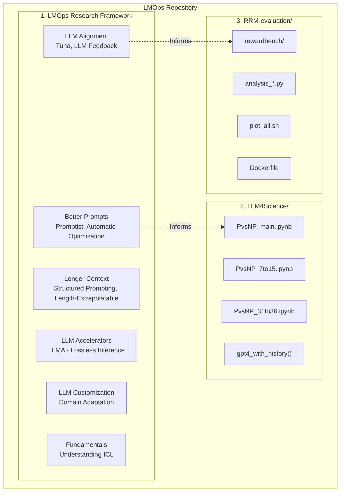
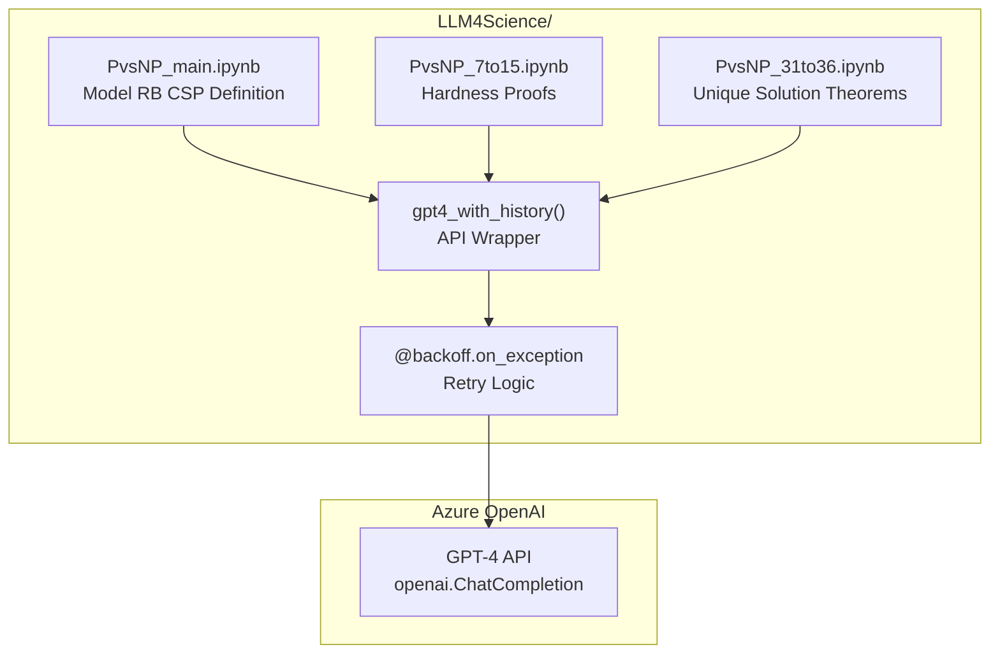
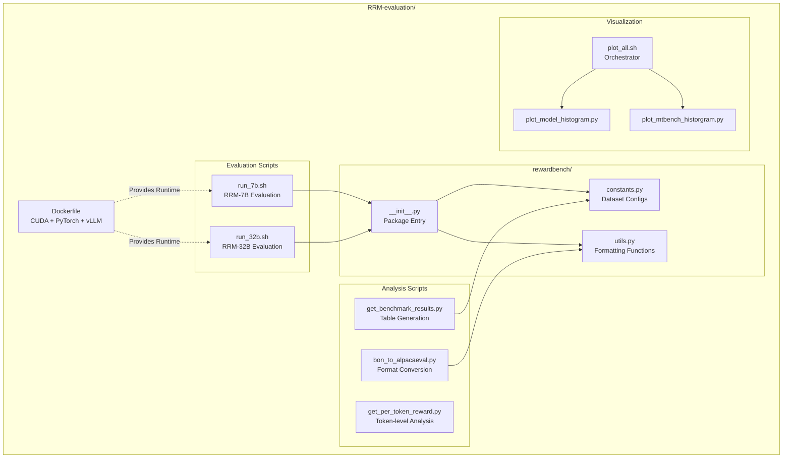
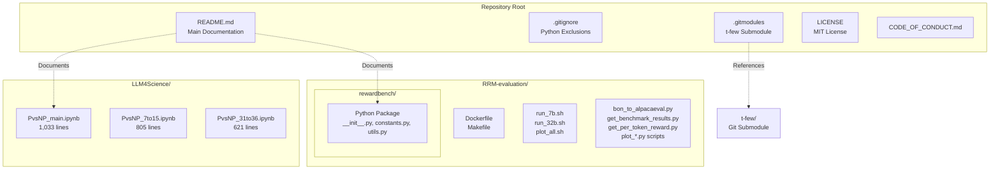
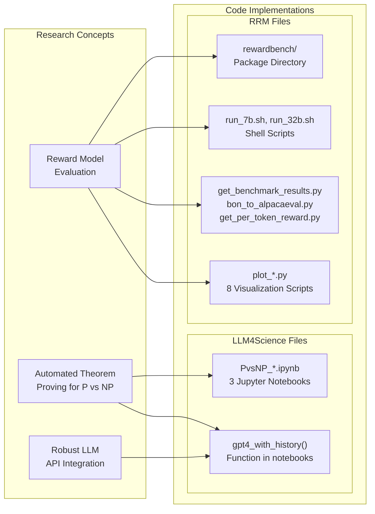
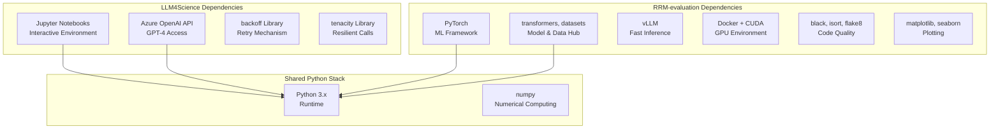

<!-- source: DeepWiki mcp.deepwiki.com · repo microsoft/LMOps · page 1 Overview · fetched 2026-10-26 -->

# Overview

Relevant source files

The following files were used as context for generating this wiki page:

- [README.md](README.md)

## Purpose and Scope

The LMOps repository is a research initiative focused on fundamental research and technology for building AI products with foundation models. The repository encompasses three major components:

1. **LMOps Research Framework**: Six core research areas advancing LLM capabilities
2. **LLM4Science System**: Application of LLMs to automated theorem proving for P vs NP problems
3. **RRM-evaluation System**: Comprehensive framework for evaluating reward reasoning models

This overview introduces these major systems and their relationships. For detailed information about the research areas, see page 1.1. For system-specific documentation, refer to pages 2 (LLM4Science) and 3 (RRM-evaluation).

Sources: [README.md:3-11]()

## Major Systems and Research Areas

The LMOps repository is organized around three major components that address different aspects of LLM research:

#### Three-Component Architecture

### Component Summary

| Component | Location | Primary Purpose | Key Artifacts |
|-----------|----------|-----------------|---------------|
| LMOps Research Framework | `README.md` | Foundational research in six areas | Research papers, methodologies |
| LLM4Science System | `LLM4Science/` directory | Automated theorem proving for P vs NP | Jupyter notebooks, GPT-4 integration |
| RRM-evaluation System | `RRM-evaluation/` directory | Reward model evaluation | Python scripts, Docker environment |

For detailed coverage of the six research areas (Better Prompts, Longer Context, LLM Alignment, LLM Accelerators, LLM Customization, and Fundamentals), see page 1.1.

Sources: [README.md:6-11](), [README.md:30-98]()

## System Architecture and Code Mapping

#### LLM4Science System Architecture

#### RRM-evaluation System Architecture

Sources: [README.md:6-11]()

## System Descriptions

### LLM4Science System

The LLM4Science system explores fundamental problems in theoretical computer science, specifically the P vs NP problem, using GPT-4 for interactive mathematical reasoning. The system consists of multiple Jupyter notebooks that conduct systematic explorations of mathematical concepts through LLM-assisted reasoning sessions.

Key components include:
- `PvsNP_main.ipynb`: Primary exploration notebook
- `PvsNP_7to15.ipynb` and `PvsNP_31to36.ipynb`: Focused exploration sessions
- `gpt4_with_history` infrastructure for robust API interactions

See [LLM4Science System](#2) for detailed documentation.

### RRM-evaluation System

The RRM-evaluation system provides a comprehensive framework for evaluating Reward Reasoning Models (RRMs) through pairwise comparison and ELO scoring methodologies. The system includes extensive analysis tools, visualization capabilities, and containerized evaluation environments.

Key components include:
- Evaluation framework for RRM-7B and RRM-32B models
- Analysis scripts in Python for data processing and visualization
- Docker-based infrastructure with the `rewardbench` package
- Statistical analysis and reporting tools

See [RRM-evaluation System](#3) for comprehensive documentation.

Sources: [README.md:1-11]()

## Code Organization and File Structure

The repository uses a two-directory structure for the research systems, with configuration files at the root level.

#### Directory Structure

#### Concept-to-Code Mapping

### Directory Contents

| Directory | File Count | Key Files | Purpose |
|-----------|------------|-----------|---------|
| `LLM4Science/` | 3 notebooks | `PvsNP_main.ipynb`, `PvsNP_7to15.ipynb`, `PvsNP_31to36.ipynb` | Interactive theorem exploration |
| `RRM-evaluation/` | ~20 Python files, 3 shell scripts | `rewardbench/`, `run_7b.sh`, `plot_all.sh` | Reward model evaluation pipeline |
| `RRM-evaluation/rewardbench/` | Package files | `__init__.py`, `constants.py`, `utils.py` | Core evaluation library |
| Root | 5 config files | `README.md`, `.gitignore`, `.gitmodules`, `LICENSE` | Repository configuration |

Sources: [README.md:1-112]()

## System Dependencies and Technology Stack

The three major components rely on different technology stacks optimized for their specific purposes:

#### Technology Dependencies by System

### Dependency Summary

| Component | Runtime | Key Libraries | External Services |
|-----------|---------|---------------|-------------------|
| LMOps Research | N/A (Papers) | N/A | N/A |
| LLM4Science | Jupyter | `openai`, `backoff`, `tenacity` | Azure OpenAI API |
| RRM-evaluation | Docker/Python | `torch`, `transformers`, `vllm`, `datasets` | HuggingFace Hub, multiple LLM APIs |

Both research systems follow common patterns:
- Python-based implementation
- External API/dataset integration
- Research reproducibility focus
- Modular, documented code organization

Sources: [README.md:1-112]()

## LMOps Research Framework

The LMOps Research Framework comprises six core research areas that inform the development of the two application systems. These areas represent fundamental advances in LLM technology:

### Six Research Areas

| Area | Technologies | Key Publications |
|------|--------------|------------------|
| Better Prompts | Automatic optimization, Promptist, X-Prompt, UPRISE | [Automatic Prompt Optimization](https://arxiv.org/abs/2305.03495), [Promptist](https://arxiv.org/abs/2212.09611), [Extensible Prompts](https://arxiv.org/abs/2212.00616) |
| Longer Context | Structured prompting, length-extrapolatable transformers | [Structured Prompting](https://arxiv.org/abs/2212.06713), [Length-Extrapolatable Transformers](https://arxiv.org/abs/2212.10554) |
| LLM Alignment | Tuna instruction tuning, LLM feedback | [Tuna](https://arxiv.org/pdf/2310.13385.pdf) |
| LLM Accelerators | LLMA lossless acceleration | [Inference with Reference](https://arxiv.org/abs/2304.04487) |
| LLM Customization | Domain adaptation | [Adapt LLM to Domains](https://arxiv.org/pdf/2309.09530.pdf) |
| Fundamentals | Understanding in-context learning | [Understanding ICL](https://arxiv.org/abs/2212.10559) |

### Research Timeline (2023)

- **Nov 2023**: In-Context Demonstration Selection (EMNLP)
- **Oct 2023**: Tuna, Automatic Prompt Optimization, UPRISE (EMNLP)
- **Jul 2023**: Learning to Retrieve In-Context Examples
- **Apr 2023**: LLMA Lossless Acceleration
- **Dec 2022**: Understanding In-Context Learning, Promptist, Structured Prompting, X-Prompt

For detailed coverage of each research area, including techniques and use cases, see page 1.1 (Research Areas).

Sources: [README.md:6-11](), [README.md:18-28](), [README.md:30-98]()

## Conclusion

The Microsoft LMOps repository provides a comprehensive suite of tools and systems for optimizing various aspects of large language models. From knowledge distillation and acceleration to domain adaptation and prompt engineering, these systems address the complete lifecycle of LLM development and deployment. The modular nature of the repository allows researchers and practitioners to use each system independently or combine them to create custom optimization pipelines.

For more detailed information about each system, please refer to their dedicated wiki pages.

---

