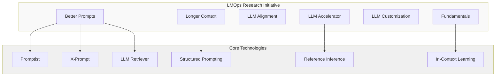
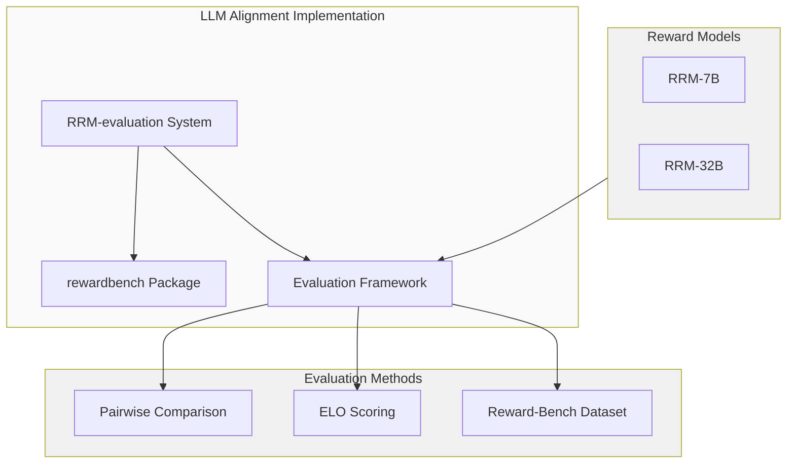
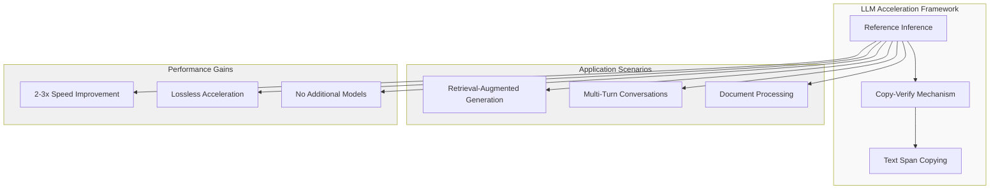
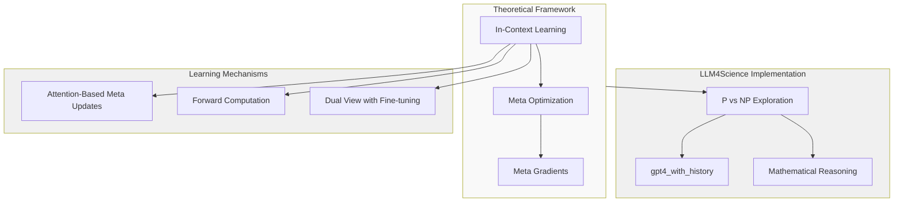
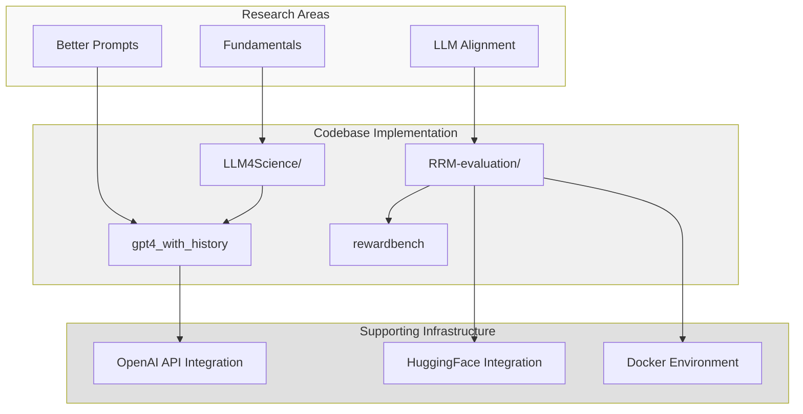

<!-- source: DeepWiki mcp.deepwiki.com · repo microsoft/LMOps · page 1.1 Research Areas · fetched 2026-10-26 -->

# Research Areas

Relevant source files

The following files were used as context for generating this wiki page:

- [README.md](README.md)

## Purpose and Scope

This document details the six main research areas that comprise the LMOps initiative: Better Prompts, Longer Context, LLM Alignment, LLM Accelerator, LLM Customization, and Fundamentals. Each research area encompasses specific technologies, methodologies, and theoretical frameworks for building AI products with foundation models, particularly Large Language Models (LLMs) and Generative AI models.

For information about specific implementations of these research areas in the codebase, see [LLM4Science System](#2) and [RRM-evaluation System](#3).

## Research Areas Overview

The LMOps research initiative encompasses six interconnected research areas that address fundamental challenges in Large Language Model operations and deployment:

**LMOps Research Areas Taxonomy**

| Research Area | Primary Focus | Key Technologies | Current Status |
|---------------|---------------|------------------|----------------|
| Better Prompts | Prompt optimization and engineering | Promptist, X-Prompt, Universal Retrieval | Active Development |
| Longer Context | Extended context handling | Structured Prompting, Length-Extrapolatable Transformers | Research Phase |
| LLM Alignment | Model alignment and feedback | RRM evaluation, LLM feedback mechanisms | Implementation Available |
| LLM Accelerator | Inference optimization | Reference-based acceleration | Production Ready |
| LLM Customization | Domain adaptation | Domain-specific fine-tuning | Research Phase |
| Fundamentals | Theoretical understanding | In-Context Learning analysis | Ongoing Research |

Sources: [README.md:4-11]()

## Better Prompts Research Area

The Better Prompts research area focuses on advanced prompt engineering techniques and automatic prompt optimization methods. This area encompasses multiple technologies for improving LLM interaction through sophisticated prompting strategies.

### Core Technologies

**Automatic Prompt Optimization**: Gradient descent and beam search methods for systematic prompt improvement, enabling automated refinement of user inputs into model-preferred prompts.

**Promptist**: Reinforcement learning-based approach for automatic prompt optimization, specifically designed for text-to-image generation tasks using language models as prompt interfaces.

**Extensible Prompts (X-Prompt)**: Framework extending beyond natural language to enable fine-grained specifications through context-guided imaginary word learning.

**Universal Prompt Retrieval**: System for retrieving optimal prompts from large databases to improve zero-shot evaluation performance across diverse tasks.

**LLM Retriever**: Technology for learning to retrieve in-context examples specifically tailored for Large Language Models.

**In-Context Demonstration Selection**: Methods using cross entropy difference for selecting optimal demonstration examples in few-shot learning scenarios.

Sources: [README.md:6](), [README.md:34-66]()

## Longer Context Research Area

The Longer Context research area addresses the challenge of processing and understanding extended sequences in Large Language Models, enabling efficient handling of long-form content.

### Core Technologies

**Structured Prompting**: Methodology for scaling in-context learning to 1,000+ examples by organizing long-sequence prompts in structured formats, enabling efficient consumption of extensive context.

**Length-Extrapolatable Transformers**: Architecture modifications allowing Transformer models to handle sequences longer than those seen during training.

### Use Cases

1. **Retrieved Document Integration**: Prepending multiple long documents as context in GPT models
2. **Large-Scale In-Context Learning**: Scaling demonstration examples to thousands of instances

Sources: [README.md:7](), [README.md:45-55]()

## LLM Alignment Research Area

The LLM Alignment research area focuses on aligning model behavior with human preferences and intentions through feedback mechanisms and reward modeling.

### Implementation Components

The alignment research area is implemented through the `RRM-evaluation` system, which provides comprehensive evaluation frameworks for Reward Reasoning Models using pairwise comparison methodologies and ELO scoring systems.

**Reward Model Evaluation**: Framework supporting evaluation of `RRM-7B` and `RRM-32B` models across multiple datasets using standardized benchmarking protocols.

**LLM Feedback Integration**: Mechanisms for incorporating feedback from Large Language Models into alignment processes.

Sources: [README.md:8]()

## LLM Accelerator Research Area

The LLM Accelerator research area develops techniques for accelerating Large Language Model inference without compromising output quality.

### Core Technology: Reference-Based Inference

**Lossless Acceleration**: Technology achieving 2-3x speed improvements by leveraging text span overlaps between LLM outputs and reference documents through copy-and-verify mechanisms.

**Application Domains**: Optimized for retrieval-augmented generation, multi-turn conversations, and document processing scenarios where significant text overlap exists.

Sources: [README.md:9](), [README.md:71-83]()

## LLM Customization Research Area

The LLM Customization research area focuses on adapting general-purpose Large Language Models to specific domains and use cases.

### Domain Adaptation Technologies

**Domain-Specific Fine-Tuning**: Methodologies for adapting LLMs to specialized domains while preserving general capabilities.

**Custom Model Training**: Techniques for training domain-specific variants of foundation models.

Sources: [README.md:10]()

## Fundamentals Research Area

The Fundamentals research area investigates the theoretical foundations and mechanisms underlying Large Language Model capabilities.

### In-Context Learning Theory

**Meta Optimization Framework**: Understanding of how GPT models perform meta optimization through forward computation, producing meta gradients for In-Context Learning (ICL) and applying them through attention mechanisms.

**Dual View with Fine-tuning**: Theoretical framework establishing the relationship between ICL meta optimization and explicit parameter updates through back-propagated gradients.

**Architecture Translation**: Methods for translating optimization algorithms (SGD with Momentum) to corresponding Transformer architectures.

### Implementation in LLM4Science

The fundamentals research area is implemented through the `LLM4Science` system, which explores theoretical computer science problems (specifically P vs NP) using GPT-4 for mathematical reasoning and theorem proving.

Sources: [README.md:11](), [README.md:88-98]()

## Research Area Integration and Implementation Mapping

### Implementation Components

The research areas are implemented through specific codebase components:

**Fundamentals → LLM4Science**: The `LLM4Science/` directory implements fundamental research through P vs NP mathematical exploration using the `gpt4_with_history` system for robust LLM interactions.

**LLM Alignment → RRM-evaluation**: The `RRM-evaluation/` directory provides comprehensive reward model evaluation through the `rewardbench` package and associated analysis tools.

**Better Prompts → Infrastructure**: Prompt optimization techniques are implemented through the `gpt4_with_history` system with retry mechanisms and error handling for robust API interactions.

Sources: [README.md:1-111]()

---

