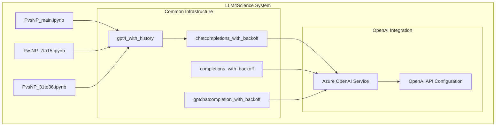
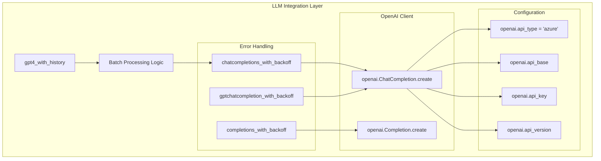
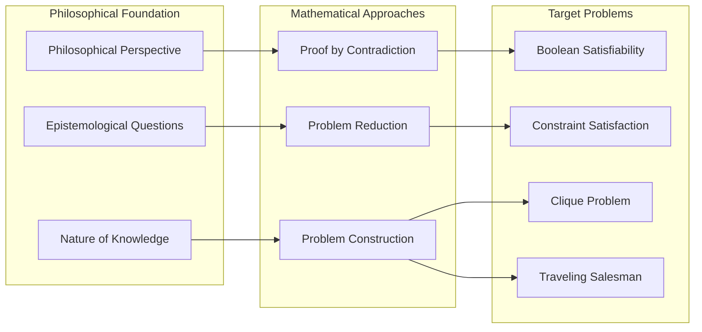
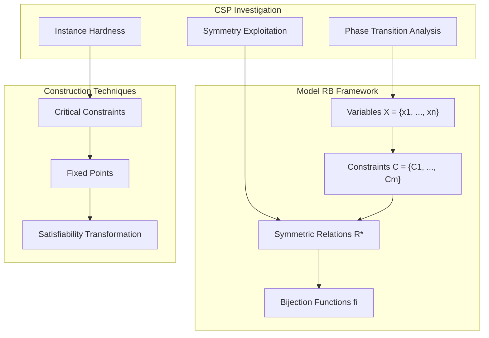
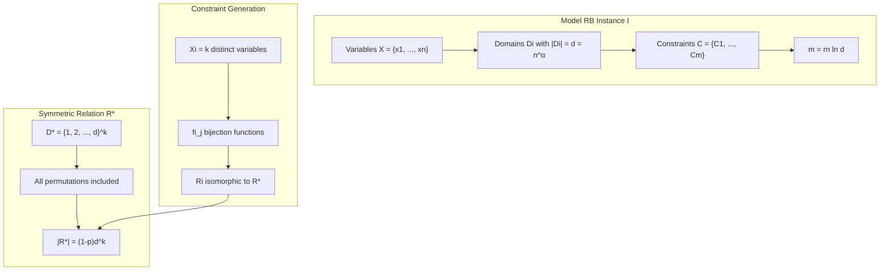

<!-- source: DeepWiki mcp.deepwiki.com · repo microsoft/LMOps · page 2 LLM4Science System · fetched 2026-10-26 -->

# LLM4Science System

Relevant source files

The following files were used as context for generating this wiki page:

- [LLM4Science/PvsNP_31to36.ipynb](LLM4Science/PvsNP_31to36.ipynb)
- [LLM4Science/PvsNP_7to15.ipynb](LLM4Science/PvsNP_7to15.ipynb)
- [LLM4Science/PvsNP_main.ipynb](LLM4Science/PvsNP_main.ipynb)

## Purpose and Scope

The LLM4Science System is a research framework designed to explore fundamental mathematical problems, specifically the P vs NP problem, through interactive sessions with large language models. The system facilitates mathematical reasoning and theorem exploration by providing robust LLM integration infrastructure and structured conversation frameworks for investigating constraint satisfaction problems (CSPs), phase transitions, and complexity theory.

For information about the broader LMOps research initiative, see [Overview](#1). For details about the RRM evaluation framework, see [RRM-evaluation System](#3).

## System Architecture

The LLM4Science System consists of three main exploration notebooks that share common infrastructure for LLM interactions and mathematical reasoning:

**LLM4Science System Architecture**

The system employs a modular design where each exploration notebook focuses on specific mathematical investigations while sharing robust LLM interaction infrastructure.

Sources: [LLM4Science/PvsNP_main.ipynb:1-93](), [LLM4Science/PvsNP_7to15.ipynb:1-97](), [LLM4Science/PvsNP_31to36.ipynb:1-111]()

## LLM Integration Infrastructure

The core infrastructure provides reliable interaction with GPT-4 through Azure OpenAI services with comprehensive error handling and retry mechanisms:

**LLM Integration Infrastructure**

### Core Functions

- **`gpt4_with_history`**: Main interface for GPT-4 interactions with conversation history management
- **`chatcompletions_with_backoff`**: Exponential backoff wrapper for chat completions using the `backoff` library
- **`completions_with_backoff`**: Exponential backoff wrapper for standard completions
- **`gptchatcompletion_with_backoff`**: Advanced retry mechanism using `tenacity` with configurable wait strategies

The retry mechanism implements a sophisticated wait chain: 3 attempts with 3-second delays, followed by 2 attempts with 5-second delays, then 10-second delays for subsequent attempts.

Sources: [LLM4Science/PvsNP_main.ipynb:59-90](), [LLM4Science/PvsNP_7to15.ipynb:64-90](), [LLM4Science/PvsNP_31to36.ipynb:78-104]()

## Mathematical Exploration Components

The system facilitates structured mathematical conversations across three main areas of investigation:

### P vs NP Theoretical Exploration

The main exploration focuses on fundamental complexity theory questions, employing philosophical and mathematical approaches to investigate the P vs NP problem:

**P vs NP Exploration Framework**

Sources: [LLM4Science/PvsNP_main.ipynb:114-284]()

### CSP Phase Transition Analysis

The system investigates constraint satisfaction problems with focus on phase transitions and symmetry properties:

**CSP and Model RB Analysis Framework**

Sources: [LLM4Science/PvsNP_7to15.ipynb:102-418](), [LLM4Science/PvsNP_main.ipynb:315-683]()

### Advanced Theorem Proving Strategies

The latest exploration focuses on constructing specific instances of Model RB that exhibit controllable satisfiability properties:

| Exploration Focus | Description | Key Techniques |
|------------------|-------------|----------------|
| **Critical Instances** | Instances with single critical constraints | Non-critical constraint satisfaction |
| **Delicate Balance** | Instances with unique solutions | Tight constraint coupling |
| **Fixed Points** | Sets invariant under transformations | Symmetry preservation |
| **Mapping Operations** | Satisfiability-altering transformations | Value swapping for k=2 cases |

The system explores two primary instance types:
1. **Unsatisfiable to Satisfiable**: Instances with mostly non-critical constraints and one critical constraint dependent on single variable assignment
2. **Satisfiable to Unsatisfiable**: Instances with delicate constraint balance having unique solutions that become unsatisfiable when critical constraints are modified

Sources: [LLM4Science/PvsNP_31to36.ipynb:114-369]()

## Model RB Specification

The system works with an enhanced Model RB definition that incorporates symmetry requirements for generating hard CSP instances:

### Core Model Components

**Enhanced Model RB Structure**

### Assignment and Satisfiability Definitions

- **Assignment σ**: Function `σ: X → ∪Di` where `σ(xi) ∈ Di` for all variables
- **Constraint Satisfaction**: Constraint `Ci = (Xi, Ri)` satisfied when `(σ(xi1), σ(xi2), ..., σ(xik)) ∈ Ri`
- **Solution**: Assignment satisfying all constraints in set C
- **Satisfiability**: Instance I is satisfiable if solution σ exists

The enhanced model introduces separate bijection functions `fi_j` for each of the first `k-1` variables to increase complexity while preserving constraint symmetry requirements.

Sources: [LLM4Science/PvsNP_main.ipynb:704-717](), [LLM4Science/PvsNP_31to36.ipynb:118-369]()

---

