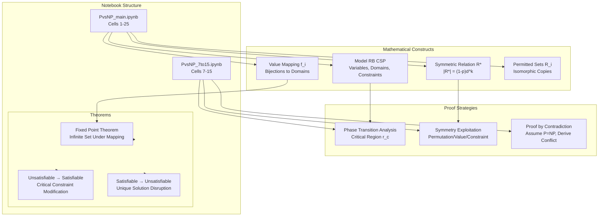
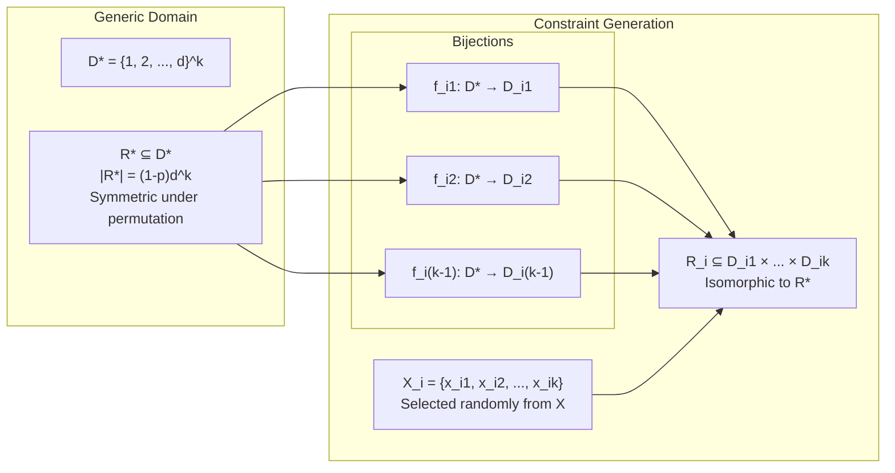
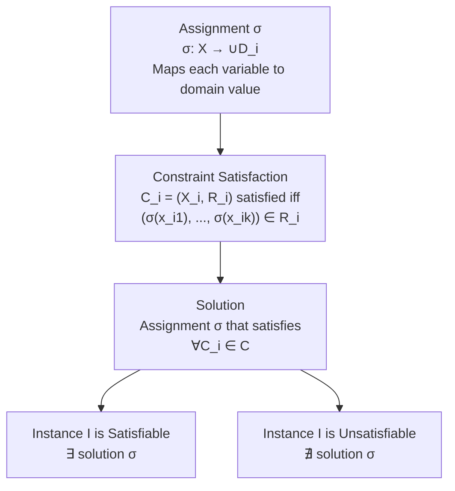
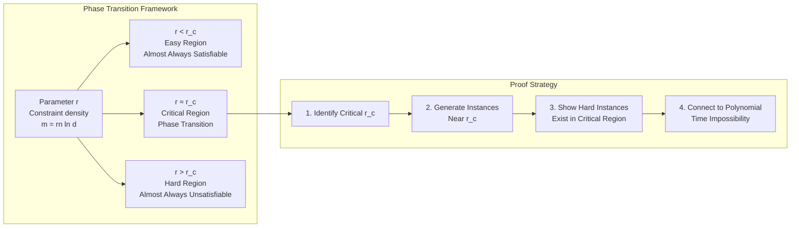
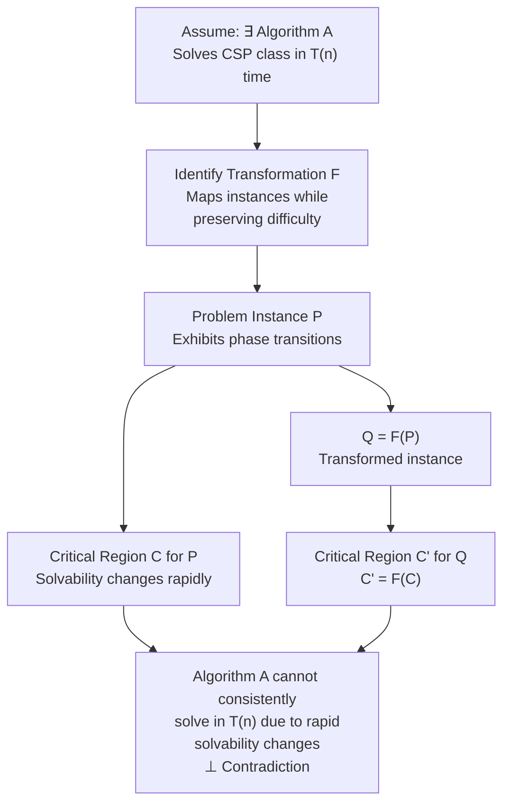
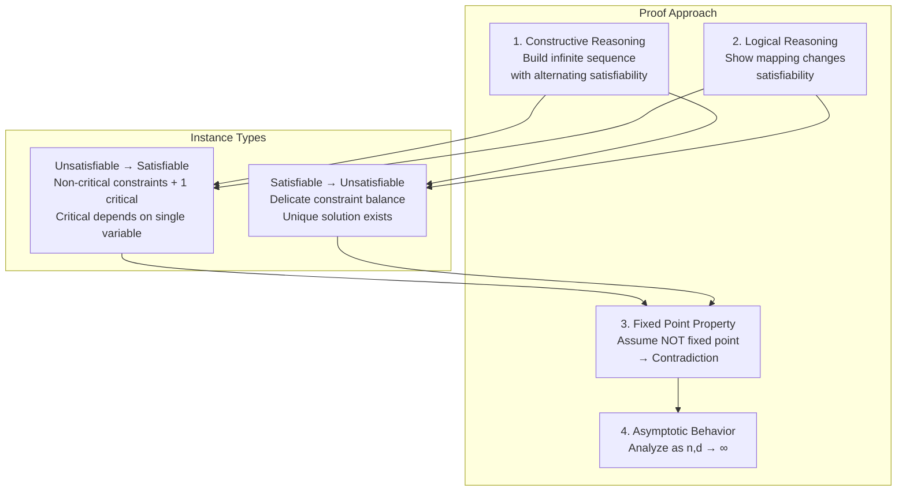
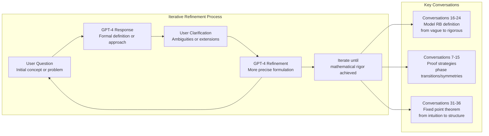

<!-- source: DeepWiki mcp.deepwiki.com · repo microsoft/LMOps · page 2.1 P vs NP Mathematical Exploration · fetched 2026-10-26 -->

# P vs NP Mathematical Exploration

<details>
<summary>Relevant source files</summary>

The following files were used as context for generating this wiki page:

- [LLM4Science/PvsNP_31to36.ipynb](LLM4Science/PvsNP_31to36.ipynb)
- [LLM4Science/PvsNP_7to15.ipynb](LLM4Science/PvsNP_7to15.ipynb)
- [LLM4Science/PvsNP_main.ipynb](LLM4Science/PvsNP_main.ipynb)

</details>


## Purpose and Scope

This page documents the mathematical content explored in the LLM4Science notebooks that investigate the P vs NP problem through constraint satisfaction problems (CSPs). The exploration uses iterative conversations with GPT-4 to develop formal definitions, proof strategies, and theorems related to CSP hardness. The work focuses on constructing a specialized CSP model called **Model RB** with symmetric relations, then exploring how satisfiability can be transformed through mapping operations to establish fixed points.

For technical infrastructure details about the GPT-4 integration, see [LLM Integration Infrastructure](#2.2). For the broader LLM4Science system overview, see [LLM4Science System](#2).

---

## Mathematical Framework Overview

The notebooks progress through three major mathematical developments:

1. **Model RB Definition** - A random CSP model with symmetric constraints designed to exhibit phase transitions
2. **Proof Strategies** - Approaches using phase transitions, symmetries, and contradiction to establish hardness
3. **Satisfiability Transformations** - Theorems about fixed points under operations that change satisfiability



**Sources:** [LLM4Science/PvsNP_main.ipynb:115-718](), [LLM4Science/PvsNP_7to15.ipynb:103-419](), [LLM4Science/PvsNP_31to36.ipynb:117-419]()

---

## Model RB Constraint Satisfaction Problem

### Original Model RB Definition

Model RB is introduced as a random CSP model that can be encoded to NP-complete problems like SAT and CLIQUE. The original definition from Xu and Li (2000) consists of:

| Component | Definition | Parameters |
|-----------|-----------|------------|
| Variables | $\mathcal{X}=\{x_1, \ldots, x_n\}$ | Each $x_i$ has domain $D_i$ with $\|D_i\|=d=n^\alpha$ |
| Constraints | $\mathcal{C}=\{C_1, \ldots, C_m\}$ | $m=rn \ln d$ where $r>0$ is constant |
| Constraint Form | $C_i=(X_i, R_i)$ | $X_i$ is sequence of $k$ distinct variables |
| Permitted Set | $R_i \subseteq D_{i_1} \times \cdots \times D_{i_k}$ | $\|R_i\|=(1-p)d^k$ where $0<p<1$ |

**Sources:** [LLM4Science/PvsNP_main.ipynb:315-367]()

### Enhanced Model RB with Symmetric Relations

Through iterative refinement in conversations 16-24, the model is enhanced to support symmetry requirements and isomorphic permitted sets. The key innovation is introducing a **symmetric relation $R^*$** that serves as a template for all constraints.



**Enhanced Model RB Components:**

1. **Symmetric Relation $R^*$**: Defined on generic domain $D^*=\{1,2,\ldots,d\}^k$ with the property that for any tuple $(a_1, a_2, \ldots, a_k) \in R^*$, all permutations of the tuple are also in $R^*$. Size: $|R^*|=(1-p)d^k$.

2. **Value Mapping Functions**: For each constraint $C_i=(X_i, R_i)$ where $X_i=\{x_{i_1}, x_{i_2}, \ldots, x_{i_k}\}$, generate random bijections $f_{i_j}: D^* \to D_{i_j}$ for the first $k-1$ variables.

3. **Permitted Set Construction**: For each tuple $(a_1, a_2, \ldots, a_k) \in R^*$, include the tuple $(f_{i_1}(a_1), f_{i_2}(a_2), \ldots, f_{i_{k-1}}(a_{k-1}), a_k)$ in $R_i$.

**Sources:** [LLM4Science/PvsNP_main.ipynb:428-683]()

### Assignments, Solutions, and Satisfiability



**Formal Definitions:**

- **Assignment $\sigma$**: A function $\sigma: \mathcal{X} \to \bigcup_{i=1}^n D_i$ such that $\sigma(x_i) \in D_i$ for all $i=1,\ldots,n$.

- **Constraint Satisfaction**: Constraint $C_i=(X_i, R_i)$ is satisfied by $\sigma$ if $(\sigma(x_{i_1}), \sigma(x_{i_2}), \ldots, \sigma(x_{i_k})) \in R_i$.

- **Solution**: An assignment $\sigma$ satisfying $\forall C_i \in \mathcal{C}$, $(\sigma(x_{i_1}), \sigma(x_{i_2}), \ldots, \sigma(x_{i_k})) \in R_i$.

- **Satisfiability**: Instance $I$ is satisfiable if $\exists$ a solution $\sigma$; otherwise unsatisfiable.

**Sources:** [LLM4Science/PvsNP_main.ipynb:705-718]()

---

## Proof Strategies for CSP Hardness

### Phase Transition Approach

The notebooks explore using phase transitions—regions where satisfiability changes rapidly—to prove hardness. The critical parameter is the constraint density ratio $r$.



**Key Steps** (from conversation 8):

1. **Identify critical parameter**: Find the value $r_c$ where the phase transition occurs
2. **Analyze the transition**: Observe how difficulty changes as $r$ varies around $r_c$
3. **Show hard instances exist**: Prove instances near $r_c$ have properties making them difficult
4. **Relate to polynomial time**: Show any polynomial-time algorithm for hard instances would solve known NP-hard problems

**Sources:** [LLM4Science/PvsNP_7to15.ipynb:134-164]()

### Symmetry-Based Approaches

Three types of symmetry are exploited to construct hard instances:

| Symmetry Type | Definition | Construction Method |
|---------------|-----------|---------------------|
| **Permutation Symmetry** | Variables and domains interchangeable | Make $D_i = D_j$ for all $i,j$ |
| **Value Symmetry** | Values can be interchanged | Constraints invariant under value exchange |
| **Constraint Symmetry** | Problem unchanged under constraint permutation | $R_i$ symmetric with respect to variables |

The exploration identifies that "symmetry" relates to **invariance under transformations** including:
- Permutations of variables and assignments
- Rotations or reflections (for geometric problems)
- Duality (interchanging variables and constraints)
- **Fixed points** (instances unchanged under certain transformations)

**Sources:** [LLM4Science/PvsNP_7to15.ipynb:233-269](), [LLM4Science/PvsNP_main.ipynb:387-447]()

### Proof by Contradiction Framework

The general approach for proving $P \neq NP$ by contradiction:



**Proof Structure** (from conversation 13):

1. Assume algorithm $A$ solves the CSP class in time $T(n)$
2. Identify transformation function $F$ preserving difficulty and invariance
3. Let $P$ be a problem instance with phase transitions, $Q = F(P)$
4. Both $P$ and $Q$ should be solvable in $T(n)$ by assumption
5. Critical regions $C$ and $C'$ exist where solvability changes rapidly
6. Algorithm $A$ cannot consistently solve instances in critical regions within $T(n)$
7. Contradiction with initial assumption

**Sources:** [LLM4Science/PvsNP_7to15.ipynb:304-387]()

---

## Satisfiability Transformation Theorems

### Mapping Operations for $k=2$

For constraints with $k=2$ variables, a specific mapping operation is defined to alter satisfiability:

**Given:** Constraint $C_i = (X_i, R_i)$ where $X_i = \{x_{i_1}, x_{i_2}\}$ and $R_i$ is obtained by applying value mapping $f_i$ to $R^*$.

**Define:** New mapping $g_i(a_1, a_2) = (f_i(a_2), f_i(a_1))$ for each $(a_1, a_2) \in R^*$.

**Result:** New constraint $C'_i = (X_i, R'_i)$ where $R'_i$ is obtained by applying $g_i$ to $R^*$.

**Property:** The mapping swaps values without changing variables, ensuring $C'_i \neq C_i$ when $f_i(a_1) \neq f_i(a_2)$ for all $(a_1, a_2) \in R^*$.

**Sources:** [LLM4Science/PvsNP_31to36.ipynb:117-192]()

### Fixed Point Theorem

**Theorem:** There exists an infinite set of satisfiable and unsatisfiable instances of Model RB such that this set is a fixed point under the mapping operation of changing satisfiability (as $n \to \infty$, $d \to \infty$).



**Sources:** [LLM4Science/PvsNP_31to36.ipynb:154-193](), [LLM4Science/PvsNP_31to36.ipynb:195-232]()

### Instance Construction Strategies

Two specific instance types are identified for the fixed point theorem:

#### Type 1: Unsatisfiable → Satisfiable Transformation

**Construction:**
- Create sequence $I_1, I_2, \ldots$ where $n_j, d_j \to \infty$ as $j \to \infty$
- For each instance $I_j$, construct constraints $\mathcal{C}_j$ where:
  - All but one constraint are **non-critical** (always satisfied)
  - One constraint $C_{j,1}$ is **critical** (satisfiability depends on single variable assignment)
- Apply mapping operation to $C_{j,1}$ to create $I'_j$ with altered satisfiability
- Remaining constraints unchanged, so set $\{I_1, I_2, \ldots\}$ is fixed point

**Sources:** [LLM4Science/PvsNP_31to36.ipynb:195-232]()

#### Type 2: Satisfiable → Unsatisfiable Transformation

**Construction:**
- Create sequence $J_1, J_2, \ldots$ where $n_j, d_j \to \infty$ as $j \to \infty$
- For each instance $J_j$, construct constraints $\mathcal{C}_j$ such that:
  - All constraints satisfied by **unique solution** $\sigma_j$
  - Constraints are **tightly coupled** (high interdependence)
  - Even small change in any constraint breaks satisfiability
- Properties to enforce:
  1. Unique solution with very specific variable assignments
  2. High degree of constraint interdependence
  3. Narrow range of permitted tuples in each $R_i$
- Apply mapping operation to one critical constraint to disrupt balance

**Sources:** [LLM4Science/PvsNP_31to36.ipynb:234-275]()

---

## Conversation-Driven Development Pattern

The notebooks demonstrate a **Socratic dialogue** pattern for mathematical development:



**Example Evolution:** Model RB definition refined through 9 conversations:
- Conv 16: Initial suggestion to add constraints/variables
- Conv 17: Specific additional constraint proposals
- Conv 18: Symmetry requirements identified
- Conv 19: First symmetric model definition
- Conv 20: Isomorphic $R_i$ requirement added
- Conv 21: $R^*$ definition and bijection $\phi_i$ introduced
- Conv 22: Changed to $f_i$, applied to $k-1$ domains
- Conv 23: Separate bijection for each domain
- Conv 24: Final consolidated definition

**Sources:** [LLM4Science/PvsNP_main.ipynb:315-683]()

---

## Implementation Notes

All mathematical exploration occurs through the `gpt4_with_history` function which maintains conversation context:

**Function Signature:**
```python
def gpt4_with_history(messages, model="gpt-4", temperature=0.7, 
                      max_tokens=800, n=1, stop=None) -> list
```

**Key Parameters:**
- `messages`: List of conversation turns with role ("system", "user", "assistant") and content
- `temperature=0.7`: Controls randomness in responses
- `max_tokens=800` (or 1024 for complex proofs): Response length limit
- Returns tuple of (outputs, messages)

**Infrastructure:**
- Azure OpenAI API integration via `openai.ChatCompletion.create`
- Retry mechanism using `@backoff.on_exception(backoff.expo, openai.error.OpenAIError)`
- Conversation state maintained by appending to `messages` list
- Random seed set to 42 for reproducibility

**Sources:** [LLM4Science/PvsNP_main.ipynb:36-97](), [LLM4Science/PvsNP_7to15.ipynb:41-98](), [LLM4Science/PvsNP_31to36.ipynb:55-112]()

---

## Key Mathematical Constructs Summary

| Construct | Definition | Purpose |
|-----------|-----------|---------|
| **Model RB** | Random CSP with $n$ variables, $m=rn\ln d$ constraints, domain size $d=n^\alpha$ | Framework for exploring hardness |
| **Symmetric Relation $R^*$** | Relation on $D^*=\{1,\ldots,d\}^k$ closed under permutations, $\|R^*\|=(1-p)d^k$ | Template ensuring constraint symmetry |
| **Value Mapping $f_{i_j}$** | Bijections $f_{i_j}: D^* \to D_{i_j}$ for first $k-1$ variables | Creates isomorphic permitted sets |
| **Permitted Set $R_i$** | Obtained by applying $f_{i_j}$ to tuples in $R^*$ | Defines allowed constraint satisfying assignments |
| **Phase Transition** | Critical density $r_c$ where satisfiability probability changes rapidly | Identifies hard instances |
| **Critical Constraint** | Single constraint determining satisfiability | Enables satisfiability transformations |
| **Fixed Point** | Set of instances unchanged under satisfiability mapping | Core of existence theorem |

**Sources:** [LLM4Science/PvsNP_main.ipynb:1-718](), [LLM4Science/PvsNP_7to15.ipynb:1-435](), [LLM4Science/PvsNP_31to36.ipynb:1-435]()

---

