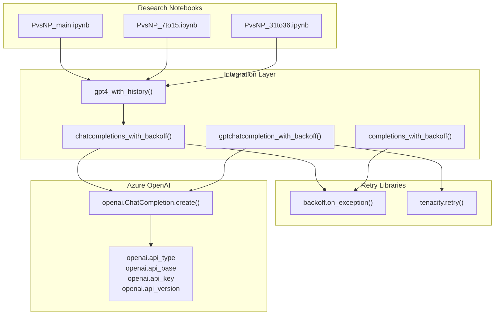
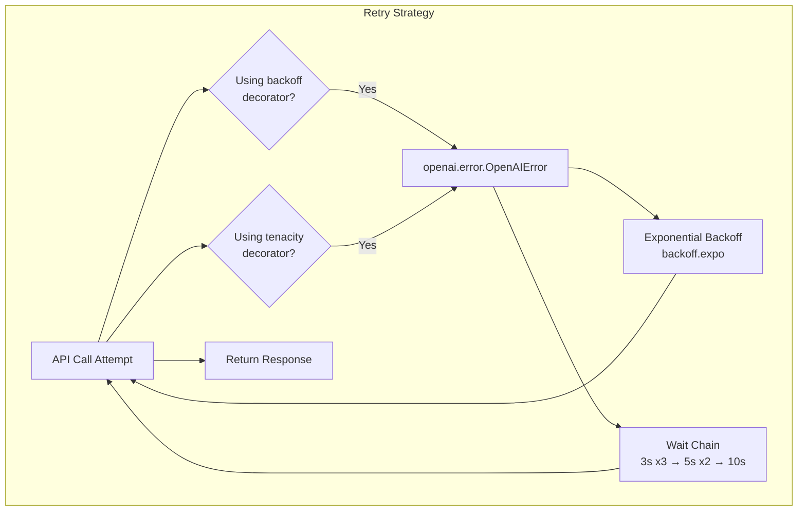
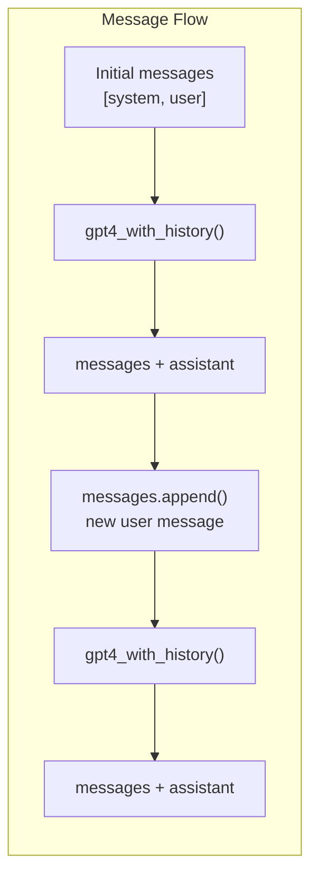
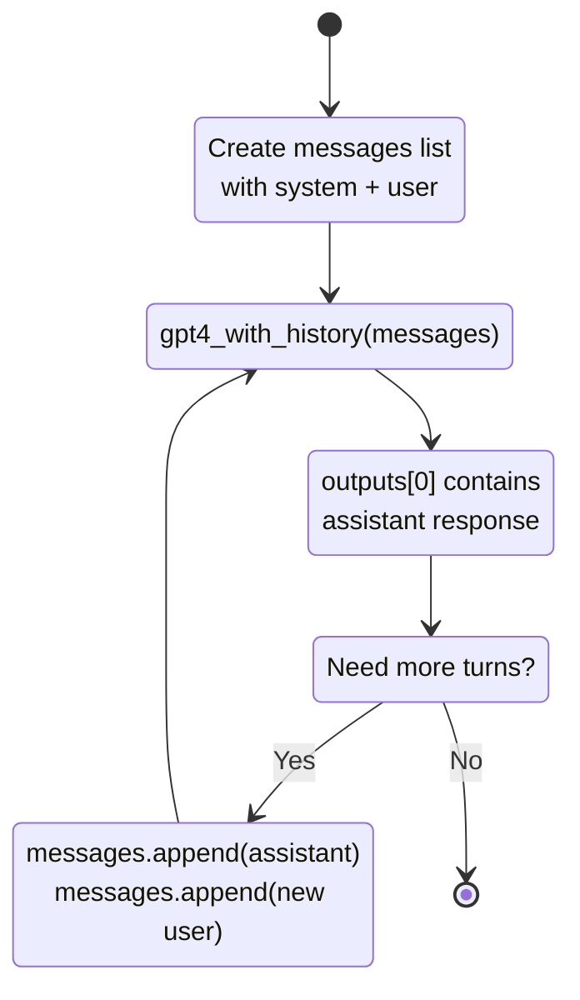
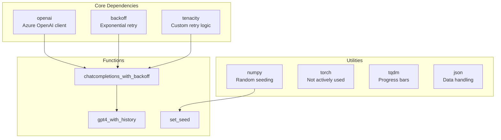

<!-- source: DeepWiki mcp.deepwiki.com · repo microsoft/LMOps · page 2.2 LLM Integration Infrastructure · fetched 2026-10-26 -->

# LLM Integration Infrastructure

<details>
<summary>Relevant source files</summary>

The following files were used as context for generating this wiki page:

- [LLM4Science/PvsNP_31to36.ipynb](LLM4Science/PvsNP_31to36.ipynb)
- [LLM4Science/PvsNP_7to15.ipynb](LLM4Science/PvsNP_7to15.ipynb)
- [LLM4Science/PvsNP_main.ipynb](LLM4Science/PvsNP_main.ipynb)

</details>


## Purpose and Scope

This document describes the technical infrastructure used in the LLM4Science system for integrating with GPT-4 through Azure OpenAI APIs. It covers API configuration, retry mechanisms, conversation state management, and the core `gpt4_with_history` function that enables iterative mathematical reasoning. For the mathematical content explored using this infrastructure, see [P vs NP Mathematical Exploration](#2.1).

---

## System Architecture

The LLM integration infrastructure provides a robust layer between the research notebooks and the Azure OpenAI API, handling authentication, error recovery, conversation management, and batching.

### High-Level Component Architecture



**Sources:** [LLM4Science/PvsNP_main.ipynb:36-92](), [LLM4Science/PvsNP_7to15.ipynb:41-97](), [LLM4Science/PvsNP_31to36.ipynb:56-111]()

---

## API Configuration

The system uses Azure OpenAI services rather than standard OpenAI APIs. Configuration is performed through global `openai` module attributes.

### Configuration Parameters

| Parameter | Value | Purpose |
|-----------|-------|---------|
| `openai.api_type` | `"azure"` | Specifies Azure deployment |
| `openai.api_base` | `"your_api_base"` | Azure endpoint URL |
| `openai.api_key` | `"your_api_key"` | Authentication credential |
| `openai.api_version` | `"2023-03-15-preview"` | API version (set in `gpt4_with_history`) |

### Configuration Code

```python
openai.api_type = "azure"
openai.api_base = "your_api_base"
openai.api_key = "your_api_key"
api_key = openai.api_key
```

The `api_version` is set dynamically within the `gpt4_with_history` function at line 79 (main notebook) to `"2023-03-15-preview"`.

**Sources:** [LLM4Science/PvsNP_main.ipynb:53-62](), [LLM4Science/PvsNP_7to15.ipynb:58-67](), [LLM4Science/PvsNP_31to36.ipynb:72-81]()

---

## Retry and Error Handling

The infrastructure implements two complementary retry mechanisms to ensure robustness against transient API failures, rate limits, and network issues.

### Retry Mechanism Architecture



**Sources:** [LLM4Science/PvsNP_main.ipynb:59-79](), [LLM4Science/PvsNP_7to15.ipynb:64-79]()

### Backoff-Based Retry Functions

The `backoff` library provides exponential backoff with jitter:

**`chatcompletions_with_backoff`**
```python
@backoff.on_exception(backoff.expo, openai.error.OpenAIError)
def chatcompletions_with_backoff(**kwargs):
    return openai.ChatCompletion.create(**kwargs)
```

**`completions_with_backoff`**
```python
@backoff.on_exception(backoff.expo, openai.error.OpenAIError)
def completions_with_backoff(**kwargs):
    return openai.Completion.create(**kwargs)
```

These decorators automatically retry on any `openai.error.OpenAIError` with exponentially increasing wait times.

**Sources:** [LLM4Science/PvsNP_main.ipynb:59-67](), [LLM4Science/PvsNP_7to15.ipynb:64-72](), [LLM4Science/PvsNP_31to36.ipynb:78-86]()

### Tenacity-Based Retry Function

The `tenacity` library provides fine-grained control over retry timing:

**`gptchatcompletion_with_backoff`**
```python
@retry(wait=wait_chain(*[wait_fixed(3) for i in range(3)] +
                       [wait_fixed(5) for i in range(2)] +
                       [wait_fixed(10)]))
def gptchatcompletion_with_backoff(**kwargs):
    return openai.ChatCompletion.create(**kwargs)
```

**Wait Strategy:**
- First 3 retries: 3 seconds
- Next 2 retries: 5 seconds  
- Final retries: 10 seconds

**Sources:** [LLM4Science/PvsNP_main.ipynb:70-74](), [LLM4Science/PvsNP_7to15.ipynb:75-79](), [LLM4Science/PvsNP_31to36.ipynb:89-93]()

---

## Conversation State Management

The system maintains conversation history through a stateful messages list that persists across multiple API calls, enabling coherent multi-turn reasoning.

### Message Structure and Flow



**Sources:** [LLM4Science/PvsNP_main.ipynb:116-122](), [LLM4Science/PvsNP_7to15.ipynb:104-111](), [LLM4Science/PvsNP_31to36.ipynb:118-133]()

### `gpt4_with_history` Function

This is the core conversation management function that handles batching, API calls, and state preservation.

**Function Signature:**
```python
def gpt4_with_history(messages, model="gpt-4", temperature=0.7, 
                      max_tokens=800, n=1, stop=None) -> list
```

**Parameters:**

| Parameter | Type | Default | Description |
|-----------|------|---------|-------------|
| `messages` | list | (required) | Conversation history in OpenAI format |
| `model` | str | `"gpt-4"` | Model engine name (Azure deployment) |
| `temperature` | float | `0.7` | Sampling temperature (0.0-1.0) |
| `max_tokens` | int | `800` | Maximum tokens in response |
| `n` | int | `1` | Number of completions to generate |
| `stop` | str/list | `None` | Stop sequence(s) |

**Return Value:**
- Tuple of `(outputs, messages)` where:
  - `outputs`: List of assistant response strings
  - `messages`: Original messages list (not modified in-place)

**Implementation Details:**

```python
def gpt4_with_history(messages, model="gpt-4", temperature=0.7, 
                      max_tokens=800, n=1, stop=None) -> list:
    outputs = []
    openai.api_version = "2023-03-15-preview"
    while n > 0:
        cnt = min(n, 20)  # Batch size limit
        n -= cnt
        res = chatcompletions_with_backoff(
            engine=model, 
            messages=messages, 
            temperature=temperature, 
            max_tokens=max_tokens, 
            n=cnt, 
            stop=stop
        )
        outputs.extend([choice["message"]["content"] for choice in res["choices"]])
    return outputs, messages
```

**Key Features:**
1. **Batching**: Splits requests into batches of max 20 completions
2. **Retry Integration**: Uses `chatcompletions_with_backoff` for automatic retries
3. **Response Extraction**: Extracts content from nested response structure
4. **State Preservation**: Returns original messages for manual extension

**Sources:** [LLM4Science/PvsNP_main.ipynb:77-85](), [LLM4Science/PvsNP_7to15.ipynb:82-90](), [LLM4Science/PvsNP_31to36.ipynb:96-104]()

---

## Usage Patterns

### Single-Turn Query Pattern

The simplest usage involves a single question to GPT-4:

```python
messages = [
    {"role": "system", "content": "You are a wise philosopher."},
    {"role": "user", "content": "Can you find the fundamental problem behind P!=NP?"}
]

outputs, messages = gpt4_with_history(messages, max_tokens=1024)
print(outputs)
```

**Example:** [LLM4Science/PvsNP_main.ipynb:116-122]()

### Multi-Turn Conversation Pattern

For iterative reasoning, the system extends the messages list:

```python
# Initial query
messages = [
    {"role": "system", "content": "You are a mathematician."},
    {"role": "user", "content": "How to prove P != NP?"}
]
outputs, messages = gpt4_with_history(messages)

# Add assistant response and continue
messages.append({"role": "assistant", "content": outputs[0]})
messages.append({"role": "user", "content": "Can you elaborate on idea #3?"})
outputs, messages = gpt4_with_history(messages)
```

**Example:** [LLM4Science/PvsNP_7to15.ipynb:136-146]()

### Socratic Dialogue Pattern

The system supports long conversation chains for stepwise refinement:

```python
messages = [
    {"role": "system", "content": "Expert mathematician."},
    {"role": "user", "content": "..."},
    {"role": "assistant", "content": "..."},
    {"role": "user", "content": "Great! Can you clarify..."},
    {"role": "assistant", "content": "..."},
    {"role": "user", "content": "Please now organize..."}
]
outputs, messages = gpt4_with_history(messages, max_tokens=1024)
```

**Example:** [LLM4Science/PvsNP_7to15.ipynb:340-369]()

### Conversation Flow Diagram



**Sources:** [LLM4Science/PvsNP_main.ipynb:114-285](), [LLM4Science/PvsNP_7to15.ipynb:102-420](), [LLM4Science/PvsNP_31to36.ipynb:115-400]()

---

## Configuration Parameters

### Model Parameters

The infrastructure supports flexible parameter tuning for different reasoning tasks:

**Temperature Settings:**
- Default: `0.7` (balanced creativity/accuracy)
- Common override: Not typically changed in the notebooks
- Range: `0.0` (deterministic) to `1.0` (highly random)

**Token Limits:**
- Default: `800` tokens
- Common override: `1024` tokens for complex proofs
- Purpose: Controls response length

**Batch Generation:**
- Parameter: `n` (number of completions)
- Default: `1`
- Purpose: Generate multiple responses for comparison

**Examples from notebooks:**
```python
# Standard query
outputs, messages = gpt4_with_history(messages, max_tokens=1024)

# Multiple completions (not used in provided examples)
outputs, messages = gpt4_with_history(messages, n=3, temperature=0.9)
```

**Sources:** [LLM4Science/PvsNP_main.ipynb:121](), [LLM4Science/PvsNP_7to15.ipynb:110](), [LLM4Science/PvsNP_31to36.ipynb:132]()

### Seed Configuration

Random seed initialization ensures reproducibility:

```python
def set_seed(seed):
    random.seed(seed)
    np.random.seed(seed)

set_seed(42)
```

This affects only the Python random number generation, not GPT-4's sampling (which is controlled by temperature and top_p parameters not exposed here).

**Sources:** [LLM4Science/PvsNP_main.ipynb:88-91](), [LLM4Science/PvsNP_7to15.ipynb:93-97](), [LLM4Science/PvsNP_31to36.ipynb:107-111]()

---

## Dependency Stack

### Required Libraries



**Installation command:**
```bash
pip install openai backoff
```

**Additional imports present but minimally used:**
- `torch.nn.functional` (imported but not used in API layer)
- `pathlib.Path` (imported but not used)
- `argparse` (imported but not used)
- `tqdm` (imported but not used for API calls)

**Sources:** [LLM4Science/PvsNP_main.ipynb:37-48](), [LLM4Science/PvsNP_7to15.ipynb:42-53](), [LLM4Science/PvsNP_31to36.ipynb:57-67]()

---

## Code Entity Reference

### Function Reference Table

| Function | Location | Purpose |
|----------|----------|---------|
| `chatcompletions_with_backoff` | All notebooks:59-62 | Chat API with exponential backoff |
| `completions_with_backoff` | All notebooks:64-67 | Completion API with exponential backoff |
| `gptchatcompletion_with_backoff` | All notebooks:70-74 | Chat API with tenacity retry chain |
| `gpt4_with_history` | All notebooks:77-85 | Main conversation management function |
| `set_seed` | All notebooks:88-91 | Initialize random seeds |

### Variable Reference Table

| Variable | Type | Location | Purpose |
|----------|------|----------|---------|
| `completion_tokens` | int | All notebooks:51 | Token tracking (unused) |
| `prompt_tokens` | int | All notebooks:51 | Token tracking (unused) |
| `openai.api_type` | str | All notebooks:53 | API provider type |
| `openai.api_base` | str | All notebooks:54 | Azure endpoint URL |
| `openai.api_key` | str | All notebooks:55 | Authentication key |
| `api_key` | str | All notebooks:57 | Backup key reference |
| `openai.api_version` | str | Set in gpt4_with_history:79 | API version string |

**Sources:** [LLM4Science/PvsNP_main.ipynb:36-92](), [LLM4Science/PvsNP_7to15.ipynb:41-97](), [LLM4Science/PvsNP_31to36.ipynb:56-111]()

---

