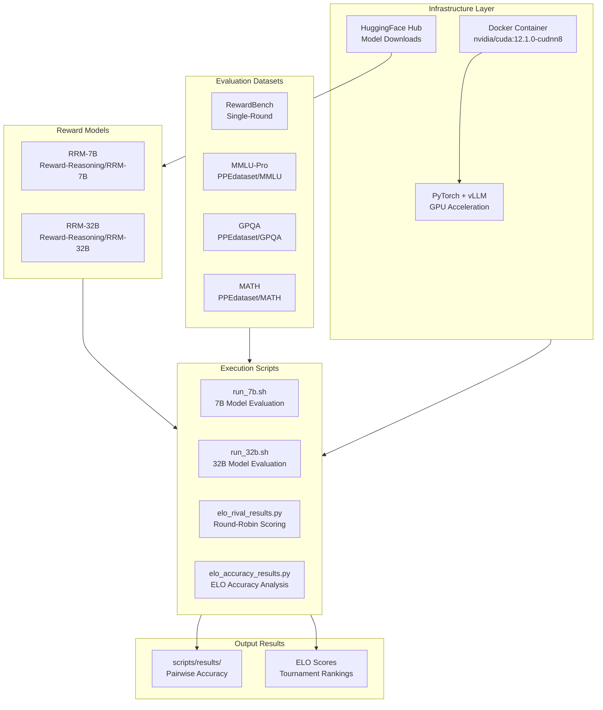
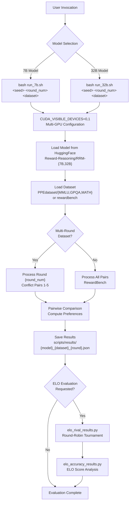
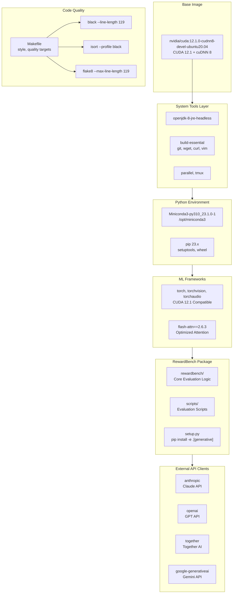

<!-- source: DeepWiki mcp.deepwiki.com · repo microsoft/LMOps · page 3 RRM-evaluation System · fetched 2026-10-26 -->

# RRM-evaluation System

<details>
<summary>Relevant source files</summary>

The following files were used as context for generating this wiki page:

- [RRM-evaluation/Dockerfile](RRM-evaluation/Dockerfile)
- [RRM-evaluation/Makefile](RRM-evaluation/Makefile)
- [RRM-evaluation/README.md](RRM-evaluation/README.md)

</details>


## Purpose and Scope

The RRM-evaluation system is a comprehensive framework for evaluating Reward Reasoning Models (RRMs) through pairwise comparison and ELO scoring methodologies. This system provides standardized benchmarking infrastructure to assess how well reward models can differentiate between correct and incorrect responses, particularly in reasoning-intensive domains such as mathematics and science.

This document covers the overall architecture, core models, datasets, and evaluation methodologies of the RRM-evaluation system. For detailed information about specific evaluation methods and scripts, see [Evaluation Framework](#3.1). For information about analysis and visualization tools, see [Analysis and Visualization Tools](#3.2). For infrastructure and environment setup, see [Infrastructure and Environment](#3.3).

**Sources:** [RRM-evaluation/README.md:1-66]()

## System Overview

The RRM-evaluation framework is built upon the [RewardBench](https://github.com/allenai/reward-bench) repository and extends it to support advanced evaluation scenarios including multi-round conflict resolution and tournament-based ELO scoring. The system evaluates two primary reward models—RRM-7B (7 billion parameters) and RRM-32B (32 billion parameters)—against four major datasets using standardized evaluation protocols.

The framework operates within a Docker-containerized environment with CUDA support, providing reproducible evaluation results across different hardware configurations. All evaluation scripts are orchestrated through shell scripts (`run_7b.sh`, `run_32b.sh`) that manage multi-GPU execution and result aggregation.

**Sources:** [RRM-evaluation/README.md:1-6](), [RRM-evaluation/Dockerfile:1-88]()

## Core Components

### Reward Models

The system evaluates two reward reasoning models hosted on HuggingFace Hub:

| Model | Parameters | HuggingFace ID |
|-------|-----------|----------------|
| **RRM-7B** | 7B | `Reward-Reasoning/RRM-7B` |
| **RRM-32B** | 32B | `Reward-Reasoning/RRM-32B` |

These models are designed to assess response quality through learned reward signals, enabling fine-grained preference ranking across candidate outputs. Both models are accessed via the evaluation scripts using the HuggingFace Transformers library with vLLM acceleration for efficient inference.

**Sources:** [RRM-evaluation/README.md:8-17]()

### Evaluation Datasets

The framework supports four benchmark datasets, each serving different evaluation purposes:

| Dataset | Dataset Argument | Multi-Round Support | Round Range | Purpose |
|---------|-----------------|---------------------|-------------|---------|
| **RewardBench** | `"rewardbench"` | No | N/A | General preference evaluation |
| **MMLU-Pro** | `"MMLU"` | Yes | 1-5 | Multi-subject knowledge conflicts |
| **GPQA** | `"GPQA"` | Yes | 1-5 | Graduate-level science reasoning |
| **MATH** | `"MATH"` | Yes | 1-5 | Mathematical problem-solving |

For MMLU-Pro, GPQA, and MATH, the system processes five distinct "conflict rounds" where each round presents a pair of responses with different correctness properties. These conflict pairs are defined in the `PPEdataset` directory structure, enabling systematic evaluation of how reward models handle challenging discrimination scenarios.

**Sources:** [RRM-evaluation/README.md:23-34]()

### Evaluation Methodologies

The system implements two complementary evaluation approaches:

1. **Pairwise Comparison**: Binary preference judgments where the reward model selects the superior response from each pair. This methodology is applied across all four datasets and produces accuracy metrics indicating how often the model correctly identifies the better response.

2. **ELO Scoring**: Tournament-based rating system where multiple candidate responses compete in a round-robin structure. This methodology is applied to the MATH dataset using responses generated by Qwen2.5-Math-7B-Instruct. ELO scores provide granular ranking signals beyond binary win/loss judgments.

**Sources:** [RRM-evaluation/README.md:21-64]()

## System Architecture

### High-Level Component Structure



**Diagram: RRM-evaluation Component Architecture**

This diagram illustrates how the core components interact. Reward models stored on HuggingFace Hub are loaded into the Docker-based infrastructure, which provides GPU-accelerated inference through PyTorch and vLLM. Evaluation scripts orchestrate the assessment process by pairing models with datasets, producing both pairwise accuracy results and ELO tournament scores.

**Sources:** [RRM-evaluation/README.md:8-64](), [RRM-evaluation/Dockerfile:1-88]()

### Evaluation Execution Flow



**Diagram: Evaluation Execution Workflow**

This flowchart details the execution path for RRM evaluations. Users invoke either `run_7b.sh` or `run_32b.sh` with parameters specifying the random seed, round number (for multi-round datasets), and dataset name. The scripts configure GPU devices, load the appropriate model and dataset, perform pairwise comparisons, and save results. For ELO evaluation on the MATH dataset, separate Python scripts (`elo_rival_results.py`, `elo_accuracy_results.py`) process the results using tournament-based scoring.

**Sources:** [RRM-evaluation/README.md:37-64]()

### Docker Infrastructure Stack



**Diagram: Docker Infrastructure Layering**

This diagram shows the layered construction of the Docker environment as defined in the Dockerfile. The base NVIDIA CUDA image provides GPU support, upon which system tools and Python environments are installed. The ML framework layer includes PyTorch with CUDA 12.1 support and Flash Attention for optimized transformer inference. The RewardBench package is installed in editable mode with generative extensions, providing access to external LLM APIs (Anthropic, OpenAI, Together, Google). Code quality is enforced through the Makefile, which invokes formatting and linting tools.

**Sources:** [RRM-evaluation/Dockerfile:1-88](), [RRM-evaluation/Makefile:1-13]()

## Usage Examples

### Pairwise Comparison Evaluation

To evaluate a reward model using pairwise comparison:

```bash
export CUDA_VISIBLE_DEVICES=0,1
cd scripts
bash run_7b.sh 0 1 "MATH"
```

This command evaluates RRM-7B on the MATH dataset using round 1 conflict pairs with random seed 0. The script produces output files in `scripts/results/` containing accuracy metrics for each subset and overall performance.

**Important:** The `run_name` variable within `run_7b.sh` or `run_32b.sh` must be updated when switching between datasets to ensure proper result organization.

### ELO Tournament Evaluation

To compute ELO scores for MATH dataset responses:

```bash
cd scripts
python elo_rival_results.py
python elo_accuracy_results.py
```

These scripts perform round-robin tournaments among candidate responses generated by Qwen2.5-Math-7B-Instruct, computing ELO ratings and analyzing accuracy correlations. File paths within the scripts must be configured to point to the appropriate model evaluation results.

**Sources:** [RRM-evaluation/README.md:37-66]()

## Key Configuration Points

### Dataset Arguments

The evaluation scripts accept the following dataset identifiers via the `--dataset` command-line argument:

- `"rewardbench"`: RewardBench dataset (no round specification needed)
- `"MMLU"`: MMLU-Pro dataset (requires `round_num` 1-5)
- `"GPQA"`: GPQA dataset (requires `round_num` 1-5)
- `"MATH"`: MATH dataset (requires `round_num` 1-5)

### Environment Variables

Key environment variables for execution:

- `CUDA_VISIBLE_DEVICES`: GPU device selection for multi-GPU execution
- `HF_HUB_ENABLE_HF_TRANSFER`: Enables optimized HuggingFace model downloads (set in Dockerfile)
- `PYTHONPATH`: Set to `src` in Makefile for local package testing

### Code Quality Enforcement

The Makefile provides two targets for maintaining code standards:

- `make style`: Formats code using `black` and `isort` with 119-character line length
- `make quality`: Validates code using `flake8` with the same line length constraint

These targets operate on the `rewardbench`, `scripts`, `analysis`, and `tests` directories, ensuring consistent formatting across the codebase.

**Sources:** [RRM-evaluation/Makefile:1-13](), [RRM-evaluation/Dockerfile:51]()

## System Capabilities

The RRM-evaluation framework provides the following capabilities:

1. **Multi-Model Evaluation**: Supports evaluation of both 7B and 32B parameter reward models with identical evaluation protocols
2. **Multi-Dataset Benchmarking**: Standardized evaluation across four distinct datasets covering general preferences, multi-subject knowledge, graduate-level science, and mathematics
3. **Conflict Resolution Analysis**: Multi-round evaluation structure enables systematic assessment of model behavior on challenging discrimination tasks
4. **Tournament Ranking**: ELO scoring system provides granular ranking information beyond binary preferences
5. **Reproducible Infrastructure**: Docker containerization with pinned dependencies ensures consistent results across environments
6. **API Integration**: Support for external LLM APIs (Anthropic, OpenAI, Together, Google) enables comparative evaluation against commercial models

The system's modular architecture allows researchers to extend evaluation protocols by adding new datasets, implementing alternative scoring methodologies, or integrating additional reward models.

**Sources:** [RRM-evaluation/README.md:1-66](), [RRM-evaluation/Dockerfile:81-84]()

---

