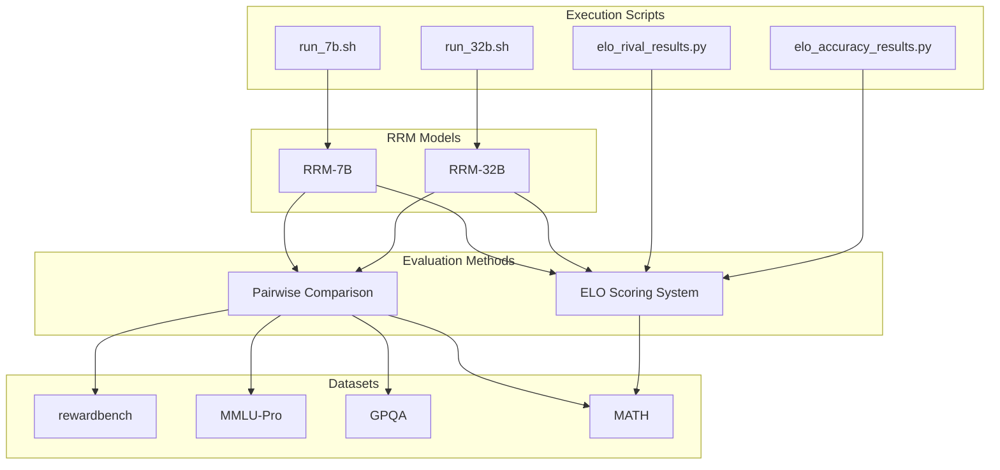
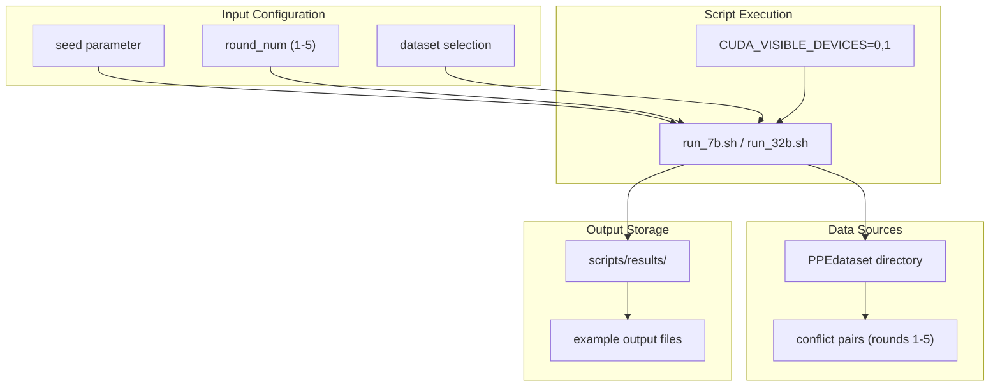
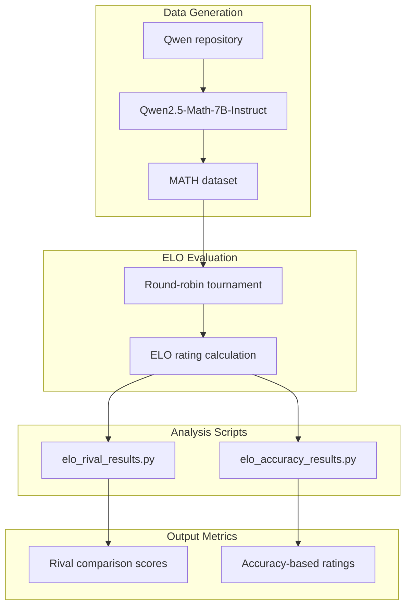

<!-- source: DeepWiki mcp.deepwiki.com · repo microsoft/LMOps · page 3.1 Evaluation Framework · fetched 2026-10-26 -->

# Evaluation Framework

<details>
<summary>Relevant source files</summary>

The following files were used as context for generating this wiki page:

- [RRM-evaluation/README.md](RRM-evaluation/README.md)

</details>


## Purpose and Scope

The Evaluation Framework provides comprehensive methodologies for assessing Reward Reasoning Model (RRM) performance through pairwise comparison tasks and ELO scoring systems. This framework enables fine-grained analysis of model preferences across reasoning challenges using RRM-7B and RRM-32B models on multiple datasets including RewardBench, MMLU-Pro, GPQA, and MATH.

For information about the analysis and visualization tools that process evaluation results, see [Analysis and Visualization Tools](#3.2). For details about the infrastructure setup and environment configuration, see [Infrastructure and Environment](#3.3).

## Evaluation Methodologies Overview

The framework implements two complementary evaluation approaches that provide different perspectives on model performance and reasoning capabilities.

### Evaluation Framework Architecture



Sources: [RRM-evaluation/README.md:1-66]()

## Pairwise Comparison Framework

The pairwise comparison methodology evaluates models by comparing response pairs across different reasoning tasks. This approach provides direct assessment of model preferences and reasoning quality.

### Dataset Configuration and Round Structure

| Dataset | `--dataset` Argument | Uses `round_num` | Valid `round_num` Range |
|---------|---------------------|------------------|-------------------------|
| RewardBench | "rewardbench" | ❌ No | Any |
| MMLU-Pro | "MMLU" | ✅ Yes | 1 - 5 |
| GPQA | "GPQA" | ✅ Yes | 1 - 5 |
| MATH | "MATH" | ✅ Yes | 1 - 5 |

For datasets with `round_num` support, each round corresponds to one of five conflict pairs defined in the `PPEdataset` directory, enabling systematic evaluation across different reasoning scenarios.

### Pairwise Evaluation Workflow



### Execution Commands

The framework provides standardized execution patterns through shell scripts:

```bash
export CUDA_VISIBLE_DEVICES=0,1
cd scripts
bash run_7b.sh <seed> <round_num> <dataset>
# Example: bash run_7b.sh 0 1 "MATH"
```

Sources: [RRM-evaluation/README.md:21-52]()

## ELO Scoring System

The ELO scoring evaluation derives informative reward signals beyond binary best response identification by implementing a round-robin tournament structure with ELO rating calculations.

### ELO Framework Components



### ELO Execution Process

The ELO evaluation requires sequential execution of analysis scripts:

```bash
cd scripts
python elo_rival_results.py
python elo_accuracy_results.py
```

The system uses candidate responses generated by `Qwen2.5-Math-7B-Instruct` on the MATH dataset, providing a standardized baseline for comparative evaluation across different RRM models.

Sources: [RRM-evaluation/README.md:53-66]()

## Model Architecture and Capabilities

### Supported Models

| Model | Parameters | Download Location |
|-------|------------|-------------------|
| RRM-7B | 7B | HuggingFace: Reward-Reasoning/RRM-7B |
| RRM-32B | 32B | HuggingFace: Reward-Reasoning/RRM-32B |

Both models support the complete evaluation framework with identical interfaces and dataset compatibility, enabling direct performance comparisons across different model scales.

### Configuration Management

The framework requires manual configuration updates when switching between datasets or models:

- Update `run_name` in `run_7b.sh` or `run_32b.sh` for dataset changes
- Update filepaths in `elo_accuracy_result.py` and `elo_rival_results.py` for model changes

Sources: [RRM-evaluation/README.md:8-17](), [RRM-evaluation/README.md:48-49](), [RRM-evaluation/README.md:65-66]()

---

