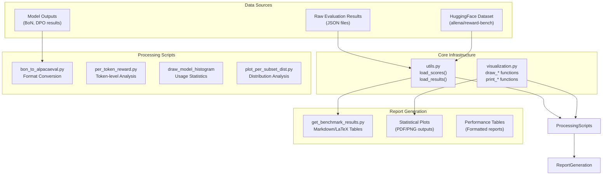
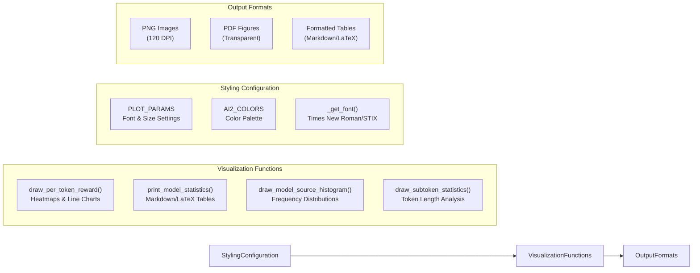
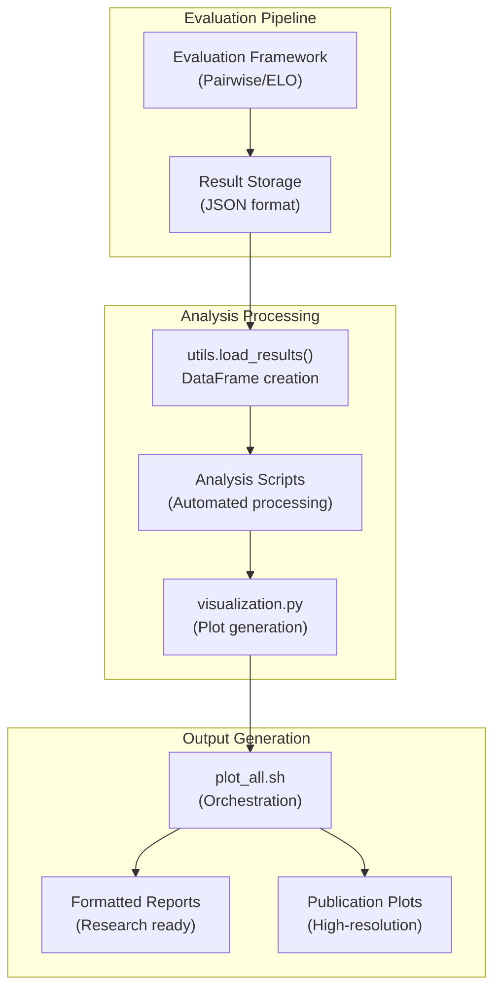

<!-- source: DeepWiki mcp.deepwiki.com · repo microsoft/LMOps · page 3.2 Analysis and Visualization Tools · fetched 2026-10-26 -->

# Analysis and Visualization Tools

Relevant source files

The following files were used as context for generating this wiki page:

- [RRM-evaluation/analysis/README.md](RRM-evaluation/analysis/README.md)

This document covers the comprehensive suite of analysis scripts and visualization tools within the RRM-evaluation system for processing evaluation results, generating statistical reports, and creating visual analyses of reward model performance.

The analysis toolkit provides data processing capabilities, statistical analysis functions, and visualization generation for reward model evaluation results. For details about the core evaluation methodology, see [Evaluation Framework](#3.1). For infrastructure and environment setup, see [Infrastructure and Environment](#3.3).

## Purpose and Scope

The analysis and visualization tools serve as the post-processing layer for reward model evaluation results. These tools transform raw evaluation outputs into meaningful insights through statistical analysis, visual representations, and formatted reports. The toolkit supports various output formats including markdown tables, LaTeX reports, and high-resolution plots for research publication.

## Analysis Pipeline Architecture

The analysis system follows a modular architecture with core utility functions, specialized processing scripts, and visualization generators:

Sources: [RRM-evaluation/analysis/README.md:1-127](), [RRM-evaluation/analysis/utils.py:1-157](), [RRM-evaluation/analysis/visualization.py:1-463]()

## Core Analysis Infrastructure

The analysis toolkit is built on two primary modules that provide foundational functionality for data loading and visualization:

### Data Loading and Processing

The `utils.py` module provides core data loading capabilities through two primary functions:

| Function | Purpose | Key Features |
|----------|---------|--------------|
| `load_scores()` | Load raw evaluation scores | JSON file aggregation, organization filtering |
| `load_results()` | Load and clean evaluation results | DataFrame processing, column cleanup, averaging |

The `load_results()` function [RRM-evaluation/analysis/utils.py:44-156]() performs extensive data cleanup including:
- Removal of internal experiment data (ai2 organization filtering)
- Column standardization and alphabetical sorting
- Average score calculation across evaluation subsets
- Model type categorization and filtering

### Visualization Framework

The `visualization.py` module provides a comprehensive visualization framework with standardized styling and multiple chart types:

Sources: [RRM-evaluation/analysis/visualization.py:48-84](), [RRM-evaluation/analysis/visualization.py:32-46]()

## Analysis Tool Categories

The analysis toolkit is organized into three main categories, each serving specific aspects of the evaluation pipeline:

### Data Processing and Conversion Tools

Tools for transforming and preparing evaluation data for analysis:

- **BoN to AlpacaEval Converter**: Converts Best-of-N sampling outputs to AlpacaEval format
- **Per-token Reward Calculator**: Computes reward values at token-level granularity  
- **Ensemble Evaluation Processor**: Handles multi-model evaluation aggregation

For detailed documentation of these tools, see [Data Processing and Conversion](#3.2.1).

### Visualization and Plotting Tools  

Scripts for generating visual analyses and statistical plots:

- **Distribution Plotters**: Per-subset and model usage histograms
- **Reward Visualization**: Token-level reward heatmaps and line charts
- **Statistical Charts**: Error bars, confidence intervals, and comparative analyses

For comprehensive visualization capabilities, see [Visualization and Plotting](#3.2.2).

### Statistical Analysis and Reporting

Tools for generating benchmark results and statistical reports:

- **Benchmark Result Generator**: Formatted performance tables for publications
- **DPO Analysis Reporter**: Direct Preference Optimization specific metrics
- **Subtoken Statistics**: Token usage and distribution analysis

For statistical analysis methodologies, see [Statistical Analysis and Reporting](#3.2.3).

## Integration with Evaluation Framework

The analysis tools integrate seamlessly with the broader RRM-evaluation system through standardized data formats and automated processing pipelines:

The `plot_all.sh` orchestration script [RRM-evaluation/analysis/README.md:38-40]() coordinates the execution of multiple analysis tools to generate comprehensive result sets for research publication and performance monitoring.

Sources: [RRM-evaluation/analysis/README.md:6-127](), [RRM-evaluation/analysis/utils.py:23-42](), [RRM-evaluation/analysis/visualization.py:157-205]()

---

