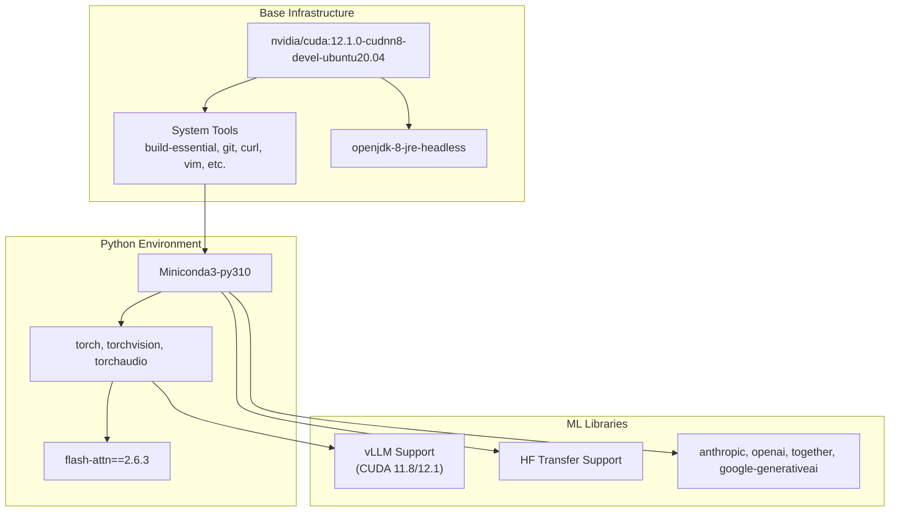
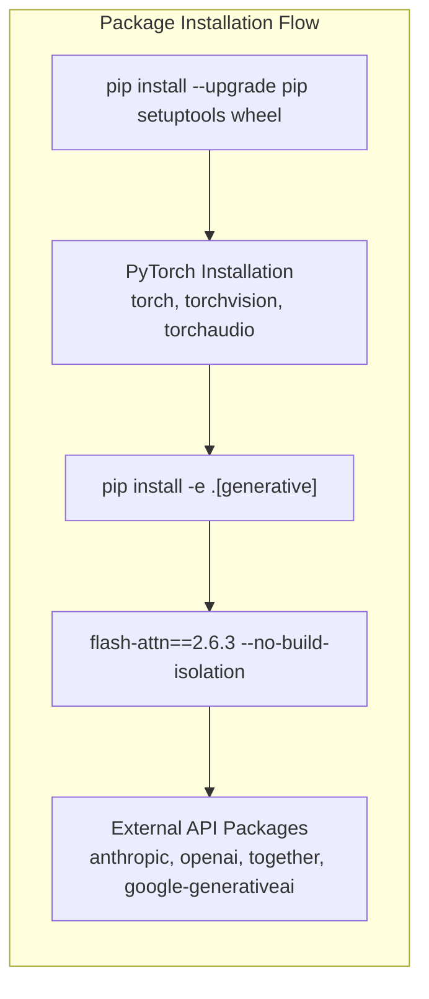
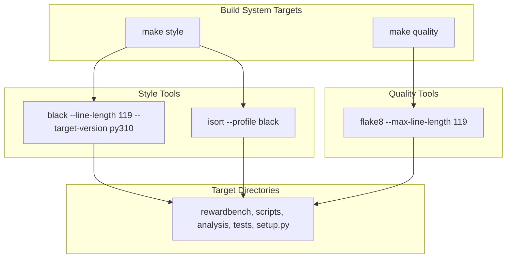
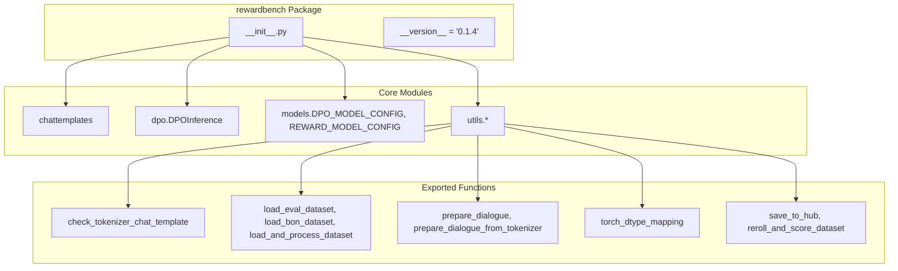

<!-- source: DeepWiki mcp.deepwiki.com · repo microsoft/LMOps · page 3.3 Infrastructure and Environment · fetched 2026-10-26 -->

# Infrastructure and Environment

Relevant source files

The following files were used as context for generating this wiki page:

- [RRM-evaluation/Dockerfile](RRM-evaluation/Dockerfile)
- [RRM-evaluation/Makefile](RRM-evaluation/Makefile)

This document covers the infrastructure and environment setup for the RRM-evaluation system, including Docker containerization, build system configuration, and the core `rewardbench` package infrastructure. For information about the evaluation methodologies, see [Evaluation Framework](#3.1). For analysis and visualization components, see [Analysis and Visualization Tools](#3.2).

## Docker Environment Setup

The RRM-evaluation system uses a comprehensive Docker environment built on NVIDIA CUDA infrastructure to ensure reproducible evaluation environments across different hardware configurations.

### Base Container Configuration

The Docker environment is built on NVIDIA CUDA 12.1.0 with cuDNN 8 support on Ubuntu 20.04, providing GPU acceleration capabilities for neural model evaluation.

**Sources:** [RRM-evaluation/Dockerfile:1-88]()

### System Dependencies and Tools

The container includes essential development tools and utilities required for model evaluation and analysis:

| Category | Tools | Purpose |
|----------|-------|---------|
| Build Tools | `build-essential`, `make` | Compilation and build processes |
| Version Control | `git`, `git-lfs` | Repository management and large file handling |
| Utilities | `curl`, `wget`, `jq`, `parallel` | Data fetching and processing |
| Development | `vim`, `tmux` | Interactive development environment |
| Networking | `iputils-ping` | Network diagnostics |

The system is configured with timezone `America/Los_Angeles` and includes Java 8 runtime for specific evaluation dependencies.

**Sources:** [RRM-evaluation/Dockerfile:5-24]()

### Python Environment and ML Stack

The container uses Miniconda3 with Python 3.10 as the base Python environment. Key ML dependencies include:

- **PyTorch Stack**: Core tensor computation framework with CUDA support
- **Flash Attention**: Optimized attention mechanisms for transformer models
- **vLLM**: High-performance LLM serving (supports both CUDA 11.8 and 12.1)
- **External APIs**: Integration with major LLM providers (Anthropic, OpenAI, Together, Google)

**Sources:** [RRM-evaluation/Dockerfile:53-84]()

### Container File Structure

The Docker build process copies essential project files into the container workspace at `/stage/`:

- `rewardbench/`: Core package directory
- `scripts/`: Evaluation and analysis scripts
- `setup.py`: Package installation configuration
- `Makefile`: Build system configuration
- `README.md`: Project documentation

**Sources:** [RRM-evaluation/Dockerfile:63-69]()

## Build System and Code Quality

The project uses a Makefile-based build system focused on code quality enforcement through automated formatting and linting.

### Code Quality Targets

The build system provides two primary targets for maintaining code quality:

**Sources:** [RRM-evaluation/Makefile:1-13]()

### Directory Scope and Configuration

The build system operates on a defined set of directories and files:

| Target | Directories/Files |
|--------|------------------|
| Code Formatting | `rewardbench`, `scripts`, `analysis`, `tests`, `setup.py` |
| Python Path | `src` (for local development testing) |
| Line Length | 119 characters (both Black and Flake8) |
| Python Version | 3.10 target for Black formatting |

**Sources:** [RRM-evaluation/Makefile:4-6]()

## Core Package Infrastructure

The `rewardbench` package serves as the central infrastructure component providing evaluation utilities, model configurations, and data processing capabilities.

### Package Structure and Exports

**Sources:** [RRM-evaluation/rewardbench/__init__.py:15-46]()

### Key Infrastructure Components

The package provides several critical infrastructure components:

| Component | Purpose | Key Functions |
|-----------|---------|---------------|
| `DPOInference` | Direct Preference Optimization inference | Model evaluation and scoring |
| `REWARD_MODEL_CONFIG` | Reward model configurations | Model parameter and setup definitions |
| `DPO_MODEL_CONFIG` | DPO model configurations | DPO-specific model settings |
| Dataset utilities | Data loading and processing | `load_eval_dataset`, `load_bon_dataset` |
| Dialogue preparation | Text formatting for evaluation | `prepare_dialogue`, `prepare_dialogue_from_tokenizer` |
| Hub integration | HuggingFace Hub operations | `save_to_hub`, `reroll_and_score_dataset` |

**Sources:** [RRM-evaluation/rewardbench/__init__.py:17-30]()

### Environment Configuration

The infrastructure includes several environment-specific configurations:

- **HuggingFace Transfer**: `HF_HUB_ENABLE_HF_TRANSFER=1` for optimized model downloads
- **NVIDIA Capabilities**: `NVIDIA_DRIVER_CAPABILITIES=graphics,utility,compute` for GPU access
- **CUDA Library Path**: Extended `LD_LIBRARY_PATH` for CUDA runtime
- **User Permissions**: Sudo access for container environment modification

**Sources:** [RRM-evaluation/Dockerfile:28-45]()

---

