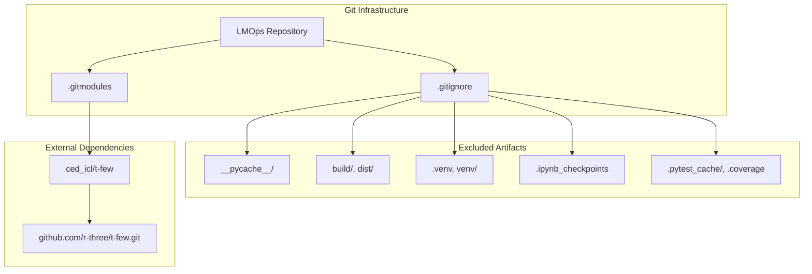
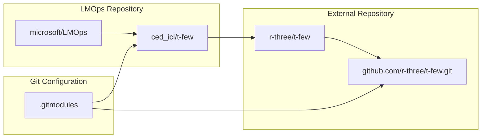
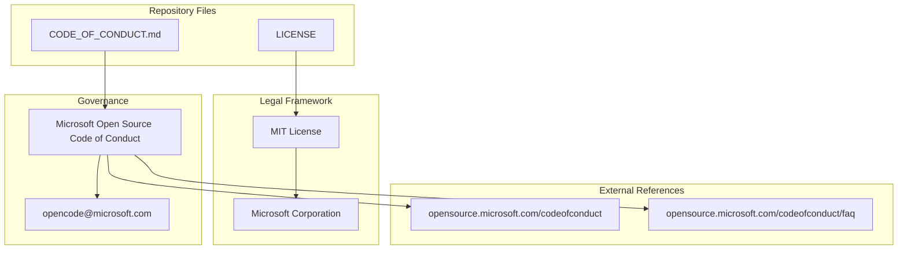

<!-- source: DeepWiki mcp.deepwiki.com · repo microsoft/LMOps · page 4 Repository Infrastructure · fetched 2026-10-26 -->

# Repository Infrastructure

Relevant source files

The following files were used as context for generating this wiki page:

- [.gitignore](.gitignore)
- [.gitmodules](.gitmodules)
- [CODE_OF_CONDUCT.md](CODE_OF_CONDUCT.md)
- [LICENSE](LICENSE)

This document covers the foundational infrastructure components that support the LMOps repository, including Git configuration, submodule management, licensing framework, and governance policies. For information about the main research systems, see [LLM4Science System](#2) and [RRM-evaluation System](#3).

## Git Configuration Management

The repository uses Git for version control with specific configurations to manage Python development workflows and external dependencies through submodules.

### Version Control Exclusions

The `.gitignore` file implements comprehensive exclusion patterns for Python development artifacts and common development environment files. The configuration follows standard Python project patterns covering:

**Python Runtime Artifacts**: Bytecode files (`__pycache__/`, `*.py[cod]`, `*$py.class`) and compiled extensions (`*.so`) are excluded from version control [.gitignore:1-7]().

**Package Distribution Files**: Build artifacts including `build/`, `dist/`, `*.egg-info/`, and wheel-related directories are ignored to prevent packaging artifacts from being committed [.gitignore:9-28]().

**Development Environment Files**: Virtual environments (`venv/`, `.env`), IDE configurations (`.spyderproject`, `.ropeproject`), and testing artifacts (`.pytest_cache/`, `.coverage`) are excluded [.gitignore:104-129]().

**Jupyter Notebook Checkpoints**: Notebook checkpoint files (`.ipynb_checkpoints`) are ignored, which is particularly relevant given the LLM4Science notebooks in the repository [.gitignore:77-78]().

### Git Configuration Diagram

Sources: [.gitignore:1-130](), [.gitmodules:1-4]()

### Submodule Configuration

The repository integrates external dependencies through Git submodules. The `.gitmodules` file defines one external submodule:

**T-Few Integration**: The `ced_icl/t-few` submodule points to `https://github.com/r-three/t-few.git`, indicating integration with the T-Few (Training with Few examples) research codebase [.gitmodules:1-4](). This submodule is located in the `ced_icl` directory, suggesting it supports in-context learning capabilities.

### Submodule Management Diagram

Sources: [.gitmodules:1-4]()

## Licensing Framework

The repository operates under the MIT License, providing broad permissions for use, modification, and distribution while maintaining minimal restrictions.

### License Terms

**Copyright Holder**: Microsoft Corporation holds the copyright for the LMOps codebase [LICENSE:3]().

**Permissions Granted**: The MIT License grants unrestricted rights to use, copy, modify, merge, publish, distribute, sublicense, and sell the software [LICENSE:5-9]().

**Requirements**: The only requirement is inclusion of the copyright notice and license text in all copies or substantial portions of the software [LICENSE:10-11]().

**Warranty Disclaimer**: The software is provided "AS IS" without warranty of any kind, with Microsoft disclaiming all liability for damages [LICENSE:14-21]().

## Code of Conduct

The repository adheres to the Microsoft Open Source Code of Conduct, establishing community standards and contact procedures for concerns.

### Governance Structure

**Adopted Framework**: The project follows the [Microsoft Open Source Code of Conduct](https://opensource.microsoft.com/codeofconduct/) [CODE_OF_CONDUCT.md:3]().

**Resource Links**: The document provides links to the full code of conduct and FAQ for detailed guidance [CODE_OF_CONDUCT.md:7-8]().

**Contact Information**: Issues or concerns should be directed to `opencode@microsoft.com` [CODE_OF_CONDUCT.md:9]().

### Repository Governance Diagram

Sources: [LICENSE:1-22](), [CODE_OF_CONDUCT.md:1-10]()

## Infrastructure Summary

| Component | File | Purpose | External Dependencies |
|-----------|------|---------|----------------------|
| Version Control | `.gitignore` | Exclude development artifacts | None |
| Submodules | `.gitmodules` | Manage external dependencies | `r-three/t-few` |
| Licensing | `LICENSE` | Define usage terms | MIT License framework |
| Governance | `CODE_OF_CONDUCT.md` | Community standards | Microsoft Open Source policies |

The repository infrastructure provides a robust foundation for collaborative development while maintaining legal compliance and community standards. The Git configuration supports Python development workflows, the submodule system enables integration with external research codebases, and the licensing framework ensures broad accessibility under industry-standard terms.

Sources: [.gitignore:1-130](), [.gitmodules:1-4](), [LICENSE:1-22](), [CODE_OF_CONDUCT.md:1-10]()