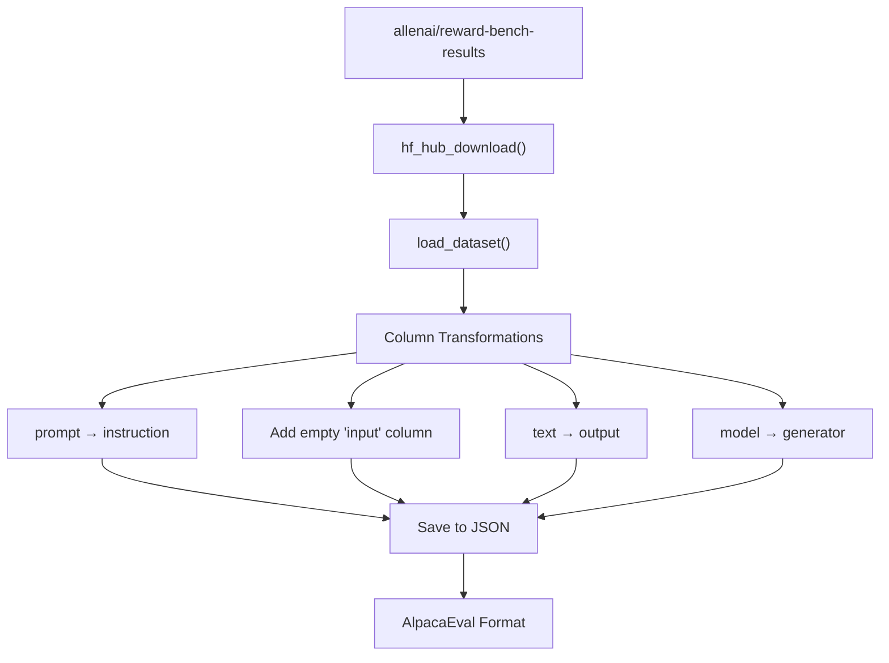
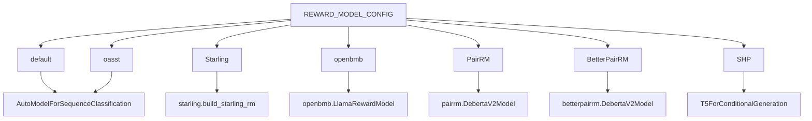
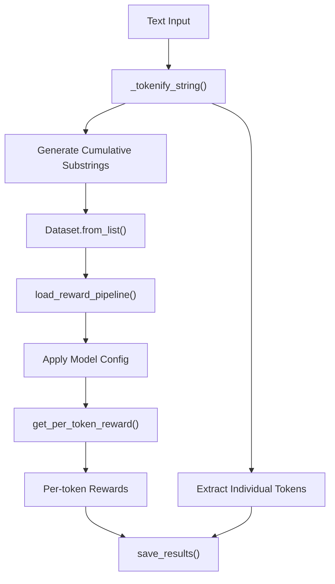
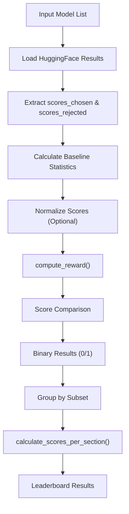
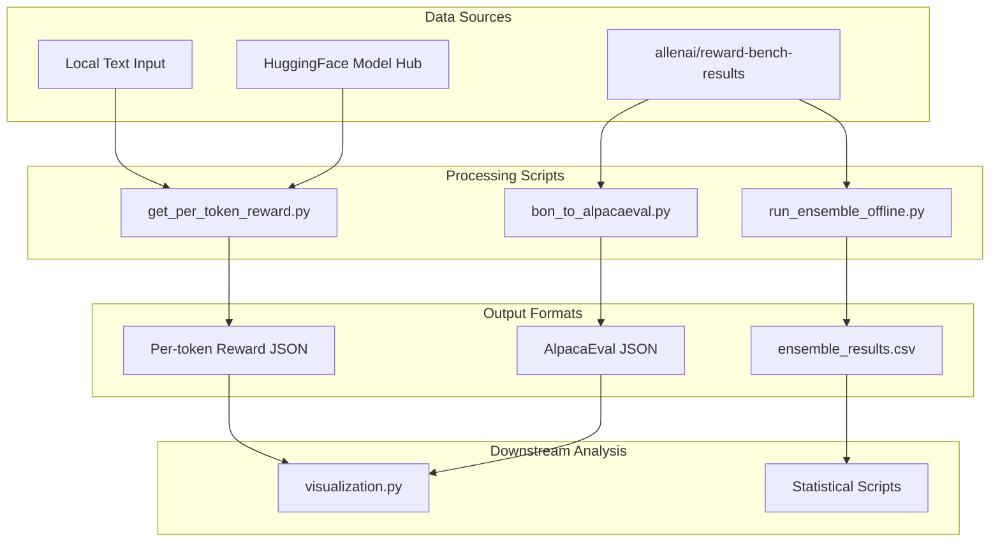

<!-- source: DeepWiki mcp.deepwiki.com · repo microsoft/LMOps · extra page Data Processing and Conversion · fetched 2026-10-26 -->

# Data Processing and Conversion

<details>
<summary>Relevant source files</summary>

The following files were used as context for generating this wiki page:

- [RRM-evaluation/analysis/bon_to_alpacaeval.py](RRM-evaluation/analysis/bon_to_alpacaeval.py)
- [RRM-evaluation/analysis/get_benchmark_results.py](RRM-evaluation/analysis/get_benchmark_results.py)
- [RRM-evaluation/analysis/get_dpo_ref_free_results.py](RRM-evaluation/analysis/get_dpo_ref_free_results.py)
- [RRM-evaluation/analysis/run_ensemble_offline.py](RRM-evaluation/analysis/run_ensemble_offline.py)

</details>


This document covers the data processing and conversion scripts within the RRM-evaluation system that handle format transformations, per-token reward computation, and ensemble evaluation processing. These scripts form the data preprocessing pipeline that prepares evaluation results for analysis and visualization.

For information about the visualization outputs generated from these processed datasets, see [Visualization and Plotting](#3.2.2). For statistical analysis performed on the converted data, see [Statistical Analysis and Reporting](#3.2.3).

## Overview

The data processing and conversion functionality consists of three primary script categories:

| Script Category | Primary Script | Purpose |
|----------------|---------------|---------|
| Format Conversion | `bon_to_alpacaeval.py` | Convert RewardBench BoN results to AlpacaEval format |
| Token-level Analysis | `get_per_token_reward.py` | Compute per-token rewards for text sequences |
| Ensemble Processing | `run_ensemble_offline.py` | Aggregate multiple model scores via ensemble methods |

## BoN to AlpacaEval Format Conversion

The `bon_to_alpacaeval.py` script converts RewardBench best-of-n (BoN) evaluation results into the AlpacaEval format for downstream analysis.

### Conversion Process



### Key Parameters

The script accepts the following command-line arguments defined in `get_args()`:

- **`--hf_evals_repo`**: HuggingFace repository containing evaluation results (default: `allenai/reward-bench-results`)
- **`--generation_model`**: Generation model used (`zephyr-7b` or `tulu-13b`)
- **`--reward_model`**: Reward model identifier for evaluation
- **`--best_of`**: Number of responses to consider from first index (default: 16)

The data transformation process [RRM-evaluation/analysis/bon_to_alpacaeval.py:92-101]() performs these column mappings:
- `prompt` → `instruction`
- `text` → `output` 
- `model` → `generator`
- Adds empty `input` column

Sources: [RRM-evaluation/analysis/bon_to_alpacaeval.py:1-112]()

## Per-Token Reward Computation

The `get_per_token_reward.py` script provides comprehensive per-token reward analysis using various reward model architectures.

### Reward Model Configuration

The script supports multiple reward model types through the `REWARD_MODEL_CONFIG` dictionary:



### Processing Pipeline

The per-token reward computation follows this pipeline:



### Key Functions

- **`_tokenify_string()`** [RRM-evaluation/analysis/get_per_token_reward.py:197-203](): Tokenizes input string and generates cumulative text substrings
- **`load_reward_pipeline()`** [RRM-evaluation/analysis/get_per_token_reward.py:295-340](): Creates reward model pipeline with appropriate configuration
- **`get_per_token_reward()`** [RRM-evaluation/analysis/get_per_token_reward.py:343-388](): Computes rewards for each text substring
- **`save_results()`** [RRM-evaluation/analysis/get_per_token_reward.py:391-440](): Saves results with hashed filenames for reproducibility

Sources: [RRM-evaluation/analysis/get_per_token_reward.py:1-444]()

## Ensemble Evaluation Processing

The `run_ensemble_offline.py` script aggregates scores from multiple reward models using ensemble methods to analyze combined model performance.

### Ensemble Aggregation Modes

The script supports three ensemble aggregation modes implemented in `compute_reward()`:

| Mode | Formula | Description |
|------|---------|-------------|
| `Mean` | `np.mean(scores)` | Average of all model scores |
| `Worst` | `np.min(scores)` | Minimum score across models |
| `Uncertainty` | `np.mean(scores) - np.std(scores)` | Mean minus standard deviation |

### Data Processing Workflow



### Score Normalization

When normalization is enabled (default), the script applies z-score normalization [RRM-evaluation/analysis/run_ensemble_offline.py:90-97]():

```
normalized_score = (score - mean_reward) / std_dev_reward
```

Where baseline statistics are computed from concatenated chosen and rejected scores for each model.

### Ensemble Computation

For each evaluation example, the script:
1. Collects scores from all ensemble models [RRM-evaluation/analysis/run_ensemble_offline.py:136-140]()
2. Applies the selected aggregation mode [RRM-evaluation/analysis/run_ensemble_offline.py:142-143]()
3. Compares chosen vs rejected ensemble scores [RRM-evaluation/analysis/run_ensemble_offline.py:146]()
4. Records binary preference result (1 if chosen > rejected, 0 otherwise)

Sources: [RRM-evaluation/analysis/run_ensemble_offline.py:1-174]()

## Data Flow Architecture

The following diagram shows how these processing scripts fit into the broader RRM-evaluation data pipeline:



Sources: [RRM-evaluation/analysis/bon_to_alpacaeval.py:1-112](), [RRM-evaluation/analysis/get_per_token_reward.py:1-444](), [RRM-evaluation/analysis/run_ensemble_offline.py:1-174]()

---

