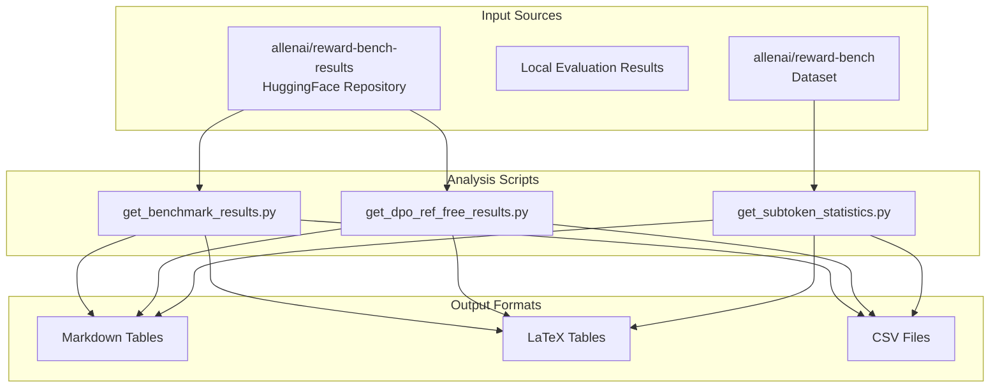
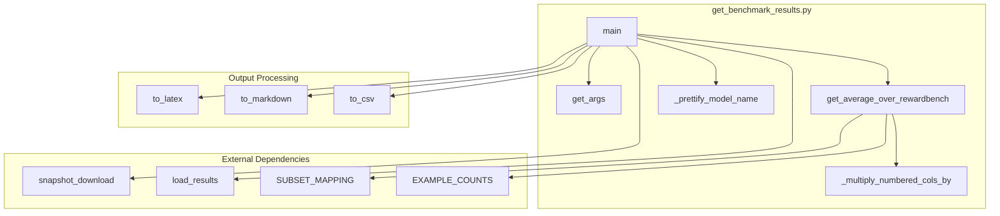
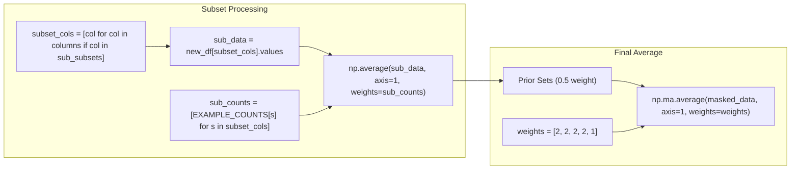
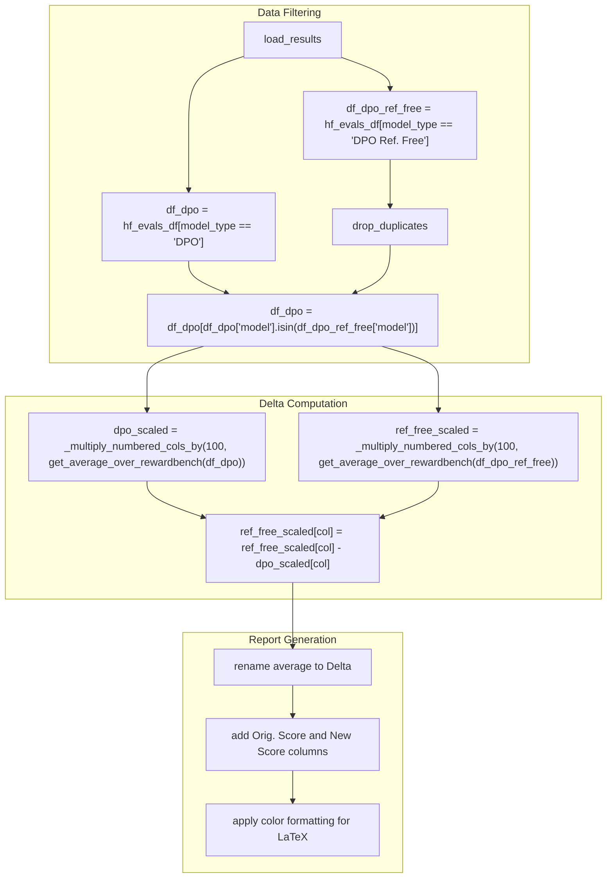
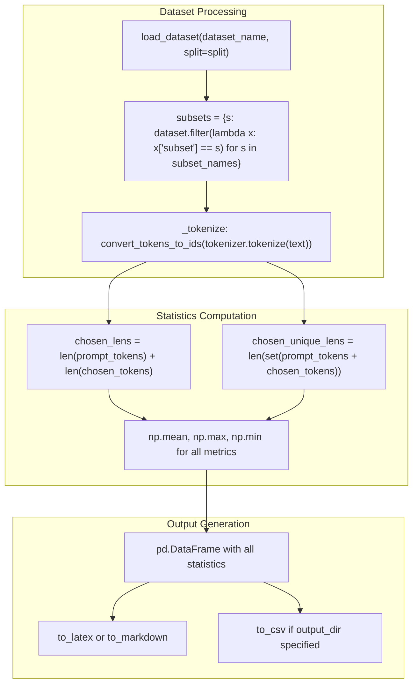
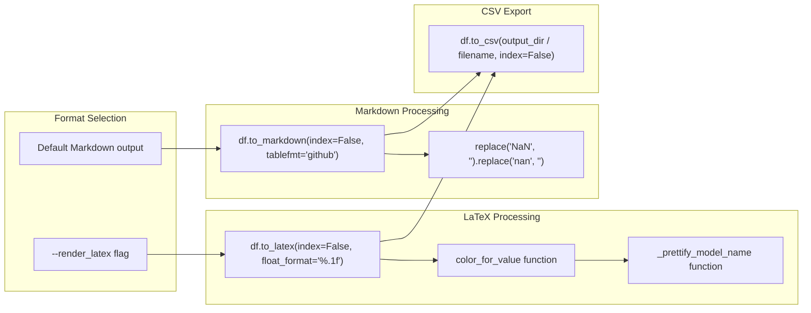

<!-- source: DeepWiki mcp.deepwiki.com · repo microsoft/LMOps · extra page Statistical Analysis and Reporting · fetched 2026-10-26 -->

# Statistical Analysis and Reporting

Relevant source files

The following files were used as context for generating this wiki page:

- [RRM-evaluation/analysis/get_benchmark_results.py](RRM-evaluation/analysis/get_benchmark_results.py)
- [RRM-evaluation/analysis/get_per_token_reward.py](RRM-evaluation/analysis/get_per_token_reward.py)
- [RRM-evaluation/analysis/get_subtoken_statistics.py](RRM-evaluation/analysis/get_subtoken_statistics.py)

This document covers the statistical analysis and reporting components of the RRM-evaluation system that generate human-readable reports from evaluation results. These tools transform raw evaluation data into formatted benchmark tables, comparative analyses, and statistical summaries suitable for research publication and performance assessment.

For information about data processing and format conversion, see [Data Processing and Conversion](#3.2.1). For visualization and plotting capabilities, see [Visualization and Plotting](#3.2.2).

## Overview

The statistical analysis and reporting system consists of three main components that process evaluation results and generate formatted reports:

Sources: [RRM-evaluation/analysis/get_benchmark_results.py:1-270](), [RRM-evaluation/analysis/get_dpo_ref_free_results.py:1-244](), [RRM-evaluation/analysis/get_subtoken_statistics.py:1-164]()

## Benchmark Results Generation

The `get_benchmark_results.py` script serves as the primary tool for generating comprehensive benchmark reports from evaluation results stored in HuggingFace repositories.

### Core Functionality

Sources: [RRM-evaluation/analysis/get_benchmark_results.py:145-270](), [RRM-evaluation/analysis/get_benchmark_results.py:90-142](), [RRM-evaluation/analysis/get_benchmark_results.py:36-81]()

### Key Configuration Options

| Parameter | Default | Description |
|-----------|---------|-------------|
| `--hf_evals_repo` | `allenai/reward-bench-results` | HuggingFace repository containing evaluation results |
| `--output_dir` | None | Directory to save generated reports |
| `--render_latex` | False | Generate LaTeX tables instead of Markdown |
| `--ignore_columns` | None | Comma-separated column names to exclude |
| `--model_type` | None | Filter results by specific model type |
| `--print_all_results` | False | Include detailed results for all categories |
| `--ignore_closed_models` | False | Exclude closed-source models from results |

Sources: [RRM-evaluation/analysis/get_benchmark_results.py:36-81]()

### Weighted Average Computation

The system computes weighted averages across different evaluation subsets using the `get_average_over_rewardbench` function:

Sources: [RRM-evaluation/analysis/get_benchmark_results.py:90-142]()

## DPO Reference-Free Analysis

The `get_dpo_ref_free_results.py` script provides specialized analysis for Direct Preference Optimization (DPO) models, comparing reference-free methods against standard DPO approaches.

### Analysis Pipeline

Sources: [RRM-evaluation/analysis/get_dpo_ref_free_results.py:90-244](), [RRM-evaluation/analysis/get_dpo_ref_free_results.py:115-175]()

### LaTeX Color Formatting

The DPO analysis includes sophisticated LaTeX formatting with color-coded cells based on performance deltas:

| Value Range | Color Scheme | Purpose |
|-------------|--------------|---------|
| Positive values | `\cellcolor{blue!{intensity}}` | Performance improvements |
| Negative values | `\cellcolor{red!{intensity}}` | Performance degradations |
| NaN values | `\cellcolor{gray!20}` | Missing data |

Sources: [RRM-evaluation/analysis/get_dpo_ref_free_results.py:181-208]()

## Subtoken Statistics Generation

The `get_subtoken_statistics.py` script analyzes token-level characteristics of benchmark datasets using configurable tokenizers.

### Token Analysis Pipeline

Sources: [RRM-evaluation/analysis/get_subtoken_statistics.py:61-92](), [RRM-evaluation/analysis/get_subtoken_statistics.py:105-120](), [RRM-evaluation/analysis/get_subtoken_statistics.py:124-161]()

### Statistical Metrics

The subtoken analysis computes comprehensive statistics for both chosen and rejected responses:

| Metric Category | Computed Statistics |
|-----------------|-------------------|
| Token Lengths | Mean, Max, Min for chosen and rejected responses |
| Unique Tokens | Mean, Max, Min unique token counts |
| Combined Analysis | Prompt + response token statistics |

Sources: [RRM-evaluation/analysis/get_subtoken_statistics.py:106-142]()

## Output Format Management

All three analysis scripts support multiple output formats with consistent formatting conventions:

Sources: [RRM-evaluation/analysis/get_benchmark_results.py:211-266](), [RRM-evaluation/analysis/get_dpo_ref_free_results.py:181-240](), [RRM-evaluation/analysis/get_subtoken_statistics.py:148-160]()

### Standard Data Cleaning

All scripts implement consistent data cleaning procedures:

- NaN value replacement with empty strings or dashes
- Numeric precision formatting (typically 1 decimal place)
- Column renaming using `SUBSET_NAME_TO_PAPER_READY` mappings
- Model name prettification for publication-ready output

Sources: [RRM-evaluation/analysis/get_benchmark_results.py:258-259](), [RRM-evaluation/analysis/get_dpo_ref_free_results.py:232-233](), [RRM-evaluation/analysis/get_subtoken_statistics.py:153-154]()

---

